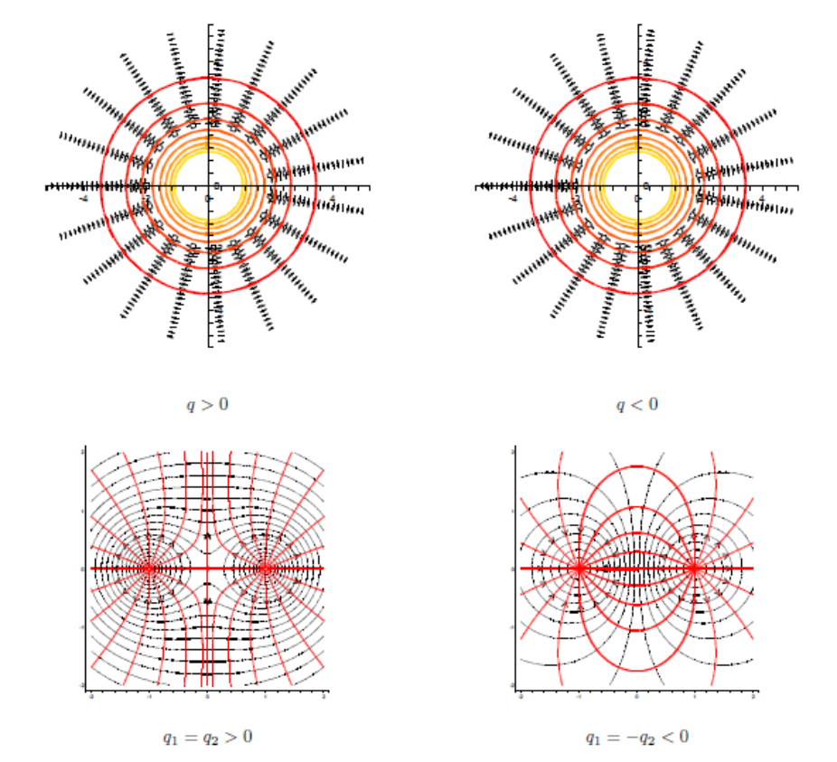
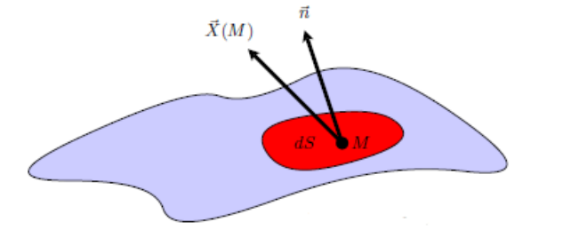
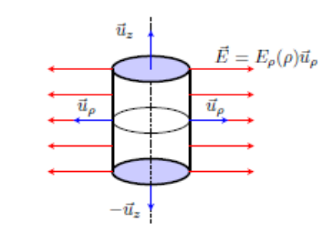

## Propriétés du champ et du potentiel électriques

### Champ conservatif

**Circulation du champ électrique.** La circulation le long d'une courbe (ou contour) d'un champ vectoriel $\vec{E}$ est donnée par :

$$
\int_C \vec{E} \cdot \vec{dM} = -\int_C \overrightarrow{\text{grad}}\,V(M) \cdot \vec{dM} = -\int_A^B dV = V(A) - V(B)
$$

Pour un champ de gradient, cette circulation est indépendante du chemin suivi : elle ne dépend que de la différence de potentiel entre les points de départ et d'arrivée.

Dans le cas du champ électrique, cette différence de potentiel est appelée tension électrique :

$$
U_{AB} = V(A) - V(B) = \int_A^B \vec{E} \cdot \vec{dM}
$$

Comme le potentiel électrique est défini à une constante additive près, seules les différences de potentiel (indépendantes de cette constante) ont un sens physique.

La circulation du champ électrique sur tout contour fermé est nulle : c'est un champ conservatif.

$$
\oint_C \vec{E} \cdot \vec{dM} = 0 \quad \forall C
$$

**Lignes de champ et équipotentielles.** Les équipotentielles sont des surfaces (en dimension 3) ou des courbes (en dimension 2) d'équation $V(M) = cte$. Les lignes de champ électrique sont des courbes orientées (dans le sens du champ) en tout point tangentes à celui-ci. Pour obtenir leurs équations, il faut intégrer la relation différentielle :

$$
\vec{E} = \lambda\,\vec{dM}, \quad \lambda \in \mathbb{R}
$$

**Remarque.**

- Les lignes de champ coupent orthogonalement les équipotentielles.
- Les lignes de champ sont orientées dans le sens des potentiels décroissants.

### Invariances et symétries

En électrostatique, les symétries des distributions de charges (causes) se retrouvent dans le champ et le potentiel électriques (effets). Les symétries envisagées sont des transformations géométriques qui laissent les distributions de charges invariantes.

**Invariances.**

1. Si une distribution de charges est invariante pour toute translation parallèle à un axe noté $(Oz)$, champ et potentiel seront indépendants de la coordonnée cartésienne $z$.
2. Si une distribution de charges est invariante pour toute translation parallèle à un plan noté $(Oxy)$, champ et potentiel ne dépendront que de la coordonnée cartésienne $z$.
3. Si une distribution de charges est invariante pour toute rotation autour d'un axe noté $(Oz)$, champ et potentiel seront indépendants de la coordonnée cylindrique $\phi$. Le problème est dit à symétrie de révolution.
4. Si une distribution de charges possède les invariances (1) et (3), champ et potentiel ne dépendront que de la coordonnée cylindrique $\rho$. Le problème est dit à symétrie cylindrique.
5. Si une distribution de charges est invariante pour toute rotation d'axe passant par un point noté $O$, champ et potentiel ne dépendront que de la coordonnée sphérique $r$. Le problème est dit à symétrie sphérique.

**Symétries et antisymétries planes.** Une symétrie plane est une symétrie qui laisse invariantes les charges électriques. A contrario, une antisymétrie plane est une symétrie plane qui change les signes de toutes les charges électriques. Ainsi, en tout point d'un plan de symétrie, le champ électrique est contenu dans ce plan. A contrario, en tout point d'un plan d'antisymétrie, le champ électrique est orthogonal à ce plan.

## Théorème de Gauss

### Flux d'un champ vectoriel

Le flux d'un champ vectoriel $\vec{X}(M)$ à travers une surface orientée est donné par :

$$
\Phi_S(\vec{X}) = \iint_S \vec{X} \cdot d\vec{S}
$$

### Théorème de Gauss

Le flux du champ électrique à travers une surface fermée est égal à la charge contenue dans cette surface divisée par la permittivité électrique du vide.

$$
\Phi(\vec{E}) = \oint\!\!\oint_{S_{\text{fermée}}} \vec{E} \cdot d\vec{S} = \frac{Q_{int}}{\epsilon_0}
$$

En l'absence de charges, le champ électrique est à flux conservatif :

$$
\Phi(\vec{E}) = \oint\!\!\oint \vec{E} \cdot d\vec{S} = 0
$$

**Exemple : le cylindre.** Dans un problème à symétrie cylindrique, le champ $\vec{E}$ est dans tout plan de symétrie. Tout plan passant par l'axe $z$ ou perpendiculaire à l'axe $z$ est un plan de symétrie, ainsi :

$$
\vec{E} = E_\rho\,\vec{e_\rho}
$$

De plus, on a une invariance par rotation selon $\phi$ et par translation selon $z$, ainsi :

$$
\vec{E} = E_\rho(\rho)\,\vec{e_\rho}
$$

Calculons le flux d'un tel champ à travers un cylindre de rayon $\rho$, de hauteur $h$, de même axe de symétrie que la distribution :

$$
\oint\!\!\oint \vec{E} \cdot d\vec{S} = \iint_{(S)} E_\rho(\rho)\,\vec{e_\rho} \cdot dS\,\vec{e_\rho} = \iint E_\rho(\rho)\,dS = E_\rho(\rho) \oint\!\!\oint_{(S)} dS = E_\rho(\rho)\,2\pi\rho h
$$

Le flux à travers les deux disques qui ferment le cylindre est nul car le champ électrique est tangent à ces disques.

On considère un cylindre infini de rayon $R$, uniformément chargé avec la densité volumique $\rho_0$. La charge contenue dans le cylindre de Gauss de rayon $\rho$ et de hauteur $h$ vaut $\rho_0\pi\rho^2 h$ à l'intérieur de la distribution, et $\rho_0\pi R^2 h$ à l'extérieur.

Si on se place à l'intérieur de la distribution ($\rho < R$), le théorème de Gauss donne

$$
2\pi\rho h E_\rho(\rho) = \frac{\rho_0\pi\rho^2 h}{\epsilon_0} \Rightarrow E(\rho) = \frac{\rho_0\rho}{2\epsilon_0}
$$

Si on se place à l'extérieur de la distribution ($\rho > R$), le théorème de Gauss donne

$$
2\pi\rho h E_\rho(\rho) = \frac{\rho_0\pi R^2 h}{\epsilon_0} \Rightarrow E(\rho) = \frac{\rho_0 R^2}{2\epsilon_0\rho}
$$

Le potentiel électrique s'obtient par intégration par rapport à $\rho$, en posant $V(\rho_0) = 0$.

## Le champ électrique dans les matériaux, cas des métaux

### Métaux et isolants

Les solides sont une assemblée d'atomes dont les noyaux forment un réseau plus ou moins ordonné mais rigide.

**Isolant.** Lorsqu'on applique un champ électrique (gradient de voltage), les électrons restent **tous** piégés dans leurs atomes respectifs.

**Conducteurs (métaux, semi-conducteurs).** Chaque atome de cuivre (métal monovalent) libère un électron libre. On a un **gaz** d'électrons libres qui s'agitent au sein d'un réseau **rigide d'ions** $Cu^+$.

Pourquoi ce gaz d'électrons libres ne fuit-il pas en dehors du fil de cuivre ? La densité de ce gaz d'électrons libres vaut $n_{el} = n_{at} \approx 10^{30}\ \text{électrons}/\text{m}^3$ : il y a donc une très forte densité. Ainsi, si l'électron approche une extrémité du fil, la puissance des forces de rappel fait qu'il reste à l'intérieur.

### Conducteur parcouru par un courant : modèle du gaz d'électrons de conduction

En 1804, la pile de Volta est créée ; en 1900, le modèle de Drude est créé. Il se base sur le fait que si on a $\langle \vec{v_e} \rangle = \vec{0}$, alors la tension est nulle. En revanche, si $\langle \vec{v_e} \rangle = \vec{v}_{\text{dérive}} \neq \vec{0}$, alors il y a présence de tension.

**Modèle quantitatif de Drude.** En appliquant les équations de Newton sur un électron soumis au champ $\vec{E}$ de la pile :

$$
m\frac{d\vec{v_e}}{dt} = -e\vec{E} - \frac{m}{\tau}\vec{v_e}
$$

Il vient donc que $\tau$ est un temps qui caractérise l'intensité de la force de frottement. On ne va pas chercher à résoudre cette équation à partir de conditions initiales. On va plutôt chercher s'il existe un **régime stationnaire** : $\dfrac{d\vec{v_e}}{dt} = 0 \Rightarrow \vec{0} = -e\vec{E} - \dfrac{m}{\tau}\vec{v_e}$.

$$
\vec{v_e} = -\frac{e\tau}{m}\vec{E}
$$

avec $-\dfrac{e\tau}{m}$ la mobilité des électrons dans ce matériau, en $\text{m}^2.\text{V}^{-1}.\text{s}^{-1}$. La mobilité est très recherchée dans les transistors. $\tau$ est le temps nécessaire pour que le courant s'établisse ($on$) ou disparaisse ($off$). Les électrons de conduction dérivent tous à la vitesse $\vec{v}_{e\,\text{lim}}$, donc on a un vecteur densité de courant $\vec{j} = n(-e)\vec{v}_{e\,\text{lim}} = \dfrac{ne^2\tau}{m}\vec{E}$, donc :

$$
\vec{j} = \sigma\vec{E} \quad \text{avec} \quad \sigma = \frac{ne^2\tau}{m}
$$

où $\sigma$ est la conductivité, qui est intrinsèque au matériau (à l'échantillon). Si $n$ augmente et $\tau$ augmente, alors $\sigma$ augmente. Cette relation conduit à $I = GU \Leftrightarrow U = RI$.

### Conducteur en équilibre électrostatique

**Définition.** Les électrons ne bougent plus : $\langle \vec{v_e} \rangle = \vec{0}$.

**Théorème.**

- Dans un métal à l'équilibre électrostatique (quand il n'y a pas de courant), le champ électrique est $\vec{E}_{\text{métal}} = \vec{0}$.
- À travers la surface, $\oint\!\!\oint_\Sigma \vec{E}_{\text{métal}} \cdot d\vec{S} = \dfrac{Q_{int}}{\epsilon_0} \Rightarrow 0$. Ainsi, dans un métal à l'équilibre électrostatique, il n'y a pas de **charges** ($\neq 0$) dans le volume : $\rho = 0$ (neutralité électrique parfaite entre les électrons et les ions).
- En revanche, il existe des accumulations de charges non nulles à la surface d'un conducteur à l'équilibre. Ces charges de surface sont même cruciales pour annuler le champ à l'intérieur du conducteur.

$$
\vec{E}_{\text{total}} = \vec{E}_{\text{extérieur appliqué}} + \vec{E}_{\text{réponse de la matière}} = \vec{0}
$$
