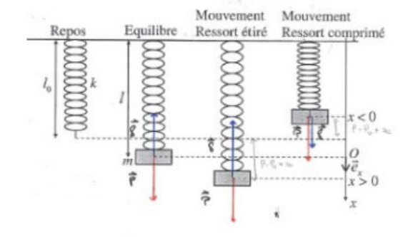

## Oscillations libres

### Mouvement d'un point matériel au voisinage d'une position d'équilibre

Par définition, on appelle oscillateur harmonique à une dimension un point matériel mobile repéré par un paramètre dont le mouvement est décrit par une équation différentielle de la forme ci-dessous :

$$
\frac{d^2X}{dt^2} + \omega_0^2 X = 0 \quad \text{avec} \quad \omega_0^2 = \frac{k}{m}
$$

### Description du mouvement

La solution de l'équation ci-dessus est $X(t) = A\cos(\omega_0 t + \phi)$, avec

$$
\begin{cases} A : \text{amplitude} \\ \phi : \text{phase} \\ \omega_0 : \text{pulsation propre du mouvement} \end{cases}
$$

Le mouvement de l'oscillateur harmonique à une dimension est périodique. La période vaut $T_0 = \dfrac{2\pi}{\omega_0}$.

### Deux représentations classiques de l'oscillateur harmonique

**L'oscillateur élastique.** La force exercée par le ressort est, en première approximation, proportionnelle à l'allongement du ressort : $\vec{f} = -kx\,\vec{e_x}$. En résolvant l'équation différentielle, on trouve $x = x_M \cos(\omega_0 t)$.

**Le pendule simple.** En résolvant l'équation différentielle, on trouve $E_p = -\displaystyle\int \vec{f} \cdot d\overrightarrow{OM}$.

## Aspect énergétique de l'oscillateur harmonique

### L'oscillateur élastique

**Énergie potentielle élastique.** On définit l'énergie potentielle élastique :

$$
E_p = \frac{1}{2} kx^2 + cte
$$

## Oscillations amorties par frottement fluide

### Équation différentielle du mouvement

L'équation se met sous la forme :

$$
\ddot{x} + 2\lambda\dot{x} + \omega_0^2 x = 0
$$

En résolvant l'équation, on a $r^2 + 2\lambda r + \omega_0^2 = 0$.

**Régime pseudo-périodique.** Si $\delta < 0$, la solution est de la forme

$$
x(t) = Ae^{-\lambda t}\cos(\omega t + \phi)
$$

**Régime critique.** Si $\delta = 0$, la solution est de la forme

$$
x(t) = (At + B)e^{-\omega_0 t}
$$

**Régime apériodique.** Si $\delta > 0$, la solution est de la forme

$$
x(t) = Ae^{r_+ t} + Be^{r_- t}
$$

## Oscillations forcées

### Équation différentielle du mouvement

L'équation se met sous la forme :

$$
\ddot{x} + 2\lambda\dot{x} + \omega_0^2 x = \frac{F_0}{m}\cos\omega t
$$

avec $x = A\cos(\omega t + \phi)$.

### Détermination de l'amplitude

$$
A = \frac{\dfrac{F_0}{m}}{\sqrt{(\omega_0^2 - \omega^2)^2 + 4\lambda^2\omega^2}}
$$

$$
\tan(\phi) = \frac{2\lambda\omega}{\omega^2 - \omega_0^2}
$$

### Étude de la résonance

Pour que $A_{max}$ existe, il faut que $\lambda < \dfrac{\omega_0}{\sqrt{2}}$. L'amplitude $A$ passe par son maximum pour $\omega = \sqrt{\omega_0^2 - 2\lambda^2}$ : c'est un phénomène de résonance.
