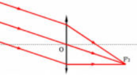
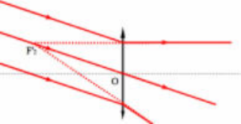

## Image et stigmatisme

### Objet lumineux

Un objet lumineux est l'ensemble de points émettant chacun un faisceau de rayons. L'image d'un objet par un instrument d'optique (IO) doit être semblable à l'objet ; il existe donc un rapport de similitude $\gamma$.

Dans une situation idéale, si tous les rayons d'un même point $A$ de l'objet convergent en un point $A'$ unique, alors l'IO est rigoureusement stigmatique.

On différencie alors :

**Point objet :** il émet les rayons incidents sur l'IO.

**Point image :** les rayons émergeant de l'IO y convergent.

### Stigmatisme approché, conditions de Gauss

**Conditions de Gauss.**

- L'objet est plan, perpendiculaire à l'axe du système et de petite dimension.
- L'ensemble des rayons émis par chaque point de l'objet constitue un faisceau peu ouvert (rayons paraxiaux).

**Cas d'un objet AB étendu et perpendiculaire à l'axe du système.**

- Même raisonnement que pour un objet ponctuel, en considérant chaque extrémité de l'objet.
- $A'B'$ est également plane et perpendiculaire à l'axe dans les conditions de Gauss.

### Image réelle, image virtuelle

Les points de convergence peuvent être réels, si les deux rayons passent effectivement par ce point, ou virtuels, s'il faut prolonger les rayons émergents. On peut appliquer la même distinction aux rayons incidents ; de plus, un point peut servir d'objet et d'image dans une succession d'IO.

## Miroirs plans

Un miroir réfléchit totalement la lumière pour tout angle d'incidence du rayon considéré. L'image de chaque point est symétrique ; de plus, $\gamma = 1$.

Ainsi, un miroir plan fait d'un objet réel une image virtuelle et d'un objet virtuel une image réelle. Les objets et images sont symétriques l'un de l'autre par rapport au plan du miroir.

## Dioptres plans

On a la relation de conjugaison suivante :

$$
\frac{n}{\overline{SA}} = \frac{n'}{\overline{SA'}}
$$

### Remarques

Les points $A$ et $A'$ sont du même côté du dioptre plan ; de plus, si l'un est réel, l'autre est virtuel.

Si les conditions de Gauss ne sont pas respectées, on peut observer une tache lumineuse.

## Lentilles minces

### Définition

Une lentille sphérique est un système centré autour de l'axe optique. On caractérise une lentille par le centre $C$, le sommet $S$ et son rayon de courbure $R$ :

$$
R = \overline{SC}
$$

Une lentille est mince si :

- $e = S_1 S_2$ ;
- $e \ll S_1 C_1$ ;
- $e \ll C_1 C_2$.

### Foyers et plans focaux

Une lentille convergente donne des foyers réels, alors qu'une lentille divergente donne des foyers virtuels.

On définit la distance focale objet par $f = \overline{OF}$ et la distance focale image par $f' = \overline{OF'}$ ; ainsi $f' = -f$. Si $f' > 0$, la lentille est convergente. Si $f' < 0$, la lentille est divergente.

### Plans focaux

### Relations de conjugaison et de grandissement

**Newton.**

$$
\overline{FA} \cdot \overline{F'A'} = ff' = -f'^2
$$

$$
\gamma = \frac{\overline{A'B'}}{\overline{AB}} = -\frac{\overline{F'A'}}{f'}
$$

**Descartes.**

$$
(f' + \overline{OA})(-f' + \overline{OA'}) = -f'^2
$$

$$
\frac{1}{\overline{OA'}} - \frac{1}{\overline{OA}} = \frac{1}{\overline{OF'}}
$$

$$
\gamma = \frac{\overline{OA'}}{\overline{OA}}
$$

### Vergence d'une lentille et retour sur la classification

La vergence caractérise la déviation que subit un rayon lumineux. Ainsi $V = \dfrac{1}{f'} = (n - 1)\left(\dfrac{1}{R_1} - \dfrac{1}{R_2}\right)$.

Lorsque deux lentilles sont accolées, on a $V = V_1 + V_2$.

### Associations de lentilles minces (non accolées)

On définit l'intervalle optique de l'association par $\Delta = \overline{F'_1 F_2}$. Il vient donc

$$
\overline{F_1 F} = -\frac{f_1'^2}{\Delta}
$$

$$
\overline{F'_2 F'} = \frac{f_2'^2}{\Delta}
$$

On définit les distances focales objet et image par $f' = -\dfrac{f'_1 f'_2}{\Delta} = -f$. On en déduit la formule de Gullstrand :

$$
V = V_1 + V_2 - \frac{e}{f'_1 f'_2}
$$
