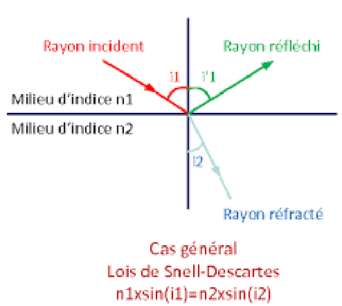
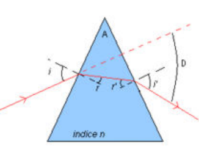

## Principe de Fermat

**Énoncé.** *Le chemin emprunté par la lumière pour aller d'un point à un autre est celui pour lequel le temps de parcours est minimum.*

### Conséquences

- Milieu transparent homogène = propagation rectiligne.
- Rayon lumineux = droite représentant la trajectoire de la lumière.

Dans un milieu transparent autre que le vide : $v = \dfrac{c}{n}$, où $n$ est l'indice de réfraction[^refringent] du milieu.

### Loi de Cauchy

L'indice de réfraction dépend de la longueur d'onde de la lumière se propageant dans le milieu[^dispersion].

$$
n(\lambda) = A + \frac{B}{\lambda^2}
$$

## Lois de Snell-Descartes

**Énoncé 1.** *Les rayons réfractés et réfléchis sont dans le plan d'incidence.*

**Énoncé 2.** $i_1 = -i'_1$

**Énoncé 3.** $n_1 \sin(i_1) = n_2 \sin(i_2)$

### Remarques

- Si les deux indices sont positifs, alors le rayon réfracté et le rayon incident sont de part et d'autre de la normale.
- $n_1 > n_2$ : le rayon s'écarte de la normale.
- $n_1 < n_2$ : le rayon se rapproche de la normale.
- Si l'angle est petit, on a la loi de Kepler : $n_1 i_1 = n_2 i_2$.
- Principe de retour inverse de la lumière.

[^refringent]: Plus l'indice de réfraction est élevé, plus le milieu est réfringent.

[^dispersion]: Dispersion : décomposition de la lumière en ses différentes couleurs.

## Réfraction limite, réflexion totale

Ce sont les cas limites, conséquences de la troisième loi de Snell.

### Réfraction limite

- Pour $i_1 = 0^\circ \Rightarrow i_2 = 0^\circ$.
- Pour $0^\circ < i_1 < 90^\circ \Rightarrow 0^\circ < i_2 < i_1$.
- Pour $i_1 = 90^\circ \Rightarrow \sin i_{lim} = \dfrac{n_1}{n_2}$.

### Réflexion totale

- Pour $i_1 = 0^\circ \Rightarrow i_2 = 0^\circ$.
- Pour $0^\circ < i_1 < 90^\circ \Rightarrow i_2 > i_1$.
- Pour $i_2 = 90^\circ \Rightarrow \sin(i_R) = \dfrac{n_2}{n_1} < 1$.
- Pour $i_1 > i_R \Rightarrow$ rayon totalement réfléchi.

## Lame à faces parallèles

- Si $n_1 \neq n_3$, la réfraction ne dépend pas de $n_2$ : on a $n_1 \sin(i_1) = n_3 \sin(i_3)$.
- Si $n_1 = n_3$, le rayon émerge de manière parallèle mais décalé de $\dfrac{e}{\cos i_2} \sin(i_1 - i_2)$.

## Prisme

### Définitions

**Prisme :** milieu transparent d'indice de réfraction $n$ limité par deux faces planes formant un dièdre. On assimile le prisme à un plan perpendiculaire triangulaire.

**Dispersion :** décomposition de la lumière en ses différentes longueurs d'onde.

### Marche d'un rayon dans une section principale du prisme, formules du prisme

- Face d'entrée : $\sin(i) = n \sin(r)$.
- Face de sortie : $n \sin(r') = \sin(i')$.
- $A = r + r'$.
- $D = i + i' - A$.

### Conditions d'émergence du rayon

Il faut que $2 i_R > A$ et que $i > i_0 \Leftrightarrow \sin(i_0) = n \sin(A - i_R)$.

### Minimum de déviation

L'angle d'incidence $i$ est compris entre $i_0$ et $\pi/2$ ; ce minimum se produit quand $i = i'$, donc

$$
n = \frac{\sin \dfrac{A + D_m}{2}}{\sin \dfrac{A}{2}}
$$

### Dispersion

Rappel de la loi de Cauchy : $n(\lambda) = A + \dfrac{B}{\lambda^2}$.

Le prisme décompose la lumière blanche en ses composantes. Raisonnement sur le bleu et le rouge :

- $\lambda_R > \lambda_B \Rightarrow n_R < n_B$ ;
- face d'entrée : $\sin(i) = n_R \sin r_r = n_B \sin r_B$ ;
- $\Rightarrow r_r > r_B$, donc décomposition de la lumière.
