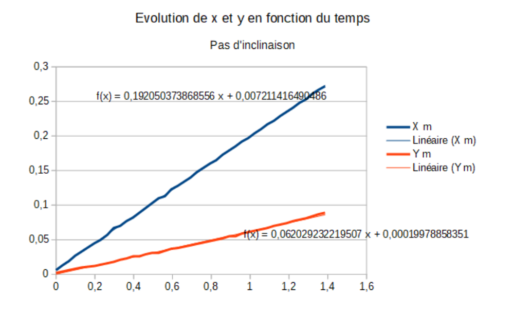
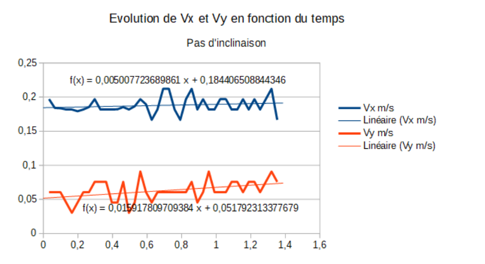
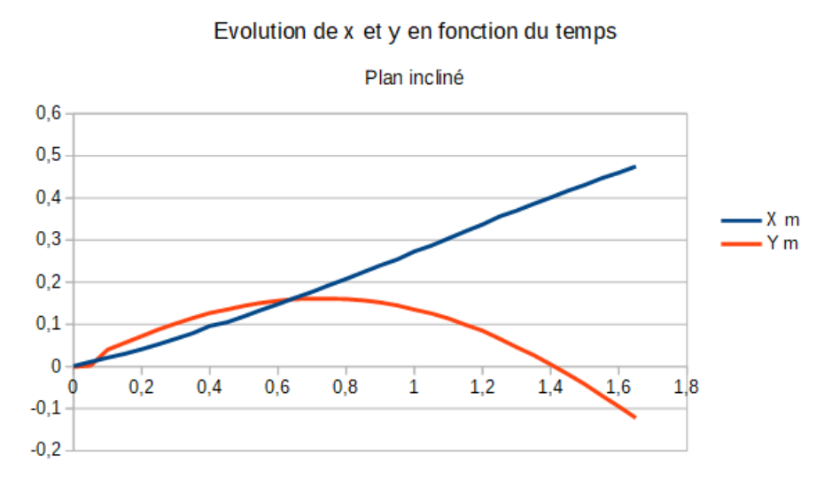
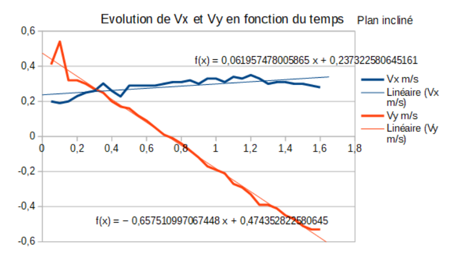
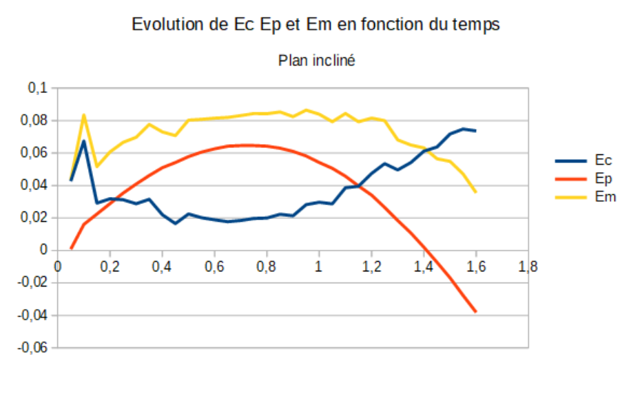
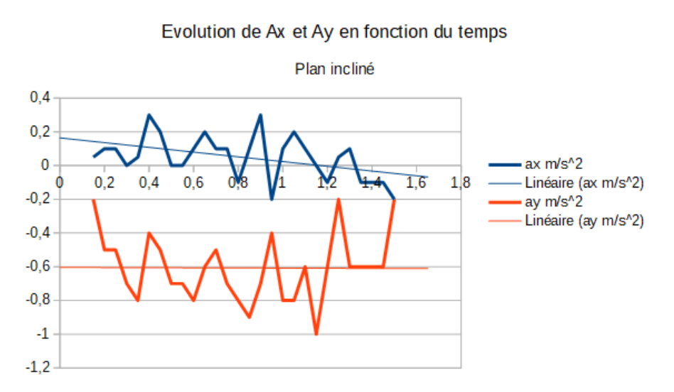

## Analyse théorique préliminaire

### Principe d'inertie

**Définir le référentiel, le repère et le système étudié (on choisira toujours la position du centre de masse du mobile, à t = 0, comme origine du repère). À partir du bilan des forces, justifier le fait que le système soit isolé.** Le référentiel du laboratoire est un référentiel terrestre considéré comme galiléen. On se place dans le repère cartésien $(O, \vec{e_x}, \vec{e_y})$ avec pour origine la position du mobile à $t = 0$. Le système est le mobile autoporté de masse $m = 230 \pm 1$ g.

Bilan des forces : $\begin{cases} \text{Poids } \vec{P} \\ \text{Réaction } \vec{R} \end{cases}$. Les deux forces sont selon $\vec{e_z}$, or le système se déplace selon $\vec{e_x}$ et $\vec{e_y}$. Ainsi on a $\vec{P} + \vec{R} = \vec{0} \Rightarrow \sum \vec{F} = \vec{0}$. Le système est donc isolé.

**Écrire les équations du mouvement. En déduire la vitesse puis la position en fonction du temps.** Le système est isolé, ainsi $\sum \vec{F} = \vec{0} = m\vec{a} \Rightarrow \vec{a} = \vec{0}$. On en déduit donc

$$
\vec{v} = \overrightarrow{cte} = \vec{v_0} = \begin{cases} v_{0_x}\vec{e_x} \\ v_{0_y}\vec{e_y} \end{cases}
$$

On peut donc déduire la position :

$$
\begin{cases} v_{0_x} t\,\vec{e_x} \\ v_{0_y} t\,\vec{e_y} \end{cases}
$$

### Principe fondamental de la dynamique

**Définir le référentiel, le repère et le système étudié. Faire le bilan des forces, et exprimer leurs composantes (en fonction de $\alpha$) dans le repère suggéré sur la figure.** Le référentiel terrestre est considéré comme galiléen. On se place dans le repère $(O, \vec{e_x}, \vec{e_y}, \vec{e_z})$. Le système est le mobile autoporté de masse $m = 230 \pm 1$ g.

Bilan des forces : $\begin{cases} \text{Poids } \vec{P} \\ \text{Réaction } \vec{R} \end{cases}$ avec $\begin{cases} \vec{P} = -P\cos(\alpha)\vec{e_z} - P\sin(\alpha)\vec{e_y} \\ \vec{R} = R\vec{e_z} = mg\cos(\alpha)\vec{e_z} \end{cases}$

**Écrire les équations du mouvement. En déduire la vitesse puis la position en fonction du temps. En déduire l'équation de la trajectoire. Quelle est la nature de cette trajectoire ?**

$$
\sum \vec{F} = m\vec{a} = \vec{P} + \vec{R} = (-mg\cos(\alpha) + mg\cos(\alpha))\vec{e_z} - mg\sin(\alpha)\vec{e_y} = m\vec{a}
\Rightarrow \vec{a} = -g\sin(\alpha)\vec{e_y}
$$

$$
\Rightarrow \vec{v}(t) = \begin{cases} v_{0_x}\vec{e_x} \\ (-g\sin(\alpha)t + v_{0_y})\vec{e_y} \\ 0\,\vec{e_z} \end{cases}
$$

On en déduit la position :

$$
\begin{cases} v_{0_x} t\,\vec{e_x} \\ \left(-\dfrac{1}{2}g\sin(\alpha)t^2 + v_{0_y} t\right)\vec{e_y} \\ 0\,\vec{e_z} \end{cases}
$$

Les constantes d'intégration sont nulles par choix du référentiel. On a donc l'équation de la trajectoire, parabolique :

$$
y(t) = -\frac{1}{2}g\sin(\alpha)\frac{x^2}{v_{0_x}^2} + v_{0_y}\frac{x}{v_{0_x}}
$$

### Conservation de l'énergie

**Exprimer $h$ en fonction de $y$ et de $\sin(\alpha)$.**

$$
h = y\sin(\alpha)
$$

**À partir des résultats obtenus en 1.2, déterminer les expressions de l'énergie cinétique et de l'énergie potentielle du système étudié. Tracer ces grandeurs en fonction du temps.**

$$
\begin{aligned}
E_c &= \frac{1}{2}m\left(v_{0_x}^2 + (-g\sin(\alpha)t + v_{0_y})^2\right) \\
&= \frac{1}{2}mv_{0_x}^2 + \frac{1}{2}m\left(g^2\sin^2(\alpha)t^2 - 2v_{0_y}g\sin(\alpha)t + v_{0_y}^2\right) \\
&= \frac{1}{2}m\left(v_{0_x}^2 + v_{0_y}^2 + g^2\sin^2(\alpha)t^2 - 2gv_{0_y}\sin(\alpha)t\right)
\end{aligned}
$$

$$
E_p = mgh = mgy\sin(\alpha) = mg\sin(\alpha)\left(-\frac{1}{2}g\sin(\alpha)t^2 + v_{0_y}t\right)
$$

**Calculer la somme $E_c + E_p$. Comment varie cette quantité au cours du temps ? Que peut-on conclure sur les forces en présence ?**

$$
E_c + E_p = \frac{1}{2}m\left(v_{0_x}^2 + v_{0_y}^2 + g^2\sin^2(\alpha)t^2 - 2gv_{0_y}\sin(\alpha)t\right) + mg\sin(\alpha)\left(-\frac{1}{2}g\sin(\alpha)t^2 + v_{0_y}t\right) = \frac{1}{2}mv_0^2 = cte
$$

L'énergie mécanique est donc constante : il y a conservation de l'énergie, et donc les forces sont conservatives.

## Expériences

### Principe d'inertie

### Principe fondamental de la dynamique

### Conservation de l'énergie

