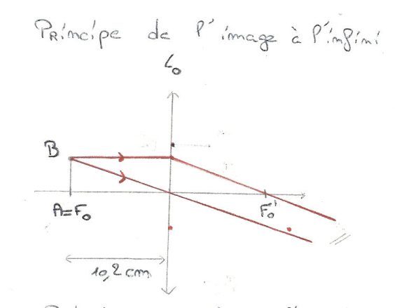
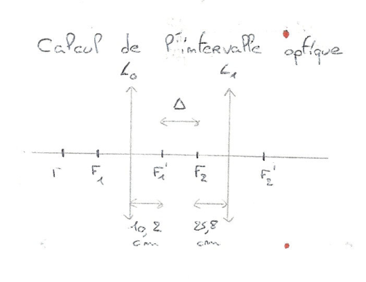
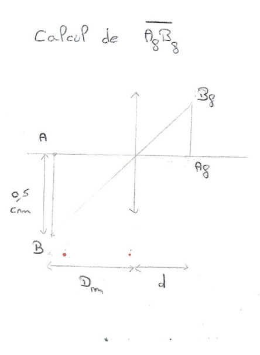
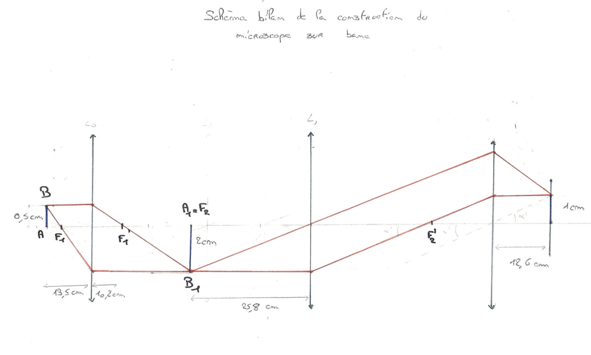

Ce compte rendu a été rédigé en trinôme en 2017-2018. Le TP se décompose en deux parties : une première partie où l'on construit un microscope sur un banc optique, et une seconde partie où l'on étudie directement un microscope commercial.

## Construction d'un microscope sur banc optique

### Introduction

Nous allons ici construire un microscope sur banc optique. Le microscope est caractérisé par une lentille objectif et une lentille oculaire ; nous allons déterminer leurs positions dans le montage. Nous analyserons ensuite la puissance et le grossissement du microscope sur banc pour ensuite les comparer avec ceux du microscope commercial.

### Identification des lentilles objectif et oculaire

Le but de cette partie est d'identifier les lentilles objectif et oculaire. Pour ce faire, nous allons mesurer la distance focale par auto-collimation (voir le [TP d'optique 1](./optique-distance-focale.md)). On trouvera alors deux distances focales : la plus faible correspondra à la lentille objectif (la plus élevée sera donc l'oculaire).

| Lentilles | Distance focale (moyenne des deux mesures) | Fonction dans le montage |
| --- | --- | --- |
| $L_0$ | $\frac{1}{2}(10{,}7 + 9{,}8) = 10{,}2\ \text{cm}$ | Objectif |
| $L_1$ | $\frac{1}{2}(25{,}6 + 26) = 25{,}8\ \text{cm}$ | Oculaire |

### Construction de l'œil fictif observant à l'infini

Pour construire l'œil fictif, il est nécessaire d'avoir un objet à l'infini. Pour ce faire, nous avons placé $L_0$ (l'objectif) sur le banc, puis nous avons placé l'objet $AB$ sur le plan focal objet de l'objectif. Ainsi, nous avons une image à l'infini : autrement dit, l'image reste nette et identique peu importe où l'on place l'œil. En effet, comme $AB$ est au plan focal objet de l'objectif, les faisceaux de lumière émergent parallèles de la lentille. En outre, sur le banc, nous avons placé l'objet $AB$ à 5 cm et la lentille à 15,2 cm.

De plus, nous avons réglé la distance entre le cristallin et la rétine pour que l'image soit nette. On obtient alors une distance $d = 12{,}6$ cm.

### Position et caractérisation de l'objectif

Comme demandé dans l'énoncé, nous avons placé la lentille objectif à une distance de 13,5 cm de l'objet $AB$, le but étant que cette distance soit supérieure à la distance focale de la lentille pour ne pas avoir d'image à l'infini.

On détermine ensuite la distance $O_1 A_1$. On obtient $O_1 A_1 = 55{,}3$ cm ; on mesure aussi $A_1 B_1 = -2$ cm. Nous pouvons en déduire la valeur du grandissement de l'objectif :

$$
\gamma_1 = \frac{A_1 B_1}{AB} = \frac{-2}{0{,}5} = -4
$$

$$
\gamma_1 = \frac{O_1 A_1}{O_1 A} = \frac{55{,}3}{-13{,}5} = -4{,}1
$$

### Position et caractérisation de l'oculaire

Pour que l'image $A_2 B_2$ soit rejetée à l'infini, nous avons placé une seconde lentille de manière à ce que l'objet $A_1 B_1$ soit positionné sur le plan focal objet de l'oculaire. On trouve alors une distance $O_2 A_1 = -f_{L_1} = -25{,}8$ cm. On obtient alors la puissance de l'oculaire :

$$
P_2 = \frac{1}{f'} = \frac{1}{\overline{OF'}} = \frac{1}{0{,}258} = 3{,}88\ \text{m}^{-1}
$$

On en déduit la valeur du grossissement de l'oculaire :

$$
G_2 = P_2 d_m = 3{,}88 \times 0{,}25 = 0{,}97
$$

Et finalement, la valeur de l'intervalle optique $F'_1 F_2$ :

$$
\Delta = \overline{F'_1 F_2} = \overline{O_1 O_2} - (\overline{O_1 F'_1} + \overline{F_2 O_2}) = 81{,}1 - (10{,}2 + 25{,}8) = 45{,}1
$$

### Position de l'œil derrière le microscope

Dans cette partie, en translatant l'œil fictif sans modifier la distance $d$ derrière l'oculaire, on observe que l'image finale sur la rétine $A'_f B_f$ ne change pas, puisqu'elle reste constante à 1 cm.

On souhaite maintenant calculer la taille de l'image finale en l'absence de microscope. En utilisant le théorème de Thalès :

On obtient alors la valeur suivante :

$$
A_f B_f = AB \cdot \frac{d}{d_m} = 0{,}252\ \text{cm}
$$

### Caractérisation du microscope sur banc

Les différentes parties nous permettent maintenant de calculer les caractéristiques du microscope.

**Puissance du microscope.**

$$
P = \frac{\alpha'}{AB} = \frac{0{,}077}{0{,}005} = 15{,}4\ \delta
$$

où $\alpha' = \arctan\left(\dfrac{A_1 B_1}{O_2 A_1}\right) = \arctan\left(\dfrac{-2}{-25{,}8}\right) = 0{,}077$ rad.

**Grossissement commercial du microscope.**

$$
G_c = \frac{\alpha'}{\alpha} = 3{,}85
$$

où $\alpha = \arctan\left(\dfrac{AB}{d_m}\right) = \arctan\left(\dfrac{0{,}5}{25}\right) = 0{,}02$ rad.

$$
G_c = P \cdot d_m = 15{,}4 \times 0{,}25 = 3{,}85
$$

$$
G_c = \frac{\overline{A'_f B'_f}}{\overline{A_f B_f}} = \frac{1}{0{,}252} = 3{,}97
$$

On peut constater que nous obtenons des résultats relativement équivalents avec les trois formules. Étant donné que les puissances des microscopes sont généralement comprises entre 200 et 5000 dioptries, les grossissements des microscopes sont compris entre 50 et 1250. Notre microscope est donc très faible, puisqu'il a une puissance de $15{,}4\ \delta$ et un grossissement entre 3,85 et 3,97. Cette partie permet de comprendre le fonctionnement d'un microscope et la position des lentilles à respecter pour obtenir ce résultat.

### Conclusion

Cette partie permet de comprendre le fonctionnement d'un microscope basique et de définir les caractéristiques de ses composants. Nous avons ainsi compris comment le microscope permet de distinguer des objets de petite taille. Cette partie permet de mettre en lumière que l'association de lentilles convergentes permet d'observer un objet de taille minimale.

## Utilisation d'un microscope commercial

### Introduction

Dans cette seconde partie, nous cherchons à déterminer la puissance et le grossissement du microscope commercial pour les comparer à la puissance et au grossissement obtenus dans le cas du microscope construit sur banc optique. Nous allons étudier un cheveu à l'aide de différents objectifs.

### Détermination du grandissement $\gamma_1$ de l'objectif

Dans un premier temps, nous avons calibré le microscope pour pouvoir ensuite mesurer convenablement avec ce dernier. Pour le calibrer, nous avons tout d'abord positionné le micromètre objectif ainsi que l'oculaire normal sur le microscope, puis nous l'avons centré à l'aide du grossissement $\times 4$. Ensuite, à l'aide des deux autres grossissements, on place les deux graduations parallèlement et de manière à ce qu'elles soient superposées. On relève les valeurs suivantes :

| Objectif | Nombre de graduations sur le micromètre objet | Distance $AB$ (mm) correspondante $D$ | Nombre de graduations $A_1 B_1 \pm \Delta A_1 B_1$ sur le micromètre oculaire | Distance correspondante (mm) $D'$ | $\gamma_1 \pm \Delta\gamma_1$ |
| --- | --- | --- | --- | --- | --- |
| $\times 10$ | 100 | 1 | 100 | $10{,}0 \pm 0{,}1$ | $10{,}0 \pm 0{,}1$ |
| $\times 40$ | 25 | 0,25 | 100 | $10{,}0 \pm 0{,}1$ | $40{,}0 \pm 0{,}4$ |

**Quelques précisions sur les incertitudes.**

$$
D = \frac{D'}{\gamma_1} \rightarrow \gamma_1 = \frac{D'}{D}
$$

$$
\Delta D = \left|\frac{\partial D}{\partial \gamma_1}\right|\Delta\gamma_1 + \left|\frac{\partial D}{\partial D'}\right|\Delta D' \Rightarrow \Delta D = \left|\frac{D'}{\gamma_1^2}\right|\Delta\gamma_1 + \left|\frac{1}{\gamma_1}\right|\Delta D'
$$

$$
\Delta\gamma_1 = \left|\frac{\partial\gamma_1}{\partial D}\right|\Delta D + \left|\frac{\partial\gamma_1}{\partial D'}\right|\Delta D' \Rightarrow \Delta\gamma_1 = \left|\frac{-D'}{D^2}\right|\Delta D + \left|\frac{1}{D}\right|\Delta D'
$$

En prenant l'objectif $\times 10$, on obtient $\Delta\gamma_1 = 0{,}1$, et pour l'objectif $\times 40$, on obtient $\Delta\gamma_1 = 0{,}4$.

### Mesure du diamètre d'un cheveu

On cherche à mesurer le diamètre du cheveu en utilisant les graduations de la partie précédente. On obtient les valeurs suivantes :

| Objectif | Nombre de graduations sur le micromètre oculaire correspondant au diamètre du cheveu | Diamètre $D' \pm \Delta D'$ du cheveu mesuré au micromètre oculaire (mm) | Diamètre $D \pm \Delta D$ du cheveu (µm) |
| --- | --- | --- | --- |
| $\times 40$ | 30 | $0{,}3 \pm 0{,}1$ | $75 \pm 2{,}6$ |

$$
D = \frac{D'}{\gamma_1} \Rightarrow \Delta D = \left|\frac{D'}{\gamma_1^2}\right|\Delta\gamma_1 + \left|\frac{1}{\gamma_1}\right|\Delta D'
$$

### Conclusion

Dans cette deuxième partie, après avoir déterminé le grossissement des objectifs $\times 10$ et $\times 40$, nous avons pu déterminer le diamètre du cheveu, soit $(75 \pm 2{,}6)$ µm.
