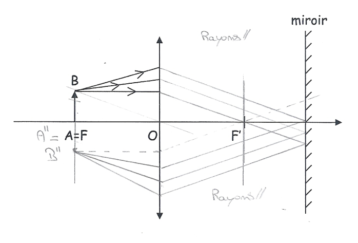
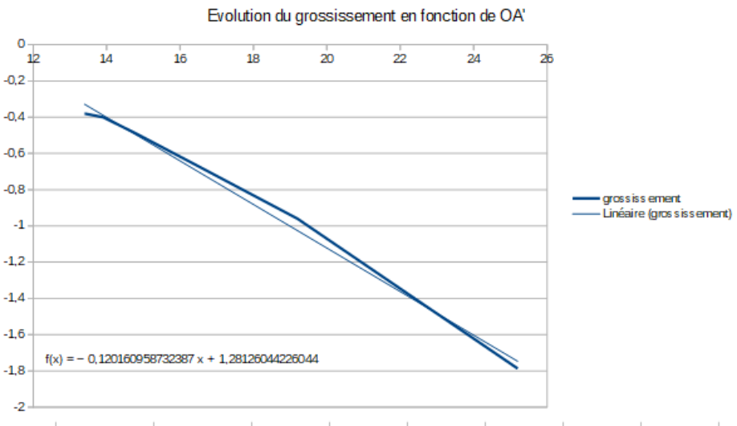

## Avant-propos

Il faut rappeler que les travaux pratiques sont théoriquement des devoirs personnels (mais bon, ça fait 10 ans qu'ils font les mêmes TP...) : il est donc fortement déconseillé d'amener ce fascicule en séance de TP. Ce fascicule permet de préparer en amont les TP (on peut utiliser son téléphone pendant les TP).

Les TP « électrocinétique 1 » et « électromagnétisme » ne sont pas présents ; le [compte rendu « optique 2 »](./microscope.md) est présent dans le dossier du semestre 2.

Les données expérimentales de « Mécanique » sont approximatives, la théorie est juste.

## Mesure de distance focale

### Auto-collimation

**Position de l'image finale $\overline{A''B''}$ :** dans le plan de l'objet $AB$, mais renversée.

**Valeur du grandissement global :** $\gamma = \dfrac{\overline{A''B''}}{\overline{AB}}$ : $\gamma = -1$.

**Principe de détermination de la distance focale :** on observe l'écran (= objet) et on déplace l'ensemble lentille + miroir le long du banc optique. On positionne ce dernier de manière à avoir une image nette dans le plan objet. On vérifie que la position du miroir est indépendante. On obtient $f'$ en mesurant la distance source-lentille.

**Mesures (avec incertitudes) :**

- première valeur de $f'$ : $9{,}6 \pm 0{,}1$ cm ;
- deuxième valeur de $f'$ : $9{,}4 \pm 0{,}1$ cm.

**Distance focale moyenne (avec l'incertitude) :** $f' = \dfrac{f'_1 + f'_2}{2} = 9{,}5 \pm 0{,}2\ \text{cm}$ (ou $\pm 0{,}1$ cm).

**Influence de la position du miroir :** la position du miroir n'influence pas le résultat car les rayons qui arrivent sur le miroir sont parallèles entre eux ; l'image sera donc nette peu importe la distance. L'image est renversée et réelle ; cependant, si on éloigne le miroir, certains rayons ne traversent plus la lentille et l'image disparaît donc peu à peu. Ces observations sont confirmées expérimentalement.

### Méthode de Bessel

**Mesures.**

| $D \pm \Delta D$ (cm) | $d \pm \Delta d$ (cm) | $f' \pm \Delta f'$ (cm) |
| --- | --- | --- |
| $80{,}0 \pm 0{,}1$ | $56{,}6 \pm 0{,}2$ | $10{,}0 \pm 0{,}13$ |
| $60{,}0 \pm 0{,}1$ | $34{,}8 \pm 0{,}2$ | $10{,}0 \pm 0{,}11$ |

**Estimation des incertitudes.**

|  | Incertitude de lecture | Incertitude de netteté | Incertitude totale |
| --- | --- | --- | --- |
| $D$ | 0,1 | 0 | 0,1 |
| $d$ | 0,1 | 0,15 | 0,25 |

**Expression de l'incertitude $\Delta f'$ :**

$$
\Delta f' = \left|\frac{\partial f'}{\partial D}\right|\Delta D + \left|\frac{\partial f'}{\partial d}\right|\Delta d = \frac{D^2 + d^2}{4D^2}\Delta D + \frac{d}{2D}\Delta d
$$

- $D = 80$ cm $\Rightarrow \Delta f' \sim 0{,}13$ cm ;
- $D = 60$ cm $\Rightarrow \Delta f' \sim 0{,}11$ cm.

### Méthode de Silbermann

**Expression de $\overline{AA'}$ en fonction de $f'$ :** $\overline{AA'} = -\overline{OA} + \overline{OA'} = 2\overline{OA'} = 4f'$ (relation de Descartes avec origine au centre : $\dfrac{1}{\overline{OA'}} - \dfrac{1}{\overline{OA}} = \dfrac{1}{f'}$).

**Mesure :** $\overline{AA'} = 40{,}0 \pm 0{,}2$ cm.

**Distance focale :** $f' = 10{,}0 \pm 0{,}05$ cm.

**Lien entre les méthodes de Bessel et de Silbermann :** dans la méthode de Bessel, il fallait $D > 4f'$. Pour Silbermann, on trouve $\overline{AA'} = 4f'$ : c'est donc un cas particulier de la méthode de Bessel (où $d = 0$), et les résultats coïncident.

### Conclusion

Avec les trois méthodes, on a des valeurs très proches. Il y a cependant des différences entre les méthodes de calcul :

**Auto-collimation :** rapide, mais incertitude la plus élevée.

**Bessel :** il faut plus de matériel ; assez simple, assez précise.

**Silbermann :** plus complexe, plus précise.

## Détermination de la focale par la formule de conjugaison

| $\overline{OA}$ (cm) | $-40{,}0$ | $-35{,}0$ | $-30{,}0$ | $-25{,}0$ | $-20{,}0$ | $-15{,}0$ | $-10{,}0$ |
| --- | --- | --- | --- | --- | --- | --- | --- |
| $\overline{OA'}$ (cm) | $13{,}4$ | $13{,}9$ | $14{,}8$ | $16{,}4$ | $19{,}2$ | $25{,}2$ | non mesurable |
| $\gamma = \frac{\overline{OA'}}{\overline{OA}}$ | $-0{,}38$ | $-0{,}40$ | $-0{,}49$ | $-0{,}66$ | $-0{,}96$ | $-1{,}787$ | non calculable |
| $\overline{A'B'}$ (cm) | $-0{,}5$ | $-0{,}6$ | $-0{,}7$ | $-1{,}0$ | $-1{,}4$ | $-2{,}6$ | $\times$ |
| $\gamma = \frac{\overline{A'B'}}{\overline{AB}}$ | $-0{,}3$ | $-0{,}4$ | $-0{,}5$ | $-0{,}7$ | $-1{,}0$ | $-1{,}8$ | $\times$ |

**Calcul de l'expression théorique de $\gamma$ en fonction de $\overline{OA'}$ et $f'$ :**

$$
\gamma = \frac{\overline{OA'}}{\overline{OA}} = \overline{OA'}\left(\frac{1}{\overline{OA'}} - \frac{1}{f'}\right) = 1 - \frac{\overline{OA'}}{f'}
$$

(relation de conjugaison).

**Commentaires sur la courbe :** c'est une droite affine, donc le coefficient directeur est $-\dfrac{1}{f'}$ et l'ordonnée à l'origine vaut 1.

**Valeur de $f'$ (deux méthodes) :**

1. $f' = 9{,}1$ cm ;
2. $f' = 10{,}0$ cm.

**Explication de la valeur de $f'$ :**

1. La pente : $\dfrac{\Delta\gamma}{\Delta\overline{OA'}} = -0{,}11 \rightarrow f' = 9{,}1$.
2. Si $\gamma \to 0$, on a $\overline{OA'} = 10{,}0$ cm. En injectant dans la relation de conjugaison, on obtient $f' = 10{,}0$ cm.

### Conclusion générale

Différentes méthodes existent pour déterminer la distance focale image. La plus simple est l'auto-collimation, mais elle est peu précise. Celle de la formule de conjugaison est précise (multi-mesure) mais longue. Les méthodes de Bessel et de Silbermann sont précises mais moins longues. Tous les résultats restent cohérents.
