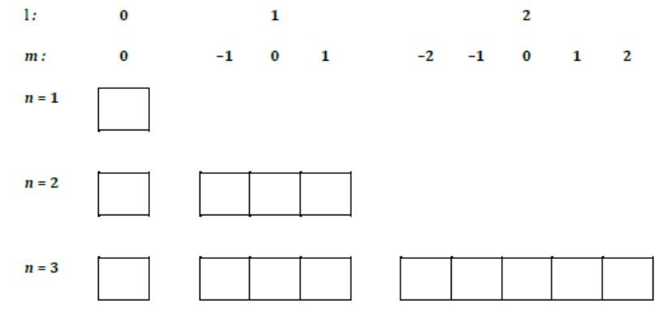
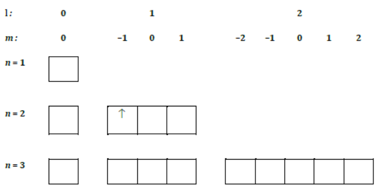

Les ions hydrogénoïdes sont les plus simples des édifices atomiques : ils ne possèdent qu'un seul électron. La résolution de l'équation de Schrödinger permet de décrire rigoureusement les états quantiques de cet électron unique que l'on dénomme orbitales atomiques. L'utilisation des orbitales atomiques est à la base de la description de la structure électronique des atomes polyélectroniques.

## Les ions hydrogénoïdes

Les ions hydrogénoïdes ne possèdent qu'un seul électron. Un ion hydrogénoïde est donc constitué d'un noyau $N$ de charge $+Ze$ et d'un électron de masse $m_e$ et de charge $e$ ($Z$ est le numéro atomique ou nombre de protons contenus dans le noyau de l'atome).

Bien qu'il ne soit pas un ion, l'atome d'hydrogène fait partie de cette famille hydrogénoïde. C'est l'édifice atomique le plus simple et le plus courant ne possédant qu'un électron.

On cherche à décrire le mouvement interne de ce système constitué de deux particules, c'est-à-dire leur mouvement par rapport au centre de gravité de l'atome. En raison de la très grande différence de masse entre les deux particules, on peut considérer que le centre de gravité de l'ensemble est confondu avec le noyau. On ne considère alors que le mouvement de l'électron par rapport au noyau supposé fixe et pris comme origine d'un référentiel "atomique". Les systèmes hydrogénoïdes sont les seuls systèmes pour lesquels il est possible de déterminer les solutions exactes de l'équation de Schrödinger. Pour les systèmes plus complexes (plus de deux particules en interaction), on ne peut déterminer que des fonctions d'onde approchées.

## L'équation de Schrödinger électronique

On recherche donc les fonctions d'onde stationnaires $\Psi(r, \theta, \phi)$ de l'électron dans le référentiel atomique, où $(r, \theta, \phi)$ sont les coordonnées sphériques. On doit pour ce faire résoudre l'équation de Schrödinger pour une particule mobile soumise à une énergie potentielle coulombienne attractive due au noyau :

$$
\mathbf{H}_{el}\Psi_{el}(r, \theta, \phi) = E\Psi_{el}(r, \theta, \phi)
$$

L'opérateur $H_{el}$ est la somme de l'opérateur $T$ correspondant à l'énergie cinétique de l'électron et de l'opérateur $V$ associé à l'énergie d'attraction électron-noyau :

$$
\mathbf{H}_{el} = \mathbf{T} + \mathbf{V}
$$

Avec

$$
\mathbf{T} = \frac{-\hbar^2}{2m}\Delta \qquad \mathbf{V} = \frac{-Ze^2}{4\pi\epsilon_0 r}
$$

Pour simplifier les expressions mathématiques et faire disparaître les constantes, on introduit les unités atomiques de longueur et d'énergie. On cherche à résoudre

$$
\Delta\Psi + \frac{2\mu}{\hbar^2}\Big(\frac{Ze^2}{4\pi\epsilon_0 r} + E\Big) = 0
$$

avec $\mu = \dfrac{mM}{m + M}$. On observe donc une séparation des termes, l'un de nature radiale ($r$) et l'autre de la partie angulaire ($\theta, \phi$). Résoudre l'équation de Schrödinger équivaut à trouver la fonction propre $\Psi$ et les valeurs propres $E$. Dans un système hydrogénoïde, l'équation de Schrödinger a des solutions exactes.

**Exemple.**

$$
\mathbf{T} = \frac{-\hbar^2}{2m}\Big(\frac{\partial^2}{\partial x^2} + \frac{\partial^2}{\partial y^2} + \frac{\partial^2}{\partial z^2}\Big) = \frac{-\hbar^2}{2m}\Delta
\qquad
\mathbf{V} = \frac{-Ze^2}{4\pi\epsilon_0 r}
$$

**Dans les régions 1 et 3.** $V = \infty \Rightarrow \Psi = \dfrac{\hbar^2}{2m(V - E)} \dfrac{\partial^2\Psi}{\partial x^2} \to 0$ donc

$$
\Psi_x^{1,3} = 0
$$

**Dans la région 2.** $\dfrac{\hbar^2}{2m} \dfrac{\partial^2\Psi}{dx^2} + E\Psi = 0$ donc

$$
\frac{\partial^2\Psi}{\partial x^2} + \frac{2mE}{\hbar^2}\Psi = 0
$$

On pose $\alpha^2 = \dfrac{2mE}{\hbar^2}$.

On a les solutions de la forme $\Psi = A\sin(\alpha x) + B\cos(\alpha x)$. On cherche à vérifier que $\Psi$ est une fonction propre :

$$
\mathbf{H}\Psi = E\Psi \Leftrightarrow \frac{\partial^2\Psi}{\partial x^2} + \alpha^2\Psi = 0 \Rightarrow \frac{\partial^2\Psi}{\partial x^2} = -\alpha^2\Psi - \alpha^2\big(A\sin(\alpha x) + B\cos(\alpha x)\big) = -\alpha^2\Psi
$$

Pour avoir une fonction d'onde convenable, on fixe les conditions aux limites :

$$
\begin{cases} \Psi(0) = 0 = 0 + B \Rightarrow B = 0 \\ \Psi(L) = 0 \Rightarrow A\sin(\alpha L) = 0 \Rightarrow \alpha L = n\pi \ \forall n \in \mathbb{N} \end{cases}
$$

$$
\Psi(x) = A\sin\Big(\frac{n\pi}{L}x\Big)
$$

Pour trouver la valeur de $A$, on utilise la condition de normalisation : $\displaystyle\int_{-\infty}^{+\infty} \Psi(x)dx = 1 \Rightarrow \int_{-\infty}^{0} \Psi(x)dx + \int_0^L \Psi(x)dx + \int_L^{+\infty} \Psi(x)dx = 1$. Il faut donc imposer que

$$
A^2 \int_0^L \sin^2\Big(\frac{n\pi x}{L}\Big)dx = 1
$$

On pose $\beta = \dfrac{n\pi}{L}$, on a donc

$$
\begin{aligned}
A^2 \int_0^L \Big(\frac{1 - \cos(2\beta x)}{2}\Big)dx &= 1 \\
A^2 \Big[\frac{1}{2}x - \frac{\sin(2\beta x)}{4\beta}\Big]_0^L &= 1 \\
A^2 \Big[\frac{1}{2}x - \frac{L\sin\big(\frac{2n\pi x}{L}\big)}{4n\pi}\Big]_0^L &= 1 \\
A^2\Big(\frac{L}{2}\Big) = 1 &\Leftrightarrow A = \sqrt{\frac{2}{L}}
\end{aligned}
$$

Au final on obtient donc

$$
\Psi(x) = \sqrt{\frac{2}{L}}\sin\Big(\frac{n\pi}{L}x\Big)
$$

On cherche maintenant les énergies :

$$
\mathbf{H}\Psi = E\Psi
$$

En reprenant l'opérateur hamiltonien, on a :

$$
-\frac{\hbar^2}{2m}\frac{\partial^2}{\partial x^2}\Big(\sqrt{\frac{2}{L}}\sin\Big(\frac{n\pi x}{L}\Big)\Big) = -\frac{\hbar^2}{2m}\sqrt{\frac{2}{L}}\Big(-\frac{n^2\pi^2}{L^2}\sin\Big(\frac{n\pi x}{L}\Big)\Big) = \frac{n^2\pi^2\hbar^2}{2mL^2}\Psi(x) = \frac{n^2h^2}{8mL^2}\Psi(x)
$$

On obtient donc

$$
\Psi^n(x) = \sqrt{\frac{2}{L}}\sin\Big(\frac{n\pi x}{L}\Big)
$$

donc on a

$$
E_n = \frac{n^2h^2}{8mL^2} \quad \forall n \in \mathbb{N}^*
$$

## Les orbitales

### Les trois nombres quantiques

Les orbitales sont des fonctions propres de l'opérateur hamiltonien $\mathbf{H}_{el}$ associé à l'énergie totale du système. Mais elles doivent également être fonctions propres de tous les opérateurs associés à des constantes du mouvement.

Ces trois nombres quantiques sont reliés par les inégalités suivantes :

$$
n > 0 \quad l < n \quad -l \leq m \leq +l
$$

Le module au carré de l'orbitale $\Psi_{nml}(r, \theta, \phi)$ donne la densité volumique de probabilité de présence de l'électron ou densité du nuage électronique.

$$
|\Psi_{nml}(r, \theta, \phi)|^2 = \frac{dP}{dV}
$$

### Nomenclature des orbitales

**Couches et sous-couches.** Une couche est définie par le nombre quantique principal $n$. On lui associe une lettre dans la série $K, L, M, \dots$ dans l'ordre croissant de $n$. Pour $n$ donné, il y a $n$ valeurs possibles de $l$ : $0, 1, \dots, n - 1$. Pour $l$ donné, on peut associer $2l + 1$ valeurs de $m$ : $m = -l, \dots, 0, \dots, +l$.

On définit alors la dégénérescence $g$ d'une couche comme le nombre d'états de même nombre quantique principal $n$.

$$
g = n^2
$$

La valeur du nombre quantique secondaire $l$ détermine la sous-couche. On utilise comme symboles les lettres minuscules.

**Cases quantiques.** La représentation symbolique en cases quantiques des couches et sous-couches est obtenue en associant une case à chaque orbitale et en plaçant les cases de chaque couche sur une ligne tout en les groupant par sous-couche suivant les valeurs de $l$.

Pour une couche donnée de nombre quantique principal $n$, on dispose de $n^2$ cases quantiques, que l'on arrange suivant les nombres quantiques $l$ et $m$, les cases de même valeur de $l$ étant groupées ensemble et formant les sous-couches. Chaque sous-couche contient $2l + 1$ cases.

**Nomenclature des orbitales.** On désigne les différentes orbitales en fonction de la valeur des nombres quantiques $n$, $l$ et $m$ selon le tableau suivant :

| $n$ | $l$ | $m$ | orbitales |
| --- | --- | --- | --- |
| 1 | 0 | 0 | 1 orbitale 1s |
| 2 | 0 | 0 | 1 orbitale 2s |
| | 1 | $-1, 0, 1$ | 3 orbitales 2p |
| 3 | 0 | 0 | 1 orbitale 3s |
| | 1 | $-1, 0, 1$ | 3 orbitales 3p |
| | 2 | $-2, -1, 0, 1, 2$ | 5 orbitales 3d |
| 4 | 0 | 0 | 1 orbitale 4s |
| | 1 | $-1, 0, 1$ | 3 orbitales 4p |
| | 2 | $-2, -1, 0, 1, 2$ | 5 orbitales 4d |
| | 3 | $-3, -2, -1, 0, 1, 2, 3$ | 7 orbitales 4f |

## Représentation des orbitales

Pour représenter les orbitales $\Psi_{nml}(r, \theta, \phi)$, fonctions de trois variables, il faudrait un espace à 4 dimensions. On est donc amené soit à séparer les variables, soit à représenter des surfaces d'amplitude constante de la fonction d'onde. En outre, il est plus intéressant de représenter la densité de probabilité $|\Psi|^2$ qui est reliée à la densité du nuage électronique représentant l'électron.

$$
P = \int_{esp} \Psi_{1s}^* \Psi_{1s} \, dV
$$

$$
= \int_0^\infty \int_0^\pi \int_0^{2\pi} \Psi_{1s}^2 r^2 \sin(\theta) \, dr \, d\theta \, d\phi = 4\pi \int_0^\infty r^2 \Psi_{1s}^2 \, dr \Leftrightarrow dP = 4\pi r^2 \Psi_{1s}^2 \, dr
$$

### Séparation des parties radiales et angulaires

Le choix des coordonnées sphériques permet la factorisation des orbitales en une partie radiale, qui ne dépend que de la distance au noyau $r$, et une partie angulaire, qui donne la variation de l'orbitale suivant l'orientation du rayon qui relie le noyau à un point de l'espace de coordonnées $(r, \theta, \phi)$ :

$$
\Psi_{nlm}(r, \theta, \phi) = R_{nl}(r) \cdot \Theta_{lm}(\theta) \cdot \Phi_m(\phi)
$$

On peut représenter graphiquement les parties radiales ou angulaires des orbitales. Mais il faut bien voir que ces représentations ne sont pas celles des fonctions d'onde. Ce ne sont que des représentations partielles et arbitraires.

### Représentation des parties radiales

La partie radiale d'une orbitale ne dépend que de la seule variable $r$. Plutôt que de représenter son amplitude, il est plus intéressant de représenter la densité de probabilité de présence de l'électron à une distance $r$ du noyau donnée par $D(r) = r^2|R_{nl}(r)|^2$.

### Représentation des parties angulaires

On représente la fonction $\Phi_{lm}(\theta, \phi)$ par un diagramme polaire, en portant dans chaque direction de l'espace issue du noyau et caractérisée par les angles $\theta$ et $\phi$ une longueur $OM = |\Psi_{lm}(\theta, \phi)|$. On obtient une sphère centrée en $O$ pour les orbitales $ns$, deux sphères tangentes en $O$ centrées sur les axes $Ox, Oy, Oz$ pour les orbitales $npx, npy, npz$ et des figures plus complexes pour les orbitales $d$ et $f$. Pour rappeler le signe de la partie angulaire alors qu'on ne trace que son module, on affecte à la courbe la couleur grise quand $|\Psi_{lm}(\theta, \phi)|$ est positive et blanche quand elle est négative. Il est en effet très important de conserver l'information quant au signe positif ou négatif des différents lobes orbitalaires. Dans le modèle ondulatoire de la liaison chimique, l'assemblage des atomes sous forme de molécules dépend de l'orientation relative des orbitales et du recouvrement plus ou moins important des lobes de même signe.

On peut aussi représenter le module au carré de la partie angulaire $|\Psi_{lm}(\theta, \phi)|^2$ par un diagramme polaire. Les figures que l'on obtient traduisent l'évolution angulaire de la densité de probabilité de présence. Elles apparaissent comme des versions déformées des figures précédentes. On obtient toujours une sphère centrée en l'origine pour les orbitales $s$. Pour les orbitales $px, py, pz$, on obtient deux lobes ovoïdes tangents en $O$, alignés sur les axes $Ox, Oy, Oz$ respectivement. Les orbitales de type $d$ conduisent à des figures plus complexes.

Cette dernière représentation est la plus couramment utilisée par les chimistes. Elle permet de proposer des modèles d'interprétation des propriétés des atomes, des molécules et des assemblages plus complexes.

### Surfaces d'isoamplitude et d'isodensité

On porte dans le référentiel $Oxyz$ les surfaces le long desquelles la fonction d'onde $\Psi_{nlm}(r, \theta, \phi)$ ou la densité de probabilité $|\Psi|^2$ a une valeur constante donnée a priori. On obtient alors respectivement les surfaces d'isoamplitude et d'isodensité.

En général ces surfaces ont une symétrie de révolution et la connaissance de l'intersection de ces surfaces avec un plan contenant l'axe de révolution permet de générer la surface totale. On représente alors des courbes d'isodensité dans ces plans particuliers. On obtient de cette manière des figures analogues aux courbes de niveau des cartes géographiques.

### Niveaux d'énergie

Les valeurs propres de l'opérateur hamiltonien forment un spectre quantifié. L'énergie d'une orbitale $\Psi_{nml}$ est donnée par :

$$
E_n = -\frac{me^4}{(4\pi\epsilon_0\hbar)^2} \frac{Z^2}{2n^2} \ \text{Joules} = -13{,}6\frac{Z^2}{n^2} \ \text{eV} = -\frac{Z^2}{2n^2} \ \text{Hartree}
$$

Les états quantiques $\Psi_{nml}$ de l'électron dépendent des trois nombres quantiques $n$, $l$ et $m$. L'énergie ne dépend que du seul nombre quantique principal $n$. Tous les états de même valeur de $n$ sont donc d'énergie égale. On dit que ces états sont énergétiquement dégénérés. Dans le cas des atomes hydrogénoïdes, le degré de dégénérescence énergétique est égal à celui des couches. Le premier niveau d'énergie correspond à un seul état, le second à 4 états et le $n$-ième à $n^2$ états. Le niveau d'énergie le plus bas est appelé l'état fondamental. Les autres niveaux sont les états excités.

La différence d'énergie entre deux niveaux $E_n$ et $E_m$ s'écrit :

$$
\Delta E = |E_n - E_m| = \frac{me^4}{(4\pi\epsilon_0\hbar)^2} \frac{Z^2}{2}\Big(\frac{1}{m^2} - \frac{1}{n^2}\Big)
$$

L'absorption ou l'émission d'un photon permet la transition entre ces deux niveaux. Le nombre d'onde du photon est alors

$$
\frac{1}{\lambda} = \frac{\Delta E}{hc} = R_H\Big(\frac{1}{m^2} - \frac{1}{n^2}\Big)
$$

où $R_H$ est la constante de Rydberg.

### Le spin de l'électron

**Nombre quantique de spin, spin-orbitale.** Les informations fournies par les orbitales (fonctions des coordonnées spatiales uniquement) ne sont en fait pas suffisantes pour interpréter un certain nombre d'expériences. Il est nécessaire d'introduire une variable supplémentaire $\sigma$, le spin de l'électron. Cette introduction du spin se fait rigoureusement à partir de la mécanique quantique relativiste développée par Dirac.

La particularité du spin est qu'il constitue une variable discrète ne pouvant prendre que les valeurs $\frac{1}{2}$ et $-\frac{1}{2}$.

**Représentation symbolique.** On représente les spin-orbitales au moyen des cases quantiques regroupées par couches et sous-couches dans lesquelles on place une flèche.

