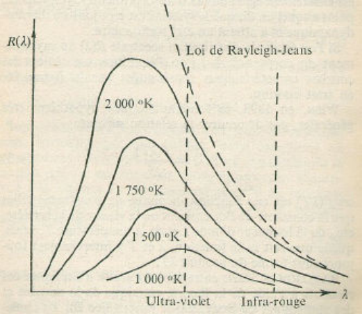
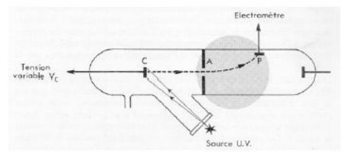

À la fin du 19e siècle, les deux piliers de la physique que constituent la mécanique et l'électromagnétisme semblaient capables de rationaliser l'ensemble des lois de la nature. Cependant, l'examen critique des phénomènes liés à l'interaction entre la matière et un rayonnement électromagnétique fit apparaître la nécessité de remettre en cause cet édifice. L'analyse de plusieurs expériences (rayonnement du corps noir, effet photoélectrique, expériences de diffraction d'électrons ou de neutrons...) a mis en évidence le fait que les particules élémentaires ne se conforment pas aux lois de la mécanique classique, et se manifestent parfois selon des lois similaires à celles qui régissent les ondes. À l'opposé, les ondes lumineuses se manifestent aussi sous forme corpusculaire. Ces phénomènes sont à l'origine de la révolution de la physique au début du siècle, et sont décrits par les relations de dualité onde-corpuscule.

## Structure de l'atome

En 1897, le physicien anglais Thomson observe que lorsqu'on établit une différence de potentiel entre deux électrodes placées dans un tube en verre à l'intérieur duquel la pression est très faible, un spot lumineux (appelé rayon cathodique) apparaît sur le verre derrière l'électrode positive. Une étude détaillée des déviations subies par le rayon cathodique sous l'effet de champs électriques et magnétiques montre qu'il s'agit d'un courant de particules indépendantes du matériau et chargées négativement, les électrons. Quelques années plus tard, Millikan détermine la valeur de la charge de l'électron en étudiant les mouvements de gouttelettes d'huile électrisées entre les plaques d'un condensateur horizontal. Cette valeur, notée conventionnellement $e$, constitue la plus petite charge électrique que puisse porter une particule. Toute charge électrique ne peut être, en valeur absolue, qu'un multiple entier de celle de l'électron :

$$
e = 1{,}602177 \cdot 10^{-19}\ \text{C}
$$

Autre conclusion importante des observations de Thomson : les électrons portant une charge négative et étant émis par des métaux initialement neutres, une source de charges positives doit exister dans les métaux. En 1911, Rutherford montre expérimentalement que presque toute la masse et toute la charge positive d'un atome sont localisées en son centre, qu'il appelle le noyau. Il propose alors une structure de l'atome de type planétaire, dans laquelle les électrons chargés négativement orbitent autour du noyau. Dans ce modèle, la cohésion de l'édifice atomique résulte de la force de Coulomb, jouant pour l'atome le rôle de la force de gravitation dans un système planétaire.

Ce modèle planétaire souffre cependant d'une incohérence liée aux lois de l'électromagnétisme. En effet, les particules chargées en mouvement accéléré sont susceptibles d'émettre un rayonnement lumineux. Le mouvement de rotation d'un électron autour du noyau fait que le champ électrique créé par le dipôle que constituent les deux particules chargées varie au cours du temps : ce dipôle électron-proton change d'orientation au fur et à mesure que l'électron tourne autour du proton. L'atome crée donc un champ électrique oscillant, c'est-à-dire une onde électromagnétique. Il perd donc continûment de l'énergie sous forme électromagnétique. La conservation de l'énergie totale implique que l'énergie rayonnée correspond à une perte d'énergie mécanique de l'électron. Celui-ci doit perdre de "l'altitude". Le terme inéluctable de sa trajectoire est la collision avec le noyau, avec pour l'atome une durée de vie estimée de l'ordre de $10^{-8}$ seconde. La réalité est évidemment tout autre ; les atomes sont stables et n'émettent pas spontanément de lumière. La physique classique est donc incapable de rendre compte de l'existence des atomes et donc des molécules. L'existence de deux théories

## Aspect corpusculaire de la lumière

La nature de la lumière est un problème qui a suscité un grand nombre de controverses scientifiques pendant plusieurs siècles. En 1704, Newton suggère qu'un faisceau lumineux pourrait être constitué de corpuscules très fins. Cette hypothèse est en accord avec les lois de l'optique géométrique : la conservation de la quantité de mouvement explique la propagation rectiligne du flux lumineux, et le phénomène de réflexion provient des collisions élastiques entre les corpuscules et le miroir, et apparaît donc comme une conséquence directe de la conservation de l'énergie et de la quantité de mouvement. Contemporain de Newton, le physicien néerlandais Huygens émet l'hypothèse que la lumière est un phénomène ondulatoire. Cette hypothèse offre le moyen de décrire parfaitement les rayons lumineux, mais se heurte à un problème insurmontable : à cette époque, tous les phénomènes ondulatoires connus (ondes aquatiques, ondes sonores...) nécessitent un milieu à travers lequel se propager. Dans ce cas, comment expliquer que la lumière traverse le vide ? Pour contourner cette difficulté, on postula l'existence de l'éther, milieu dans lequel toute onde lumineuse peut se propager. Pendant un siècle, les descriptions ondulatoire et corpusculaire de la lumière coexistent. Il faut attendre les travaux de Young en 1801, et en particulier l'observation des phénomènes de diffraction et d'interférences, pour que soit abandonnée la description corpusculaire de la lumière. Si un faisceau lumineux rencontre une fente très étroite percée dans un écran opaque, la lumière qui traverse la fente se propage dans toutes les directions, de manière analogue aux ondes aquatiques : c'est la diffraction. Si deux faisceaux diffractés qui se recouvrent sont projetés sur un écran, il apparaît sur l'écran une alternance de bandes lumineuses et de bandes sombres, appelée figure d'interférences. La théorie corpusculaire ne permet pas d'expliquer ces deux phénomènes : ils prouvent le caractère ondulatoire de la lumière. En 1862, Maxwell montre que l'onde lumineuse est de nature électromagnétique et propose une série d'équations décrivant sa propagation. À la fin du 19e siècle, il semble donc définitivement acquis que la lumière est une onde. Mais une série d'expériences menées au début du 20e siècle viennent remettre en question cette description, et relancer la controverse.

**Le rayonnement du corps noir.** Un corps noir est un objet non réfléchissant qui émet de la lumière lorsqu'il est chauffé. Lorsqu'un corps noir est porté à haute température, il émet un rayonnement appelé rayonnement thermique, dont le taux d'émission $R$ est proportionnel à la puissance 4 de la température (loi de Stefan, 1879). Si un rayonnement thermique à taux constant est envoyé sur un corps noir, la température de ce dernier s'élève ; il émet alors à son tour un rayonnement, dont le taux d'émission devient de plus en plus intense à mesure que la température augmente. La température se stabilise lorsque le taux d'émission est égal au taux d'absorption. Le système est alors dans un état d'équilibre thermodynamique.

À la fin du 19e siècle, Rayleigh et Jeans proposent une loi de distribution spectrale du rayonnement à l'équilibre thermodynamique, à partir de la théorie cinétique de la matière et des statistiques de Boltzmann. Dans ce modèle, les ions oscillent avec un ensemble continu de fréquences autour de leur position moyenne ; ces oscillations sont responsables de l'émission du rayonnement. Le spectre du corps noir est alors donné par :

$$
R(\lambda) = \frac{8\pi k}{\lambda^4} T
$$

où $k$ est la constante de Boltzmann.

Comme le montre la figure, la loi de Rayleigh-Jeans ne permet de rendre compte de l'émission du corps noir qu'aux grandes longueurs d'onde (faibles fréquences). Pour des longueurs d'onde inférieures, elle fait apparaître une divergence dramatique par rapport à la distribution expérimentale. Cette divergence est appelée "catastrophe ultra-violette", car la discordance devient particulièrement marquée pour les longueurs d'onde correspondant à l'ultra-violet.

En 1900, Max Planck propose une solution permettant de résoudre le problème posé par la catastrophe UV et de décrire complètement l'ensemble du spectre du corps noir. Le point central de la solution de Planck est que les ions oscillants ne se comportent pas comme des oscillateurs classiques, et n'émettent pas une énergie variant de façon continue. Ils ne peuvent émettre qu'une énergie égale à un multiple entier d'une quantité de base $h\nu$ (le quantum d'énergie), où $\nu$ est la fréquence de l'oscillateur. La constante $h$ fut proposée comme nouvelle constante universelle. Sa dimension est celle d'une action (une énergie fois un temps). Les déterminations expérimentales ultérieures de $h$ conduisent à la valeur :

$$
h = 6{,}6253 \cdot 10^{-34}\ \text{J.s}
$$

L'échange d'énergie entre le rayonnement et la cavité est donc discontinu, ou quantifié. L'introduction de la condition de quantification dans la statistique de Boltzmann conduit à une modification de la loi de distribution spectrale qui reproduit parfaitement la loi expérimentale :

$$
R(\lambda) = \frac{8\pi hc}{\lambda^5} \frac{1}{\exp(hc/k\lambda T) - 1}
$$

En contradiction avec les lois classiques de la thermodynamique et de l'électromagnétisme, la quantification de l'échange d'énergie entre matière et rayonnement apparaît à l'époque comme une révolution. Planck lui-même émet des doutes quant à la validité de son postulat. Mais en 1905, Einstein montre qu'une généralisation du postulat de Planck permet de comprendre un autre phénomène que la physique classique ne peut expliquer : l'effet photoélectrique.

**L'effet photoélectrique.** Sous irradiation ultraviolette, un métal émet spontanément des électrons. La première observation expérimentale de ce phénomène, appelé effet photoélectrique, a été faite par Becquerel en 1839. Les expériences de Lenard en 1900 en donnent les caractéristiques principales :

- pour chaque type de métal, il existe une fréquence seuil $\nu_0$ en deçà de laquelle on n'observe pas d'émission de "photoélectrons" ;
- le nombre d'électrons émis par le métal dépend de l'intensité lumineuse, mais leur vitesse ne dépend que de la fréquence du rayonnement UV ;
- l'émission est un phénomène instantané, même pour de très faibles intensités.

Ces faits sont complètement incompréhensibles avec l'image classique d'un échange continu d'énergie entre la matière et le rayonnement.

L'interprétation des lois expérimentales est due à Albert Einstein en 1905. Sur la base des travaux de Planck, Einstein suppose qu'un rayonnement électromagnétique est composé de corpuscules de masse au repos nulle, baptisés photons par la suite. La relation liant l'énergie $E$ portée par les photons et la fréquence $\nu$ du rayonnement lumineux est appelée relation de Planck-Einstein :

$$
E = h\nu = hc/\lambda
$$

Pour extraire un électron d'un métal, il faut fournir une énergie minimale $W$. Lorsqu'un photon est absorbé sur une surface métallique, il cède à l'électron un quantum d'énergie $h\nu$. Si la fréquence $\nu$ est suffisamment élevée, l'électron est arraché du métal. L'excédent d'énergie permet à l'électron d'acquérir une certaine énergie cinétique. Ceci se traduit par l'équation :

$$
h\nu = \frac{1}{2} m v^2 + W
$$

où $v$ est la vitesse du photoélectron. L'existence d'une valeur limite de la fréquence en dessous de laquelle l'effet photoélectrique n'est plus observé se comprend alors facilement : si l'on diminue la fréquence du rayonnement incident, l'énergie cinétique du photoélectron diminue jusqu'à une fréquence seuil $\nu_0$ correspondant à une énergie cinétique nulle. Le photon possède alors juste assez d'énergie pour arracher l'électron du métal :

$$
h\nu_0 = W
$$

*Figure 1 – Appareil de Lenard pour étudier l'émission photoélectrique d'une cathode $C$ éclairée par une source lumineuse.*

L'énergie d'ionisation $W$ étant une caractéristique du métal utilisé, la fréquence seuil $\nu_0$ ne dépend pas de l'intensité du rayonnement, conformément aux observations expérimentales.

L'effet photoélectrique et le rayonnement électromagnétique du corps noir montrent que l'échange d'énergie entre la matière et le rayonnement est quantifié. La constante universelle $h$ découverte par Planck est liée à l'existence de ces échanges discontinus d'énergie.

C'est la mise en évidence de la nature discontinue des échanges d'énergie et son interprétation qui révèle en tant que conséquence l'aspect corpusculaire de la lumière.

## Quantification du spectre de l'hydrogène

En 1885, Balmer étudie le spectre d'émission de l'atome d'hydrogène. Il obtient une série de raies formant un spectre discontinu, et non pas le spectre continu prédit par les lois classiques de l'électromagnétisme. Rydberg établit en 1900 une loi empirique en $\dfrac{1}{n^2}$ (avec $n$ entier) permettant de retrouver précisément les longueurs d'onde d'émission de cette série de raies. Grâce au progrès des techniques spectroscopiques, Lyman découvre en 1906 une autre série de raies dans le domaine ultraviolet, puis Paschen détecte une série dans le domaine infrarouge en 1909. On dénombre en tout 5 séries observées expérimentalement. Elles peuvent être analysées par une formule empirique similaire à celle de Rydberg, énoncée par Ritz en 1908 :

$$
\frac{1}{\lambda} = R_H \left(\frac{1}{n_f^2} - \frac{1}{n_i^2}\right)
$$

où $R_H$ est la constante de Rydberg, dont la valeur déterminée expérimentalement vaut $109677{,}30\ \text{cm}^{-1}$. $n_f$ et $n_i$ sont des entiers strictement positifs. Les séries observées se distinguent par la valeur de $n_f$ :

| Série | $n_f$ | Région d'émission |
| --- | --- | --- |
| Lyman (1906) | 1 | Ultraviolet |
| Balmer (1885) | 2 | Visible et proche UV |
| Paschen (1909) | 3 | Infrarouge |
| Bracket (1922) | 4 | Infrarouge |
| Pfund (1924) | 5 | Infrarouge |

Pour tenter de concilier un modèle atomique planétaire pour l'atome d'hydrogène et la quantification observée sur son spectre d'émission, Bohr publie en 1913 un article intitulé "De la constitution des atomes et des molécules" dans lequel il s'appuie sur les travaux de Planck et propose les postulats suivants :

- L'électron circule à vitesse et énergie constantes sur des orbites circulaires particulières pour lesquelles il y a exacte compensation entre l'attraction coulombienne du noyau et la force centrifuge.
- Ces orbites particulières se limitent à celles pour lesquelles le moment cinétique est un multiple entier de la constante de Planck $h$, divisée par $2\pi$.
- Le changement d'orbite se produit par absorption ou émission d'un photon. L'énergie du photon absorbé ou émis correspond à la différence d'énergie des deux orbites.

De la condition de quantification du moment cinétique (postulat 2) résulte la quantification des niveaux d'énergie de l'atome :

$$
E_n = -\frac{me^4}{(4\pi\epsilon_0\hbar)^2} \frac{Z^2}{2n^2}
$$

ou encore :

$$
E_n = -13{,}6 \cdot \frac{Z^2}{n^2}
$$

Le nombre entier $n$ est appelé nombre quantique principal. Le troisième postulat lie la différence d'énergie entre deux orbites stables à la fréquence $\nu$ du photon émis ou absorbé :

$$
|E_f - E_i| = h\nu
$$

Les travaux de Bohr furent une avancée considérable dans l'établissement de la théorie quantique, bien qu'ils ne présentent qu'une juxtaposition d'une condition de quantification sur un modèle classique. En suggérant de distinguer, dans la notion de grandeur physique, le concept et les valeurs permises, il ouvrait la voie à une théorie formellement plus aboutie qui allait apparaître plus tard avec les travaux de Heisenberg et Schrödinger. Le modèle de Bohr fut ensuite raffiné afin d'expliquer la décomposition hyperfine des raies du spectre de l'hydrogène. En effet, l'observation à résolution élevée montre que les raies ne sont pas uniques mais sont en réalité des groupes de raies distinctes, bien que très rapprochées. En accord avec la loi d'attraction électromagnétique, Sommerfeld explique le phénomène en postulant que les électrons gravitent sur des orbites non pas circulaires mais elliptiques. Il introduit ainsi deux nombres quantiques supplémentaires $l$ et $m$, nommés respectivement nombre quantique azimutal et magnétique. Apparaît alors le concept de couche et de sous-couche. En 1921, Stern et Gerlach mettent expérimentalement en évidence le moment magnétique de l'électron. Dans cette expérience, un faisceau d'atomes d'argent passant dans un champ magnétique inhomogène se voyait dévié en deux faisceaux. Uhlenbeck et Goudsmit en rendent compte en 1925 en introduisant un quatrième (et dernier) nombre quantique : le spin de l'électron.

## Aspect ondulatoire de la matière

**L'hypothèse de de Broglie.** En 1923, de Broglie tente de concilier les aspects corpusculaires et ondulatoires de la lumière, et propose d'associer à un photon, de nature corpusculaire, une onde qui détermine son mouvement probable. Il établit également la relation liant la quantité de mouvement $p$ du corpuscule à la longueur de l'onde associée ($\lambda$) :

$$
\lambda = \frac{h}{p} = \frac{h}{mv}
$$

L'année suivante, de Broglie va plus loin et propose de généraliser aux particules matérielles le concept d'onde associée. Cette hypothèse, à première vue fantaisiste, est vérifiée expérimentalement en 1927 par Davisson et Germer qui mettent en évidence l'existence du phénomène de diffraction électronique. Si on bombarde un cristal de nickel avec un faisceau d'électrons, le diagramme de diffraction obtenu est de la même forme que celui obtenu en utilisant des rayons $X$. Cette observation prouve de manière incontestable que la matière peut être associée à un phénomène ondulatoire.

**Interférences électroniques.** Avec la diffraction, c'est l'existence des figures d'interférences qui prouve le plus sûrement la nature ondulatoire d'un phénomène. Considérons l'expérience suivante (réalisée en 1961) : si on remplace dans l'expérience des fentes de Young la source lumineuse par une source d'électrons capable d'émettre les électrons un par un, et l'écran par un détecteur adapté, on constate, en mesurant le nombre d'impacts sur la cible, que chaque électron pris individuellement semble se comporter de manière apparemment aléatoire, son impact pouvant se trouver apparemment n'importe où sur la cible. Mais au bout d'un temps suffisant, quand un grand nombre d'électrons sont arrivés sur la cible, la courbe du nombre total d'impacts en fonction de la position sur la cible est du même type que celle obtenue avec une source lumineuse : on observe en effet des zones sans impacts alternant avec des zones où le nombre d'impacts est grand. Comme pour les ondes lumineuses, si on ferme une des fentes, l'alternance disparaît. Il y a donc là manifestation d'un phénomène d'interférences, bien qu'à un instant donné un seul électron se trouve entre les fentes et la cible, et ne peut donc pas interférer avec les autres électrons. L'aspect ondulatoire se manifeste en fait sur la courbe :

$$
\text{nombre d'électrons détectés} = f(x)
$$

où $x$ symbolise une variable de position sur la cible. Cette courbe donne la statistique des impacts, et est proportionnelle à la probabilité statistique de présence (d'impact) des électrons en un point du détecteur.

En outre, dans cette expérience, du fait de la procédure employée, les électrons n'ont pas la possibilité d'interagir entre eux. On ne peut alors interpréter la propriété d'interférence par une interaction entre particules. La propriété ondulatoire est donc un phénomène probabiliste propre à chacun des électrons.

C'est donc sur la probabilité de présence des électrons que se manifeste le caractère ondulatoire de la matière. On retiendra aussi que l'aspect ondulatoire de la matière ne se manifeste que si la longueur d'onde est appréciable en comparaison de la taille de la particule ou de celle du milieu où elle évolue. Ici la taille des fentes : si les fentes sont grandes par rapport à $\lambda$, l'effet d'interférence disparaît.

**Le principe d'incertitude de Heisenberg.** Un aspect révolutionnaire de la théorie quantique est lié à l'indétermination sur la trajectoire des particules. Le caractère probabiliste du comportement des particules, tel que montré dans l'expérience des fentes de Young, s'exprime aussi au travers du principe d'indétermination (ou d'incertitude) de Heisenberg qui nous enseigne notre incapacité à voir la matière à l'échelle atomique comme on le ferait à notre échelle. Il n'est plus possible de prédire la trajectoire d'une particule individuelle. Le concept même de trajectoire n'est plus valable à l'échelle des particules élémentaires. L'interprétation de Heisenberg se base sur le postulat d'existence d'une action minimale non nulle (produit position $\times$ quantité de mouvement) lors de la mesure des caractéristiques d'une trajectoire : position et quantité de mouvement. La mesure simultanée de la position et de la quantité de mouvement est alors entachée d'une incertitude intrinsèque liée au fait qu'elle perturbe la particule. Ainsi, mesurer précisément la position d'une particule implique l'utilisation d'un choc avec un photon dont la longueur d'onde correspond à l'incertitude $\Delta x$ voulue sur la position. Mais le choc élastique entre le photon et la particule (effet Compton) conduit à une modification de la quantité de mouvement de la particule. On ne peut donc pas déterminer simultanément avec une précision voulue ces deux grandeurs : elles sont incompatibles. Soit $\Delta x$ l'incertitude sur la position d'une particule et $\Delta p$ l'incertitude sur sa quantité de mouvement. Le principe de Heisenberg est donné par l'inégalité :

$$
\Delta x \cdot \Delta p \geq \frac{\hbar}{2}
$$

qui relie les deux incertitudes. Cette inégalité donne donc une limite à nos capacités d'observation, intrinsèque à la nature quantique des particules. Ceci conduit à l'abandon nécessaire du concept de trajectoire puisqu'elle n'est plus mesurable, et à une formulation mathématique entièrement nouvelle de la physique à cette échelle.

On rappelle l'indétermination d'Heisenberg : $\Delta A \Delta B \geq \frac{1}{2}|[\mathbf{A}, \mathbf{B}]|$, ainsi

$$
\begin{cases} \text{sur position } \mathbf{r}_j = r_j \\ \text{sur impulsion } \mathbf{p}_j = -i\dfrac{\hbar\partial}{\partial r_j} \end{cases}
$$

ainsi

$$
[\mathbf{r}_j, \mathbf{p}_j] = (\mathbf{rp} - \mathbf{pr})\Psi = r \times \Big((-i)\hbar\frac{\partial}{\partial r}\Big)\Psi + i\hbar\frac{\partial}{\partial r} \times (r\Psi) = -ir\hbar\frac{\partial}{\partial r}(\Psi) + i\hbar r\frac{\partial\Psi}{\partial r} + i\hbar\Psi = (i\hbar)\Psi
$$

donc $\Delta r \Delta p \geq \frac{1}{2}|i\hbar| = \frac{1}{2}\sqrt{(i\hbar) \times (-i\hbar)} = \dfrac{\hbar}{2}$.
