Le modèle des OM (ou modèle Hartree-Fock) est le plus employé pour décrire la structure électronique des molécules. Il permet d'interpréter l'existence des liaisons chimiques telles que rationalisées par le modèle descriptif de Lewis. Ce chapitre présente une application qualitative du modèle des OM aux molécules diatomiques homo- et hétéronucléaires.

## Symétrie des OM

Les OM peuvent être classées suivant leur symétrie. Pour cela, il faut d'abord identifier les éléments de symétrie de la molécule. Dans le cas d'une molécule diatomique $AB$, on place les deux atomes sur un axe d'un référentiel cartésien dont l'origine est placée au centre de gravité (par convention, on prendra pour axe de la liaison l'axe $Oy$).

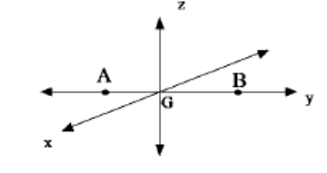

On distingue alors deux types d'éléments de symétrie : l'axe de la liaison $(Oy)$ qui est un axe de révolution et deux plans perpendiculaires contenant cet axe (les plans $xGy$ et $yGz$). Dans le cas des molécules homonucléaires $A_2$, $G$ est au centre de la liaison et devient un centre de symétrie.

Chaque OM est alors caractérisée par la manière dont elle se transforme sous l'action de ces éléments de symétrie.

- Une OM est alors caractérisée par la manière dont elle se transforme par rotation autour de l'axe de la liaison. C'est donc une caractéristique de toute orbitale dont l'axe de révolution est l'axe $Oy$.
- Une OM de symétrie $\pi_x$ est impaire par rapport au plan $yGz$

  $$
  \phi(-x, y, z) = -\phi(x, y, z)
  $$

- Une OM de symétrie $\pi_z$ est impaire par rapport au plan $xGy$

  $$
  \phi(x, y, -z) = -\phi(x, y, z)
  $$

Dans le cas homonucléaire, une OM de symétrie $g$ est invariante par le centre de symétrie

$$
\phi(-x, -y, -z) = \phi(x, y, z)
$$

Dans le cas homonucléaire, une OM de symétrie $u$ change de signe par le centre de symétrie

$$
\phi(-x, -y, -z) = -\phi(x, y, z)
$$

On distinguera alors

- pour les diatomiques $AB$ les OM de type : $\sigma$, $\pi_x$ et $\pi_z$ ;
- pour les diatomiques $A_2$ les OM de type : $\sigma_g$, $\sigma_u$, $\pi_{xg}$, $\pi_{xu}$, $\pi_{zg}$, $\pi_{zu}$.

Les propriétés de symétrie des OM imposent alors certaines règles de construction à partir des OA. Ainsi, pour former une OM de symétrie $\sigma$, on ne mélange que les $OA$ qui ont une symétrie de révolution autour de $Oy$ : les orbitales atomiques $s$ et $p_y$. Pour former une OM de symétrie $\pi_x$ ($\pi_z$), on ne mélange que les OA qui possèdent le même plan d'antisymétrie : les OA $p_x$ ($p_z$).

## Analyse de la formation des OM

### Représentation symbolique des OA

L'approximation LCAO permet de se faire rapidement une idée de l'allure des OM. Pour cela, une règle de représentation graphique qualitative est nécessaire. Il faut d'abord définir une convention de représentation des OA. On se limite ici aux OA des 2 premières couches. Les OA 1s et 2s sont de symétrie sphérique. Leurs propriétés d'interférence avec des OA voisines sont gouvernées par le signe de la partie externe de l'OA. On la choisit positive par convention. On utilise un cercle signé. Les 3 OA 2p réelles sont de symétrie axiale, composées de deux parties de signe opposé. Par convention, on affecte un référentiel cartésien similaire à chaque atome et la partie positive est dans la direction positive. On utilise la représentation à 2 lobes signés.

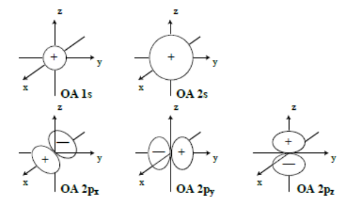

### Analyse des couplages et représentation des OM

Les différentes OM d'une molécule sont formées par un recouvrement des OA appartenant à chaque atome. La forme qualitative de ces OM nous révèle la nature constructive ou destructive du couplage entre les OA et, par conséquent, la nature liante ou antiliante de l'OM en question.

On a représenté ci-dessous, de manière schématique, les couplages entre paires d'OA (ex : orbitales s et/ou py) appartenant à deux atomes $A$ et $B$. On regarde donc dans une OM donnée la résultante (figure d'interférence) du couplage de deux OA.

**Remarque.** Pour simplifier, on considère, dans les exemples suivants, les coefficients LCAO égaux $|C_{pi}| = |C_{qi}|$.

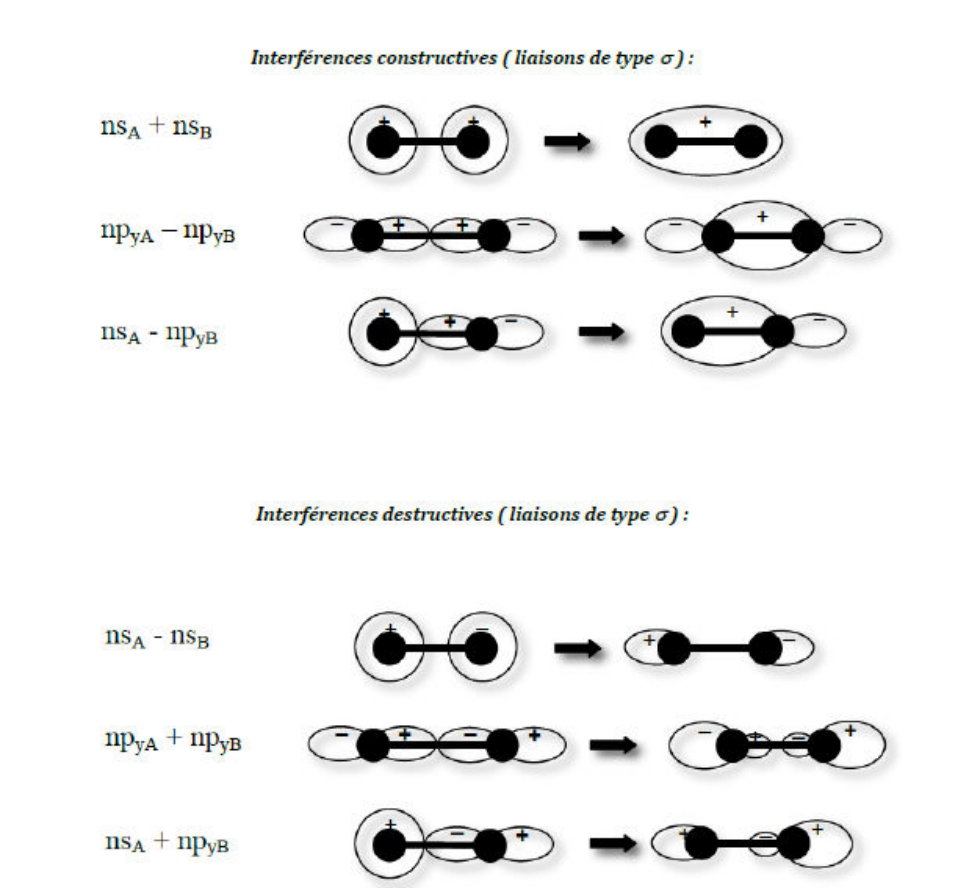

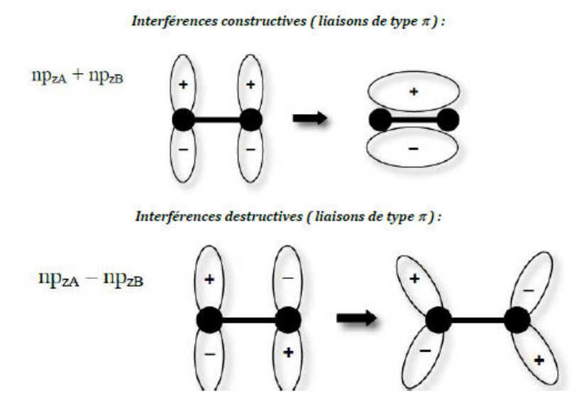

La nature liante ou antiliante d'une OM n'a pas rigoureusement de sens puisque c'est l'état multiélectronique qui est liant ou antiliant au vu de sa courbe d'énergie potentielle. Il n'en demeure pas moins que plus seront peuplées des OM pour lesquelles les couplages liants sont forts, plus l'état sera liant.

### Notion d'orbitales hybrides

Dans la méthode LCAO, les OM sont construites comme des combinaisons linéaires d'OA appartenant à l'atome A et d'OA appartenant à l'atome B, les deux atomes A et B formant la liaison moléculaire. Ainsi, si on se place du point de vue d'un atome (A ou B), écrire la décomposition de l'OM revient à considérer que les OA se mélangent pour former une nouvelle orbitale que l'on appellera "orbitale hybride". La notion d'hybridation ou d'orbitale hybride est très utilisée dans la description de la liaison chimique car elle permet de transcrire simplement les concepts de Lewis et Gillespie (forme et propriétés des molécules) en termes de structure électronique.

La combinaison des OA sur le même atome se traduit par un schéma de superposition des figures correspondantes. La multiplication d'une OA par un coefficient LCAO négatif inverse les signes. Les parties de même signe se confortent, celles de signe opposé s'annihilent pour former une combinaison hybride. Dans les exemples suivants, on illustre des combinaisons normées d'OA sur un même atome.

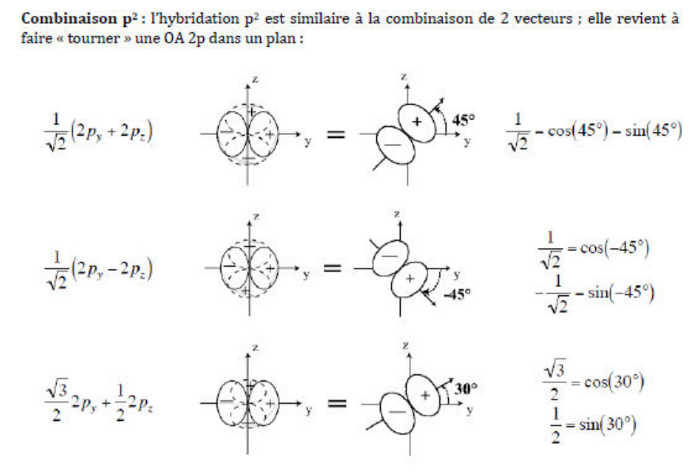

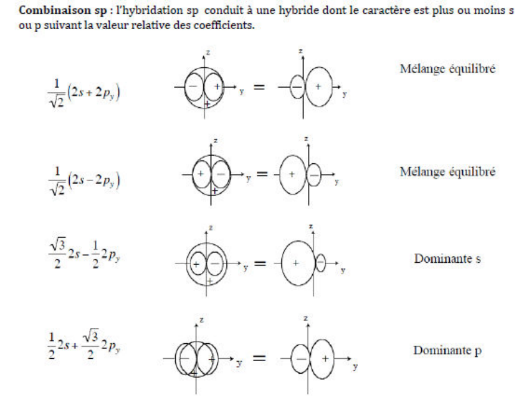

**Combinaison $sp^2$.** Elle est identique à l'hybridation $sp$, avec une OA $p$ non alignée sur les axes. On fait d'abord la combinaison $p^2$ puis on hybride avec l'OA $2s$. C'est une combinaison équilibrée d'une OA $2s$ et d'une hybride $p^2$.

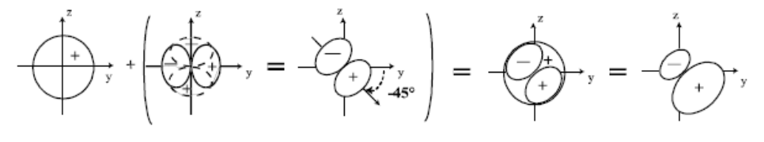

## Diagrammes de corrélation

Les diagrammes de corrélation portent l'énergie des OM et les relient aux niveaux d'énergie des OA qui les composent. En général, les OM liantes ont une énergie plus basse que celles des OA qui les composent et, inversement, les antiliantes ont une énergie plus haute. Les prédictions sont cependant plus délicates quand le caractère n'est que partiellement liant ou antiliant.

Pour les molécules hétéronucléaires, la dissymétrie des atomes a pour conséquence le couplage d'OA d'énergies différentes. Le couplage des OA (proportionnel au produit $C_{pi}C_{qi}$) est d'autant plus important que les énergies des OA sont proches.

Considérons deux OA $\chi_A$ et $\chi_B$ d'énergies $E_A$ et $E_B$ ($E_A < E_B$) ; elles forment deux OM $\phi$ et $\phi^*$ d'énergies $E$ et $E^*$ ($E < E^*$). On a : $E < E_A$ et $E^* > E_B$.

Si $|E_A - E_B|$ est grand, le couplage est peu intense. L'OM liante est alors peu stabilisée et l'OM antiliante peu déstabilisée. Le mélange des OA est faible, et les OM sont alors essentiellement les OA d'origine. Dans le cas contraire, où les OA ont des énergies voisines, les OM sont très différentes des OA de base.

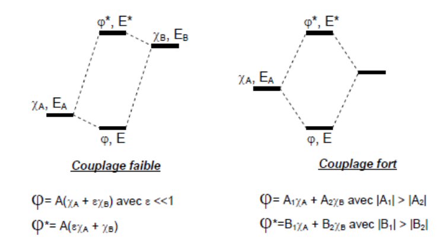

**Conséquences importantes.**

- Les OA 1s des atomes lourds (au-delà de la première période) ont une énergie beaucoup plus basse que celles des OA de valence ; elles ne se couplent pas aux OA de valence. Les cœurs atomiques ne sont donc pas affectés par la liaison chimique. Ceci est à la base de l'approximation qui consiste à séparer les électrons de cœur, qui ne participent pas à la liaison, des électrons de valence qui interviennent directement dans la formation de la liaison.
- Plus un coefficient d'OA dans une OM est grand, plus l'OM est proche en énergie de cette OA.
- L'effet de transfert de charge (effet inductif) entre deux atomes lors de la formation de liaison peut être prédit par l'analyse de la position relative des niveaux d'énergie des OA et des OM.

## Indice de liaison, charge partielle atomique

### Indice de liaison

On définit l'indice de liaison $D_{pq}$ entre deux OA appartenant respectivement aux atomes $A$ et $B$ par

$$
D_{pq} = \sum_{i=1}^{M} n_i C_{pi} C_{qi}
$$

- $i = 1, \dots, M$, où $M$ est le nombre total d'OM formées par l'association des atomes $A$ et $B$.
- $n_i$ est le nombre d'électrons appartenant à l'OM $i$.
- $C_{pi}$ est le coefficient LCAO relatif à l'OA $\chi_p$ dans l'expression de l'OM $i$.
- $C_{qi}$ est le coefficient LCAO relatif à l'OA $\chi_q$ dans l'expression de l'OM $i$.

Seules contribuent les OM simplement ou doublement occupées. Le caractère liant ou antiliant du couplage est donné par le signe du produit $D_{pq}\chi_p^*\chi_q$ :

- $D_{pq}\chi_p^*\chi_q > 0$ : caractère liant ;
- $D_{pq}\chi_p^*\chi_q < 0$ : caractère antiliant ;
- $D_{pq}\chi_p^*\chi_q \sim 0$ : caractère non liant.

$D_{pq}\chi_p^*\chi_q$ donne la contribution du recouvrement entre $\chi_p$ et $\chi_q$ à la densité électronique. Il est donc important de connaître le signe du recouvrement entre les deux OA.

### Charge partielle atomique

On définit la population moyenne $Q_p$ d'une OA $\chi_p$ par

$$
Q_p = D_{PP} = \sum_{i=1}^{M} n_i (C_{pi})^2
$$

On définit le nombre moyen d'électrons de l'atome $A$ ($B$) comme la somme des populations moyennes de ses OA

$$
n_A = \sum_{p \in A} Q_p = \sum_{p \in A} \sum_i n_i (C_{pi})^2
$$

La charge partielle de l'atome $A$ ($B$) dans la molécule est alors (en nombre d'électrons)

$$
\delta_A = Z_A - n_a
$$

Si $\delta_A < 0$, $A$ se charge négativement. C'est le signe que le nuage électronique de la molécule est déformé vers $A$. Si on regarde les coefficients LCAO des OM, on constate alors que les plus gros coefficients des OM liantes sont ceux affectés aux OA de l'atome $A$. Ce phénomène est donc lié au fait que les OA de $A$ ont des énergies plus basses que celles des OA de l'atome $B$. Cette différence dans l'énergie des OA est le reflet de la différence d'électronégativité des atomes : plus un atome est électronégatif, plus les énergies de ses orbitales sont basses.

## Molécules homonucléaires

On considère la molécule diatomique homonucléaire $O_2$. Dans la suite, on distinguera les deux atomes par les indices $A$ et $B$, en gardant à l'esprit que $A$ et $B$ réfèrent tous deux à un atome d'oxygène. On utilise les orbitales atomiques des couches occupées :

$$
1s_A, 1s_B, 2s_A, 2s_B, 2p_{xA}, 2p_{xB}, 2p_{yA}, 2p_{yB}, 2p_{zA}, 2p_{zB}
$$

Les OM $\sigma$ sont obtenues par combinaison linéaire des $1s$, $2s$ et $2p_y$. On doit donc obtenir 6 OM de type $\sigma$. De même, on obtient 2 OM $\pi_x$ et deux OM $\pi_z$. Les OA $1s$, $2s$ et $2p$ d'un même atome d'oxygène ayant des énergies très différentes, on considère dans un premier temps qu'elles ne se mélangent pas, et que les orbitales moléculaires peuvent être simulées par des combinaisons de deux orbitales atomiques (une sur chaque atome).

On obtient alors :

- deux OM $\sigma$ (une liante et une antiliante) formées par les deux OA $1s$ ;
- deux OM $\sigma$ (une liante et une antiliante) formées par les deux OA $2s$ ;
- deux OM $\sigma$ (une liante et une antiliante) formées par les deux OA $2p_y$ ;
- deux OM $\pi_x$ (une liante et une antiliante) formées par les deux OA $2p_x$ ;
- deux OM $\pi_z$ (une liante et une antiliante) formées par les deux OA $2p_z$.

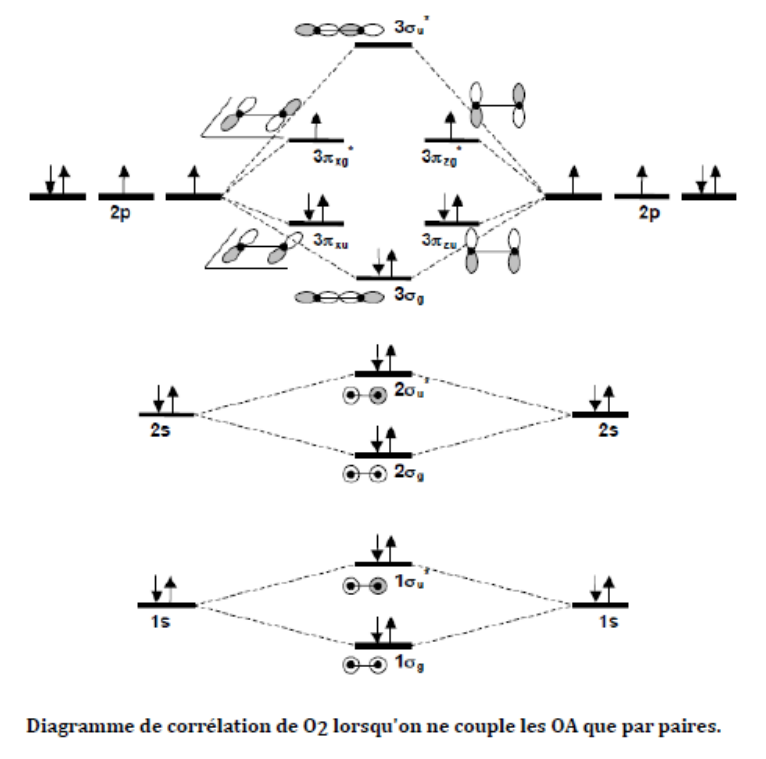

L'ordre énergétique que l'on obtient est le suivant

$$
1\sigma_g < 1\sigma_u^* < 2\sigma_g < 2\sigma_u^* < 3\sigma_g < \pi_{xu} = \pi_{zu} < \pi_{xg}^* = \pi_{zg}^* < 3\sigma_u^*
$$

La molécule contient 16 électrons, la configuration électronique de l'état fondamental est

$$
(1\sigma_g)^2, (1\sigma_u^*)^2, (2\sigma_g)^2, (2\sigma_u^*)^2, (3\sigma_g)^2, (\pi_{xu})^2, (\pi_{zu})^2, (\pi_{xg}^*)^1(\pi_{zg}^*)^1
$$

Les OM $\pi_{xg}^*$ et $\pi_{zg}^*$ sont simplement occupées : la molécule est paramagnétique. Le diagramme de corrélation est représenté ci-dessous.

| | Configuration électronique | D/P | ODL |
| --- | --- | --- | --- |
| $Li_2$ | $(1s_A)^2, (1s_B)^2, (2\sigma_g)^2$ | D | 1 |
| $Be_2$ | $(1s_A)^2, (1s_B)^2, (2\sigma_g)^2, (2\sigma_u)^2$ | - | 0 |
| $B_2$ | $(1s_A)^2, (1s_B)^2, (2\sigma_g)^2, (2\sigma_u)^2, (\pi_{xu})^1, (\pi_{zu})^1$ | P | 1 |
| $C_2$ | $(1s_A)^2, (1s_B)^2, (2\sigma_g)^2, (2\sigma_u)^2, (\pi_{xu})^2, (\pi_{zu})^2$ | D | 2 |
| $N_2$ | $(1s_A)^2, (1s_B)^2, (2\sigma_g)^2, (2\sigma_u)^2, (\pi_{xu})^2, (\pi_{zu})^2, (3\sigma_g)^2$ | D | 3 |
| $O_2$ | $(1s_A)^2, (1s_B)^2, (2\sigma_g)^2, (2\sigma_u)^2, (3\sigma_g)^2, (\pi_{xu})^2, (\pi_{zu})^2, (\pi_{xg}^*)^1(\pi_{zg}^*)^1$ | P | 2 |
| $F_2$ | $(1s_A)^2, (1s_B)^2, (2\sigma_g)^2, (2\sigma_u)^2, (3\sigma_g)^2, (\pi_{xu})^2, (\pi_{zu})^2, (\pi_{xg}^*)^2(\pi_{zg}^*)^2$ | D | 1 |
| $Ne_2$ | $(1s_A)^2, (1s_B)^2, (2\sigma_g)^2, (2\sigma_u)^2, (3\sigma_g)^2, (\pi_{xu})^2, (\pi_{zu})^2, (\pi_{xg}^*)^2(\pi_{zg}^*)^2, (3\sigma_u)^2$ | - | 0 |

Les OM $1\sigma_g$ et $1\sigma_u^*$ sont toutes deux doublement occupées ; il y a alors compensation des effets liants et antiliants. Ces OM ne participent donc pas à la liaison et forment les cœurs atomiques. On pourrait montrer que dans ce cas on peut remplacer ces deux OM par les deux OA $1s$ sans changer la fonction d'onde. Les OM $2\sigma_g$ et $2\sigma_u^*$ sont aussi toutes deux doublement occupées ; il y a aussi compensation des effets liants et antiliants ; ces OM ne participent donc pas non plus à la liaison : elles forment les doublets non liants. On pourrait également montrer que dans ce cas, d'après le principe d'invariance orbitalaire, on peut remplacer ces deux OM doublement occupées par les deux OA $2s$ doublement occupées sans changer la fonction d'onde. Ces orbitales $2s$ doublement occupées décrivent alors des doublets d'électrons non liants, et la configuration de $O_2$ peut donc s'écrire alternativement :

$$
(1s_A)^2, (1s_B)^2, (2s_A)^2, (2s_B)^2, (3\sigma_g)^2, (\pi_{xu})^2, (\pi_{zu})^2, (\pi_{xg}^*)^1(\pi_{zg}^*)^1
$$

Les configurations électroniques des molécules diatomiques homonucléaires de la seconde période sont reportées dans le tableau suivant, ainsi que le caractère dia- ou paramagnétique (D/P) de la molécule. La dernière colonne reporte l'ordre de liaison (ODL) pour chaque molécule, qui définit le nombre de liaisons covalentes par la formule suivante :

$$
ODL = \frac{\text{nombre d'électrons liants} - \text{nombre d'électrons antiliants}}{2}
$$

Les gaz rares ne forment pas de liaison covalente (ODL = 0 pour $Ne_2$ et $Be_2$). Leur couche de valence étant saturée, ils conduisent à peupler également les combinaisons liantes et antiliantes. Le béryllium ne forme pas non plus de liaison covalente pour la même raison.

Le bore et le carbone ne forment pas de liaisons triple et quadruple respectivement, comme le prédit le modèle simple de Lewis.

La triple liaison du diazote est décrite par l'occupation de trois OM liantes sans compensation par les OM antiliantes. Les deux OM non liantes doublement occupées décrivent les paires non liantes des atomes d'azote.

Contrairement au modèle de Lewis, le modèle des OM permet de prédire le paramagnétisme de $O_2$. $O_2$ est un diradical possédant deux électrons célibataires à spins parallèles.

## Molécules hétéronucléaires

Les diagrammes de corrélation se rapprochent des précédents. La dégénérescence des orbitales $\pi$ est conservée. La différence tient au fait que les OA de $A$ et $B$ n'ont pas la même énergie et la même extension spatiale. Les OM ne sont plus alors des mélanges équilibrés des OA de $A$ et $B$ : on rend alors compte de la différence d'électronégativité des atomes et d'un effet de transfert de charge ou effet inductif.

### Les hydrures

Dans le cas des hydrures de type AH, il faut mélanger l'orbitale $1s$ de l'hydrogène aux orbitales $2s$ et $2p_z$ de l'autre atome. On obtient alors trois combinaisons de symétrie $\sigma$. Les autres orbitales $2p$ restent purement atomiques. Elles sont dites non liantes. L'orbitale $1s$ de l'atome lourd est d'énergie suffisamment basse pour que l'on puisse négliger son interaction avec l'orbitale de l'hydrogène. C'est une orbitale de cœur, pratiquement insensible aux interactions intermoléculaires. Le diagramme de corrélation de la molécule $LiH$ est présenté ci-dessous. $H$ est plus électronégatif que $Li$ et son orbitale $1s$ est d'énergie plus basse que les orbitales de valence de $Li$. Dans la première OM ($1\sigma$), toutes les interactions sont liantes. Dans la dernière ($3\sigma$), elles sont toutes antiliantes. Dans la seconde ($2\sigma$), l'interaction $1s_H/2s_{Li}$ est antiliante, alors que l'interaction $1s_H/2p_{Li}$ est liante, ce qui confère à cette OM une nature quasi non liante, par compensation des effets. L'ordre de liaison est égal à 1, comme dans le modèle de Lewis.

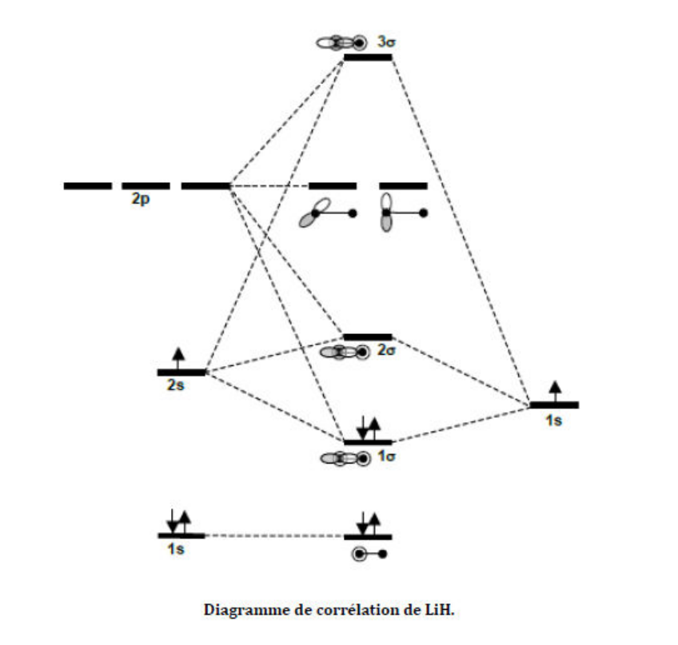

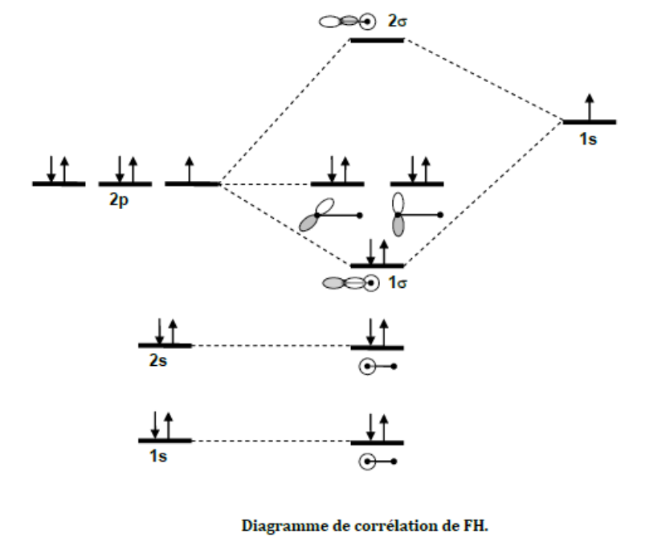
