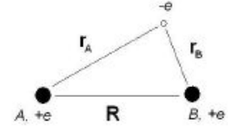
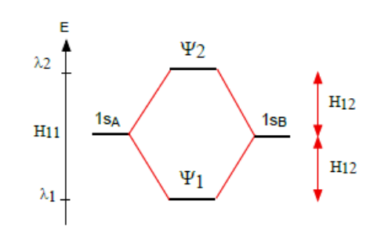
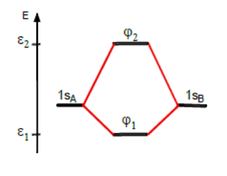
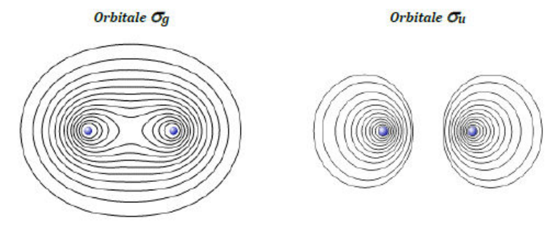
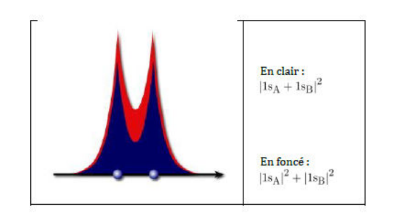
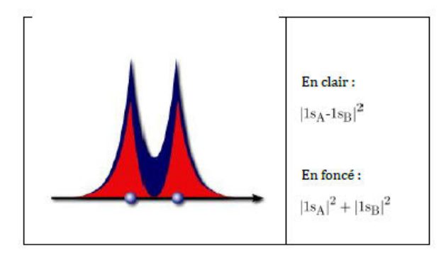
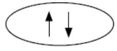
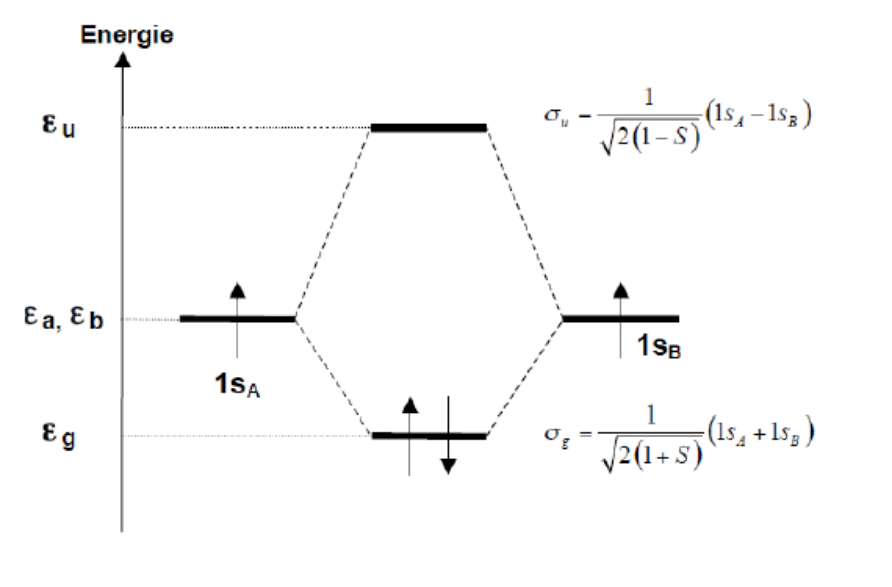

La molécule de dihydrogène $H_2$ est la plus simple des molécules covalentes puisqu'elle ne met en jeu qu'une liaison simple. La description quantique de cette liaison revient à décrire l'état quantique des deux électrons formant cette liaison. Ce chapitre présente le modèle des orbitales moléculaires (OM), qui permet de prédire la stabilité énergétique de cette molécule.

## L'approximation de Born-Oppenheimer

### Séparation des mouvements électroniques et nucléaires

S'il est relativement aisé par un changement de variable de s'affranchir du mouvement d'ensemble de translation de la molécule (3 degrés de liberté externes), les mouvements relatifs des noyaux ainsi que le mouvement de rotation sont formellement couplés aux mouvements des électrons. Mais si l'on considère que les électrons sont beaucoup plus rapides que les noyaux, on peut concevoir que le nuage électronique s'adapte instantanément à la géométrie moléculaire, ou autrement dit que les états stationnaires électroniques ont le temps de s'établir avant que les noyaux n'aient bougé suffisamment pour changer appréciablement l'environnement moléculaire.

Il est alors raisonnable de chercher la fonction d'onde de la molécule sous la forme d'un produit d'une fonction d'onde nucléaire et d'une fonction d'onde électronique, et de déterminer la fonction d'onde électronique dans le champ des noyaux fixes. C'est l'approximation de Born-Oppenheimer.

### Les hamiltoniens électronique et nucléaire

L'hamiltonien électronique s'écrit alors

$$
\mathbf{H}_{el} = -\frac{1}{2}\sum_{i=1}^{N} \Delta_i - \sum_{i=1}^{N} \sum_{p=1}^{M} \frac{Z_p}{r_{ip}} + \sum_{i=1}^{N} \sum_{j>i}^{N} \frac{1}{r_{ij}}
$$

La résolution de $\mathbf{H}_{el}\Psi_{el} = E_{el}\Psi_{el}$ pour chaque valeur de coordonnées nucléaires internes notées $Q$, pour simplifier, donne les fonctions $E_{el}(Q)$ pour chaque état électronique. L'opérateur associé $\mathbf{E}_{el}(Q)$ représente alors l'énergie potentielle d'interaction entre le nuage électronique et les noyaux. Il agit sur les fonctions d'onde nucléaires et intervient dans l'hamiltonien nucléaire.

$$
\mathbf{H}_{nuc} = \underbrace{\sum_{p=1}^{M} -\frac{m_e}{2m_p}\Delta_p}_{\text{termes cinétiques nucléaires}} + \underbrace{\underbrace{\sum_{p}^{M} \sum_{q>p}^{M} \frac{Z_p Z_q}{r_{pq}}}_{\text{termes de répulsion noyau-noyau}} + \mathbf{E}_{el}(Q)}_{\text{énergie potentielle totale } \mathbf{V}(Q)}
$$

La fonction $V(Q)$ associée à l'opérateur potentiel total est appelée surface d'énergie potentielle (courbe s'il n'y a qu'une variable nucléaire interne, hypersurface s'il y a plus de deux variables nucléaires) correspondant à un état électronique donné. Elle représente l'énergie potentielle de la molécule. Il est donc important pour l'obtenir de pouvoir calculer $E_{el}$ et la fonction d'onde électronique $\Psi_{el}$.

La résolution de $\mathbf{H}_{nuc}\Psi_{nuc} = E_{nuc}\Psi_{nuc}$ donne alors les niveaux d'énergie de vibration/rotation de la molécule.

Nous nous concentrerons dans ce cours sur l'équation de Schrödinger électronique. Les solutions exactes analytiques de cette équation sont inaccessibles et seules des solutions approchées sont envisageables. Pour cela, il faut définir a priori des formes acceptables de fonctions d'onde.

On distingue deux grands types de fonctions acceptables qui conduisent à deux méthodes bien distinctes : la méthode des orbitales moléculaires et la méthode des liaisons de valence. Nous aborderons dans ce cours la méthode des orbitales moléculaires dans le cadre de l'approximation LCAO (Linear Combination of Atomic Orbitals). Il s'agit d'une approximation qui consiste à exprimer les OM comme des combinaisons linéaires d'OA (orbitales atomiques).

## L'approximation LCAO : exemple de l'ion moléculaire H2+

### L'équation de Schrödinger électronique pour H2+

Considérons dans un premier temps le système moléculaire le plus simple ne possédant qu'un seul électron : l'ion $H_2^+$. L'opérateur hamiltonien électronique exprimé en unités atomiques s'exprime sous la forme suivante

$$
\mathbf{H} = -\frac{1}{2}\Delta - \frac{Z_A}{r_A} - \frac{Z_B}{r_B}
$$

Il traduit les effets cinétique et d'attraction coulombienne de l'électron par les deux noyaux d'hydrogène $A$ et $B$. Dans cette formule, $r_A$ et $r_B$ mesurent la distance entre l'électron et les noyaux.

L'équation de Schrödinger électronique s'écrit

$$
\mathbf{H}\phi_i = \epsilon_i\phi_i
$$

Les états quantiques $\phi_i$ qui décrivent l'électron sont appelés orbitales moléculaires (OM). Les OM sont dans les molécules les analogues des orbitales atomiques, à la différence qu'elles sont délocalisées sur plusieurs noyaux, qu'elles enveloppent pour former le nuage électronique de la molécule. À chaque orbitale moléculaire $\phi_i$ correspond une énergie $\epsilon_i$.

### Construction des OM de H2+ : méthode LCAO

L'approximation LCAO repose sur la considération suivante : si on dissocie l'ion $H_2^+$ ($R$ tend vers l'infini), l'électron se situera soit au voisinage du proton $A$ ($R_B$ tend vers l'infini), soit au voisinage du proton $B$ ($R_A$ tend vers l'infini). Les solutions exactes de l'équation de Schrödinger électronique pour ces deux cas limites sont donc soit la fonction hydrogénoïde centrée sur $A$ ($1s_A$), soit la fonction centrée sur $B$ ($1s_B$). Pour des distances intermédiaires, l'approximation LCAO pose que les états électroniques sont des combinaisons linéaires de ces deux solutions. On écrit les orbitales moléculaires comme des combinaisons linéaires d'orbitales atomiques

$$
\phi = C_A 1s_A + C_B 1s_B
$$

La détermination des OM de l'ion $H_2^+$ se résume donc à la détermination variationnelle des deux coefficients $C_A$ et $C_B$. Lorsque les fonctions approchées sont des combinaisons linéaires de fonctions connues et que les paramètres variationnels sont exclusivement les coefficients des combinaisons linéaires, on peut rationaliser la démarche variationnelle sous une forme simple, appelée méthode des variations linéaires.

## Méthode des variations linéaires

### Les variations linéaires : méthode des multiplicateurs de Lagrange

Considérons une équation aux valeurs propres insoluble de la forme

$$
\mathbf{H}\Psi = E\Psi
$$

$\mathbf{H}$ est un opérateur hermitique. On cherche une solution approchée $\Psi$ sous forme de combinaison linéaire normée de $M$ fonctions connues $\Omega_i$

$$
\Psi = \sum_{i=1}^{M} c_i\Omega_i
$$

Les $\Omega_i$ sont normées mais non orthogonales

$$
\int \Omega_i^*\Omega_i \, dV = S_{ii} = 1
$$

$$
\int \Omega_i^*\Omega_j \, dV = S_{ij} \neq 0
$$

La norme de la fonction modèle est

$$
\int \Psi^*\Psi \, dV = \sum_i c_i^* c_i S_{ii} + \sum_{i \neq j} \sum c_i^* c_j S_{ij} = 1
$$

On note

$$
\int \Omega_i^* \mathbf{H} \Omega_j \, dV = H_{ij}
$$

L'hermiticité de $\mathbf{H}$ se traduit par les égalités

$$
H_{ij}^* = H_{ji}
$$

L'énergie moyenne est décomposable

$$
\langle E \rangle = \int \Psi^* \mathbf{H} \Psi \, dV = \sum_i c_i^* c_i H_{ii} + \sum_{i \neq j} \sum c_i^* c_j H_{ij}
$$

Travaillant avec une fonction qui peut varier par ses paramètres variationnels, on doit veiller à ce qu'elle soit toujours normée. La contrainte de normalisation (écrite plus haut) de $\Psi$ peut s'écrire

$$
1 - \int \Psi^*\Psi \, dV = 1 - \Big(\sum_i c_i^* c_i S_{ii} + \sum_{i \neq j} \sum c_i^* c_j S_{ij}\Big) = 0
$$

Pour trouver le minimum de $\langle E \rangle$ sous contrainte de normalisation, on utilise la méthode des multiplicateurs de Lagrange. Le lagrangien s'écrit alors

$$
L = \langle E \rangle + \lambda\Big[1 - \Big(\sum_i c_i^* c_i + \sum_{i \neq j} \sum c_i^* c_j S_{ij}\Big)\Big]
$$

où $\lambda$ est le multiplicateur de Lagrange.

C'est l'énergie augmentée de la contrainte, qui est nulle si elle est vérifiée. On peut alors minimiser $L$ sans contrainte pour obtenir l'énergie minimale sous la contrainte de normalisation de $\Psi$. On se contente en fait de rechercher un extremum

$$
\frac{\partial L}{\partial c_k} = 0 \ \forall k \quad \text{et} \quad \frac{\partial L}{\partial c_l^*} = 0 \ \forall l
$$

Dans toutes les expressions, il faut considérer que les coefficients et leurs complexes conjugués sont des variables distinctes.

Pour $M$ fonctions de base, on obtient donc deux ensembles de $M$ équations de la forme

$$
c_k^* H_{kk} + \sum_{i \neq k} c_i^* H_{ik} - \lambda\Big(c_k^* S_{kk} + \sum_{i \neq k} c_i^* S_{ik}\Big) = 0 \ \forall k
$$

$$
c_l H_{ll} + \sum_{j \neq l} c_j H_{lj} - \lambda\Big(c_l S_{ll} + \sum_{j \neq l} c_j S_{lj}\Big) = 0 \ \forall l
$$

Ces deux systèmes sont conjugués l'un de l'autre car

$$
H_{ij}^* = H_{ji} \ \forall i, j \qquad S_{ij}^* = S_{ji} \ \forall i, j
$$

On n'obtient donc que $M$ équations, que l'on peut représenter sous la forme matricielle suivante

$$
HC = \lambda SC
$$

La résolution de l'équation aux valeurs propres se transforme donc en celle d'une équation matricielle dans laquelle tous les éléments de matrice sont des intégrales. Comme les matrices sont de dimension $M \times M$, on obtient en fait $M$ solutions distinctes, c'est-à-dire $M$ vecteurs $C$ associés à $M$ valeurs distinctes de $\lambda$.

Les $H_{ij}$ avec $i \neq j$ sont assimilés aux énergies d'interaction entre les fonctions $\Omega_i$ et $\Omega_j$.

Les $H_{ii}$ sont assimilés aux énergies des fonctions $\Omega_i$.

Les vecteurs $C$ décrivent les différents états quantiques, combinaisons linéaires des fonctions de base $\Omega_i$. À chaque vecteur solution $C_n$ on associe son énergie $\lambda_n$. Les $\lambda_n$ sont les énergies des états quantiques ; ce sont ces valeurs qu'il faut mettre en rapport avec les énergies mesurables. Les $H_{ij}$ sont, elles, des intermédiaires de calcul ; elles ne correspondent généralement pas à des grandeurs mesurables.

### Application simple : le cas de deux fonctions dégénérées et orthogonales

On choisit le cas $M = 2$ et des fonctions de base réelles. Pour simplifier, on néglige le recouvrement entre les fonctions $\Omega_1$ et $\Omega_2$. On considère en plus que les énergies de ces deux fonctions sont égales : $\mathbf{H}_{11} = \mathbf{H}_{22}$. On prend l'énergie d'interaction $H_{12}$ négative.

L'équation matricielle peut alors s'écrire $HC = \lambda SC$, soit plus explicitement

$$
\begin{pmatrix} H_{11} & H_{12} \\ H_{12} & H_{11} \end{pmatrix} \begin{pmatrix} c_1 \\ c_2 \end{pmatrix} = \lambda \begin{pmatrix} c_1 \\ c_2 \end{pmatrix}
$$

Cette équation admet des solutions non triviales si

$$
\begin{vmatrix} H_{11} - \lambda & H_{12} \\ H_{12} & H_{11} - \lambda \end{vmatrix} = 0
$$

On obtient alors une équation du second degré en $\lambda$

$$
(H_{11} - \lambda)^2 - H_{12}^2 = 0 = (H_{11} + H_{12} - \lambda)(H_{11} - H_{12} - \lambda)
$$

Les deux solutions correspondent à

$$
\lambda_1 = H_{11} + H_{12}
$$

$$
\lambda_2 = H_{11} - H_{12}
$$

L'énergie d'interaction stabilise le premier état de $H_{12}$ par rapport à l'énergie $H_{11}$ de $\Omega_1$ et $\Omega_2$. Elle déstabilise le dernier état de $H_{12}$. On représente alors ces évolutions énergétiques sous la forme d'un diagramme de corrélation. On porte les niveaux d'énergie des fonctions de base de part et d'autre de la figure, les niveaux d'énergie des états quantiques au milieu, et on relie ces derniers aux niveaux des fonctions qui les composent.

## Étude complète de l'ion H2+

### Équation matricielle

Dans le cas de l'ion $\mathbf{H}_2^+$, la fonction d'onde modèle est une orbitale moléculaire. On la choisit comme une combinaison linéaire des 2 orbitales atomiques $1s$, supposées connues, des deux hydrogènes notés $A$ et $B$. On écrit alors

$$
\phi = c_A 1s_A + c_b 1s_B
$$

Compte tenu de l'équivalence des hydrogènes, $H_{AA} = H_{BB}$ et l'équation matricielle s'écrit alors

$$
\begin{pmatrix} H_{AA} & H_{AB} \\ H_{AB} & H_{AA} \end{pmatrix} \begin{pmatrix} c_A \\ c_B \end{pmatrix} = \epsilon \begin{pmatrix} 1 & S \\ S & 1 \end{pmatrix} \begin{pmatrix} c_A \\ c_B \end{pmatrix}
$$

### Sens physique des différentes intégrales

Différents types d'intégrales interviennent dans les équations matricielles :

**Les intégrales de recouvrement.**

$$
S = \int 1s_A 1s_B \, dV = \int 1s_B 1s_A \, dV
$$

Cette intégrale donne une mesure de l'interpénétration des deux orbitales atomiques.

Quand les deux atomes sont très éloignés, les deux nuages atomiques sont suffisamment séparés pour qu'on puisse négliger leur recouvrement. L'intégrale de recouvrement est nulle, car les deux fonctions $1s$ ne sont jamais simultanément non nulles.

Quand les atomes se rapprochent, les deux orbitales atomiques prennent des valeurs simultanément non nulles dans la zone de liaison autour du centre de la molécule. Dans la limite de fusion des deux noyaux ($R = 0$), les deux orbitales deviennent identiques et l'intégrale de recouvrement devient égale à une intégrale de normalisation ($S = 1$).

**Les éléments diagonaux de la matrice hamiltonienne.**

$$
H_{AA} = \int 1s_A \mathbf{h} 1s_A \, dV
$$

$$
H_{BB} = \int 1s_B \mathbf{h} 1s_B \, dV
$$

Le terme $H_{AA}$ ($H_{BB}$) est associé à l'énergie de l'orbitale atomique $1s_A$ ($1s_B$) dans la molécule. Dans le cas de l'ion moléculaire $H_2^+$, ces deux termes sont égaux par symétrie. En décomposant ces intégrales suivant les différents termes, on obtient :

$$
\begin{aligned}
H_{AA} &= \int 1s_A\Big(-\frac{1}{2}\Delta - \frac{Z_A}{r_A}\Big)1s_A \, dV - \int 1s_A\Big(\frac{Z_B}{r_B}\Big)1s_A \, dV = E_A + V_{AB} \\
H_{BB} &= \int 1s_B\Big(-\frac{1}{2}\Delta - \frac{Z_B}{r_B}\Big)1s_B \, dV - \int 1s_B\Big(\frac{Z_A}{r_A}\Big)1s_B \, dV = E_B + V_{BA}
\end{aligned}
$$

Ici $E_A = E_B$ est l'énergie d'un atome $H$ isolé ($-13{,}6\ \text{eV}$). $V_{AB} = V_{BA}$ représente l'énergie d'attraction classique ($< 0$) d'une distribution de charge correspondant au nuage électronique $1s$ d'un atome par le noyau de l'autre atome ; mais ce terme n'est pas assez important pour contrebalancer la répulsion des deux noyaux.

**Les éléments extra-diagonaux de la matrice hamiltonienne.**

$$
H_{AB} = H_{BA} = \int 1s_A\Big(-\frac{1}{2}\Delta - \frac{Z_A}{r_A} - \frac{Z_B}{r_B}\Big)1s_B \, dV = \int 1s_B\Big(-\frac{1}{2}\Delta - \frac{Z_A}{r_A} - \frac{Z_B}{r_B}\Big)1s_A \, dV = \beta
$$

$\beta$ est un terme d'interaction qui n'a pas d'équivalent classique et qui exprime l'énergie d'une distribution électronique mixte $1s_A, 1s_B$ dans le champ moléculaire. Il dépend essentiellement du recouvrement des orbitales atomiques et est de signe inverse (plus $S$ est grand et positif, plus $\beta$ est négatif) ; c'est ce terme qui stabilise la liaison chimique.

### Détermination des niveaux d'énergie

En appliquant la méthode des variations linéaires, les états quantiques électroniques et les niveaux d'énergie associés sont solutions du système d'équations pouvant s'écrire sous forme matricielle

$$
\begin{pmatrix} h_{AA} & \beta \\ \beta & h_{BB} \end{pmatrix} \begin{pmatrix} C_A \\ C_B \end{pmatrix} = \epsilon \begin{pmatrix} 1 & S \\ S & 1 \end{pmatrix} \begin{pmatrix} C_A \\ C_B \end{pmatrix}
$$

Avec $h_{AA} = E_A + V_{AB}$, on obtient

$$
\begin{pmatrix} E_A + V_{AB} - \epsilon & \beta - \epsilon S \\ \beta - \epsilon S & E_B + V_{BA} - \epsilon \end{pmatrix} \begin{pmatrix} C_A \\ C_B \end{pmatrix} = 0
$$

Le système d'équations

$$
\begin{cases} C_A(E_A + V_{AB} - \epsilon) + C_B(\beta - \epsilon S) = 0 \\ C_A(\beta - \epsilon S) + C_B(E_B + V_{BA} - \epsilon) = 0 \end{cases}
$$

Il faut donc résoudre l'équation du second degré

$$
(E_A + V_{AB} - \epsilon) \cdot (E_B + V_{BA} - \epsilon) - (\beta - \epsilon S)^2 = 0
$$

On obtient les deux niveaux d'énergie électronique

$$
\epsilon_1 = \frac{E_A + E_B + 2V_{AB} + 2\beta}{2(1 + S)} \quad \text{et} \quad \epsilon_2 = \frac{E_A + E_B + 2V_{AB} - 2\beta}{2(1 - S)}
$$

### Énergie potentielle moléculaire

$\epsilon_1$ et $\epsilon_2$ dépendent paramétriquement de la distance internucléaire $R$. L'énergie potentielle moléculaire est obtenue en ajoutant la répulsion internucléaire. On obtient donc deux courbes distinctes d'énergie potentielle

$$
V_1(R) = \epsilon_1(R) + \frac{1}{R} \quad \text{et} \quad V_2(R) = \epsilon_2(R) + \frac{1}{R}
$$

Le signe négatif de $\beta$ entraîne que l'état de plus basse énergie est l'état 1. On obtient en outre que l'énergie $\epsilon_1$ est plus basse que l'énergie d'un atome isolé et d'un proton. On en conclut donc que $H_2^+$ est plus stable que $H + H^+$, et que c'est le recouvrement positif des orbitales atomiques qui est à l'origine de cette stabilisation.

**Courbes d'énergie potentielle.** Pour l'état 1, la diminution de la répulsion internucléaire par l'écran électronique conduit à l'apparition d'un minimum de $V(R)$. On s'attend alors à ce que cet état soit liant.

Pour l'état 2, l'augmentation de la répulsion internucléaire conduit à une augmentation de l'énergie totale. Cet état est de type dissociatif. La courbe d'énergie potentielle ne présente pas de minimum.

### Détermination des coefficients LCAO

Le système d'équations séculaires fournit pour chaque niveau d'énergie une relation entre les coefficients LCAO :

- avec $\epsilon = \epsilon_1$, on obtient $C_A = C_B$ ;
- avec $\epsilon = \epsilon_2$, on obtient $C_A = -C_B$.

La relation de normalisation des OM fixe la valeur des coefficients

$$
\int |C_A 1s_A + C_B 1s_B|^2 \, dV = C_A^2 + C_B^2 + 2C_A C_B S = 1
$$

On obtient finalement deux solutions de la forme

$$
\phi_1 = \frac{1}{\sqrt{2(1 + S)}}(1s_A + 1s_B) \quad \text{et} \quad \phi_2 = \frac{1}{\sqrt{2(1 - S)}}(1s_A - 1s_B)
$$

Le fait que les coefficients soient égaux ou opposés résulte de la symétrie de la matrice hamiltonienne qui ne fait qu'exprimer la symétrie du problème : si on intervertit $A$ et $B$, on ne change pas la molécule. Le diagramme de corrélation n'est cependant pas symétrique : l'état $\phi_2$ est plus déstabilisé que l'état $\phi_1$ n'est stabilisé. C'est dû à un effet du recouvrement des orbitales atomiques.

### Quelques éléments sur la symétrie des OM

Comme dans les atomes, les orbitales servant à bâtir la structure électronique des molécules doivent respecter certaines règles de symétrie. Ces règles sont dictées par les différents éléments de symétrie de la molécule. Dans l'ion $H_2^+$, on distingue l'axe de la liaison qui constitue un axe de révolution. On considère aussi que les deux atomes s'échangent par un centre de symétrie.

Les deux orbitales $1s_A$ et $1s_B$ possèdent en commun l'axe de révolution. Une combinaison linéaire quelconque de ces deux orbitales doit également posséder cet axe de révolution. Les deux OM $\phi_1$ et $\phi_2$ vérifient bien cette condition : elles sont toutes deux invariantes par une rotation quelconque autour de l'axe de la liaison. Ces OM sont dites de symétrie $\sigma$.

De plus, les orbitales $1s_A$ et $1s_B$ s'échangent par un centre d'inversion :

$$
1s_A \to 1s_B
$$

$$
1s_B \to 1s_A
$$

Les combinaisons linéaires de ces orbitales doivent refléter cette possibilité d'échange. Les seules combinaisons possibles sont la combinaison symétrique (invariante) et la combinaison antisymétrique (qui change de signe) lors de l'opération d'inversion. Les OM $\phi_1$ et $\phi_2$ vérifient bien cette propriété

$$
\phi_1(1s_A, 1s_B) = \phi_1(1s_B, 1s_A)
$$

$$
\phi_2(1s_A, 1s_B) = -\phi_2(1s_B, 1s_A)
$$

L'OM $\phi_1$ (symétrique par rapport au centre de symétrie de la molécule) est dite de symétrie $g$. L'OM $\phi_2$ est dite de symétrie $u$. Les deux OM de l'ion $H_2^+$ sont donc notées $\sigma_g$ et $\sigma_u$.

Ces étiquettes de symétrie sont le pendant moléculaire de celles utilisées pour les atomes (orbitales $s, p, d, f, \dots$). Les figures suivantes présentent plusieurs représentations possibles des deux OM $\sigma_g$ et $\sigma_u$.

### Représentation des OM

On utilise des représentations similaires à celles employées pour les atomes, telles que la représentation de courbes et de surfaces d'isovaleurs ou d'isodensité. On a représenté ci-contre les courbes d'isovaleurs des orbitales $\sigma_g$ et $\sigma_u$ dans un plan contenant les deux noyaux.

Comme pour les OA, il est plus intéressant de représenter la densité de probabilité $|\phi|^2$, reliée à la densité du nuage électronique représentant l'électron, plutôt que l'orbitale $\phi$ elle-même. On conserve l'information relative au signe des différents lobes de l'orbitale en utilisant différentes couleurs.

### Origine ondulatoire de la liaison chimique

L'effet de recouvrement entre les deux fonctions d'onde atomiques conduit à des effets d'interférences qui illustrent l'importance de la nature ondulatoire de l'électron.

**Orbitale moléculaire $\sigma_g$.** On a représenté ci-dessous $|1s_A + 1s_B|^2$ (c'est-à-dire la densité du nuage électronique à une constante multiplicative près) le long de l'axe de la liaison. Sur la même figure, on a également porté la somme des densités atomiques ($|1s_A|^2 + |1s_B|^2$).

On remarque que la densité électronique sur la liaison est supérieure à la simple somme des densités atomiques. En effet, il vient

$$
|1s_A + 1s_B|^2 = |1s_A|^2 + |1s_B|^2 + 2 \cdot 1s_A \cdot 1s_B > |1s_A|^2 + |1s_B|^2
$$

La formation de l'OM $\sigma_g$ conduit donc à une accumulation du nuage électronique entre les deux noyaux. C'est le signe d'une interférence constructive entre les fonctions d'onde atomiques. Il y a en conséquence une forte densité électronique entre les atomes, qui contribue à assurer la cohésion de la molécule en écrantant la répulsion entre les deux noyaux : la partie du nuage électronique située entre les noyaux exerce une attraction sur ces noyaux et s'oppose donc à leur répulsion mutuelle.

L'orbitale moléculaire $\sigma_g$ est dite liante.

**Orbitale moléculaire $\sigma_u$.** Dans l'orbitale antisymétrique $\sigma_u$, les interférences dues au recouvrement des deux $OA$ sont destructives. Ceci est dû au fait que l'on fait interférer deux "ondes atomiques" de signes opposés.

$$
|1s_A - 1s_B|^2 = |1s_A|^2 + |1s_B|^2 - 2 \cdot 1s_A \cdot 1s_B < |1s_A|^2 + |1s_B|^2
$$

La densité du nuage électronique s'appauvrit entre les deux noyaux et la répulsion nucléaire est amplifiée. L'énergie doit donc bien être supérieure à celle de l'état $\sigma_g$. L'orbitale moléculaire $\sigma_u$ est dite "antiliante".

## La molécule H2 dans le modèle LCAO

Si on développe les OM de l'hydrogène sur la base $1s_A$ et $1s_B$, pour des raisons de symétrie, on obtient les mêmes OM que pour l'ion moléculaire $H_2^+$. La configuration électronique fondamentale est alors $\sigma_g^2$, correspondant à l'occupation de l'OM liante par deux électrons de spins opposés

$$
\Psi_0 = |\sigma_g\alpha\sigma_g\beta|
$$

Les deux électrons fournis par les atomes d'hydrogène se retrouvent donc sur la première orbitale moléculaire $\sigma_g$. L'OM antiliante $\sigma_u$ reste vide.

C'est une illustration quantique de la liaison chimique vue comme une mise en commun de deux électrons par les atomes constituant la molécule. Dans la méthode des orbitales moléculaires, les deux électrons participant à la liaison partagent la même orbitale liante.

La liaison covalente est symbolisée par le diagramme de corrélation représenté ci-dessous. À partir des deux OA des atomes séparés décrivant chacune un électron, on forme une OM liante de plus basse énergie qui décrit les deux électrons dans la molécule.

Les états excités sont construits en promouvant les électrons sur l'orbitale antiliante $\sigma_u$. Ils sont formés comme combinaisons linéaires des cinq déterminants "excités"

$$
\Psi_1 = |\sigma_g\alpha\sigma_u\beta| \quad \Psi_2 = |\sigma_g\alpha\sigma_u\alpha| \quad \Psi_3 = |\sigma_g\beta\sigma_u\alpha| \quad \Psi_4 = |\sigma_g\beta\sigma_u\beta| \quad \Psi_5 = |\sigma_u\alpha\sigma_u\beta|
$$
