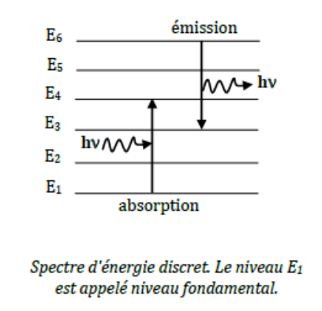

Ce chapitre a pour but de rappeler quelques notions de mécanique quantique importantes pour la compréhension de la structure de la matière et de la stabilité des édifices atomiques et moléculaires.

À la fin du 19e siècle, les deux piliers de la physique que constituent la mécanique et l'électromagnétisme semblaient capables de rationaliser l'ensemble des lois de la nature. Cependant, l'examen critique des phénomènes liés à l'interaction entre la matière et un rayonnement électromagnétique fit apparaître la nécessité de remettre en cause cet édifice. L'analyse de plusieurs expériences (rayonnement du corps noir, effet photoélectrique, expériences de diffraction d'électrons ou de neutrons...) a mis en évidence le fait que les particules élémentaires ne se conforment pas aux lois de la mécanique classique, et se manifestent parfois selon des lois similaires à celles qui régissent les ondes. À l'opposé, les ondes lumineuses se manifestent aussi sous forme corpusculaire. Ces phénomènes sont à l'origine de la révolution de la physique au début du siècle, et sont décrits par les relations de dualité onde-corpuscule.

Nous avons vu qu'il n'est pas possible de déterminer exactement la trajectoire des particules. On peut cependant accéder à la probabilité de trouver le système en un point donné de l'espace. Cet aspect probabiliste de la théorie quantique conduit à une formulation mathématique totalement différente de celle de la mécanique déterministe de Newton. Au lieu de parler de la position des particules, on introduit une fonction de distribution de leurs positions possibles : la fonction d'onde. Cette fonction d'onde est une fonction de probabilité qui représente en quelque sorte la généralisation de la notion d'onde aux particules matérielles. Elle est définie dans le premier postulat de la mécanique quantique.

## La fonction d'onde

L'état dynamique d'une particule quantique est défini par la donnée d'une fonction "convenable" de ses coordonnées ainsi que du temps :

$$
\Psi(x, y, z, t)
$$

$$
\Psi \ \text{est appelée fonction d'onde du système}
$$

On entend par fonction convenable une fonction continue ainsi que sa dérivée première et donc le carré du module $|\Psi|^2 = \Psi^*\Psi$ est intégrable. De manière générale, $\Psi$ est une fonction complexe et $\Psi^*$ est la fonction complexe conjuguée de $\Psi$. Pratiquement, on se ramène toujours à n'utiliser que des fonctions réelles. Dans ce cas, $\Psi^* = \Psi$.

Il n'est pas possible d'obtenir d'autres renseignements sur le système que ceux contenus dans la fonction d'onde.

**Interprétation de la fonction d'onde.** La fonction d'onde n'a pas de sens physique en elle-même. Elle permet d'accéder à la probabilité de présence de particules en tout point de l'espace. On interprète le module au carré de la fonction d'onde comme la densité de probabilité de présence (probabilité de présence par unité de volume) de la particule ponctuelle au point $M(x, y, z)$ à l'instant $t$ :

$$
|\Psi|^2 = \frac{dP}{dV}
$$

C'est une propriété ponctuelle. En chaque point de l'espace, on peut calculer cette densité volumique à partir de l'expression de la fonction d'onde. $dV$ peut être associé à un élément de volume infinitésimal. La probabilité de présence élémentaire $dP$ de la particule à l'intérieur de ce volume $dV$ est :

$$
dP = |\Psi|^2 dV
$$

La probabilité de présence dans un volume donné fini $V$ est donnée par l'intégrale sur tout le volume :

$$
P = \int_V |\Psi|^2 \cdot dV = 1 \quad \text{par condition de normalisation}
$$

## Second postulat : les grandeurs physiques

Le fait que l'on ne puisse plus définir à chaque instant la position et la vitesse de la particule conduit à une nouvelle manière d'appréhender les grandeurs physiques telles que moment cinétique, énergies cinétique et potentielle, etc. On ne peut alors plus considérer que ce sont des fonctions de la position et de la vitesse. La théorie quantique fait apparaître deux concepts liés aux grandeurs physiques : celui des opérateurs décrivant les grandeurs physiques et celui des valeurs propres associées à ces opérateurs.

**Notion d'opérateur.** Un opérateur est un objet mathématique qui agit sur une fonction et la transforme en une autre fonction. On note conventionnellement les opérateurs par un accent circonflexe (ou en gras). L'opérateur $\mathbf{G}$ transforme une fonction portée à sa droite :

$$
\mathbf{G}\Psi = \Psi'
$$

On distingue plusieurs types d'opérateurs :

- **Les opérateurs différentiels.** $\mathbf{G} = \dfrac{\partial}{\partial x}$ soit $\mathbf{G}\Psi = \dfrac{\partial\Psi}{\partial x}$
- **Les opérateurs multiplicatifs.** $\mathbf{G} = \frac{1}{2}kx^2$ soit $\mathbf{G}\Psi = \frac{1}{2}kx^2\Psi$
- **Les opérateurs vectoriels.** $\mathbf{G}\Psi = \dfrac{\partial\Psi}{\partial x}\vec i + \dfrac{\partial\Psi}{\partial y}\vec j + \dfrac{\partial\Psi}{\partial z}\vec k$

**Propriétés des opérateurs.**

**Produit de deux opérateurs.** L'action du produit $\mathbf{G} \cdot \mathbf{F}$ de deux opérateurs $\mathbf{G}$ et $\mathbf{F}$ sur une fonction $\Psi$ s'obtient en faisant agir $\mathbf{F}$ puis $\mathbf{G}$ :

$$
\mathbf{G} \cdot \mathbf{F}\Psi = \mathbf{G}(\mathbf{F} \cdot \Psi)
$$

**Somme de deux opérateurs.** L'action de la somme $\mathbf{G} + \mathbf{F}$ de deux opérateurs $\mathbf{G}$ et $\mathbf{F}$ sur une fonction $\Psi$ s'obtient comme :

$$
(\mathbf{G} + \mathbf{F})\Psi = \mathbf{G}\Psi + \mathbf{F}\Psi
$$

**Hermiticité.** L'opérateur $\mathbf{G}$ est hermitien si l'égalité suivante est vérifiée :

$$
\int \Psi_1^* \mathbf{G} \Psi_2 \, dV = \Big(\int \Psi_2^* \mathbf{G} \Psi_1 \, dV\Big)^* \quad \forall \Psi_1, \Psi_2
$$

**Opérateurs décrivant une grandeur physique (principe de correspondance).** Toute grandeur physique mesurable $G$ est décrite par un opérateur $\mathbf{G}$ agissant sur la fonction d'onde $\Psi$.

Principe de construction des opérateurs associés aux grandeurs physiques : on exprime la grandeur classique en fonction de la position et de la quantité de mouvement. Les expressions classiques de la position et de la quantité de mouvement sont ensuite remplacées par les opérateurs correspondants de la manière suivante :

| Variable dynamique | Opérateur |
| --- | --- |
| $x, y, z$ | $x, y, z$ |
| $p_{(x, y, z)} = mV$ | $-i\hbar\dfrac{\partial}{\partial(x, y, z)}$ |
| $t$ | $t$ |

L'expression classique de l'énergie cinétique d'une particule de masse $m$ est donnée par

$$
E_c = \frac{1}{2}mv^2 = \frac{p^2}{2m} = \frac{1}{2m}(p_x^2 + p_y^2 + p_z^2)
$$

L'opérateur correspondant s'écrit :

$$
\mathbf{T} = -\frac{\hbar^2}{2m}\Big(\frac{\partial^2}{\partial x^2} + \frac{\partial^2}{\partial y^2} + \frac{\partial^2}{\partial z^2}\Big) = -\frac{\hbar^2}{2m}\Delta
$$

L'opérateur différentiel $\Delta$ est appelé opérateur laplacien.

## Le postulat de la mesure

En mécanique quantique, la mesure d'une grandeur physique $G$ s'exprime par l'action de l'opérateur sur la fonction d'onde de la particule. De cette action résultent d'une part une perturbation (modification) de l'état quantique et une valeur mesurée. Les notions de fonctions propres et de valeur propre des grandeurs physiques permettent d'exprimer le résultat de la mesure.

**Fonctions et valeurs propres d'un opérateur.** $\Psi_k$ est une fonction propre de l'opérateur $\mathbf{G}$ associé à la valeur propre $g_k$ si :

$$
\mathbf{G}\Psi_k = g_k\Psi_k
$$

Cette équation est appelée équation aux valeurs propres de $\mathbf{G}$. Elle peut avoir plusieurs solutions (en général une infinité) indicées par le nombre $k$. $k$ est le nombre quantique caractérisant la fonction propre $\Psi_k$. Il numérote conventionnellement les valeurs propres dans l'ordre croissant.

L'ensemble des valeurs propres de $\mathbf{G}$ est en général discontinu (discret) : toutes les valeurs possibles de $\mathbf{G}$ ne sont pas permises. On dit alors que $\mathbf{G}$ est quantifié.

L'ensemble des fonctions propres de $\mathbf{G}$ forme une base : n'importe quelle fonction convenable $\Psi$ peut être exprimée sous forme de combinaison linéaire des $\Psi_k$. Cette base est orthonormée :

$$
\int \Psi_k^* \Psi_l \, dV = \delta_{kl}
$$

où $dV$ est l'élément de volume et $\delta_{kl}$ est appelé symbole de Kronecker (1 si $k = l$ ; 0 si $k \neq l$).

*Démonstration.* Soient 2 fonctions propres distinctes de $\mathbf{G}$ telles que $\Psi_k \to \mathbf{G}\Psi_k = g_k\Psi_k$ et $\Psi_l \to \mathbf{G}\Psi_l = g_l\Psi_l$. Ainsi on a $\langle \Psi_k | \mathbf{G} | \Psi_l \rangle = g_l \langle \Psi_k | \Psi_l \rangle \Leftrightarrow \langle \mathbf{G}\Psi_k | \Psi_l \rangle = g_k \langle \Psi_k | \Psi_l \rangle \Leftrightarrow 0 = (g_k - g_l) \langle \Psi_k | \Psi_l \rangle$. $\square$

Quelle que soit la fonction d'onde, on sait donc qu'elle est exprimable comme une combinaison linéaire des fonctions propres $\Psi_k$ d'un opérateur $\mathbf{G}$. On peut donc écrire :

$$
\Psi = \sum_k a_k \Psi_k
$$

Exprimons la norme de cette fonction :

$$
\begin{aligned}
\int \Psi^*\Psi \, dV &= \int \Big(\sum_k a_k^* \Psi_k^*\Big)\Big(\sum_l a_l \Psi_l\Big) dv = \sum_k \sum_l a_k^* a_l \int \Psi_k^* \Psi_l \, dV \\
&= \sum_k \sum_l a_k^* a_l \delta_{kl} = \sum_k a_k^* a_k = \sum_k |a_k|^2 = 1
\end{aligned}
$$

On peut alors interpréter le terme $|a_k|^2$ comme le poids de la fonction propre $\Psi_k$ dans l'état quantique $\Psi$. Autrement dit, dans l'état réel $\Psi$, la probabilité d'être en fait dans l'état propre $\Psi_k$ vaut $|a_k|^2$. La somme de ces probabilités $|a_k|^2$ vaut 1.

Retenons donc qu'un état quantique quelconque peut toujours être interprété comme une superposition d'états propres.

Le coefficient $a_k$ d'un état propre $\Psi_k$ est alors associé à une probabilité $|a_k|^2$.

**Postulat de la mesure.** Lorsque l'on mesure $\mathbf{G}$, on ne peut obtenir que l'une des valeurs propres de $\mathbf{G}$.

Dans un état propre $\Psi_k$, on a : $\mathbf{G}\Psi_k = g_k\Psi_k$.

Cette équation indique alors que la grandeur physique $\mathbf{G}$ est un invariant du mouvement prenant la valeur $g_k$, lorsque le système est dans l'état $\Psi_k$. Autrement dit, si le système est dans l'état propre $\Psi_k$, alors quand on mesure $\mathbf{G}$, on est certain de trouver la valeur $g_k$.

Considérons maintenant un état quantique quelconque $\Psi$. Nous voulons mesurer la grandeur $\mathbf{G}$ pour une particule dans cet état. Quelle que soit la fonction $\Psi$, on sait qu'elle est exprimable comme une combinaison linéaire des fonctions propres $\Psi_k$ de l'opérateur $\mathbf{G}$ (supposées connues). On peut donc écrire :

$$
\Psi = \sum_k a_k \Psi_k
$$

Nous avons vu que $|a_k|^2$ donne la probabilité que l'état quantique soit $\Psi_k$. La probabilité d'obtenir la valeur propre $g_k$ est donc $|a_k|^2$.

Lors d'une mesure de $\mathbf{G}$, on peut obtenir n'importe quelle valeur propre $g_k$, mais avec la probabilité $|a_k|^2$.

**Valeur moyenne d'une grandeur physique.** Si la fonction d'onde $\Psi$ n'est pas fonction propre de l'opérateur $\mathbf{G}$, la mesure de $G$ permet d'obtenir n'importe quelle valeur propre $g_k$ et on ne sait pas a priori laquelle (c'est une manifestation du principe d'incertitude). On ne peut connaître que la probabilité d'obtenir une des valeurs propres, si on connaît les coefficients $a_k$.

Dans ce cas, il est préférable de raisonner sur la valeur moyenne de $\mathbf{G}$, obtenue en faisant un grand nombre de mesures. La fonction d'onde permet de calculer cette valeur moyenne :

$$
\langle G \rangle = \int \Psi^* \mathbf{G} \Psi \, dV
$$

On peut, connaissant $\Psi$, connaître la probabilité d'obtenir telle valeur plutôt que telle autre. Il faut pour ce faire utiliser le développement de $\Psi$ dans la base des fonctions propres :

$$
\Psi = \sum_k a_k \Psi_k
$$

On accède à la probabilité $P(g_k)$ de trouver la valeur $g_k$ par la formule :

$$
P(g_k) = a_k^* a_k
$$

On retrouve alors, en insérant le développement en combinaison linéaire dans la formule de la valeur moyenne, que cette dernière peut se mettre sous la forme :

$$
\langle G \rangle = \sum_k P(g_k) g_k
$$

Ce qui est la formule habituelle d'une valeur moyenne : somme des valeurs possibles pondérées par les probabilités.

## L'équation de Schrödinger

La fonction d'onde $\Psi(x, y, z, t)$ d'un système caractérisé par l'opérateur hamiltonien $\mathbf{H}$ est une fonction "convenable" satisfaisant à l'équation de Schrödinger :

$$
\mathbf{H}\Psi(x, y, z, t) = i\hbar \cdot \frac{d\Psi(x, y, z, t)}{dt}
$$

Cette équation détermine l'évolution temporelle de l'état quantique. Elle permet d'accéder à la variation de la densité volumique de probabilité de présence dans l'espace au cours du temps. Pour la résoudre, il faut disposer de conditions initiales, à savoir la fonction d'onde à un instant donné.

**Cas des systèmes conservatifs.** Dans le cas des systèmes conservatifs, pour lesquels l'opérateur $\mathbf{H}$ ne dépend pas explicitement du temps, il est commode de rechercher les solutions pour lesquelles les variables d'espace et de temps se séparent :

$$
\Psi(x, y, z, t) = \Phi(x, y, z) \cdot f(t)
$$

En remplaçant cette expression dans l'équation de Schrödinger, on obtient :

$$
\mathbf{H}\big(\Phi(x, y, z) \cdot f(t)\big) = i\hbar \frac{d\big(\Phi(x, y, z) \cdot f(t)\big)}{dt}
$$

Puisque l'opérateur hamiltonien ne fait pas intervenir explicitement le temps, $f(t)$ est une constante pour $\mathbf{H}$, d'où :

$$
f(t) \cdot \mathbf{H}\big(\Phi(x, y, z)\big) = \Phi(x, y, z) \cdot i\hbar \cdot \frac{df(t)}{dt}
$$

ou encore, en divisant les deux membres par le produit $\Phi(x, y, z) \cdot f(t)$ :

$$
\frac{\mathbf{H}\Phi(x, y, z)}{\Phi(x, y, z)} = \frac{i\hbar}{f(t)} \cdot \frac{df(t)}{dt}
$$

Les deux membres dépendent de variables différentes et doivent être égaux pour toutes valeurs de ces variables. Ils sont donc forcément égaux à une constante $E$. Ceci conduit donc aux deux équations :

$$
\mathbf{H}\Phi(x, y, z) = E \cdot \Phi(x, y, z)
$$

$$
i\hbar \cdot \frac{df(t)}{dt} = E \cdot f(t)
$$

La première équation montre que $\Phi(x, y, z)$ est fonction propre de $\mathbf{H}$. La recherche des fonctions propres convenables conduit à ne retenir que certaines solutions $\Phi_n(x, y, z)$ de cette équation, associées aux valeurs propres $E_n$ :

$$
\mathbf{H}\Phi_n(x, y, z) = E_n \cdot \Phi_n(x, y, z)
$$

Cette équation est appelée équation de Schrödinger indépendante du temps.

Pour chaque valeur de $E_n$, la fonction $f_n(t)$ donne l'évolution temporelle de l'état quantique. La résolution de l'équation temporelle donne :

$$
f_n(t) = \exp(-iE_n t/\hbar)
$$

Les solutions générales de l'équation de Schrödinger sont donc de la forme :

$$
\Psi_n(x, y, z, t) = \Phi_n(x, y, z) \cdot f_n(t) = \Phi_n(x, y, z) \cdot \exp(-iE_n t/\hbar)
$$

**États stationnaires.** Considérons la densité de probabilité de présence associée à un état quantique obtenu suivant la procédure précédente. Il vient alors :

$$
|\Psi_n|^2 = \Psi_n^*\Psi_n = \Phi_n^* \cdot \exp(iE_n t/\hbar) \cdot \Phi_n \cdot \exp(-iE_n t/\hbar)
$$

$$
\text{soit : } |\Psi_n|^2 = \Phi_n^*\Phi_n = |\Phi_n|^2
$$

$\Psi_n$ dépend du temps mais son module au carré n'en dépend plus : la densité de probabilité de présence est constante au cours du temps ; l'état quantique que l'on vient de dériver pour un système conservatif est un état stationnaire.

Outre la constance de la densité de probabilité de présence au cours du temps, la caractéristique principale d'un état stationnaire est d'être un état propre de l'opérateur hamiltonien, d'énergie totale également invariante. Pour ces états, l'équation de Schrödinger indépendante du temps suffit donc et on peut se limiter à ne rechercher que la partie spatiale $\Phi_n$ de la fonction d'onde pour obtenir les énergies possibles du système.

Les états stationnaires ne représentent cependant qu'une classe des états quantiques que l'on privilégie dans l'étude de systèmes qui ne sont pas soumis à des perturbations variables. Ainsi l'étude des fonctions d'onde stationnaires des électrons d'un atome ou d'une molécule isolée permet d'obtenir ses niveaux d'énergie électronique qui constituent son "empreinte digitale" : ces états gouvernent en effet sa capacité d'absorption et d'émission lumineuse dans une certaine gamme du rayonnement. On accède ainsi à la compréhension de la signature spectroscopique des édifices moléculaires.

**Niveaux d'énergie.** En général, l'ensemble des valeurs propres est discontinu et le système ne peut avoir une énergie comprise entre deux valeurs de $E_n$ successives. On dit dans ce cas que l'énergie est quantifiée et les niveaux d'énergie discrets. Le spectre énergétique du système est la représentation de ses niveaux d'énergie :

Le niveau fondamental est celui d'énergie la plus basse. L'état stationnaire correspondant est appelé état fondamental. Les niveaux supérieurs sont dits niveaux excités. L'interaction matière-rayonnement se produit par absorption ou émission de photons d'énergie :

$$
E = h\nu = \frac{hc}{\lambda}
$$

L'énergie du photon absorbé ou émis est telle que l'énergie échangée correspond à la différence entre deux niveaux d'énergie du système matériel permis :

$$
E = |E_f - E_i|
$$

Le système n'absorbe donc la lumière que pour des valeurs particulières de la fréquence ou de la longueur d'onde.
