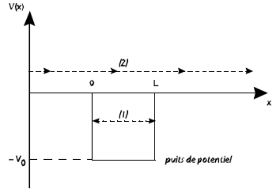
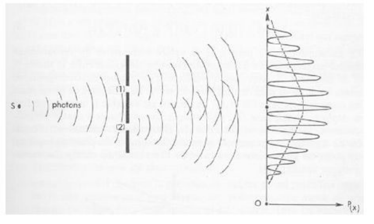

## État dynamique d'un système

**Définition.** En mécanique classique, l'état dynamique d'un système de particules est défini par l'expression de leurs positions $r$ et de leurs quantités de mouvement $p = mv$ (appelées les variables dynamiques) en fonction du temps. Dans un repère cartésien, chaque particule (indicée par la lettre $i$) est donc repérée par la donnée de 6 variables dépendantes du temps :

$$
(x_i(t), y_i(t), z_i(t), px_i(t), py_i(t), pz_i(t))
$$

Cet ensemble de relations définit la trajectoire du système de particules au cours du temps et caractérise totalement son mouvement. C'est cette trajectoire que l'on cherche à déterminer en mécanique classique.

## Grandeurs physiques

**Définition.** Outre les positions et vitesses (ou quantités de mouvement), on peut s'intéresser à d'autres grandeurs telles que l'énergie cinétique $T$, l'énergie potentielle $V$, l'énergie totale $E$, ou le moment cinétique de chaque particule :

$$
\vec l = \vec r \wedge \vec p
$$

Ces grandeurs sont des fonctions continues des variables dynamiques : elles varient continûment au cours du temps (le long de la trajectoire). En mécanique classique, toutes les valeurs possibles des grandeurs physiques sont accessibles. De manière corollaire, l'échange de quantités de mouvement, de moments et d'énergies entre particules peut se faire continûment.

**Exemples.**

**Énergie cinétique d'une particule $i$ de masse $m$.**

$$
T_i = \frac{1}{2} m v_i^2 = \frac{p_i^2}{2m} = \frac{1}{2m} \vec p_i \cdot \vec p_i
$$

Pour $Z$ particules, l'énergie cinétique totale est simplement la somme des énergies cinétiques individuelles.

$$
T = \sum_{i=1}^{Z} T_i
$$

**Énergie potentielle d'interaction coulombienne entre deux particules.** Dans un atome constitué de particules chargées, l'énergie d'interaction entre ces particules est de type coulombien ; elle dépend des charges des particules et de la distance qui les sépare. Soient deux particules $i$ et $j$, respectivement de charges $q_i$ et $q_j$, distantes de $r_{ij}$ ; leur énergie potentielle d'interaction est :

$$
V_{ij} = \frac{1}{4\pi\epsilon_0} \cdot \frac{q_i q_j}{r_{ij}} = \frac{1}{4\pi\epsilon_0} \cdot \frac{q_i q_j}{\big((x_i - x_j)^2 + (y_i - y_j)^2 + (z_i - z_j)^2\big)^{\frac{1}{2}}}
$$

Cette énergie potentielle dépend des positions des particules $i$ et $j$. Elle n'est donc pas caractéristique d'une seule particule. L'énergie potentielle totale ne peut donc pas être mise sous la forme d'une somme d'énergies potentielles individuelles. Ainsi l'énergie potentielle totale d'interaction entre $Z$ particules se met sous la forme d'une somme de termes de paires :

$$
V = \sum_{i=1}^{Z-1} \sum_{j>i}^{Z} V_{ij}
$$

**Énergie totale.** L'énergie totale d'un ensemble de particules est simplement la somme de l'énergie cinétique totale et de l'énergie potentielle totale. Dans le cas d'un atome neutre composé de $Z$ électrons de charge $-e$ gravitant autour d'un noyau de charge $+Ze$ (considéré comme fixe et placé à l'origine des coordonnées), l'énergie totale s'écrit comme la somme de trois contributions : l'énergie cinétique $T$, l'énergie coulombienne (d'attraction) noyau-électrons $V_{Ne}$ et l'énergie potentielle (de répulsion) entre électrons $V_{ee}$.

$$
\begin{aligned}
E = T + V_{Ne} + V_{ee} &= \sum_{i=1}^{Z} \frac{p_i^2}{2m} - \sum_{i=1}^{Z} \frac{1}{4\pi\epsilon_0} \frac{Ze^2}{r_i} + \sum_{i=1}^{Z-1} \sum_{j>i}^{Z} \frac{1}{4\pi\epsilon_0} \frac{e^2}{r_{ij}} \\
&= \sum_{i=1}^{Z} \Big(\frac{p_i^2}{2m} - \frac{1}{4\pi\epsilon_0} \frac{Ze^2}{r_i}\Big) + \sum_{i=1}^{Z-1} \sum_{j>i}^{Z} \frac{1}{4\pi\epsilon_0} \frac{e^2}{r_{ij}} \\
&= \sum_{i=1}^{Z} h_i + \sum_{i=1}^{Z-1} \sum_{j>i}^{Z} V_{ij}
\end{aligned}
$$

**Invariant du mouvement.** Certaines grandeurs physiques se conservent au cours du mouvement. Elles servent alors à caractériser le mouvement. On les appelle invariants ou constantes du mouvement. Dans le cas où les forces dérivent d'une énergie potentielle (système conservatif), il en est ainsi de l'énergie totale $E$ : l'énergie totale d'un ensemble de particules en interaction est constante au cours du temps. Un autre invariant du mouvement est le moment cinétique $\vec l = \vec r \wedge \vec p$. Cette grandeur physique n'est cependant invariante que dans le cas de forces centrales.

## Équation fondamentale de la dynamique

L'équation fondamentale de la mécanique, ou équation de Newton, permet de déterminer l'état dynamique et donc la trajectoire des particules.

**Notion de force.** Nous nous limiterons aux forces conservatives : par définition, la force conservative qui s'exerce sur une particule $i$ dérive de l'énergie potentielle à laquelle est soumise cette particule.

$$
\vec F_i = -\vec\nabla_i V
$$

Si l'énergie potentielle $V$ dépend des coordonnées de plusieurs particules, il en est de même pour la force. On dit alors que les mouvements de ces particules sont couplés. Une fois connues les positions, les vitesses et les forces à un instant donné, il est théoriquement possible de déterminer exactement ces grandeurs à n'importe quel instant grâce à l'équation de Newton.

**Équation de Newton.** Pour chaque particule $i$, on définit une équation aux dérivées partielles qui relie la force à l'accélération $\vec\Gamma_i$ :

$$
\vec F_i = -\frac{\partial V}{\partial \vec r_i} = m \frac{d\vec v_i}{dt} = m \frac{d^2 \vec r_i}{dt^2} = m \vec\Gamma_i
$$

On obtient donc, si l'on veut décrire $N$ particules, un ensemble de $3N$ équations différentielles aux dérivées partielles dont la résolution (analytique ou numérique) nécessite la donnée de conditions initiales pour les positions et les vitesses. S'il existe une énergie potentielle d'interaction entre les particules, alors ces équations sont couplées : la force qui s'exerce sur une particule dépend de la position des autres particules. Il s'ensuit une complication mathématique insurmontable qui fait qu'au-delà de 2 particules on est confronté au problème à $N$ corps : les équations mathématiques deviennent insolubles à cause de cette interaction entre les particules. On se contente le plus souvent de chercher des solutions approchées.

**Exemple.** Dans le cas de l'étude du système solaire, on néglige en première approximation l'interaction gravitationnelle entre les planètes, qui est beaucoup plus faible que l'interaction avec le soleil. On décrit alors le mouvement de chaque planète indépendamment des autres dans le seul champ du soleil supposé fixe.

On peut faire de même pour le mouvement des électrons (modèle des électrons indépendants) dans un atome, mais dans le cas de l'interaction coulombienne, cette approximation est délicate car la répulsion entre les électrons gravitant autour du noyau atomique est du même ordre de grandeur que l'attraction du noyau.

## États liés ou libres

La compétition entre l'énergie cinétique et l'énergie potentielle est d'une importance cruciale pour déterminer si une particule peut se déplacer librement dans tout l'espace ou si au contraire elle reste attachée à une portion seulement de l'espace. Dans le premier cas, on dit que la particule est libre ; dans le second, on dit qu'elle est dans un état lié ou liant.

**Exemple.** Cas d'une particule se déplaçant sur un axe $x'Ox$ soumise à un "puits de potentiel carré" entre 0 et $L$. L'énergie potentielle prend la forme suivante :

La trajectoire correspond à un déplacement à $E = T + V = \text{cte}$. Si l'énergie cinétique initiale est non nulle et inférieure à la hauteur du puits, le système va évoluer au cours du temps selon la ligne horizontale (1). La trajectoire de la particule est confinée entre les deux bords du puits de potentiel car l'énergie potentielle ne peut être supérieure à l'énergie totale ($T \geq 0$). La particule est donc prisonnière du segment $[0, L]$. On dit qu'elle est liée au segment. L'existence de ce "puits de potentiel" est à l'origine de ce phénomène. Si au contraire l'énergie cinétique initiale est plus grande que la hauteur du puits, alors la trajectoire à énergie totale constante ne rencontre jamais la courbe d'énergie potentielle (ligne 2), et la particule peut alors se déplacer librement sur l'axe $x'Ox$. Elle n'est pas liée au segment et est dite libre.

## Ondes électromagnétiques

**Notion d'onde.** À côté de la mécanique classique coexiste indépendamment la théorie de Maxwell de l'électromagnétisme. Dans ce cadre, la lumière visible ou invisible est décrite par une onde, c'est-à-dire une oscillation du champ électromagnétique dans le temps et l'espace.

$$
\frac{\partial^2 \Psi}{\partial x^2} + \frac{\partial^2 \Psi}{\partial y^2} + \frac{\partial^2 \Psi}{\partial z^2} = \frac{1}{c^2} \cdot \frac{\partial^2 \Psi}{\partial t^2}
$$

Une onde électromagnétique est décrite par la donnée du champ électrique $E$ et du champ magnétique $B$ comme fonctions de l'espace et du temps. La propagation de l'onde est décrite par les équations de Maxwell. La solution d'une telle équation est de la forme (pour une propagation suivant l'axe $x$) :

$$
\Psi = \Psi_0 e^{i(kx - \omega t)}
$$

où $k$ est le vecteur d'onde, $\omega$ la pulsation liée à la fréquence du rayonnement par la relation $\omega = 2\pi\nu$. La longueur d'onde $\lambda$ et le nombre d'onde $k$ sont définis par :

$$
\lambda = \frac{2\pi}{k} = \frac{c}{\nu}
$$

**Énergie électromagnétique.** Les ondes lumineuses transportent de l'énergie. L'énergie électromagnétique $U$ disponible à un instant donné par unité de volume est proportionnelle au carré du module du champ électrique (on néglige le champ magnétique). Pour une onde plane se déplaçant dans le vide, on a :

$$
U = \epsilon_0 |E|^2
$$

L'intensité lumineuse $I$ est définie comme l'énergie transportée par unité de temps à travers une unité de surface. Elle est proportionnelle à la moyenne temporelle du carré du module du champ électrique. Pour une onde plane se déplaçant dans le vide, l'intensité lumineuse s'exprime par la relation :

$$
I = \epsilon_0 c \langle |E|^2 \rangle
$$

Dans cette formule, le symbole $\langle \ \rangle$ signifie "moyenne temporelle". Une conséquence de l'existence de cette énergie électromagnétique est que tout corps qui émet un rayonnement, et donc perd de l'énergie sous forme électromagnétique, doit, en vertu du principe de conservation de l'énergie totale, perdre de l'énergie mécanique (cinétique ou potentielle).

**Interférences lumineuses.** La propriété d'interférence est inhérente à tout phénomène ondulatoire. C'est en particulier une manifestation typique du caractère ondulatoire de la lumière. L'interférence se produit lorsque l'on combine deux ondes. Appelons $\Psi_1$ et $\Psi_2$ les amplitudes de deux ondes se combinant. Dans le cas de la lumière se propageant dans un milieu isotrope, ces amplitudes sont des amplitudes de champ électrique, car ce dernier est la grandeur physique vectorielle caractéristique de l'onde électromagnétique. D'après le principe de superposition, l'amplitude de l'onde résultante est la somme des amplitudes $\Psi_1$ et $\Psi_2$ :

$$
\Psi = \Psi_1 + \Psi_2
$$

L'intensité résultante est proportionnelle au carré du module de l'amplitude $\Psi$. En négligeant (pour simplifier les notations) la moyenne temporelle, on a donc :

$$
I \propto |\Psi|^2 = |\Psi_1|^2 + |\Psi_2|^2 + (\Psi_1^* \Psi_2 + \Psi_2^* \Psi_1)
$$

Les intensités ne s'ajoutent pas et il apparaît un terme supplémentaire dit d'interférence.

- Lorsque ce terme est négatif, il diminue l'intensité lumineuse globale ; l'interférence est dite destructive.
- Lorsqu'il est positif, l'intensité globale est plus importante que la somme des intensités de $\Psi_1$ et $\Psi_2$ ; l'interférence est dite constructive.

Pour deux ondes se combinant, on observe des effets constructifs à certains endroits, et destructifs à d'autres. La figure d'interférence rassemble l'image caractéristique de ces différents effets. L'expérience illustrative de cette propriété d'interférences est celle des fentes de Young.

