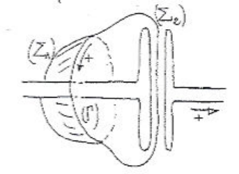
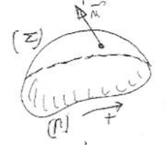
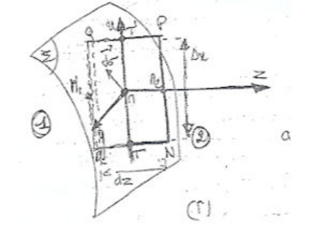

## Introduction : but du chapitre

Considérons un circuit RLC et essayons d'appliquer le théorème d'Ampère à un contour fermé $\Gamma$ proche du condensateur.

On choisit une surface $\Sigma_1$ limitée par $\Gamma$ et coupant le fil de connexion reliant une électrode du condensateur au reste du circuit. Si $I$ désigne l'intensité du courant circulant dans ce fil, le théorème d'Ampère fournit pour la circulation du champ magnétique le long de $\Gamma$ la valeur

$$
C_1 = \oint_{\Gamma^+} \vec{B} \cdot \vec{dl} = \mu_0 I
$$

Mais quand on applique le théorème d'Ampère à un contour fermé $\Gamma$, le choix de la surface $\Sigma$ limitée par ce contour est en principe arbitraire. On peut également choisir une surface $\Sigma_2$ limitée par le même contour $\Gamma$ mais enveloppant l'électrode du condensateur de manière à ne pas couper le fil de connexion ; aucun courant ne traverse cette surface, et l'application du théorème d'Ampère donne alors :

$$
C_2 = \oint_{\Gamma^+} \vec{B} \cdot \vec{dl} = 0
$$

On a donc $C_1 \neq C_2$ : on aboutit à une contradiction.

Quand on applique le théorème d'Ampère en régime statique, la liberté de choix de la surface $\Sigma$ repose sur la propriété de conservation de l'intensité du courant le long d'un conducteur (l'intensité est la même le long du fil et le circuit est un circuit fermé).

Cette propriété n'est donc pas réalisée dans un circuit comportant un condensateur : les lignes de courant s'arrêtent sur les électrodes du condensateur.

Les difficultés mentionnées paraissent donc liées au problème de la conservation de l'électricité. Ce chapitre va donc commencer par la recherche de l'expression de la conservation de l'électricité en régime variable, c'est-à-dire par l'établissement de ce qu'on appelle l'équation de continuité. Ensuite, on cherche comment il faut modifier les équations fondamentales de l'électromagnétisme pour qu'elles soient cohérentes avec l'équation de conservation de la charge électrique. Cela conduit à introduire le courant de déplacement dans l'équation de l'expression locale du théorème d'Ampère. On vérifie alors que la modification apportée lève bien le problème du début. On récapitule enfin l'ensemble des équations de l'électromagnétisme en examinant en détail celle qui a été modifiée, c'est-à-dire l'équation de Maxwell-Ampère.

## La conservation de la charge électrique

### Énoncé et signification physique

La charge électrique totale d'un système physique isolé (c'est-à-dire un système n'ayant aucun échange de matière avec le milieu extérieur) est une constante.

Si 2 systèmes physiques échangent entre eux de la matière, mais sans qu'aucun des deux n'ait échangé de matière avec le milieu extérieur, la somme de leurs charges électriques est une constante, et donc les variations $\Delta Q_1$ et $\Delta Q_2$ de ces charges électriques qui interviennent pendant un intervalle de temps donné sont opposées :

$$
\Delta Q_1 + \Delta Q_2 = 0 \quad \text{d'où} \quad \Delta Q_1 = -\Delta Q_2
$$

### Équation de continuité : cas particulier

Dans un premier temps, on établit l'expression de la conservation de la charge sur un cas particulier simple, en explicitant bien les détails mathématiques de la démonstration.

On considère un cylindre d'axe $Ox$ de section droite $S$, contenant une charge électrique et un courant parallèle à l'axe $Ox$, également distribués en volume.

Les répartitions de charge et de courant ne dépendent que de l'abscisse $x$ et du temps $t$ : $\rho(x, t)$ et $\vec{j} = j(x, t)\vec{u}_x$.

La charge contenue dans un tronçon du cylindre limité par les plans d'abscisses respectives $x_1$ et $x_2$ est

$$
Q(t) = S\int_{x_1}^{x_2} \rho(x, t)\,dx
$$

Cette charge dépend en général du temps et, entre les instants $t_1$ et $t_2$, elle varie de :

$$
\Delta Q = Q(t_2) - Q(t_1) = S\int_{x_1}^{x_2} [\rho(x, t_2) - \rho(x, t_1)]\,dx
$$

La charge du tronçon de cylindre peut varier avec le temps parce que ce tronçon ne constitue pas un système physique isolé : il échange de la matière avec le reste du cylindre. Le courant électrique transporte des charges à travers les plans de section droite d'abscisses $x_1$ et $x_2$.

Par définition du vecteur densité de courant volumique, il pénètre dans le tronçon du cylindre, à travers le plan d'abscisse $x_1$, entre les instants $t_1$ et $t_2$, la charge :

$$
\Delta Q_1 = S\int_{t_1}^{t_2} j(x_1, t)\,dt
$$

De même, il sort à travers le plan d'abscisse $x_2$ la charge

$$
-\Delta Q_2 = S\int_{t_1}^{t_2} j(x_2, t)\,dt
$$

La somme des charges qui pénètrent dans le cylindre entre les instants $t_1$ et $t_2$ est

$$
\Delta Q' = \Delta Q_1 + \Delta Q_2 = S\int_{t_1}^{t_2} \big(j(x_1, t) - j(x_2, t)\big)\,dt
$$

D'après la loi de conservation de la charge électrique, la variation de la charge du cylindre est égale à la quantité de charge qui pénètre dans le cylindre :

$$
\Delta Q = \Delta Q'
$$

soit

$$
S\int_{x_1}^{x_2} [\rho(x, t_2) - \rho(x, t_1)]\,dx = S\int_{t_1}^{t_2} \big(j(x_1, t) - j(x_2, t)\big)\,dt
$$

En posant $x_2 = x_1 + \Delta x$ et $t_2 = t_1 + \Delta t$, et en divisant par $S\Delta x\Delta t$, on obtient :

$$
\frac{1}{\Delta x}\int_{x_1}^{x_2} \frac{\rho(x, t_2) - \rho(x, t_1)}{\Delta t}\,dx = \frac{1}{\Delta t}\int_{t_1}^{t_2} \frac{j(x_1, t) - j(x_2, t)}{\Delta x}\,dt
$$

En effectuant alors le passage à la limite quand $\Delta x \to 0$, on obtient

$$
\frac{\rho(x_1, t_2) - \rho(x_1, t_1)}{\Delta t} = \frac{1}{\Delta t}\int_{t_1}^{t_1 + \Delta t} -\left(\frac{\partial j(x_1, t)}{\partial x}\right)dt
$$

Puis, en effectuant le passage à la limite $\Delta t \to 0$, on aboutit finalement au résultat :

$$
\frac{\partial \rho(x_1, t_1)}{\partial t} = -\frac{\partial j(x_1, t_1)}{\partial x}
$$

L'instant $t_1$ et l'abscisse $x_1$ étant bien évidemment arbitraires, on a de manière générale

$$
\frac{\partial \rho}{\partial t}(x, t) + \frac{\partial j}{\partial x}(x, t) = 0
$$

### Équation de continuité : cas général

On généralise maintenant cette équation au cas où les distributions volumiques de charge et de courant sont quelconques : les fonctions $\rho$ et $\vec{j}$ dépendent des 3 coordonnées d'espace et du temps, et la direction de $\vec{j}$ peut varier d'un point à l'autre de l'espace.

On considère dans l'espace un domaine $\tau$ limité par une surface fermée $\Sigma$. Le domaine $\tau$ contient une charge électrique $Q$, fonction du temps, donnée en fonction de la charge volumique $\rho(M, t)$ par

$$
Q(t) = \iiint_\tau \rho(M, t)\,d\tau
$$

Pendant l'intervalle de temps $dt$, cette charge varie de

$$
dQ = \iiint_\tau \left(\frac{\partial \rho}{\partial t}dt\right)d\tau
$$

La surface $\Sigma$ est traversée par les lignes de courant. Si l'on introduit comme d'habitude la normale $\vec{n}$ à la surface $\Sigma$ orientée vers l'extérieur, la quantité de charge qui sort du domaine $\tau$ à travers la surface $\Sigma$ pendant le temps $dt$ est

$$
-dQ' = \oiint_\Sigma (\vec{j} \cdot \vec{n}\,dS)\,dt
$$

La charge électrique qui pénètre dans le domaine $\tau$ est évidemment égale à $(+dQ')$, et l'on doit avoir

$$
dQ = dQ'
$$

Pour exprimer cette égalité, on transforme l'intégrale de flux (de $\vec{j}$) en une intégrale de volume (de $\vec{\nabla} \cdot \vec{j}$) grâce à la formule d'Ostrogradsky :

$$
\oiint_\Sigma \vec{j} \cdot \vec{n}\,dS = \iiint_\tau (\vec{\nabla} \cdot \vec{j})\,d\tau
$$

Et l'égalité $dQ = dQ'$ conduit alors, après division par $dt$, à

$$
\iiint_\tau \left(\vec{\nabla} \cdot \vec{j} + \frac{\partial \rho}{\partial t}\right)d\tau = 0
$$

Le domaine $\tau$ a bien entendu été choisi de manière arbitraire. Pour que l'intégrale de volume soit nulle quel que soit le domaine $\tau$ d'intégration, il est nécessaire que la fonction à intégrer soit nulle en tout point. On a donc finalement

$$
\vec{\nabla} \cdot \vec{j}(M, t) + \frac{\partial \rho(M, t)}{\partial t} = 0
$$

Cette équation, qui exprime la conservation de la charge électrique, est connue sous le nom d'équation de continuité.

## L'équation de Maxwell-Ampère

### Courant de déplacement

En régime statique, les fonctions $\rho$ et $\vec{j}$ ne sont pas fonctions du temps, de sorte que l'équation de continuité se réduit à

$$
\vec{\nabla} \cdot \vec{j} = 0
$$

Cette équation est cohérente avec l'expression locale du théorème d'Ampère

$$
\vec{\nabla} \wedge \vec{B} = \mu_0 \vec{j}
$$

En effet, la divergence du premier membre est nulle ($\vec{\nabla} \cdot (\vec{\nabla} \wedge \vec{B})$ est nulle quelle que soit la fonction $\vec{B}$), et celle du deuxième membre l'est en statique car

$$
\vec{\nabla} \cdot \vec{j} = -\frac{\partial \rho}{\partial t}
$$

En régime variable, $\vec{j} \neq \dfrac{\vec{\nabla} \wedge \vec{B}}{\mu_0}$. On peut toujours poser $\vec{T} = \vec{\nabla} \wedge \vec{B} - \mu_0 \vec{j}$, où $\vec{T}$ désigne une fonction de l'espace et du temps. La fonction $\vec{T}$ est telle que

$$
\mu_0 \vec{\nabla} \cdot \vec{j} + \vec{\nabla} \cdot \vec{T} = 0
$$

soit

$$
\vec{\nabla} \cdot \vec{T} = \mu_0 \frac{\partial \rho}{\partial t}
$$

En admettant alors que le théorème de Gauss a la même expression locale qu'en statique, c'est-à-dire que $\rho = \epsilon_0 \vec{\nabla} \cdot \vec{E}$, on aboutit à : $\vec{\nabla} \cdot \vec{T} = \mu_0\epsilon_0 \dfrac{\partial}{\partial t}(\vec{\nabla} \cdot \vec{E}) = \mu_0\epsilon_0 \vec{\nabla} \cdot \left(\dfrac{\partial \vec{E}}{\partial t}\right)$, soit $\vec{\nabla} \cdot \left(\vec{T} - \epsilon_0\mu_0 \dfrac{\partial \vec{E}}{\partial t}\right) = 0$.

Une manière très simple de rétablir la cohérence des équations consiste à poser $\vec{T} = \epsilon_0\mu_0 \dfrac{\partial \vec{E}}{\partial t}$, c'est-à-dire

$$
\vec{\nabla} \wedge \vec{B} = \mu_0 \vec{j} + \epsilon_0\mu_0 \frac{\partial \vec{E}}{\partial t}
$$

C'est l'équation de Maxwell-Ampère. On remarque que les 3 autres équations de Maxwell gardent en régime variable la forme qu'elles ont en régime quasi stationnaire.

### Récapitulatif des équations de Maxwell

$$
\begin{aligned}
\vec{\nabla} \cdot \vec{E} &= \frac{\rho}{\epsilon_0} \\
\vec{\nabla} \cdot \vec{B} &= 0 \\
\vec{\nabla} \wedge \vec{E} &= -\frac{\partial \vec{B}}{\partial t} \\
\vec{\nabla} \wedge \vec{B} &= \mu_0 \vec{j} + \epsilon_0\mu_0 \frac{\partial \vec{E}}{\partial t}
\end{aligned}
$$

La théorie de l'électromagnétisme repose sur les postulats de base constitués par ces 4 équations et sur la formule de Lorentz

$$
\vec{F} = q(\vec{E} + \vec{v} \wedge \vec{B})
$$

qui fournit la loi de la force et définit les champs électrique et magnétique. Il faudrait ajouter la loi de conservation de la charge électrique (équation de continuité), mais celle-ci peut être en quelque sorte considérée comme contenue implicitement dans les équations de Maxwell.

À chacune des équations de Maxwell est associée une relation de passage concernant : la composante normale de $\vec{E}$ (1), la composante normale de $\vec{B}$ (2), la composante tangentielle de $\vec{E}$ (3) et la composante tangentielle de $\vec{B}$ (4).

À chacune des équations de Maxwell est associée une formulation intégrale concernant : le flux de $\vec{E}$, le flux de $\vec{B}$, la circulation de $\vec{E}$ et la circulation de $\vec{B}$.

Les formulations intégrales associées aux 3 premières équations ont déjà été étudiées. On va examiner en détail celle associée à l'équation de Maxwell-Ampère, ainsi que la relation de passage associée, dans les paragraphes sur le théorème d'Ampère généralisé et sur la composante tangentielle de $\vec{B}$.

### Relations entre les champs et les sources des champs

Un problème important en électromagnétisme est le calcul des champs électriques et magnétiques produits par des distributions de charges et de courants données.

En régime statique (et de manière approchée en régime lentement variable), le champ électrique est calculé en fonction des distributions de charges par la loi de Coulomb, le champ $\vec{B}$ est calculé en fonction des distributions de courant par la loi de Biot et Savart.

En régime variable, les lois de Coulomb et de Biot et Savart ne sont pas valables.

En régime variable, ce sont les équations de Maxwell qui établissent la relation entre les champs et les distributions de charge, plus précisément la relation

$$
\vec{\nabla} \cdot \vec{E} = \frac{\rho}{\epsilon_0}
$$

et la relation

$$
\vec{\nabla} \wedge \vec{B} = \mu_0 \vec{j} + \epsilon_0\mu_0 \frac{\partial \vec{E}}{\partial t}
$$

Le calcul dans chaque cas à partir de ces relations est, sauf dans des cas particuliers, fort compliqué. Il est simplifié par l'intermédiaire des potentiels.

### Le théorème d'Ampère généralisé

Ce théorème peut se déduire de l'équation de Maxwell-Ampère établie précédemment. Cependant, il s'applique dans des conditions plus larges, en particulier quand les champs sont discontinus en certains points.

On considère la circulation de $\vec{B}$ le long d'une courbe fermée $\Gamma$ :

$$
\oint \vec{B} \cdot \vec{dl}
$$

On transforme ensuite cette intégrale en une intégrale de flux à travers une surface $\Sigma$ limitée par le contour $\Gamma$ :

$$
\oint_{\Gamma^+} \vec{B} \cdot \vec{dl} = \iint (\vec{\nabla} \wedge \vec{B}) \cdot \vec{n}\,dS
$$

Puis, par la relation de Maxwell-Ampère, on obtient

$$
\iint_\Sigma (\vec{\nabla} \wedge \vec{B}) \cdot \vec{n}\,dS = \iint_\Sigma \mu_0 \vec{j} \cdot \vec{n}\,dS + \iint_\Sigma \epsilon_0\mu_0 \frac{\partial \vec{E}}{\partial t} \cdot \vec{n}\,dS
$$

On aboutit finalement au théorème d'Ampère généralisé :

$$
\oint_{\Gamma^+} \vec{B} \cdot \vec{dl} = \mu_0 I + \mu_0\epsilon_0\left(\frac{d\phi_E}{dt}\right)
$$

où $\phi_E$ est le flux de $\vec{E}$ à travers $\Sigma$, $\phi_E = \displaystyle\iint_\Sigma \vec{E} \cdot \vec{n}\,dS$.

### La relation de passage de la composante tangentielle de $\vec{B}$

Considérons une surface de discontinuité $\Sigma$ sur laquelle sont présentes une densité surfacique de charges $\sigma$ et une densité surfacique de courant $\vec{j}_0$.

Par analogie avec les densités volumiques de charge et de courant, liées entre elles par $\vec{j} = \rho\vec{v}$, où $\vec{v}$ est la vitesse des charges mobiles créant le courant, on définit la densité surfacique de courant par

$$
\vec{j}_0 = \sigma\vec{v}
$$

où $\vec{v}$ est la vitesse des charges mobiles en surface et $\sigma$ leur densité surfacique.

**Remarque.**

- La densité $\vec{j}$ de courant volumique est homogène à une intensité divisée par une surface.
- La densité $\vec{j}_0$ de courant surfacique est homogène à une intensité divisée par une longueur. Soit $dl = AB$ un segment appartenant à $\Sigma$ et $\vec{u}_N$ le vecteur unitaire normal à $AB$ et appartenant à $\Sigma$. Ainsi l'intensité du courant qui traverse $AB$ est

$$
dI = (\vec{j}_0 \cdot \vec{u}_N)\,dl
$$

**Relation de passage pour la composante tangentielle $\vec{B}_t$ de $\vec{B}$ à la traversée de $\Sigma$.** Soit $M \in \Sigma$, $Mz$ un axe normal à $\Sigma$ orienté de 1 vers 2, $Mx$ et $My$ deux axes orthogonaux dans le plan tangent en $M$ à $\Sigma$, qui forment avec $Mz$ un repère orthogonal direct. Dans le plan $Mxz$, considérons le contour $\Gamma$, $NPQR$, passant par les points $M_1$ dans 1 et $M_2$ dans 2. La circulation de $\vec{B}$ le long de ce contour est égale à

$$
\oint_{NPQRN} \vec{B} \cdot \vec{dl} = [B_x(M_2) - B_x(M_1)]\Delta x + \Delta x\,\epsilon(\Delta x)
$$

D'après le théorème d'Ampère généralisé, cette quantité s'exprime en fonction du courant traversant la surface du rectangle $NPQR$ et du flux électrique à travers cette surface.

Le courant $I$ est le courant surfacique traversant la médiane $TT'$ du rectangle :

$$
I = (\vec{j}_0 \cdot \vec{u}_H)\Delta u = j_{Oy}\Delta u
$$

Le flux est rendu arbitrairement petit quand $\Delta z$ tend vers 0.

Finalement, on a donc, quand $M_1$ et $M_2$ tendent vers $M$, puis $\Delta x$ vers 0 :

$$
B_{x_2} - B_{x_1} = \mu_0 j_{Oy}
$$

En choisissant un contour rectangulaire dans le plan $Myz$, on peut montrer que

$$
B_{y_2} - B_{y_1} = -\mu_0 j_{Ox}
$$

On peut rassembler ces 2 formules en une seule, relative à la composante tangentielle $\vec{B}_t$ du champ magnétique, en s'affranchissant des axes $Mx$ et $My$ :

$$
\vec{B}_{t_2} - \vec{B}_{t_1} = \mu_0(\vec{j}_0 \wedge \vec{n}_{12})
$$

où $\vec{n}_{12}$ représente la normale unitaire à $\Sigma$ en $M$ orientée de 1 vers 2.

De plus, comme la composante normale de $\vec{B}$ est continue, on peut écrire

$$
\vec{B}_2 - \vec{B}_1 = \mu_0 \vec{j}_0 \wedge \vec{n}_{12}
$$
