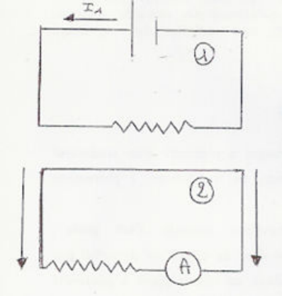
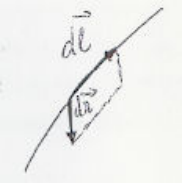
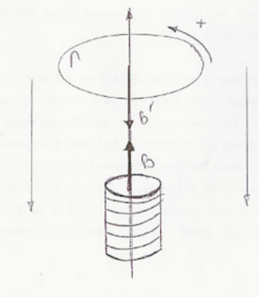
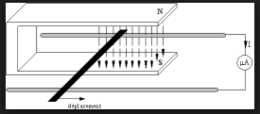
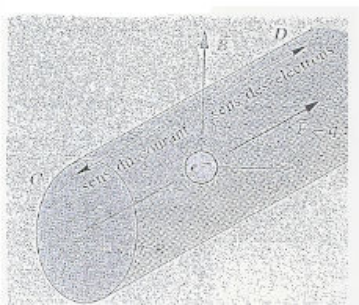
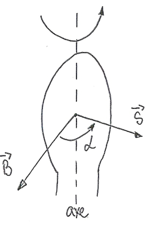
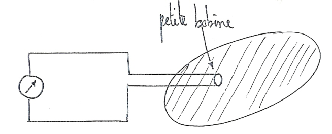

**Introduction.** Les phénomènes étudiés jusqu'à présent concernent des charges au repos (électrostatique) ou des courants permanents (magnétostatique). On va aborder maintenant une nouvelle classe de phénomènes, ceux où les courants sont variables dans le temps (régimes variables).

## Expériences fondamentales

En électrostatique, la présence de charges à proximité d'un conducteur produit l'apparition de charges sur ce conducteur (phénomène d'influence).

D'une manière analogue, la question suivante s'est posée historiquement : un courant circulant dans un circuit ne devrait-il pas produire l'apparition d'un courant dans un circuit placé à proximité du premier ?

L'expérience a montré que le courant n'apparaît dans le second circuit que s'il y a déplacement relatif des deux circuits, ou encore si le courant qui parcourt le premier circuit varie. Le courant cesse dès que le déplacement cesse ou dès que le courant est maintenu constant dans le premier circuit.

Les phénomènes d'influence ont un caractère statique : les charges développées à la surface d'un conducteur par l'approche d'une charge extérieure se maintiennent si cette dernière est fixe. Au contraire, les phénomènes d'induction ont un caractère dynamique : ils sont liés à un mouvement ou à une variation.

Parmi la grande diversité des expériences d'induction, on va décrire trois expériences, réalisées toutes trois par Faraday, qui mettent bien en évidence les divers aspects du phénomène.

**Expérience $A$.** On considère deux circuits $1$ et $2$ placés à proximité. $1$ comporte un générateur et est parcouru par un courant $I_1$ ; $2$ ne comporte pas de générateur mais un milliampèremètre. On déplace $2$ ; on constate que, tant que $2$ se déplace, un courant circule dans le circuit $2$. Un effet analogue est observé si un simple aimant est substitué au circuit $1$. Le sens du courant est inversé si, au lieu, par exemple, de rapprocher $2$ de $1$, on l'éloigne.

**Expérience $B$.** Même expérience que la précédente, sinon que $2$ est fixe et $1$ mobile. On observe, comme précédemment, l'apparition d'un courant dans $2$ (immobile) tant que dure le déplacement. Il y a accord quantitatif si le mouvement relatif des deux circuits est le même que dans l'expérience $A$. Le circuit $1$ peut être remplacé par un aimant.

**Expérience $C$.** Les deux circuits sont fixes, mais on modifie $I_1$ (à l'aide d'une résistance variable insérée dans le circuit $1$). De nouveau, un courant apparaît dans $2$ et s'annule dès que $I_1$ reprend une valeur constante.

## Interprétation

Soit $\vec{dl}$ un élément du fil filiforme $2$ plongé dans une région où règne un champ $\vec{B}$ engendré par $1$.

Soit $\vec{v}$ la vitesse d'un porteur du circuit $2$ et $\vec{v}_0$ la vitesse avec laquelle on déplace l'élément $\vec{dl}$ :

$$
\vec{v}_0 = \frac{d\vec{r}}{dt}
$$

(le référentiel utilisé est celui du conducteur $1$ immobile).

Le porteur de charge est soumis à la force de Lorentz

$$
\vec{F} = q(\vec{v}_0 + \vec{v}) \wedge \vec{B}
$$

ceci équivaut à dire que $q$ est soumise à un champ électrique (champ électromoteur) :

$$
de = \vec{E} \cdot \vec{dl} = \big[(\vec{v}_0 + \vec{v}) \wedge \vec{B}\big] \cdot \vec{dl} = (\vec{v}_0 \wedge \vec{B}) \cdot \vec{dl} + (\vec{v} \wedge \vec{B}) \cdot \vec{dl}
$$

Le second produit mixte est nul ($\vec{v}$ et $\vec{dl}$ sont colinéaires) ; remplaçons $\vec{v}_0$ par $d\vec{r}/dt$ :

$$
de = \frac{d}{dt}(d\vec{r} \wedge \vec{B}) \cdot \vec{dl} = -\frac{d}{dt}(d\vec{r} \wedge \vec{dl}) \cdot \vec{B}
$$

où $(d\vec{r} \wedge \vec{dl}) \cdot \vec{B}$ est le flux coupé par l'élément $\vec{dl}$, donc :

$$
de = -\frac{d\phi_C}{dt}
$$

Pour le circuit entier, la force électromotrice totale est donnée par l'expression :

$$
e = -\frac{d\phi_C}{dt} = -\frac{d\phi}{dt}
$$

où $d\phi$ est la variation de flux à travers le circuit.

Dans le cas de l'expérience $B$, le circuit $2$, où se développe le courant induit, est immobile. Le référentiel utilisé est celui de $2$. Comme $\vec{v}_0 = \vec{0}$, les porteurs ne sont pas soumis à une force magnétique ; ils ne sont pas non plus soumis à une force électrostatique. Comme il y a néanmoins un courant observé, les porteurs sont soumis à une force de Lorentz où intervient seulement un champ électrique $\vec{E}$ :

$$
\vec{F} = q\vec{E}
$$

Ceci provient du fait que, dans cette expérience où le référentiel de $2$ est utilisé, le champ magnétique auquel $2$ est soumis varie par suite du mouvement de $1$.

Un champ magnétique variable dans le temps est nécessairement accompagné d'un champ électrique.

La force électromotrice d'induction dans le circuit qui correspond à ce champ électrique est donnée par la même formule que dans l'expérience $A$ :

$$
e = -\frac{d\phi}{dt}
$$

Ici, la variation de $\phi$ n'est plus due au mouvement du circuit (il est immobile) mais à la variation du champ magnétique.

Les expériences du type $A$ et $B$, qui conduisent aux mêmes faits expérimentaux, sont interprétées à première vue de manières très différentes. En réalité, champ électrique et champ magnétique sont deux composantes du champ électromagnétique, et les deux expériences constituent une seule et même expérience "vue" de deux référentiels différents, celui du circuit induit pour $B$.

Cette dissymétrie entre les deux expériences sert de point de départ à l'article de 1905 d'Einstein, relatif à l'électrodynamique des corps en mouvement, qui introduit la relativité restreinte.

Si l'on admet, comme pour $B$, que la variation dans le temps du champ magnétique est accompagnée d'un champ électrique, alors l'expérience $C$ s'interprète comme l'expérience $B$, et la force électromotrice d'induction dans $2$ est donnée par $e = -\dfrac{d\phi}{dt}$. La variation de flux provient de la variation de l'induction magnétique, due elle-même à la variation de $I_1$.

## Loi de Lenz

Le signe du flux d'induction $\Phi$ à travers le circuit $2$ (décrit dans les expériences $A$, $B$ et $C$) est, bien entendu, lié au sens de parcours positif arbitrairement choisi pour $2$.

Si $\phi$ a tendance à augmenter, $d\phi/dt$ est positif et $e$ est négatif, c'est-à-dire que le courant induit circule en sens contraire du sens positif choisi initialement. Ce courant induit crée lui-même un champ magnétique dont le flux à travers $2$ est négatif et tend donc à s'opposer à l'augmentation du flux du champ magnétique extérieur (champ engendré par $1$).

Si au contraire $\phi$ a tendance à diminuer, alors $e$ est positif ; le courant induit circule donc dans le sens positif et crée un champ dont le flux à travers $2$ est positif, ce qui s'oppose à la diminution du champ extérieur. On a donc la loi de Lenz :

*Le courant induit dans le circuit est d'un sens tel qu'il tend à s'opposer à la cause qui le produit ; de manière plus précise, le flux du champ produit par le courant induit tend à compenser les variations du flux du champ extérieur.*

**Exemple.** Soit l'expérience ci-dessous, où l'on rapproche la boucle $\Gamma$ du solénoïde. Cette boucle est munie d'un certain sens de circulation (figure). Le flux du champ inducteur à travers la boucle ainsi orientée a tendance à augmenter, donc le courant induit circule dans le sens négatif et crée un champ magnétique $B'$ qui s'oppose au champ inducteur ; on arrive évidemment à la même conclusion si le sens de circulation est inversé sur la boucle.

## Interprétation du phénomène d'induction dans un cas particulier simple

On a constaté qu'une variation du flux inducteur engendre une force électromotrice induite et un courant induit dans un circuit fermé.

Il s'agit maintenant d'analyser les causes du courant induit : quelles sont les actions qui entraînent les porteurs de charge en un courant induit ?

Cette analyse sera faite dans le cas simple d'une portion de circuit rectiligne mobile dans un champ magnétique uniforme et constant.

**Expérience.** Un conducteur rectiligne est posé sur deux rails parallèles et horizontaux (figure). Le conducteur est perpendiculaire à ceux-ci. L'ensemble est placé dans l'entrefer d'un aimant en $U$. Les lignes de champ du champ magnétique uniforme sont perpendiculaires au plan des rails. Un galvanomètre branché aux extrémités ferme le circuit.

Provoquons le déplacement de la barre le long des rails : le galvanomètre détecte un courant induit. En augmentant la surface du circuit, on provoque une variation du flux magnétique inducteur et on engendre de la sorte une force électromotrice induite.

**Champ électromoteur d'induction.** Lorsqu'on déplace la barre parallèlement aux rails à la vitesse d'entraînement $\vec{v}_e$, chaque électron du métal est entraîné avec la barre à la vitesse $\vec{v}_e$ (figure 2). Il correspond à ce mouvement d'entraînement une force d'origine électromagnétique :

$$
\vec{F} = q\vec{v}_e \wedge \vec{B}
$$

s'exerçant sur chaque électron.

Cette force, qui provoque dans la barre un mouvement d'ensemble des électrons liés au métal, est à l'origine du courant induit. Elle peut se noter :

$$
\vec{F} = q\vec{E}_m
$$

La grandeur vectorielle $\vec{E}_m = \vec{v}_e \wedge \vec{B}$, appelée champ électromoteur d'induction, caractérise l'action qui s'exerce sur les porteurs de charge contenus dans la barre et se déplaçant dans le champ magnétique.

- $\vec{E}_m$ est perpendiculaire à $\vec{v}_e$ et à $\vec{B}$ ;
- $\vec{v}_e$, $\vec{B}$, $\vec{E}_m$ forment un trièdre direct ;
- $E_m = v_e B|\sin(\vec{v}_e, \vec{B})|$.

D'autre part, $\vec{F}$ et $\vec{E}_m$ sont de sens contraires ($q < 0$). Les électrons se déplaceront dans la barre dans le sens opposé à $\vec{E}_m$ ; le sens du courant induit (sens conventionnel) est donc celui de $\vec{E}_m$.

Dans le cas de la figure, $\vec{E}_m$ et $i$ sont dirigés de $D$ vers $C$.

Le sens de $\vec{E}_m$ donne celui de $i$ (en l'absence de toute autre force électromotrice).

**Force électromotrice induite.** Calculons le travail $W_{C-D}(\vec{F})$ reçu par une charge $q$ lorsqu'elle se déplace de $C$ vers $D$ sous l'action de la force d'origine électromagnétique $\vec{F}$ :

$$
W_{C-D}(\vec{F}) = \vec{F} \cdot \vec{CD} = q\vec{E}_m \cdot \vec{CD}
$$

Le rapport $W_{C-D}(\vec{F})/q$, homogène à une tension, n'est autre que la force électromotrice d'induction, que l'on note $e_{CD}$. Ainsi :

$$
e_{CD} = \vec{E}_m \cdot \vec{CD} \quad \text{avec} \quad \vec{E}_m = \vec{v}_e \wedge \vec{B}
$$

Dans le cas particulier étudié, les vecteurs $\vec{v}_e$ et $\vec{B}$ sont orthogonaux entre eux et à la direction du conducteur $CD$ de longueur $l$. La valeur absolue de la force électromotrice induite dans un champ uniforme vaut :

$$
|e_{CD}| = |e| = v_e.B.l
$$

Orientons la normale $\vec{n}$ à la surface dans le sens de $\vec{B}$ (figure). Désignons par $\phi_0$ le flux initial à travers le circuit comprenant la barre et les rails :

$$
\Phi_0 = \sum \vec{B} \cdot \vec{n}\,dS
$$

À une translation $x$ de la barre de longueur $l$ correspond une variation $\delta S = x.l$ de la surface du circuit induit, et le flux devient :

$$
\Phi = \Phi_0 + \vec{B} \cdot \vec{n}\,l.x
$$

Dans cet exemple, $\vec{B}$ et $\vec{n}$ ont le même sens :

$$
\Phi = \Phi_0 + B.l.x
$$

$\Phi$ et $x$ sont des fonctions du temps ; dérivons :

$$
\frac{d\phi}{dt} = B.l.\frac{dx}{dt}
$$

Finalement

$$
\left|\frac{d\phi}{dt}\right| = B.l.v_e = |e|
$$

On retrouve la relation entre les valeurs absolues de la force électromotrice induite et de la dérivée du flux par rapport au temps.

Procédons à une étude du signe : $\vec{n}$ définit un sens positif de circulation le long du circuit, de $C$ vers $D$ dans le cas de la figure. Le courant induit allant de $D$ vers $C$ a une intensité négative. On a donc :

$$
e = R.i < 0
$$

Or :

$$
\frac{d\phi}{dt} = B.l.\frac{dx}{dt} > 0
$$

Donc

$$
e = -\frac{d\phi}{dt}
$$

On notera d'ailleurs que le champ électromoteur d'induction $\vec{E}_m$ est effectivement de sens contraire à $\vec{CD}$, de sorte que

$$
e = \vec{E}_m \cdot \vec{CD} < 0
$$

## Induction mutuelle

Soient deux circuits $\Gamma_1$ et $\Gamma_2$ immobiles l'un par rapport à l'autre. Supposons que dans $\Gamma_1$ circule un courant $I_1(t)$. $\Gamma_2$ est le siège d'un courant induit dû à la force électromotrice :

$$
e_2 = -\frac{d\phi_2}{dt}
$$

($\Phi_2$ désigne le flux du champ dû à $\Gamma_1$ à travers $\Gamma_2$). $\Phi_2$ est évidemment proportionnel au champ créé par $\Gamma_1$, lequel est proportionnel à $I_1$ ; on peut écrire :

$$
\Phi_2 = k_2 I_1
$$

et par suite :

$$
e_2 = -k_2 \frac{dI_1}{dt}
$$

où $k_2$ est une constante (c'est-à-dire indépendante du temps) qui est fonction des caractéristiques (formes et position relative) des deux circuits.

D'une manière symétrique, $\Gamma_2$ peut comporter un générateur et être le siège d'un courant variable $I_2(t)$ qui provoque dans $\Gamma_1$ l'apparition d'un courant induit dû à la force électromotrice d'induction :

$$
e_1 = -k_1 \frac{dI_2}{dt}
$$

On va montrer que $k_1 = k_2$. Pour cela, les intensités $I_1$ et $I_2$ étant maintenues constantes :

1. On transporte $\Gamma_2$ de sa position initiale à $\infty$, $\Gamma_1$ restant fixe. Le travail des forces magnétiques est :

$$
W_2 = I_2(0 - \phi_2) = -I_2\phi_2 = -I_1 I_2 k_2
$$

2. On transporte $\Gamma_1$ de sa position initiale à $\infty$, $\Gamma_2$ restant fixe. Le travail des forces magnétiques est :

$$
W_1 = I_1(0 - \phi_1) = -I_1\phi_1 = -I_1 I_2 k_1
$$

Comme :

1. les forces qui agissent sur les deux circuits ne dépendent à chaque instant que des positions relatives des deux circuits ;
2. ces deux forces satisfont au principe de l'action et de la réaction ;
3. le déplacement relatif est le même dans les deux opérations envisagées, le travail effectué est le même et $W_1 = W_2$.

Donc

$$
k_1 = k_2 = k = M
$$

$M$ est un coefficient, positif ou négatif, appelé inductance mutuelle des deux circuits. $M$ est le quotient d'un flux par une intensité et s'exprime en henry (symbole $H$ : $m^2.kg.s^{-2}.A^{-2}$).

## Auto-induction

**Auto-inductance.** Soit un circuit $\Gamma$ parcouru par un courant variable $I(t)$.

On peut définir à tout instant le flux du champ créé par ce circuit à travers lui-même, et ce flux va varier dans le temps, ce qui provoque l'apparition d'une force électromotrice d'induction dans le circuit :

$$
e = -\frac{d\phi}{dt}
$$

Le champ magnétique créé est en tout point proportionnel à $I(t)$, d'où :

$$
\phi(t) = LI(t)
$$

où $L$ est un coefficient caractéristique du circuit et indépendant du temps, appelé auto-inductance du circuit. Finalement :

$$
e = -L\frac{dI}{dt}
$$

Donc la force électromotrice d'induction qui apparaît aux bornes d'un circuit d'auto-inductance $L$, parcouru par un courant $I$ variable, est :

$$
e = -L\frac{dI}{dt}
$$

Étudions l'auto-induction dans un solénoïde. Soit un solénoïde de longueur $l$ comportant $N$ spires de surface $S$. On a :

$$
B = \mu_0 nI = \mu_0 \frac{N}{l} I
\qquad
\phi = NBS = \mu_0 \frac{N^2}{l} IS
$$

d'où

$$
L = \mu_0 \frac{N^2 S}{l}
$$

Insérons ce solénoïde, de résistance $R$ (en général très petite), dans un circuit comportant une pile de force électromotrice constante $e_0$ et un interrupteur. À tout instant $t$, on a dans ce circuit, après fermeture :

$$
e_0 + e = RI
$$

c'est-à-dire :

$$
e_0 = RI + L\frac{dI}{dt}
$$

Cette équation différentielle régit les variations de $I$.

À partir de l'instant où l'on ferme le circuit à l'aide de l'interrupteur, l'intensité $I$ doit croître depuis $I = 0$ jusqu'à $I = \dfrac{e_0}{R}$ (régime permanent) : on doit donc avoir initialement $dI/dt > 0$.

Comme, d'après la loi de Lenz, le phénomène d'auto-induction doit s'opposer à l'accroissement du courant, la force électromotrice doit être en opposition par rapport à celle du générateur, c'est-à-dire que $e < 0$, donc $L(dI/dt) > 0$. Comme $dI/dt > 0$, $L$ doit être positif. Ceci est une propriété générale de l'auto-inductance :

$$
L > 0
$$

Si le circuit, une fois le régime permanent atteint, est ouvert, l'intensité va passer progressivement de la valeur $e_0/R$ à la valeur $0$ ; le solénoïde s'oppose en effet à la variation du courant et se comporte comme un générateur.

## Applications de l'induction

### Principe de l'alternateur

Soit un circuit plan qui peut tourner autour d'un axe situé dans son plan. Le circuit est placé dans un champ uniforme $\vec{B}$ ; soit $\alpha$ l'angle $(\vec{B}, \vec{S})$. Le flux d'induction à travers ce circuit est :

$$
\phi = \vec{B} \cdot \vec{S} = BS\cos(\alpha)
$$

Faisons tourner ce circuit d'un mouvement uniforme, avec $\alpha = \omega t + \phi$, $\omega$ étant la pulsation. Alors il apparaît aux bornes du circuit une force électromotrice d'induction alternative :

$$
e = -\frac{d\phi}{dt} = BS\omega\sin(\omega t + \phi)
$$

Pour faire tourner ce circuit, il faut évidemment fournir de l'énergie mécanique ; l'appareil transforme donc de l'énergie mécanique en énergie électrique.

### Mesures d'induction magnétique

Pour mesurer l'induction magnétique dans une certaine région, on utilise une petite spire insérée dans un circuit comportant un intégrateur de charge.

Pour faire la mesure, on déplace la bobine de la région où règne le champ à mesurer à la région où le champ est nul.

À chaque instant, durant ce déplacement qui commence à l'instant $t_0$ et s'achève à l'instant $t_1$, la force électromotrice induite est :

$$
e = -\frac{d\phi}{dt}
$$

L'intensité dans le circuit incluant la bobine est :

$$
i = \frac{dq}{dt} = \frac{e}{R}
$$

La charge totale, mesurée à l'aide d'un intégrateur de charge, est :

$$
\begin{aligned}
q = \int_{t_0}^{t_1} i\,dt &= \frac{1}{R}\int_{t_0}^{t_1} e\,dt = -\frac{1}{R}\int_{\phi_0}^{\phi_1} d\phi \\
&= -\frac{1}{R}(\phi_1 - \phi_0) = \frac{1}{R}(\phi_0 - \phi_1)
\end{aligned}
$$

Le flux à l'instant $t_1$ est nul ($B = 0$, donc $\phi_1 = 0$).

À l'instant initial, on peut orienter par tâtonnements la bobine pour que le flux soit maximum ; alors :

$$
\phi_0 = NSB
$$

avec $N$ le nombre de spires de la bobine, $S$ la surface d'une spire et $B$ la norme du champ magnétique :

$$
B = \frac{R}{NS} q
$$
