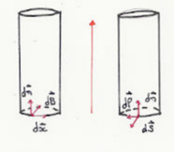
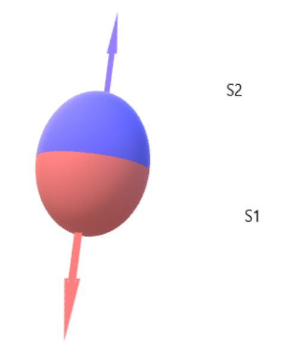
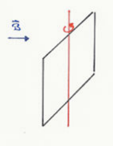

## Mise en évidence des interactions électromagnétiques

Les phénomènes suivants révèlent des forces que l'on ne peut interpréter à partir de ce que l'on sait de la gravitation ou de l'électrostatique :

- un morceau de fer est attiré par un aimant ;
- l'aiguille d'une boussole indique sensiblement la direction du pôle nord de la Terre ;
- l'aiguille d'une boussole change de direction si l'on approche d'elle un aimant, un morceau de fer ou un fil parcouru par un courant (Oersted, 1820) ;
- deux fils conducteurs parcourus tous deux par des courants électriques s'attirent ou se repoussent ;
- la trajectoire d'un électron est courbée au voisinage d'une bobine parcourue par un courant.

L'analyse de ces phénomènes montre qu'il s'agit toujours d'interactions entre des particules chargées en mouvement. Ces interactions sont appelées interactions électromagnétiques.

La situation électrostatique n'est qu'un cas particulier correspondant à des charges immobiles ; elle a permis de se familiariser avec la notion de champ en partant de la forme simple que prennent les interactions électromagnétiques dans ce cas. Cette notion est indispensable à l'étude du cas général, et l'on procédera de la façon suivante : étant donné des charges électriques animées de mouvements quelconques, on cherche à exprimer la force électromagnétique à laquelle une charge en un point $P$ de l'espace est soumise en fonction de grandeurs caractéristiques de l'espace en ce point, propriétés qui résultent des autres charges et de leurs mouvements.

## Force de Lorentz

S'agissant de charges en mouvement, il faut préciser le référentiel. On choisit un référentiel dans lequel l'observateur est immobile. On considère un système quelconque de charges animées de mouvements quelconques par rapport à ce référentiel.

Étudions expérimentalement la force $\vec{F}$ agissant sur une charge $q$ de vitesse $\vec{v}$ en un point de l'espace.

- Quelle que soit $\vec{v}$, $\vec{F}$ est proportionnelle à $q$.
- Si $\vec{v} = \vec{0}$, la charge est soumise à une force $\vec{F}_E$ que l'on met sous la forme :

$$
\vec{F}_E = q\vec{E}
$$

($\vec{E}$ est le champ électrique en $P$ ; c'est aussi le champ électrostatique si toutes les autres charges sont immobiles.)

- Si $\vec{v} \neq \vec{0}$, la charge est soumise à la force $\vec{F}$. On constate que la différence $\vec{F} - \vec{F}_E$ est proportionnelle à $\vec{v}$, perpendiculaire à une même direction de l'espace en $P$ quelle que soit $\vec{v}$. On peut mettre cette différence sous la forme :

$$
\vec{F} - \vec{F}_E = \vec{F}_B = q\vec{v} \wedge \vec{B}
$$

relation qui définit le champ magnétique $\vec{B}$ en $P$. Finalement :

$$
\vec{F} = q(\vec{E} + \vec{v} \wedge \vec{B})
$$

$\vec{B}$ est un vecteur axial. L'unité du champ magnétique est le tesla ($T$). Par exemple, sur Terre, le champ magnétique vaut $6{,}2.10^{-5}\,T$, celui d'un électroaimant $1{,}5\,T$ et celui d'un matériau supraconducteur $15\,T$.

## Action d'un champ magnétique sur un courant

**Force exercée sur un élément de volume conducteur.** Soit un élément de volume $dV$ d'un conducteur entourant un point $M$ et parcouru par un courant de densité $\vec{j}$. L'élément $dV$ contient la charge $\rho_m dV$, qui subit la force magnétique :

$$
d\vec{F} = \rho_m dV(\vec{v} \wedge \vec{B}) = dV\,\vec{j} \wedge \vec{B}
\qquad
\frac{d\vec{F}}{dV} = \vec{j} \wedge \vec{B}
$$

La force magnétique par élément de volume de conducteur est $\vec{j} \wedge \vec{B}$. Ceci reste valable dans le cas où il y a plusieurs types de porteurs mobiles, car :

$$
d\vec{F} = \sum \rho_{im} dV(\vec{v}_i \wedge \vec{B}) = dV\left[\left(\sum \rho_{im}\vec{v}_i\right) \wedge \vec{B}\right] = dV\,\vec{j} \wedge \vec{B}
$$

**Force exercée sur un élément de circuit filiforme parcouru par un courant.** Soit un élément de conducteur filiforme de section constante et de longueur $dl$ assez petite pour que $\vec{B}$ puisse être considéré comme constant, et que le tronçon envisagé puisse être considéré comme rectiligne et assimilable à un cylindre de hauteur $dl$, de base d'aire $dS$. Le vecteur densité de courant $\vec{j}$ est uniforme dans tout le volume du cylindre et parallèle à $\vec{u}$ (vecteur unitaire dans le sens du courant).

$$
\begin{aligned}
d\vec{F} = dV\,\vec{j} \wedge \vec{B} &= (\vec{dS} \cdot \vec{dl})(\vec{j} \wedge \vec{B}) = (\vec{dS} \cdot \vec{u})\,dl\,j(\vec{u} \wedge \vec{B}) \quad \text{car } \vec{j} = j\vec{u} \\
&= (\vec{dS} \cdot \vec{u}\,j)(dl\,\vec{u} \wedge \vec{B}) \quad \text{car } \vec{dl} = dl\,\vec{u} \\
&= (\vec{j} \cdot \vec{dS})(\vec{dl} \wedge \vec{B})
\end{aligned}
$$

$$
d\vec{F} = I(\vec{dl} \wedge \vec{B})
$$

Cette loi peut s'écrire sous une forme équivalente en introduisant le vecteur intensité de courant, de module $I$ et orienté dans le sens du courant :

$$
\frac{d\vec{F}}{dl} = \vec{I} \wedge \vec{B}
$$

La force magnétique qui s'exerce par unité de longueur d'un fil parcouru par un courant est $\vec{I} \wedge \vec{B}$.

Bien entendu, la résultante des forces d'origine magnétique s'exerçant sur une portion $\Gamma$ de circuit sera :

$$
\vec{F} = I\int_\Gamma \vec{dl} \wedge \vec{B}
$$

**Effet Hall.** Dans un conducteur, le mouvement des charges est dû à la présence d'un champ électrique $\vec{E}$, et la densité de courant est $\vec{j} = \sigma\vec{E}$.

Si le conducteur est plongé dans un champ magnétique $\vec{B}$, ces porteurs sont soumis (outre la force électrique et la force de frottement) à une force magnétique perpendiculaire à $\vec{j}$.

Un déplacement de charges va donc se produire, qui se superpose au mouvement initial et produit des accumulations de charges sur les parois du conducteur. Ces distributions de charges produisent un champ électrique qui exerce sur les charges mobiles une force opposée à la force magnétique. Ce phénomène se poursuit jusqu'à ce que la force résultante à laquelle les porteurs sont soumis (force magnétique + force électrique) soit de nouveau parallèle aux parois du conducteur, c'est-à-dire reprenne la même direction qu'en l'absence de champ magnétique.

Pour étudier ce phénomène de manière plus quantitative, considérons un tronçon de conducteur de forme parallélépipédique dont les faces sont parallèles respectivement aux axes $Ox$, $Oy$, $Oz$ d'un trièdre trirectangle. Le courant circule parallèlement à $Ox$ ($j > 0$) : $\vec{j} = j\vec{u}_x$ et $\vec{v} = v\vec{u}_x$ (ici, les porteurs sont des électrons, $\vec{v}$ est dirigé en sens contraire de $\vec{j}$). Le champ magnétique est parallèle à $Oy$ : $\vec{B} = B\vec{u}_y$.

Supposons $j > 0$ et $B > 0$.

Il y a excès de porteurs sur la face avant et défaut sur la face arrière du parallélépipède. Ces charges produisent un champ électrique $\vec{E}_H$ dirigé selon $Oz$, dont l'effet doit compenser exactement la force magnétique. Pour un élément de volume $dV$, la force transversale totale doit être nulle :

$$
(\rho_m dV)\vec{E}_H + (\rho_m dV)(\vec{v} \wedge \vec{B}) = \vec{0}
$$

$$
\vec{E}_H = -\vec{v} \wedge \vec{B} \quad \text{où } \vec{E}_H \text{ est le champ de Hall.}
$$

La distribution de charges est stationnaire en régime permanent et $\vec{E}_H$ est ainsi de nature électrostatique. La différence de potentiel entre la face arrière et la face avant est :

$$
\Delta V = V_A - V_C = \vec{E}_H \cdot \vec{AC} = -Bvb \quad (\vec{AC} = b\vec{u}_z)
$$

ici $B > 0$.

Cette différence de potentiel qui apparaît ainsi est la manifestation de l'effet Hall. $\Delta V$ peut s'exprimer en fonction de $I$, de $\rho_m$ et de $a$ ; en effet :

$$
\vec{j} = j\vec{u}_x = \rho_m v\vec{u}_x = \frac{I}{ab}\vec{u}_x \Rightarrow v = \frac{I}{ab\rho_m}
$$

$$
\Delta V = -\frac{1}{\rho_m} \frac{IB}{a}
$$

ici $\rho_m < 0$ (électrons) : $I > 0$, $B > 0$ et $a > 0$.

- **Ordre de grandeur.** Pour de l'argent (un électron libre par atome), on trouve pour $B = 1\,T$, $I = 10\,A$ et $a = 0{,}1\,mm$ : $\Delta V \sim 8{,}4\,\mu V$, effet faible mais parfaitement mesurable.
- **Application.** Détermination du signe des porteurs s'il est inconnu. Mesure de $B$ après étalonnage (sonde à effet Hall, voir TP).

## Flux du champ magnétique

**Travail fourni par la force magnétique qui s'exerce sur un circuit qui se déplace : flux coupé.** Le travail fourni par la force magnétique qui s'exerce sur une charge ponctuelle en mouvement est nul ($\vec{F} \perp \vec{v}$). Il n'en est pas de même pour un conducteur parcouru par un courant, qui se déplace dans le champ. En effet, le mouvement du conducteur n'a aucune relation avec le mouvement des porteurs à l'intérieur du conducteur.

Soit un élément $\vec{dl}$ d'un circuit parcouru par un courant $I$, et supposons que cet élément subit une translation $\vec{dr}$. La force magnétique qu'il subit fournit alors le travail :

$$
dW = d\vec{F} \cdot \vec{dr} = I(\vec{dl} \wedge \vec{B}) \cdot \vec{dr}
$$

Par suite de l'invariance d'un produit mixte par permutation circulaire :

$$
dW = I\vec{B} \cdot (\vec{dr} \wedge \vec{dl})
\qquad
dW = I\vec{B} \cdot \vec{dS}
$$

où $\vec{dS}$ est le vecteur-aire du parallélogramme construit sur $\vec{dr}$ et $\vec{dl}$ ; ce parallélogramme est la surface balayée par $\vec{dl}$ lors de son déplacement $\vec{dr}$. $\vec{B} \cdot \vec{dS}$ est le flux de $\vec{B}$ à travers $\vec{dS}$ ; ce flux $d\Phi_c$ est le flux d'induction à travers la surface balayée par l'élément de circuit dans son déplacement ; on dit encore qu'il s'agit du flux coupé par l'élément lors de son déplacement :

$$
dW = I\,d\Phi_c
$$

Considérons maintenant un circuit fermé qui passe d'une position initiale à une position finale, en changeant éventuellement de forme durant son déplacement. On décompose le circuit en éléments $\vec{dl}$ dont le déplacement peut lui aussi être décomposé en éléments $\vec{dr}$. Le travail total des forces magnétiques est la somme des travaux élémentaires du type précédent. Si l'intensité du courant reste constante durant le déplacement du circuit, ce travail est :

$$
W = I\int d\Phi_c = I\Phi_c
$$

$\Phi_c$ est le flux d'induction coupé par le circuit dans son déplacement, c'est-à-dire le flux d'induction à travers la surface balayée par le circuit. L'orientation de cette surface est définie par $\vec{dS} = \vec{dr} \wedge \vec{dl}$ et dépend donc du sens positif arbitraire choisi sur le circuit.

Ainsi, dans la figure ci-dessus, à gauche, le flux coupé est le flux à travers le cylindre balayé par le circuit, orienté vers l'intérieur. Si l'on change le sens de circulation, le flux coupé est le flux à travers le cylindre orienté vers l'extérieur (à droite) et change de signe. Mais $I$ change également de signe, donc $W$ est, comme il se doit, indépendant du sens choisi. L'unité du flux est le weber ($Wb$) : $1\,Wb = 1\,T.m^2$.

L'évaluation du flux coupé par le circuit est souvent difficile. Une autre expression, faisant appel à la variation du flux à travers le circuit dans les positions finale et initiale de ce circuit, est en général beaucoup plus commode à utiliser : c'est la loi de Maxwell.

**Loi de Maxwell.**

- On admet qu'une propriété fondamentale de $\vec{B}$ est la suivante :

$$
\text{div}(\vec{B}) = 0
$$

- Par suite, le flux de $\vec{B}$ à travers une surface fermée est nul ; en effet :

$$
\iint_S \vec{B} \cdot \vec{dS} = \iiint_V \text{div}(\vec{B})\,dV = 0
$$

- Soit le contour $\Gamma$ muni d'un sens de circulation arbitraire, et deux surfaces s'appuyant sur $\Gamma$ et orientées par rapport à ce contour (il en résulte que $S_2$ peut être obtenue par déformation de $S_1$).

Dans l'exemple ci-dessus, changeons l'orientation de $S_1$ pour obtenir $S_1'$. La réunion de $S_2$ et de $S_1'$ constitue une surface fermée, orientée de l'intérieur vers l'extérieur. Soient $\phi(S_1)$, $\phi(S_1')$ et $\phi(S_2)$ les flux de $\vec{B}$ à travers $S_1$, $S_1'$ et $S_2$ : on a $\phi(S_1) = -\phi(S_1')$ (il s'agit de la même surface à l'orientation près) ; de plus, $\phi(S_1') + \phi(S_2) = 0$, donc $-\phi(S_1') = \phi(S_2)$ et

$$
\phi(S_1) = \phi(S_2)
$$

Ainsi, le flux d'induction à travers une surface quelconque de bord $\Gamma$ orientée par rapport à ce bord ne dépend que de $\Gamma$.

Soit un circuit doté d'un sens de parcours positif arbitraire et dans lequel circule un courant constant $I$. Ce circuit subit un déplacement d'une position initiale $1$ à une position finale $2$ ; ce circuit peut éventuellement se déformer durant le déplacement. Le travail des forces magnétiques est $W = I\phi_C$.

Considérons la surface fermée constituée de la réunion de la surface balayée et de deux surfaces (absolument quelconques) s'appuyant sur le contour du circuit dans ses positions respectivement initiale et finale (bien noter que le choix de ces deux surfaces est arbitraire en raison du caractère conservatif du flux ; si le circuit est plan, il est commode de prendre les surfaces planes limitées par le circuit lui-même dans ses positions extrêmes). La surface fermée doit, bien entendu, être orientée d'une manière cohérente.

Dans le cas particulier illustré par la figure, la surface coupée est orientée vers l'intérieur de la surface (voir le sens du produit vectoriel $\vec{dr} \wedge \vec{dl}$) ; la surface $S_1$ est orientée, par rapport au contour, également vers l'intérieur, alors que la surface $S_2$ est orientée vers l'extérieur. Modifions l'orientation de $S_2$ pour obtenir $S_2'$. Alors la réunion de $S_1$, de $S_2'$ et de $S_c$ est une surface fermée, donc :

$$
\begin{aligned}
\phi(S_1) + \phi(S_2') + \phi_C &= 0 \\
\phi(S_1) - \phi(S_2) + \phi_C &= 0 \\
\phi_C &= \phi_2 - \phi_1
\end{aligned}
$$

avec $\phi_2$ le flux à travers le circuit dans sa position finale (c'est-à-dire le flux à travers toute surface s'appuyant sur le contour et orientée par rapport à ce contour) et $\phi_1$ le flux à travers le circuit dans sa position initiale. On obtient donc la loi de Maxwell :

$$
W = I(\phi_2 - \phi_1)
$$

Remarquons que $W$ est, comme il se doit, indépendant du sens de circulation choisi sur le circuit : le changement de ce sens modifie en effet simultanément le signe de $I$ et le signe des flux.

**Énergie potentielle d'un circuit parcouru par un courant continu dans un champ magnétique.** On est conduit, d'après ce qui précède, à attribuer à un circuit parcouru par un courant continu et placé dans un champ magnétique une énergie potentielle

$$
U = -I\phi
$$

où $\phi$ est le flux d'induction à travers le circuit.

Lors du déplacement, le travail $(W_2 - W_1)$ des forces magnétiques est

$$
W_2 - W_1 = -(U_2 - U_1) = I(\phi_2 - \phi_1)
$$

Un circuit tendra à se déplacer de manière à rendre minimale son énergie potentielle (compte tenu des contraintes qui s'exercent sur lui, bien entendu) pour atteindre une position d'équilibre stable. Supposons que le sens de parcours arbitraire du circuit soit tel que $I$ soit positif. Alors $U$ minimal est obtenu pour $-\phi$ minimal, c'est-à-dire pour :

$$
\phi \text{ maximal (règle dite du flux maximum)}
$$

**Exemple.** Soit un cadre rectangulaire pouvant tourner autour d'un axe de rotation fixe dans un champ magnétique uniforme perpendiculaire à l'axe de rotation :

$$
\phi = \iint \vec{B} \cdot \vec{dS}
$$

or $\vec{B}$ est uniforme, donc :

$$
\phi = \vec{B} \cdot \iint \vec{dS}
$$

Comme la surface est plane, tous les $\vec{dS}$ sont parallèles et $\displaystyle\iint dS = S$. On obtient donc

$$
\Phi = \vec{B} \cdot \vec{S} = BS\cos(\alpha)
$$

Comme $I > 0$ pour le sens de circulation choisi, le flux maximal caractérise la position d'équilibre stable. Ce flux maximal, puisque aucune contrainte n'empêche le cadre de tourner, est obtenu pour $\alpha = 0$ ($\vec{S} \parallel \vec{B}$). La position $\alpha = \pi$ minimise le flux : c'est la position d'équilibre instable.

Si le circuit est déformable, le flux maximal sera atteint par déplacements et déformations combinés, dans la limite des contraintes s'exerçant sur le circuit.
