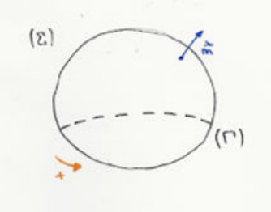
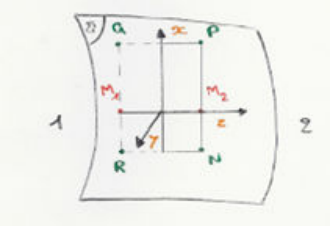
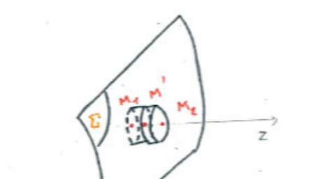
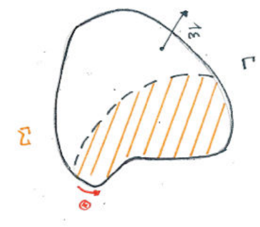

## Introduction : but du chapitre

Ce chapitre est destiné à rappeler les propriétés fondamentales des champs électriques et magnétiques en régime statique ou quasi statique.

L'interaction électromagnétique est une des quatre interactions fondamentales (gravitation, interaction électromagnétique, interactions nucléaires forte et faible) qui entrent en jeu dans la nature.

Les forces électromagnétiques s'exercent essentiellement entre particules chargées ; elles sont responsables de la cohésion des atomes, des molécules et des phases condensées (liquides, cristaux...) de la matière et sont à la base de l'ensemble des phénomènes chimiques et biologiques.

La description des interactions électromagnétiques entre particules de matière met en œuvre deux champs vectoriels, le champ électrique et le champ magnétique, suivant le schéma suivant.

Pour déterminer la force exercée par l'ensemble des charges $\Sigma$, on calcule d'abord les champs électrique et magnétique que cet ensemble produit dans l'espace ; l'action des champs $\vec{E}$ et $\vec{B}$, créés par $\Sigma$, sur la particule ponctuelle de charge $q$, située en $M$ à l'instant $t$, de vecteur position $\vec{OM} = \vec{r}$ et de vecteur vitesse $\vec{v}$ à cet instant, est donnée par la formule de Lorentz :

$$
\vec{F} = q\big(\vec{E}(M, t) + \vec{v} \wedge \vec{B}(M, t)\big)
$$

Il est à noter que cette formule est la formule de définition des champs $\vec{E}$ et $\vec{B}$. La formule de Lorentz est valable en toute généralité et en toute rigueur, même en régime variable.

Le schéma précédent paraît faire jouer aux champs électrique et magnétique le rôle de simples intermédiaires de calcul. Le développement de la théorie de l'électromagnétisme montre qu'ils ont en fait autant de "réalité physique" que les particules "matérielles" (électron, proton...) ; on est en effet conduit à leur conférer

- une énergie, distribuée dans l'espace ;
- une quantité de mouvement et un moment cinétique ;

et finalement la théorie leur associe des particules, les photons.

L'étude de l'électromagnétisme est donc dans une large mesure celle des propriétés des champs électrique et magnétique et des relations qui existent entre ces champs et les particules qui les créent (appelées sources des champs).

L'ensemble de ces propriétés est exprimé par 4 lois fondamentales que l'on va passer en revue, du moins sous leur forme particulière en régime statique ou lentement variable.

On va regarder les 3 aspects que chacune de ces relations peut prendre : la formulation intégrale, la formulation locale et les relations de passage.

## Circulation du champ électrique

### Formulation intégrale

En statique, le champ $\vec{E}$ est à circulation conservative :

- la circulation de $\vec{E}$ le long d'une courbe fermée quelconque est nulle :

$$
\oint_{\Gamma^+} \vec{E} \cdot \vec{dl} = 0
$$

- la circulation de $\vec{E}$ d'un point $A$ à un point $B$ de l'espace ne dépend pas du chemin suivi entre $A$ et $B$.

Les phénomènes d'induction conduisent à une modification de cette loi. Rappelons en effet que si un circuit électrique fermé, constitué de fil conducteur très fin, immobile, est placé dans un champ électromagnétique variable dans le temps, il est le siège d'une force électromotrice d'induction :

$$
e = -\frac{d\Phi}{dt} \qquad \text{(Faraday)}
$$

où $\phi = \displaystyle\iint_\Sigma (\vec{B} \cdot \vec{n})\,dS$ désigne le flux magnétique à travers le circuit.

Le circuit étant immobile, c'est le champ électrique qui joue le rôle de champ électromoteur, et par définition du champ électromoteur on a :

$$
e = \oint_{\Gamma^+} \vec{E} \cdot \vec{dl}
$$

En régime quasi stationnaire, on a donc :

$$
\oint_{\Gamma^+} \vec{E} \cdot \vec{dl} = -\frac{d}{dt}\left(\iint (\vec{B} \cdot \vec{n})\,dS\right)
$$

ce qui peut s'exprimer de la manière suivante :

*La circulation du champ électrique le long d'un contour fermé $\Gamma$ est égale à l'opposé de la dérivée temporelle du flux magnétique à travers une surface $\Sigma$ limitée par $\Gamma$.*

Le caractère algébrique de cette loi repose sur la convention qui lie l'orientation de la normale $\vec{n}$ à $\Sigma$ au sens de parcours choisi sur $\Gamma$ : règle du tire-bouchon.

La surface $\Sigma$ peut être choisie arbitrairement (elle est seulement astreinte à admettre $\Gamma$ pour frontière) ; cette possibilité de choix de $\Sigma$ résulte du fait que le champ magnétique est à flux conservatif.

### Formulation locale

Le flux magnétique à travers $\Sigma$ a pour dérivée :

$$
\frac{d\phi}{dt} = \iint_\Sigma \left(\frac{\partial \vec{B}}{\partial t}\right) \cdot \vec{n}\,dS
$$

La loi de l'induction établit donc l'égalité :

$$
\oint_{\Gamma^+} \vec{E} \cdot \vec{dl} = -\iint_\Sigma \left(\frac{\partial \vec{B}}{\partial t}\right) \cdot \vec{n}\,dS
$$

En transformant l'intégrale de circulation en intégrale de flux par la relation de Stokes :

$$
\oint_{\Gamma^+} \vec{E} \cdot \vec{dl} = \iint_\Sigma (\vec{\nabla} \wedge \vec{E}) \cdot \vec{n}\,dS
$$

on aboutit à l'égalité de deux intégrales de flux :

$$
\iint_\Sigma (\vec{\nabla} \wedge \vec{E}) \cdot \vec{n}\,dS = \iint_\Sigma -\left(\frac{\partial \vec{B}}{\partial t}\right) \cdot \vec{n}\,dS
$$

La surface $\Sigma$ étant quelconque, l'égalité des deux intégrales ne peut être réalisée que si les deux fonctions vectorielles sont égales en tout point (et à tout instant). On a finalement :

$$
\vec{\nabla} \wedge \vec{E} = -\frac{\partial \vec{B}}{\partial t} \qquad \text{(Maxwell-Faraday)}
$$

Cette équation a été introduite dans le contexte des régimes lentement variables, mais elle est en fait toujours valable.

### Relation de passage pour la composante tangentielle de $\vec{E}$

On considère une surface $\Sigma$ qui porte une charge et/ou un courant superficiel ; il s'agit en général d'une surface séparant deux milieux matériels différents (un métal et un isolant, ou deux isolants différents par exemple).

Il peut arriver que certaines composantes des champs $\vec{E}$ et $\vec{B}$ soient discontinues et que leurs dérivées spatiales ne soient pas définies, de sorte que les équations locales sont inapplicables sur cette surface.

Il faut donc établir des formules qui fournissent la variation des champs à la traversée d'une telle surface : ces formules sont établies à partir des équations intégrales.

Considérons une surface $\Sigma$ et désignons par 1 et 2 respectivement les régions de l'espace situées de part et d'autre de $\Sigma$.

Soit $M$ un point de la surface, $Mz$ l'axe normal à $\Sigma$ en $M$ orienté dans le sens allant de 1 vers 2, $Mx$ et $My$ deux axes tangents en $M$ à $\Sigma$ et formant avec $Mz$ un trièdre direct. Étant donné deux points $M_1$ et $M_2$ situés sur $Mz$ de part et d'autre de $M$ ($M_1$ dans la région 1 et $M_2$ dans la région 2).

Trouver la relation de passage pour $\vec{E}$ consiste à déterminer la quantité

$$
\lim_{M_1 \to M,\, M_2 \to M} \big(\vec{E}(M_2) - \vec{E}(M_1)\big)
$$

Dans cette expression vectorielle, on est amené à traiter séparément les composantes tangentielles (orthogonales à $Mz$) et normale (parallèle à $Mz$) du champ.

Le comportement de la composante tangentielle est lié à la loi sur la circulation, celui de la composante normale à la loi sur le flux.

Pour déterminer la quantité $\displaystyle\lim_{M_1 \to M,\, M_2 \to M} \big(\vec{E}_{/\!/}(M_2) - \vec{E}_{/\!/}(M_1)\big)$, on considère un contour rectangulaire $NPQR$ tracé dans le plan $Mxz$ : le côté $NP$ passe par $M_2$, le côté $QR$ par $M_1$. Les côtés du rectangle sont très petits, de sorte que le champ $\vec{E}$ reste pratiquement constant et égal à $\vec{E}(M_1)$ le long de $QR$ et à $\vec{E}(M_2)$ le long de $NP$. On a donc

$$
\lim_{M_1 \to M,\, M_2 \to M} \oint_{NPQRN} \vec{E} \cdot \vec{dl} = [E_x(M_2) - E_x(M_1)]\Delta x + \Delta x\,\epsilon(\Delta x)
$$

On pose $\Delta x = \overline{NP} = \overline{RQ}$.

Le flux magnétique à travers la surface $NPQR$ tend vers 0 lorsque $M_1$ et $M_2$ tendent vers $M$, puisque l'aire du rectangle devient alors nulle.

On a donc, à la limite où $M_1 \to M$ et $M_2 \to M$, et en divisant par $\Delta x$ : $[E_x(M_2) - E_x(M_1)] + \epsilon(\Delta x) = 0$. En faisant tendre $\Delta x$ vers $0$, on obtient

$$
E_x(M_2) - E_x(M_1) = 0
$$

On démontre de même que

$$
E_y(M_2) - E_y(M_1) = 0
$$

En conclusion, la composante tangentielle du champ électrique est continue.

Cette relation de passage, de même que l'équation locale (équation de Maxwell-Faraday) et l'équation intégrale correspondante relative à la circulation du champ électrique, est valide en toute généralité, c'est-à-dire en régime variable.

## Flux du champ électrique

### Formulation intégrale (théorème de Gauss)

Le flux du champ électrique sortant d'une surface fermée $\Sigma$ est égal à la somme algébrique des charges électriques situées dans la région intérieure à cette surface, divisée par $\epsilon_0$ :

$$
\phi_e = \oiint_\Sigma (\vec{E} \cdot \vec{n})\,dS = \frac{Q_{int}}{\epsilon_0}
$$

### Formulation locale

Elle résulte immédiatement :

- de la définition de la charge volumique (au point $M$ de l'espace) :

$$
\rho(M) = \lim_{\Delta\tau \to 0}\left(\frac{\Delta Q}{\Delta\tau}\right)
$$

où $\Delta Q$ représente la charge contenue dans le domaine de l'espace de volume $\Delta\tau$ contenant le point $M$ ;

- de la définition de la divergence :

$$
\vec{\nabla} \cdot \vec{E}(M) = \lim_{\Delta\tau \to 0}\left(\frac{\phi}{\Delta\tau}\right)
$$

où $\phi$ désigne le flux électrique sortant de la surface $\Sigma$ limitant le domaine de l'espace déjà envisagé ci-dessus ;

- du théorème de Gauss appliqué à la surface $\Sigma$ précédente :

$$
\Phi = \frac{\Delta Q}{\epsilon_0}
$$

On obtient ainsi

$$
\vec{\nabla} \cdot \vec{E} = \frac{\rho}{\epsilon_0} \qquad \text{(Maxwell-Gauss)}
$$

### Relation de passage pour la composante normale du champ électrique

On revient au problème exposé au paragraphe sur la composante tangentielle.

Le comportement de la composante normale de $\vec{E}$ est lié à la loi sur le flux. Pour déterminer la quantité

$$
\lim_{M_1 \to M,\, M_2 \to M} \big(E_\perp(M_2) - E_\perp(M_1)\big)
$$

on considère une boîte cylindrique d'axe $Mz$, limitée par deux disques situés de part et d'autre de la surface $\Sigma$, normaux à l'axe $Mz$ et contenant respectivement le point $M_1$ et le point $M_2$. La boîte découpe sur la surface $\Sigma$ un disque d'aire $\Delta S$.

La surface est chargée avec la densité surfacique $\sigma$, qui peut varier d'un point à l'autre. Les dimensions de la boîte sont très petites ; on peut donc considérer :

- que le champ électrique est pratiquement constant et égal à $\vec{E}(M_1)$ sur le disque 1, constant et égal à $\vec{E}(M_2)$ sur le disque 2 ;
- que la charge surfacique est pratiquement constante et égale à $\sigma(M)$ sur la surface d'aire $\Delta S$ découpée par la boîte cylindrique sur $\Sigma$ ;
- que les disques et la surface précédente ont la même aire $\Delta S$.

Lorsque $M_1$ et $M_2$ tendent vers $M$, l'aire de la surface latérale de la boîte tend vers 0, et la contribution de cette surface au flux sortant de la boîte également.

On a donc

$$
\lim_{M_1 \to M,\, M_2 \to M} \oiint (\vec{E} \cdot \vec{n})\,dS = [E_z(M_2) - E_z(M_1)]\Delta S + \Delta S\,\epsilon(\Delta S)
$$

(la normale sortante est $\vec{n} = -\vec{u}_z$ sur le disque 1, $\vec{n} = +\vec{u}_z$ sur le disque 2).

La charge contenue dans la boîte, $\Delta Q$, est la somme de la charge distribuée dans son volume, $\Delta Q_v$, et de celle distribuée sur l'élément $\Delta S$ de la surface $\Sigma$.

Lorsque $M_1$ et $M_2$ tendent vers $M$, le volume de la boîte tend vers 0, et donc aussi la charge $\Delta Q_v$, de sorte que :

$$
\lim_{M_1 \to M,\, M_2 \to M} \Delta Q = \sigma(M)\Delta S + \Delta S\,\epsilon(\Delta S)
$$

Le théorème de Gauss fournit l'égalité (après division par $\Delta S$) :

$$
E_z(M_2) - E_z(M_1) + \epsilon(\Delta S) = \frac{\sigma(M)}{\epsilon_0} + \frac{1}{\epsilon_0}\epsilon(\Delta S)
$$

En faisant tendre vers 0 les dimensions des disques qui ferment la boîte, on obtient finalement :

$$
\lim_{M_1 \to M,\, M_2 \to M} [E_z(M_2) - E_z(M_1)] = \frac{\sigma(M)}{\epsilon_0}
$$

**Remarques.**

- Les deux relations de passage pour le champ électrique peuvent être rassemblées en une formule vectorielle unique :

$$
\lim_{M_1 \to M,\, M_2 \to M} \big(\vec{E}(M_2) - \vec{E}(M_1)\big) = \frac{\sigma(M)}{\epsilon_0}\vec{u}_z
$$

En désignant par $\vec{n}_{12}$ la normale à $\Sigma$ en $M$ orientée de 1 vers 2, et en notant plus simplement

$$
\lim_{M_1 \to M,\, M_2 \to M} \big(\vec{E}(M_2) - \vec{E}(M_1)\big) = \vec{E}_2 - \vec{E}_1
$$

on obtient

$$
\vec{E}_2 - \vec{E}_1 = \frac{\sigma}{\epsilon_0}\vec{n}_{12}
$$

- Ces lois relatives au flux du champ électrique sont valides en toute généralité, donc en régime variable.

## Flux du champ magnétique

### Formulation intégrale

Le champ magnétique $\vec{B}$ est à flux conservatif. Cela signifie que :

- le flux du champ $\vec{B}$ sortant d'une surface fermée quelconque est nul :

$$
\oiint (\vec{B} \cdot \vec{n})\,dS = 0
$$

- étant donné un contour fermé $\Gamma$, le flux magnétique

$$
\phi = \iint (\vec{B} \cdot \vec{n})\,dS
$$

à travers une surface quelconque $\Sigma$ limitée par $\Gamma$ est indépendant de la surface $\Sigma$ considérée ; pour cette raison, on parle souvent de flux à travers le contour $\Gamma$.

Pour que cet énoncé soit valide, il faut évidemment que les normales aux différentes surfaces $\Sigma$ limitées par $\Gamma$ soient orientées de manière cohérente : cela est réalisé en orientant toutes les normales par référence au sens de parcours positif choisi sur leur frontière commune $\Gamma$ (règle du tire-bouchon).

### Formulation locale

Le même raisonnement que pour le flux du champ électrique conduit à :

$$
\vec{\nabla} \cdot \vec{B} = 0 \qquad \text{(flux magnétique)}
$$

### Relation de passage

Le même raisonnement que pour la composante normale du champ électrique montre que la composante normale de $\vec{B}$ est continue.

**Remarque.** Ces propriétés concernant le flux du champ magnétique sont valides en toute généralité, c'est-à-dire en régime variable.

## Circulation du champ magnétique

### Formulation intégrale : théorème d'Ampère

En magnétostatique, on a vu que la circulation du champ magnétique $\vec{B}$ le long d'un contour fermé $\Gamma$ est égale au produit par $\mu_0$ de la somme algébrique des courants traversant une surface $\Sigma$ quelconque limitée par le contour $\Gamma$ :

$$
\oint_{\Gamma^+} \vec{B} \cdot \vec{dl} = \mu_0 \sum_k I_k
$$

Les signes sont déterminés de la manière suivante :

- la normale à la surface $\Sigma$ est orientée par référence au sens de parcours positif choisi sur $\Gamma$ ;
- le sens sur chacun des circuits électriques $C_k$ qui traversent $\Sigma$ est déterminé par l'orientation de la normale à $\Sigma$ au point de traversée : le signe de l'intensité $I_k$ est défini par ce sens de parcours.

La surface $\Sigma$ limitée par le contour $\Gamma$ peut être choisie arbitrairement. Cela résulte du fait qu'en régime stationnaire l'intensité du courant est la même en tous les points d'un circuit donné.

### Formulation locale

On considère qu'on a ici affaire à des courants distribués en volume, et on désigne par $\vec{j}$ le vecteur densité de courant. L'intensité de courant étant le flux du vecteur densité de courant en volume, le théorème d'Ampère se formule :

$$
\oint_{\Gamma^+} \vec{B} \cdot \vec{dl} = \mu_0 \iint_\Sigma (\vec{j} \cdot \vec{n})\,dS
$$

où $\Gamma$ désigne le contour fermé et $\Sigma$ la surface limitée par $\Gamma$ introduite au paragraphe précédent.

On transforme l'intégrale de circulation en intégrale de flux par la formule de Stokes et on obtient :

$$
\iint_\Sigma (\vec{\nabla} \wedge \vec{B}) \cdot \vec{n}\,dS = \mu_0 \iint_\Sigma \vec{j} \cdot \vec{n}\,dS
$$

L'égalité des deux intégrales devant être réalisée quelle que soit $\Sigma$, il en résulte :

$$
\vec{\nabla} \wedge \vec{B} = \mu_0 \vec{j} \qquad \text{(Maxwell-Ampère)}
$$

**Remarque.** Ces lois sont valides seulement en régime statique ou quasi stationnaire. Pour cette raison, l'étude de la relation de passage associée est reportée au chapitre suivant.
