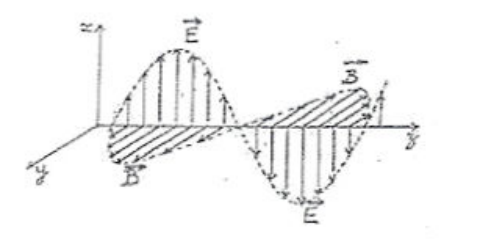
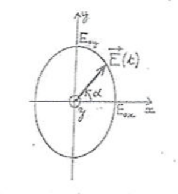
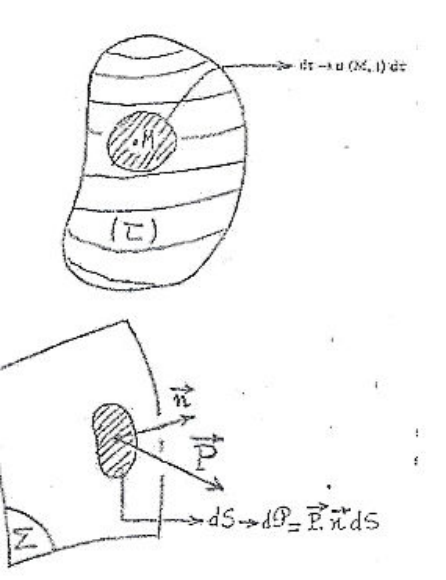
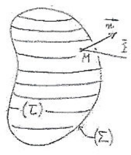
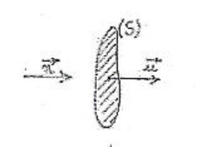
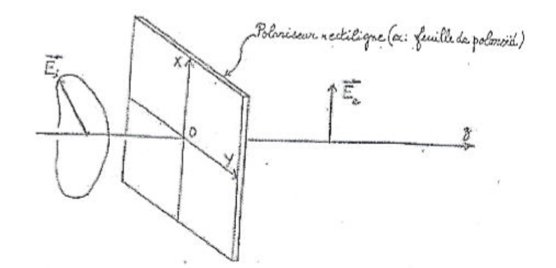
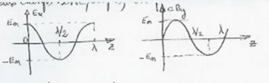
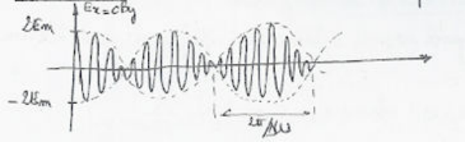

## Introduction : but du chapitre

En 1873, J. C. Maxwell publie le célèbre ensemble d'équations qui forme les bases de l'électromagnétisme. Une solution très facile à déduire de ces équations est la propagation d'un champ électrique et d'un champ magnétique (liés l'un à l'autre) : la vitesse de propagation de cette "onde électromagnétique" peut être calculée à partir des valeurs numériques des constantes, connues, qui figurent dans les lois de Coulomb ($\epsilon_0$) et de Biot et Savart ($\mu_0$). On constate alors que la vitesse ainsi calculée coïncide avec la valeur de la vitesse de la lumière, connue avec précision à cette époque à la suite des mesures de Fizeau et de Foucault, et on en infère que la lumière est une onde électromagnétique. Il s'agissait là bien sûr d'une découverte de première grandeur. Cependant, la production d'une onde électromagnétique par un dispositif électrique (macroscopique) n'allait être réussie que quinze ans plus tard, en 1888, par Heinrich Hertz, qui montre que les ondes "hertziennes" ainsi produites ont des propriétés analogues à la lumière en ce qui concerne par exemple la réflexion, la polarisation, etc., et que ces propriétés découlent des équations de Maxwell.

**But de ce chapitre.**

- Établir l'équation de propagation des champs $\vec{E}$ et $\vec{B}$ à partir des équations de Maxwell et calculer la célérité.
- Décrire la structure d'une onde électromagnétique plane (disposition de $\vec{E}$ et de $\vec{B}$ par rapport à la direction de propagation et l'un par rapport à l'autre).
- Étudier plus en détail les ondes sinusoïdales et les problèmes de polarisation.
- Examiner les problèmes énergétiques : énergie distribuée dans l'espace et flux d'énergie, décrit par le vecteur de Poynting, définition d'une onde électromagnétique.

## Équation de propagation, célérité

### Équation de propagation de $\vec{E}$

On se place dans un domaine de l'espace vide, c'est-à-dire qui ne contient aucune charge ni aucun courant. Les densités de charge volumique $\rho$ et de courant volumique $\vec{j}$ sont nulles en tous les points de ce domaine. Dans ces conditions, les équations de Maxwell ont une forme particulière :

$$
\vec{\nabla} \cdot \vec{E} = 0 \qquad \vec{\nabla} \cdot \vec{B} = 0 \qquad \vec{\nabla} \wedge \vec{E} = -\frac{\partial \vec{B}}{\partial t} \qquad \vec{\nabla} \wedge \vec{B} = \epsilon_0\mu_0 \frac{\partial \vec{E}}{\partial t}
$$

On cherche à éliminer $\vec{B}$ entre les deux équations en rotationnel pour obtenir une équation relative à $\vec{E}$ seul. Pour cela, on prend le rotationnel de l'équation de Maxwell-Faraday :

$$
\vec{\nabla} \wedge (\vec{\nabla} \wedge \vec{E}) = -\vec{\nabla} \wedge \left(\frac{\partial \vec{B}}{\partial t}\right) = -\frac{\partial}{\partial t}(\vec{\nabla} \wedge \vec{B}) = -\epsilon_0\mu_0 \frac{\partial^2 \vec{E}}{\partial t^2}
$$

Puis on introduit le laplacien vectoriel et on tient compte de l'équation $\vec{\nabla} \cdot \vec{E} = 0$ :

$$
\vec{\nabla}(\vec{\nabla} \cdot \vec{E}) - \Delta\vec{E} = -\epsilon_0\mu_0 \frac{\partial^2 \vec{E}}{\partial t^2}
$$

et finalement $\Delta\vec{E} - \epsilon_0\mu_0 \dfrac{\partial^2 \vec{E}}{\partial t^2} = \vec{0}$.

Cette équation est l'équation de d'Alembert pour une onde vectorielle décrite par le champ $\vec{E}$. En coordonnées cartésiennes, les composantes de $\Delta\vec{E}$ sont :

$$
\Delta\vec{E} = \begin{cases}
u_x = \partial^2 E_x/\partial x^2 + \partial^2 E_x/\partial y^2 + \partial^2 E_x/\partial z^2 = \Delta E_x \\
u_y = \partial^2 E_y/\partial x^2 + \partial^2 E_y/\partial y^2 + \partial^2 E_y/\partial z^2 = \Delta E_y \\
u_z = \partial^2 E_z/\partial x^2 + \partial^2 E_z/\partial y^2 + \partial^2 E_z/\partial z^2 = \Delta E_z
\end{cases}
$$

### Onde plane homogène, solution de l'équation de propagation

On cherche comme solution de l'équation de propagation établie au paragraphe précédent une fonction de la forme

$$
\vec{E}(x, y, z, t) = \vec{E}\big(0, 0, 0, t - (\alpha x + \beta y + \gamma z)/c\big)
$$

Une telle fonction, qui ne dépend que de la variable

$$
u = t - \big((\alpha x + \beta y + \gamma z)/c\big)
$$

représente une onde plane homogène se propageant parallèlement à la direction du vecteur unitaire $\vec{u}$ de composantes $\alpha$, $\beta$ et $\gamma$.

Pour vérifier que cette fonction $\vec{E}$ satisfait bien à l'équation de propagation, on calcule les dérivées :

$$
\frac{\partial E_x}{\partial t} = \frac{dE_x}{du}\frac{\partial u}{\partial t} = \frac{dE_x}{du}
$$

$$
\frac{\partial E_x}{\partial x} = \left(\frac{dE_x}{du}\right)\left(\frac{\partial u}{\partial x}\right) = -\frac{\alpha}{c}\frac{dE_x}{du} = -\frac{\alpha}{c}\frac{\partial E_x}{\partial t}
$$

En dérivant une deuxième fois par rapport à $t$ d'une part et à $x$ d'autre part, on aboutit à

$$
\frac{\partial^2 E_x}{\partial x^2} = \frac{\alpha^2}{c^2}\frac{\partial^2 E_x}{\partial t^2}
$$

et on obtient de même :

$$
\frac{\partial^2 E_x}{\partial y^2} = \frac{\beta^2}{c^2}\frac{\partial^2 E_x}{\partial t^2}
\qquad
\frac{\partial^2 E_x}{\partial z^2} = \frac{\gamma^2}{c^2}\frac{\partial^2 E_x}{\partial t^2}
$$

Ainsi

$$
\Delta\vec{E} = \frac{1}{c^2}\frac{\partial^2 \vec{E}}{\partial t^2}
$$

### Célérité

La célérité de l'onde plane introduite au paragraphe précédent est

$$
c = \frac{1}{\sqrt{\epsilon_0\mu_0}}
$$

À l'époque de Maxwell, on calculait $c$ à partir des valeurs numériques des constantes $\epsilon_0$ et $\mu_0$ déduites de l'étude des phénomènes statiques. Actuellement (depuis la mise en vigueur de la nouvelle définition du mètre en 1983), la constante $c$ est égale, exactement, à

$$
c = 299\,792\,458\ m.s^{-1}
$$

La valeur de la constante $\mu_0$ résulte de la définition de l'ampère ; on a exactement :

$$
\mu_0 = 4\pi.10^{-7}\ H.m^{-1}
$$

La valeur de la constante $\epsilon_0$ dérive de ces deux valeurs suivant la formule :

$$
\epsilon_0 = \frac{1}{\mu_0 c^2} = 8{,}854187817.10^{-12}\ F.m^{-1}
$$

**Remarque.** On a établi l'équation de propagation relative à $\vec{E}$. En éliminant $\vec{E}$ entre les 2 équations en rotationnel, on obtient pour $\vec{B}$ une équation de propagation identique :

$$
\Delta\vec{B} - \epsilon_0\mu_0 \frac{\partial^2 \vec{B}}{\partial t^2} = \vec{0}
$$

## Structure de l'onde plane homogène

### Transversalité du champ électrique

On dit qu'une onde vectorielle est transversale lorsque le vecteur représentant la grandeur physique qui se propage est orthogonal à la direction de propagation en tout point et à tout instant.

Pour les ondes électromagnétiques, comme on va le constater dans ce qui suit, la transversalité des champs pour une onde plane homogène est liée au fait que les divergences sont nulles.

Reprenons l'expression du champ électrique représentant une onde plane homogène se propageant parallèlement à la direction $\vec{u}(\alpha, \beta, \gamma)$ :

$$
\vec{E}(x, y, z, t) = \vec{E}\big(0, 0, 0, t - (\alpha x + \beta y + \gamma z)/c\big)
$$

Calculons

$$
\vec{\nabla} \cdot \vec{E} = \frac{\partial E_x}{\partial x} + \frac{\partial E_y}{\partial y} + \frac{\partial E_z}{\partial z}
$$

En utilisant les expressions des dérivées établies au paragraphe précédent, on obtient :

$$
\vec{\nabla} \cdot \vec{E} = -\frac{\alpha}{c}\frac{\partial E_x}{\partial t} - \frac{\beta}{c}\frac{\partial E_y}{\partial t} - \frac{\gamma}{c}\frac{\partial E_z}{\partial t}
$$

soit

$$
\vec{\nabla} \cdot \vec{E} = -\frac{\vec{u}}{c} \cdot \frac{\partial \vec{E}}{\partial t}
$$

La propriété

$$
\vec{\nabla} \cdot \vec{E} = 0
$$

entraîne donc, pour l'onde plane homogène considérée,

$$
\vec{u} \cdot \frac{\partial \vec{E}}{\partial t} = 0
$$

Si le champ $\vec{E}$ est alors décomposé en une composante transversale $\vec{E}_\perp$ et une composante longitudinale $\vec{E}_{/\!/}$, on a

$$
\vec{u} \cdot \vec{E}_\perp = 0 \quad \text{donc} \quad \vec{u} \cdot \frac{\partial \vec{E}_\perp}{\partial t} = 0
$$

La nullité de la divergence entraîne alors, en posant $\vec{E}_{/\!/} = E_{/\!/}\,\vec{u}$ :

$$
\vec{u} \cdot \frac{\partial \vec{E}_{/\!/}}{\partial t} = \vec{u} \cdot \frac{\partial (\vec{u}E_{/\!/})}{\partial t} = \frac{\partial E_{/\!/}}{\partial t} = 0
$$

Cela signifie que la composante longitudinale de $\vec{E}$ est statique.

Un champ statique uniforme est évidemment de la forme donnée au paragraphe sur l'onde plane homogène, mais il ne correspond pas à l'idée physique d'une onde, qui est associée à un phénomène physique variable dans le temps et l'espace.

On considère donc que la composante longitudinale statique ne fait pas réellement partie de l'onde électromagnétique considérée (il est toujours possible de faire passer une onde lumineuse entre les plaques d'un condensateur plan chargé, mais on ne considère pas pour autant que le champ créé par le condensateur fait partie du champ de l'onde lumineuse) et que la composante longitudinale du champ de l'onde électromagnétique plane homogène est nulle. Autrement dit :

*Le champ électrique d'une onde électromagnétique plane homogène se propageant dans le vide est transversal.*

### Détermination du champ magnétique

Dans ce paragraphe, on va montrer que le champ électrique de l'onde électromagnétique ne peut exister seul et qu'il est nécessairement associé à un champ magnétique, que l'on va exprimer en fonction du champ électrique donné.

Pour déterminer le champ magnétique associé au champ électrique, on part de l'équation de Maxwell-Faraday :

$$
\vec{\nabla} \wedge \vec{E} = -\frac{\partial \vec{B}}{\partial t}
$$

Les projections sur les axes cartésiens de cette équation vectorielle s'écrivent :

$$
\begin{aligned}
\frac{\partial B_x}{\partial t} &= \frac{\partial E_y}{\partial z} - \frac{\partial E_z}{\partial y} = \frac{1}{c}\left(\beta\frac{\partial E_z}{\partial t} - \gamma\frac{\partial E_y}{\partial t}\right) \\
\frac{\partial B_y}{\partial t} &= \frac{\partial E_z}{\partial x} - \frac{\partial E_x}{\partial z} = \frac{1}{c}\left(\gamma\frac{\partial E_x}{\partial t} - \alpha\frac{\partial E_z}{\partial t}\right) \\
\frac{\partial B_z}{\partial t} &= \frac{\partial E_x}{\partial y} - \frac{\partial E_y}{\partial x} = \frac{1}{c}\left(\alpha\frac{\partial E_y}{\partial t} - \beta\frac{\partial E_x}{\partial t}\right)
\end{aligned}
$$

soit

$$
\frac{\partial \vec{B}}{\partial t} = \frac{\vec{u}}{c} \wedge \frac{\partial \vec{E}}{\partial t}
$$

Par intégration par rapport au temps, on obtient

$$
\vec{B} = \frac{\vec{u}}{c} \wedge \vec{E} + \vec{B}_s
$$

La constante d'intégration $\vec{B}_s$ est indépendante du temps : elle représente un champ statique qui n'est pas considéré comme faisant partie du champ de l'onde électromagnétique (on peut faire passer une onde électromagnétique à l'intérieur d'un solénoïde parcouru par un courant continu, mais le champ statique de ce solénoïde n'est pas considéré comme faisant partie de l'onde électromagnétique). On retiendra donc la relation

$$
\vec{B} = \frac{\vec{u}}{c} \wedge \vec{E}
$$

qui relie en tout point et à tout instant le champ magnétique et le champ électrique de l'onde électromagnétique plane homogène se propageant dans le vide.

### Structure de l'onde

De la relation précédente, il résulte immédiatement que le champ magnétique $\vec{B}$ est orthogonal à $\vec{u}$, donc transversal :

*Le champ magnétique d'une onde électromagnétique plane homogène se propageant dans le vide est transversal.*

Cette propriété aurait pu être déduite, comme pour le champ électrique, du fait que

$$
\vec{\nabla} \cdot \vec{B} = 0
$$

La relation

$$
\vec{B} = \frac{\vec{u}}{c} \wedge \vec{E}
$$

montre également que les champs $\vec{E}$ et $\vec{B}$ sont orthogonaux en tout point et à tout instant. Plus précisément, les trois vecteurs $\vec{E}$, $\vec{B}$, $\vec{u}$ forment en tout point et à tout instant un trièdre trirectangle direct.

Enfin, il résulte de cette relation et de l'orthogonalité de $\vec{u}$ et de $\vec{E}$ que les modules des champs sont dans le rapport

$$
\frac{\|\vec{B}\|}{\|\vec{E}\|} = \frac{1}{c}
$$

Dans tout ce qui précède, on ne suppose pas que la direction de $\vec{E}$ ni celle de $\vec{B}$ sont invariables dans le temps et dans l'espace. La direction de $\vec{u}$ est bien sûr fixe, puisqu'il s'agit d'une propagation par ondes planes ; les directions de $\vec{E}$ et $\vec{B}$ peuvent varier, mais ces champs restent partout et à tout instant orthogonaux entre eux et à la direction de propagation $\vec{u}$.

En résumé, une onde électromagnétique plane, homogène, progressive, se propageant dans le vide, est constituée d'un champ électrique et d'un champ magnétique, tous les deux transversaux, mutuellement orthogonaux, et tels que le rapport des modules du champ magnétique et du champ électrique soit égal à $\dfrac{1}{c}$.

## Ondes sinusoïdales : polarisation

### Importance des ondes sinusoïdales

Du point de vue expérimental, il existe de nombreux types d'ondes électromagnétiques, qui se distinguent radicalement les unes des autres par la nature des dispositifs qui les produisent et les détectent, et par leurs interactions avec la matière. On distingue ainsi les ondes hertziennes (radiodiffusion, télévision...), les micro-ondes, la lumière infrarouge, la lumière visible, la lumière ultraviolette, les rayons $X$ et les rayons $\gamma$.

Le paramètre physique à la base de ce classement est la fréquence : cela signifie qu'on se réfère (implicitement) au caractère sinusoïdal de la variation temporelle des champs. Les fonctions sinusoïdales jouent donc un rôle privilégié lorsqu'on étudie les radiations électromagnétiques : cela tient en particulier à leur mode d'émission, comme les deux exemples suivants permettent de le comprendre.

Considérons d'abord un émetteur de radiodiffusion. Cet émetteur émet une onde sinusoïdale appelée porteuse : pour diffuser le signal (son), on module, par exemple en amplitude, l'onde porteuse ; cela signifie qu'on fait varier l'amplitude de manière qu'elle reproduise la fonction qui représente le signal. L'onde diffusée n'est alors plus rigoureusement sinusoïdale, mais elle reste presque sinusoïdale parce que les variations de l'amplitude sont lentes à l'échelle de la période de la porteuse (la fréquence de la porteuse est par exemple de l'ordre de $1\,MHz$, alors que la fréquence des sons à diffuser est au plus de $10\,kHz$).

Le deuxième exemple concerne l'émission de lumière par les atomes et les molécules : cette émission est associée à la transition de l'atome ou de la molécule d'un niveau d'énergie donné $E_1$ à un niveau d'énergie plus basse $E_0$. La fréquence de l'onde émise est déterminée par la différence d'énergie entre les niveaux suivant la formule

$$
\nu = \frac{E_1 - E_0}{h}
$$

L'onde émise est donc sinusoïdale (en fait, elle n'est qu'approximativement sinusoïdale, pour des raisons qui ne peuvent être données ici).

Pour ce qui concerne la lumière visible, la fréquence correspond à la couleur. La lumière blanche, émise par exemple par le soleil ou les lampes à incandescence, est une superposition de toutes les couleurs. Il est possible de séparer les composantes de couleurs, c'est-à-dire de fréquences différentes, contenues dans une lumière complexe à l'aide d'un appareil appelé spectroscope. Cet appareil contient un élément dispersif (prisme ou réseau) qui dévie les ondes électromagnétiques de manière différente suivant leur fréquence ; on verra plus tard que l'indice de réfraction d'un milieu diélectrique tel que le verre dépend de la fréquence de la radiation qui le traverse : l'angle de déviation par un prisme est donc fonction de la fréquence.

La lumière blanche fournit ainsi un "spectre" coloré, rouge à un bord (basses fréquences), violet à l'autre (hautes fréquences).

### Composantes cartésiennes des champs

On considère une onde plane progressive se propageant parallèlement à $Oz$ dans le sens des $z$ croissants. La variation des champs étant sinusoïdale, leurs composantes ont la forme suivante :

$$
\vec{E}(M, t) \begin{cases} E_{Ox}\cos(\omega t - kz + \phi) \\ E_{Oy}\cos(\omega t - kz + \psi) \\ 0 \end{cases}
\qquad
\vec{B}(M, t) \begin{cases} -\dfrac{E_{Oy}}{c}\cos(\omega t - kz + \psi) \\ \dfrac{E_{Ox}}{c}\cos(\omega t - kz + \phi) \\ 0 \end{cases}
$$

Dans ces expressions, on a introduit le module du vecteur d'onde $k = \omega/c$.

Les quantités $E_{Ox}$ et $E_{Oy}$ sont des constantes qui rendent compte des amplitudes des composantes des champs ; les quantités $\phi$ et $\psi$ décrivent les phases de ces composantes.

En représentation complexe, les composantes des champs sont

$$
\vec{E}(M, t) \begin{cases} E_{Ox}e^{i\phi}e^{i(\omega t - kz)} \\ E_{Oy}e^{i\psi}e^{i(\omega t - kz)} \\ 0 \end{cases}
\qquad
\vec{B}(M, t) \begin{cases} -\dfrac{E_{Oy}}{c}e^{i\psi}e^{i(\omega t - kz)} \\ \dfrac{E_{Ox}}{c}e^{i\phi}e^{i(\omega t - kz)} \\ 0 \end{cases}
$$

### Polarisation rectiligne

La direction du champ électrique reste donc invariable dans le temps et dans l'espace : on a affaire à une onde polarisée rectilignement.

Bien entendu, le champ magnétique, qui est orthogonal à $\vec{E}$, garde aussi une direction constante.

**Remarque.** La caractéristique d'une onde polarisée rectilignement est le fait que le champ électrique garde une direction constante : une onde polarisée rectilignement n'est donc pas nécessairement sinusoïdale.

### Polarisation circulaire et elliptique

Si $\psi = \phi + \dfrac{\pi}{2}\ (2\pi)$, les expressions de $\vec{E}$ deviennent

$$
\begin{cases}
E_x = E_{Ox}\cos(\omega t - kz + \phi) \\
E_y = -E_{Oy}\sin(\omega t - kz + \phi) \\
E_z = 0
\end{cases}
$$

En un point donné de l'espace ($z$ fixé), l'extrémité du vecteur représentant le champ électrique, c'est-à-dire le point de coordonnées

$$
X = E_{Ox}\cos(\omega t - kz + \phi) \qquad Y = -E_{Oy}\sin(\omega t - kz + \phi) \qquad Z = z
$$

décrit une ellipse au cours du temps. On a en effet

$$
\frac{X^2}{E_{Ox}^2} + \frac{Y^2}{E_{Oy}^2} = 1
$$

La pulsation $\omega$ étant toujours choisie positive, si les constantes $E_{Ox}$ et $E_{Oy}$ sont de même signe (elles sont en principe positives toutes les deux : amplitudes réelles de vibrations sinusoïdales), le point $(X, Y)$ décrit l'ellipse dans le sens rétrograde. En effet, l'angle

$$
\alpha = (Ox, \vec{E})
$$

est une fonction décroissante du temps, puisque

$$
\tan(\alpha) = \frac{Y}{X} = -\frac{E_{Oy}}{E_{Ox}}\tan(\omega t - kz + \phi)
$$

et

$$
(1 + \tan^2(\alpha))\,\dot{\alpha} = -\omega\frac{E_{Oy}}{E_{Ox}}[1 + \tan^2(\omega t - kz + \phi)]
$$

On dit que l'onde a une polarisation elliptique droite. Dans le cas particulier où, de plus, $E_{Ox} = E_{Oy}$, l'ellipse est un cercle. On dit que l'onde a une polarisation circulaire droite. On montre de la même façon que :

- si $\psi = \phi - \dfrac{\pi}{2}\ (2\pi)$, on a affaire à une onde de polarisation elliptique gauche ;
- si $\psi = \phi - \dfrac{\pi}{2}\ (2\pi)$ et si de plus $E_{Ox} = E_{Oy}$, on a affaire à une onde de polarisation circulaire gauche.

De manière plus générale, si $\psi - \phi \neq 0\ \left(\dfrac{\pi}{2}\right)$, c'est-à-dire si $\psi - \phi$ n'est pas un multiple de $\dfrac{\pi}{2}$, on montre que l'onde a une polarisation elliptique, mais les axes de l'ellipse décrite par le vecteur $\vec{E}$ ne sont pas parallèles aux axes de coordonnées $Ox$ et $Oy$.

Dans ce qui précède, on a défini la caractéristique, droite ou gauche, d'une onde polarisée elliptiquement par référence au sens de rotation du vecteur champ électrique dans le plan $xOy$, c'est-à-dire autour de l'axe $Oz$. Mais il faut pouvoir définir l'état de polarisation pour une onde ne se propageant pas suivant $Oz$ : la direction de référence physique est évidemment la direction de propagation, définie par le vecteur unitaire $\vec{u}$.

On dit qu'une onde polarisée circulairement ou elliptiquement est droite (respectivement gauche) si son champ électrique, en un point donné, tourne autour du vecteur direction de propagation $\vec{u}$ dans le sens rétrograde (respectivement direct). La "règle du tire-bouchon" permet de trouver le sens direct de rotation autour de l'axe $\vec{u}$.

On vérifie aisément qu'il est nécessaire que $\psi = \phi\ (\pi)$ pour que l'onde soit polarisée rectilignement.

De même, il est nécessaire que $\psi = \phi + \dfrac{\pi}{2}\ (\pi)$ et que $|E_{Ox}| = |E_{Oy}|$ pour que l'onde soit polarisée circulairement.

Enfin, puisque le champ magnétique forme avec $\vec{E}$ un angle de $+\pi/2$ et puisque le rapport

$$
\frac{\|\vec{B}\|}{\|\vec{E}\|} = \frac{1}{c}
$$

l'état de polarisation du champ magnétique est le même que celui du champ électrique :

- si la polarisation de $\vec{E}$ est rectiligne, celle de $\vec{B}$ l'est aussi, mais la direction de polarisation de $\vec{B}$ est orthogonale à celle de $\vec{E}$ ;
- si la polarisation de $\vec{E}$ est elliptique droite (respectivement gauche), celle de $\vec{B}$ est droite (respectivement gauche), mais la direction du grand axe de l'ellipse de $\vec{B}$ est orthogonale à celle du grand axe de l'ellipse de $\vec{E}$.

### Onde de direction de propagation quelconque et représentation complexe

Les composantes du champ électrique d'une onde de direction de propagation quelconque sont données par les expressions

$$
\begin{cases}
E_x = E_{Ox}\cos(\omega t - \vec{k} \cdot \vec{r} + \phi) \\
E_y = E_{Oy}\cos(\omega t - \vec{k} \cdot \vec{r} + \psi) \\
E_z = E_{Oz}\cos(\omega t - \vec{k} \cdot \vec{r} + \eta)
\end{cases}
\qquad \text{avec } \vec{k} \cdot \vec{r} = k_x x + k_y y + k_z z
$$

En général, les trois composantes de $\vec{E}$ sont différentes de zéro. La transversalité de $\vec{E}$ exige que

$$
\vec{k} \cdot \vec{E} = k_x E_x + k_y E_y + k_z E_z = 0 \quad \text{quels que soient } t \text{ et } x, y, z
$$

La représentation complexe permet de retrouver rapidement et d'exprimer simplement la structure de l'onde électromagnétique (sinusoïdale), parce que les expressions de la divergence et du rotationnel sont très simples. La représentation complexe des composantes de $\vec{E}$ est

$$
\begin{cases}
\underline{E}_x = E_{Ox}e^{i\phi}e^{i(\omega t - \vec{k} \cdot \vec{r})} = \underline{E}_{Ox}e^{i(\omega t - \vec{k} \cdot \vec{r})} \\
\underline{E}_y = E_{Oy}e^{i\psi}e^{i(\omega t - \vec{k} \cdot \vec{r})} = \underline{E}_{Oy}e^{i(\omega t - \vec{k} \cdot \vec{r})} \\
\underline{E}_z = E_{Oz}e^{i\eta}e^{i(\omega t - \vec{k} \cdot \vec{r})}
\end{cases}
$$

On peut donc mettre $\underline{\vec{E}}$ sous la forme $\underline{\vec{E}} = \underline{\vec{E}}_O e^{i(\omega t - \vec{k} \cdot \vec{r})}$.

Bien noter qu'une factorisation de l'expression réelle du champ $\vec{E}$ en un vecteur constant par un scalaire n'est en général pas possible.

La dérivée, par rapport à une coordonnée quelconque, d'une composante quelconque de $\vec{E}$ ou $\vec{B}$, par exemple $\dfrac{\partial \underline{E}_x}{\partial y}$, est donnée par

$$
\frac{\partial \underline{E}_x}{\partial y} = -ik_y \underline{E}_{Ox}e^{i(\omega t - \vec{k} \cdot \vec{r})}
$$

On en déduit

$$
\begin{cases}
\vec{\nabla} \cdot \underline{\vec{E}} = -i\vec{k} \cdot \underline{\vec{E}} \\
\vec{\nabla} \wedge \underline{\vec{E}} = -i\vec{k} \wedge \underline{\vec{E}}
\end{cases}
$$

Du fait que le vecteur $\vec{k}$ est réel, on a évidemment $\vec{\nabla} \cdot \vec{E} = \mathrm{Re}(\vec{\nabla} \cdot \underline{\vec{E}})$ et $\vec{\nabla} \wedge \vec{E} = \mathrm{Re}(\vec{\nabla} \wedge \underline{\vec{E}})$.

L'équation $\vec{\nabla} \cdot \underline{\vec{E}} = 0$ conduit donc à $\vec{k} \cdot \underline{\vec{E}}_0 = 0$.

L'équation $\vec{\nabla} \wedge \underline{\vec{E}} = -\dfrac{\partial \underline{\vec{B}}}{\partial t}$ se traduit par

$$
-i\vec{k} \wedge \underline{\vec{E}} = -i\omega\underline{\vec{B}} \quad \text{soit} \quad \omega\underline{\vec{B}} = \vec{k} \wedge \underline{\vec{E}}
$$

(On suppose que $\underline{\vec{B}}$ est une onde plane sinusoïdale de pulsation $\omega$ et de vecteur d'onde $\vec{k}$ ; on rappelle que la dérivation par rapport à $t$ se traduit par la multiplication par le facteur $i\omega$.) On a donc $\underline{\vec{B}} = \dfrac{\vec{k}}{\omega} \wedge \underline{\vec{E}}$ et par conséquent, en prenant les parties réelles,

$$
\vec{B} = \frac{\vec{k}}{\omega} \wedge \vec{E}
$$

Cette relation est identique à celle obtenue lors de la détermination du champ magnétique, puisque $\vec{k} = \dfrac{\omega}{c}\vec{u}$, où $\vec{u}$ désigne le vecteur unitaire de la direction de propagation.

## Énergie électromagnétique : densité volumique et flux

En électrostatique, on a introduit une énergie associée au champ et distribuée dans l'espace avec la densité volumique

$$
u_E = \epsilon_0 \frac{E^2}{2}
$$

De même, en magnétostatique, on a introduit la densité volumique d'énergie magnétique

$$
u_M = \frac{B^2}{2\mu_0}
$$

Il n'est pas a priori évident qu'en régime variable la densité d'énergie électromagnétique soit simplement la somme de ces deux quantités.

De plus, un autre problème se pose : du fait que les champs varient avec le temps, il faut s'attendre à ce que l'énergie électromagnétique se déplace.

Il faut donc trouver l'expression de la densité d'énergie électromagnétique permettant de calculer l'énergie stockée dans un volume donné de l'espace, et introduire une nouvelle grandeur physique permettant de décrire le transport de l'énergie, c'est-à-dire de calculer le flux de puissance à travers une surface donnée.

La première quantité est un scalaire dont l'intégrale de volume étendue à un domaine $\tau$ de l'espace est égale à l'énergie électromagnétique contenue dans ce domaine :

$$
W = \iiint_\tau u\,d\tau
$$

**Définition de $u$.** Chaque élément de volume $d\tau$ de l'espace contient l'énergie électromagnétique

$$
dW = u(M, t)\,d\tau
$$

L'énergie contenue dans un domaine $(\tau)$ est donnée par l'intégrale

$$
W = \iiint_\tau u\,d\tau
$$

La densité volumique d'énergie électromagnétique est fonction de la position du point dans l'espace et du temps.

**Définition de $\vec{P}$.** La puissance électromagnétique qui traverse une surface $(\Sigma)$ est égale au flux du vecteur $\vec{P}$ à travers la surface (définition de $\vec{P}$) :

$$
\mathcal{P} = \iint_\Sigma \vec{P} \cdot \vec{n}\,dS
$$

Le vecteur $\vec{P}$ est fonction de la position du point dans l'espace et du temps.

La seconde quantité est un vecteur dont le flux à travers une surface $\Sigma$ est égal à la puissance électromagnétique traversant cette surface :

$$
\mathcal{P} = \iint_\Sigma \vec{P} \cdot \vec{n}\,dS
$$

### Expression de la conservation de l'énergie

Pour trouver les expressions des quantités $u$ et $\vec{P}$ définies ci-dessus, on cherche la condition que ces quantités doivent vérifier pour que la conservation de l'énergie soit assurée. Le raisonnement qu'on va faire n'est pas restreint à l'onde électromagnétique dans le vide, mais est relatif au cas général où des charges et des courants sont distribués dans le domaine de l'espace considéré. Considérons donc un domaine de l'espace $\tau$ limité par une surface $\Sigma$ dont la normale unitaire orientée vers l'extérieur est désignée par $\vec{n}$. La quantité d'énergie dans le domaine $\tau$ à l'instant $t$ est

$$
W(t) = \iiint u(M, t)\,d\tau
$$

Sa variation différentielle pendant l'intervalle de temps $dt$ est

$$
dW = \iiint_\tau \frac{\partial u}{\partial t}\,d\tau\,dt
$$

La puissance électromagnétique pénétrant dans le domaine $\tau$ à travers la surface $\Sigma$ est

$$
\mathcal{P} = -\oiint \vec{P} \cdot \vec{n}\,dS
$$

L'énergie élémentaire pénétrant dans le domaine $\tau$ pendant $dt$ est

$$
dW' = \mathcal{P}\,dt = -\oiint_\Sigma \vec{P} \cdot \vec{n}\,dS\,dt
$$

Pour assurer la conservation de l'énergie, on pourrait être tenté d'exprimer que l'énergie pénétrant dans le domaine $\tau$ est égale à l'accroissement du stock d'énergie dans ce domaine. Mais les quantités $u$ et $\vec{P}$ ne concernent que l'énergie électromagnétique. Il faut tenir compte d'une possible conversion d'énergie électromagnétique en une autre forme d'énergie (ou du processus inverse) à l'intérieur du volume $\tau$. Ces conversions sont dues au mécanisme suivant : des charges électriques sont présentes dans le domaine $\tau$, certaines sont susceptibles de se mouvoir et donc de recevoir du travail fourni par les champs $\vec{E}$ et $\vec{B}$ par le jeu de la force de Lorentz. Soit en effet une particule ponctuelle de charge $q$, de vitesse $\vec{v}$. Elle est soumise à la force

$$
\vec{F} = q(\vec{E} + \vec{v} \wedge \vec{B})
$$

et reçoit la puissance

$$
\mathcal{P} = q(\vec{E} + \vec{v} \wedge \vec{B}) \cdot \vec{v} = q\vec{E} \cdot \vec{v}
$$

Soit $\rho^{(m)}$ la charge volumique mobile ; la puissance $d\mathcal{P}$ reçue sous forme d'énergie mécanique par l'élément $d\tau$ du domaine considéré est

$$
d\mathcal{P} = (\rho^{(m)}d\tau)\vec{E} \cdot \vec{v}
$$

Par définition du vecteur densité de courant volumique, $\vec{j} = \rho^{(m)}\vec{v}$, on obtient

$$
d\mathcal{P} = (\vec{j} \cdot \vec{E})\,d\tau
$$

L'énergie $dW''$ fournie aux particules chargées du volume $\tau$ par le champ électromagnétique est donc, pendant le temps $dt$,

$$
dW'' = \iiint_\tau (\vec{j} \cdot \vec{E})\,d\tau\,dt
$$

La conservation de l'énergie est assurée si l'on exprime que la quantité d'énergie pénétrant dans le domaine $\tau$ est égale à la somme de l'augmentation du stock d'énergie du domaine $\tau$ et de l'énergie électromagnétique convertie :

$$
dW' = dW + dW''
$$

$$
\oiint_\Sigma \vec{P} \cdot \vec{n}\,dS + \iiint_\tau \left(\vec{j} \cdot \vec{E} + \frac{\partial u}{\partial t}\right)d\tau = 0
$$

Et en transformant l'intégrale de flux en intégrale de volume :

$$
\iiint_\tau \left(\vec{\nabla} \cdot \vec{P} + \vec{j} \cdot \vec{E} + \frac{\partial u}{\partial t}\right)d\tau = 0
$$

$$
\vec{\nabla} \cdot \vec{P} + \vec{j} \cdot \vec{E} + \frac{\partial u}{\partial t} = 0
$$

### Expression de $u$ et de $\vec{P}$

Pour trouver les expressions de $u$ et de $\vec{P}$, on transforme la relation précédente de conservation de l'énergie en utilisant l'équation de Maxwell-Ampère

$$
\vec{\nabla} \wedge \vec{B} = \mu_0\vec{j} + \epsilon_0\mu_0 \frac{\partial \vec{E}}{\partial t}
$$

qui permet d'exprimer $\vec{j}$ en fonction de $\vec{B}$ et $\vec{E}$ : $\vec{j} = \dfrac{\vec{\nabla} \wedge \vec{B}}{\mu_0} - \epsilon_0 \dfrac{\partial \vec{E}}{\partial t}$.

En reportant dans l'équation de conservation de l'énergie :

$$
\vec{\nabla} \cdot \vec{P} + \frac{\vec{\nabla} \wedge \vec{B}}{\mu_0} \cdot \vec{E} - \epsilon_0 \frac{\partial \vec{E}}{\partial t} \cdot \vec{E} + \frac{\partial u}{\partial t} = 0
$$

On remarque que $\vec{E} \cdot \dfrac{\partial \vec{E}}{\partial t} = \dfrac{1}{2}\dfrac{\partial E^2}{\partial t}$. De plus, l'identité suivante

$$
(\vec{\nabla} \wedge \vec{B}) \cdot \vec{E} = (\vec{\nabla} \wedge \vec{E}) \cdot \vec{B} - \vec{\nabla} \cdot (\vec{E} \wedge \vec{B})
$$

permet de transformer l'équation en

$$
\vec{\nabla} \cdot \vec{P} + \frac{1}{\mu_0}(\vec{\nabla} \wedge \vec{E}) \cdot \vec{B} - \vec{\nabla} \cdot \frac{\vec{E} \wedge \vec{B}}{\mu_0} - \frac{1}{2}\epsilon_0 \frac{\partial E^2}{\partial t} + \frac{\partial u}{\partial t} = 0
$$

En utilisant l'équation de Maxwell-Faraday, $\vec{\nabla} \wedge \vec{E} = -\dfrac{\partial \vec{B}}{\partial t}$, on obtient finalement

$$
\vec{\nabla} \cdot \left(\vec{P} - \frac{\vec{E} \wedge \vec{B}}{\mu_0}\right) + \frac{\partial}{\partial t}\left(u - \frac{\epsilon_0 E^2}{2} - \frac{B^2}{2\mu_0}\right) = 0
$$

Une manière très simple de satisfaire cette relation est de poser

$$
\boxed{\vec{P} = \frac{\vec{E} \wedge \vec{B}}{\mu_0} \qquad u = \frac{\epsilon_0 E^2}{2} + \frac{B^2}{2\mu_0}}
$$

Ce sont ces expressions que l'on adopte en théorie de l'électromagnétisme pour décrire le flux de puissance électromagnétique (vecteur $\vec{P}$) et la répartition dans l'espace de l'énergie électromagnétique (densité volumique $u$). Le raisonnement qui précède ne prouve nullement que ces expressions sont les seules qui soient cohérentes à la fois avec les équations de Maxwell et le principe de conservation de l'énergie. Aussi bien, le choix de ces quantités doit être considéré comme un postulat supplémentaire de la théorie électromagnétique.

Le vecteur $\vec{P} = \dfrac{\vec{E} \wedge \vec{B}}{\mu_0}$ s'appelle le vecteur de Poynting.

### Intensité d'une onde électromagnétique

Les détecteurs d'ondes hertziennes (récepteurs de radio ou de télévision...) sont capables d'enregistrer les valeurs instantanées des champs de l'onde.

En revanche, les variations temporelles des champs constituant la lumière sont extrêmement rapides et ne peuvent pas être enregistrées par les détecteurs (œil, plaque ou film photographique, récepteurs photoélectriques), qui sont seulement capables, en général, de mesurer la puissance moyenne qu'ils reçoivent. Pour cette raison, on introduit la notion d'intensité :

*L'intensité d'une onde électromagnétique est égale à la puissance moyenne qui traverse un élément de surface d'onde d'aire unité.*

Cette définition paraît supposer que l'onde est homogène. S'il n'en est pas ainsi, on considère sur la surface d'onde un élément d'aire $dS$. En désignant par $d\mathcal{P}$ la puissance instantanée traversant cet élément, on a par définition de l'intensité

$$
I = \frac{\langle d\mathcal{P} \rangle}{dS}
$$

Considérons une onde électromagnétique plane homogène dont la direction de propagation est définie par le vecteur unitaire $\vec{u}$, et soit $(S)$ une surface plane disposée normalement à $\vec{u}$. D'après la définition du vecteur de Poynting, la puissance qui traverse la surface $(S)$ est

$$
\mathcal{P} = \frac{\vec{E} \wedge \vec{B}}{\mu_0} \cdot \vec{n}\,S = \frac{E^2 S}{\mu_0 c}\vec{u} \cdot \vec{n} \quad \text{puisque} \quad \vec{B} = \frac{\vec{u} \wedge \vec{E}}{c}
$$

$\vec{n}$ désigne le vecteur unitaire normal à la surface et $S$ l'aire de cette surface. On a, par hypothèse, $\vec{n} = \vec{u}$, d'où $\mathcal{P} = \dfrac{E^2 S}{\mu_0 c}$.

Par définition de l'intensité, on a donc, pour une onde plane homogène,

$$
I = \frac{\langle \mathcal{P} \rangle}{S} = \frac{\langle E^2 \rangle}{\mu_0 c} = \frac{c}{\mu_0}\langle B^2 \rangle
$$

Pour une onde plane homogène sinusoïdale, les composantes de $\vec{E}$ sont des fonctions sinusoïdales du temps, de pulsation $\omega$. En choisissant l'axe des $z$ parallèle à $\vec{u}$ et de même sens, on obtient

$$
E^2 = E_{Ox}^2\cos^2(\omega t - kz + \phi) + E_{Oy}^2\cos^2(\omega t - kz + \psi)
$$

et

$$
\langle E^2 \rangle = \frac{E_{Ox}^2 + E_{Oy}^2}{2}
$$

D'où

$$
I = \frac{E_{Ox}^2 + E_{Oy}^2}{2\mu_0 c}
$$

Cette expression est valable quel que soit l'état de polarisation de l'onde, puisqu'aucune hypothèse n'a été faite sur la différence $\psi - \phi$.

## Aspects expérimentaux de la polarisation de la lumière

### Sources de rayonnement électromagnétique polarisé

Les antennes des émetteurs de radiodiffusion et de télévision comportent des barreaux métalliques : le champ électrique de l'onde émise a une direction bien définie en relation avec la direction de ces barreaux ; l'onde reçue directement (sans réflexion sur des obstacles) est donc polarisée rectilignement.

Le "rayonnement synchrotron" est émis par des électrons de très grande énergie, de vitesse pratiquement égale à celle de la lumière. Ces électrons sont maintenus en mouvement sur des orbites fermées, à l'intérieur d'une chambre à vide, par des champs magnétiques appropriés. Leur mouvement est fortement accéléré (du fait de la courbure de la trajectoire), et c'est pour cela qu'ils émettent du rayonnement électromagnétique, dans le domaine de la lumière ultraviolette et des rayons X ; la direction du champ électrique de ce rayonnement est parallèle au plan de la trajectoire : le rayonnement synchrotron est polarisé rectilignement.

Certains lasers émettent un rayonnement polarisé rectilignement. Cela provient du fait que des éléments optiques (fenêtres à incidence brewstérienne par exemple) disposés à l'intérieur de la cavité transmettent mieux la lumière ayant une certaine polarisation que la polarisation orthogonale.

La lumière diffusée par les atomes et les molécules est également, dans certaines conditions, polarisée rectilignement.

Mais les sources de lumière classiques (tubes à décharge, lampes à incandescence...) émettent un rayonnement non polarisé. On va examiner ce point au paragraphe suivant.

### Lumière quasi monochromatique

Il résulte des paragraphes sur les composantes cartésiennes des champs et sur la polarisation qu'une onde sinusoïdale (s'il s'agit de lumière, on parle d'une onde monochromatique) a nécessairement un état de polarisation bien défini : rectiligne, circulaire, elliptique.

On dit pourtant que la lumière émise par les sources "classiques" (lampes à incandescence, lampes à décharge...) n'est pas polarisée, même lorsqu'elle est "monochromatique" ou rendue telle par filtrage (exemple : radiation verte du mercure). Il semble qu'il y ait là un paradoxe, mais ce n'est qu'une apparence : en fait, aucune source lumineuse n'est capable d'émettre une lumière rigoureusement monochromatique. Les sources lumineuses classiques sont constituées d'un nombre énorme d'émetteurs élémentaires (pour un tube à décharge, ce sont les atomes ou molécules contenus dans quelques millilitres de gaz sous faible pression) indépendants les uns des autres. Le rayonnement de chacun de ces émetteurs correspond à la transition entre deux niveaux d'énergie différents (voir le paragraphe sur l'importance des ondes sinusoïdales). Ce rayonnement est éphémère, puisque la quantité d'énergie qui est rayonnée lors d'une telle transition est finie ; de plus, l'émission d'un élément donné est perturbée par les collisions qu'il effectue avec les autres atomes ou molécules du milieu constituant la source. Le rayonnement de la source macroscopique est la superposition des rayonnements de ces émetteurs élémentaires : il n'est donc pas a priori sinusoïdal.

Pour une transition entre deux niveaux d'énergie $E_2$ et $E_1$ des atomes ou molécules d'un gaz, le rayonnement est toutefois quasi sinusoïdal (ou quasi monochromatique) et peut être représenté par le modèle décrit ci-dessous.

À grande distance de la source, l'onde peut être assimilée à une onde plane homogène. Dans un système de coordonnées cartésiennes dont l'axe $Oz$ est perpendiculaire à la surface d'onde, les deux composantes $E_x$ et $E_y$ du champ électrique sont des fonctions sinusoïdales de pulsation $\omega = 2\pi\dfrac{(E_2 - E_1)}{h}$. Elles sont données par les formules du paragraphe sur les composantes cartésiennes des champs, mais les phases additives $\psi$ et $\phi$ et les amplitudes $E_{Ox}$ et $E_{Oy}$, au lieu d'être constantes, sont des fonctions lentement variables du temps :

$$
E_x = E_{Ox}(t)\cos(\omega t - kz + \phi(t))
\qquad
E_y = E_{Oy}(t)\cos(\omega t - kz + \psi(t))
$$

Les fonctions $E_{Ox}$, $E_{Oy}$, $\phi$ et $\psi$ ont les propriétés suivantes :

1. Elles sont lentement variables. Cela signifie qu'elles restent pratiquement constantes durant un intervalle de temps $\Delta t$ de l'ordre de grandeur de la "période lumineuse" $\dfrac{2\pi}{\omega}$.
2. Elles varient de manière aléatoire avec un temps caractéristique $\tau$. Pendant un intervalle de temps $\Delta t \ll \tau$, la variation des fonctions est pratiquement négligeable. Mais, pour un intervalle de temps $\Delta t \geq \tau$, la variation est en général importante. Le temps caractéristique $\tau$ est énorme par rapport à la période $\dfrac{2\pi}{\omega}$. Sur un intervalle de temps $\Delta t$ tel que $\dfrac{2\pi}{\omega} \ll \Delta t \ll \tau$, les quantités $E_{Ox}$, $E_{Oy}$, $\phi$ et $\psi$ sont pratiquement constantes, et les fonctions $E_x$ et $E_y$ apparaissent comme des fonctions sinusoïdales du temps, de pulsation $\omega$. C'est la raison pour laquelle le rayonnement ainsi décrit est dit quasi sinusoïdal.
3. Enfin, le temps caractéristique $\tau$ est très inférieur au temps de réponse $T$ des détecteurs usuels. Les ordres de grandeur des trois durées qui ont été introduites dans ce qui précède sont les suivants (pour de la lumière visible) :

$$
\frac{2\pi}{\omega} \sim 10^{-14}\,s \qquad \tau \sim 10^{-8}\,s \qquad T \sim 1\,s
$$

### Lumière non polarisée, lumière naturelle, lumière partiellement polarisée

Si l'on considère le champ électrique de l'onde précédente pendant un temps $\Delta t$ tel que

$$
\frac{2\pi}{\omega} \ll \Delta t \ll \tau
$$

l'onde peut être assimilée à une onde sinusoïdale, et son état de polarisation est bien défini ($\dfrac{E_{Ox}}{E_{Oy}}$ et $\psi - \phi$ sont pratiquement constants).

Mais, au cours du temps, cet état de polarisation évolue progressivement et, pendant le temps de réponse $T$ du détecteur, tous les états de polarisation possibles apparaissent.

De ce fait, la lumière enregistrée par le détecteur n'a pas d'état de polarisation défini : c'est une lumière non polarisée.

Les intensités lumineuses moyennes relatives aux deux composantes orthogonales du champ électrique ($E_x$ et $E_y$) sont de plus égales entre elles dans le cas d'une source lumineuse classique : on dit qu'on a affaire à de la lumière naturelle, ou lumière non polarisée.

Il peut arriver que les intensités des deux composantes orthogonales d'une lumière naturelle soient affectées différemment par les réflexions et transmissions éventuellement subies au cours de la propagation : les intensités de ces deux composantes diffèrent alors, dans la lumière partiellement polarisée. La notion de polarisation qui intervient ici est différente, sous certains aspects, de celle introduite dans la partie sur les ondes sinusoïdales.

### Polarisation de la lumière

La lumière émise par les sources n'étant en général pas polarisée, il est nécessaire de lui faire subir un traitement si l'on a besoin de lumière polarisée. Plusieurs phénomènes physiques peuvent être utilisés dans ce but : réflexion ou transmission à travers une surface séparant deux diélectriques (dioptre air-verre par exemple), biréfringence de certains matériaux. En travaux pratiques, on utilise une grille pour polariser les ondes hertziennes. Le principe de fonctionnement de ces dispositifs ne peut être étudié dans ce chapitre ; il sera détaillé ultérieurement. Notons simplement que le polariseur le plus simple à utiliser dans le domaine de la lumière visible est une transposition de la grille pour les ondes hertziennes : les barreaux macroscopiques de la grille sont remplacés par de longues molécules linéaires. Ce dispositif s'appelle polaroïd et se présente sous la forme de feuilles de matière plastique.

Un polariseur est un dispositif qui ne transmet que la "composante" de la lumière polarisée suivant une direction donnée. Plus précisément, pour déterminer l'effet du polariseur, on projette le champ électrique de la lumière incidente sur la direction privilégiée $Ox$ du polariseur et sur la direction perpendiculaire.

Le polariseur est représenté comme une lame à faces parallèles, de faible épaisseur, parallèle au plan $Oxy$. Sa direction de transmission est $Ox$.

L'onde incidente est une onde se propageant parallèlement à $Oz$. Elle arrive en incidence normale sur le polariseur. Son champ électrique est donné par

$$
\vec{E}_i = E_{Ox}\cos(\omega t - kz + \phi)\vec{u}_x + E_{Oy}\cos(\omega t - kz + \psi)\vec{u}_y
$$

La direction de $\vec{E}_i$ est quelconque (dans le plan $Oxy$) ; elle est éventuellement variable au cours du temps.

L'onde émergente est une onde plane se propageant parallèlement à $Oz$. Son champ électrique a une direction fixe, parallèle à la direction de transmission du polariseur ($Ox$) ; il est donné par

$$
\vec{E}_e = E_{Ox}\cos(\omega t' - kz + \phi)\vec{u}_x
$$

Le changement d'origine des temps $t \to t'$ permet de tenir compte du retard dû à la traversée du polariseur, dont l'indice est en général différent de celui du milieu extérieur.

L'amplitude du champ émergent $E_{Ox}$ est égale à l'amplitude de la composante $x$ du champ incident : le polariseur est supposé idéal, il transmet parfaitement la composante de l'onde parallèle à $Ox$. Dans la pratique, il y a toujours une certaine atténuation de l'onde transmise, due par exemple à la réflexion sur les faces d'entrée et de sortie du polariseur.

Si l'on envoie de la lumière naturelle sur le polariseur, il en sort de la lumière polarisée rectilignement suivant la direction $Ox$, et l'intensité de l'onde émergente est donc égale à la moitié de l'intensité incidente, puisque

$$
I_x = I_y = \frac{I_x + I_y}{2}
$$

### Loi de Malus

Supposons maintenant qu'on éclaire le polariseur avec une onde déjà polarisée rectilignement (par un autre polariseur par exemple), et cherchons à exprimer l'intensité émergente en fonction de l'angle $\alpha$ que fait la direction du champ électrique avec la direction privilégiée du polariseur.

Soit $\vec{E}_i = E_O\cos(\omega t)\vec{u}$ le champ électrique de l'onde incidente, $\vec{u}$ étant le vecteur unitaire qui fait l'angle $\alpha$ avec $Ox$. Le champ électrique émergeant du polariseur est

$$
\vec{E}_e = E_O\cos(\alpha)\cos(\omega t)\vec{u}_x
$$

L'intensité de cette onde est

$$
I_e = \frac{E_O^2\cos^2(\alpha)}{2\mu_0 c} = I_i\cos^2(\alpha)
$$

Donc l'intensité émergente varie comme le carré du cosinus de l'angle entre la direction du champ incident et la direction du polariseur. Cette propriété constitue la loi de Malus.

## Vue d'ensemble des radiations électromagnétiques, émetteurs, récepteurs

Dans ce paragraphe, on passe en revue l'ensemble des rayonnements constituant les ondes électromagnétiques, le paramètre variable qui les différencie étant la fréquence (ou la longueur d'onde dans le vide). D'un point de vue fondamental, tous ces rayonnements sont identiques et constitués par la propagation d'un champ électrique et d'un champ magnétique, mais ils sont émis et détectés par des dispositifs différents, et leurs effets sur la matière ainsi que l'usage qu'on peut en faire sont différents.

### Les ondes de radiofréquence

Leur fréquence varie de quelques $Hz$ à $1000\,MHz$ environ, leur longueur d'onde de quelques milliers de kilomètres à $0{,}3\,m$. C'est dans ce domaine que se situent les ondes de la radiodiffusion et de la télévision : elles sont émises et détectées par des dispositifs électroniques macroscopiques munis d'antennes.

Il n'y a pas de limite inférieure à la fréquence des ondes électromagnétiques. Les réseaux de distribution d'électricité émettent ainsi des ondes de fréquence $50\,Hz$, mais on peut imaginer des émetteurs de fréquences encore plus basses.

### Les micro-ondes

Leur fréquence varie de $1\,GHz$ à $300\,GHz$, leur longueur d'onde de $30\,cm$ à $1\,mm$. Elles peuvent être émises et absorbées par des dispositifs électroniques macroscopiques et transportées par des guides d'onde. Mais elles correspondent aussi aux transitions entre niveaux de rotation des molécules. De ce fait, elles peuvent être absorbées de manière très efficace par les molécules : ainsi, la molécule d'eau absorbe très fortement à la fréquence $\nu = 2{,}45\,GHz$ (four à micro-ondes). Les micro-ondes ont une multitude d'applications pratiques (radars, téléphone...).

### L'infrarouge

Les radiations infrarouges ont des fréquences situées entre $3 \times 10^{11}\,Hz$ et $4 \times 10^{14}\,Hz$ ; les longueurs d'onde correspondantes varient de $1\,mm$ à $0{,}75\,\mu m$. Elles sont émises par les objets chauds (mais la température ordinaire suffit), et leurs fréquences sont dans le domaine des transitions entre les niveaux de vibration des molécules. Elles peuvent être produites de manière plus spécifique par des lampes, et détectées par des bolomètres et des thermopiles, dispositifs qui mesurent en fait l'énergie, transportée par ces ondes, convertie en chaleur. Il existe des films photographiques et des photomultiplicateurs sensibles au proche infrarouge.

### La lumière visible

Ce domaine du rayonnement électromagnétique est défini par les limites en fréquence de la sensibilité de l'œil : les fréquences sont comprises entre $4 \times 10^{14}$ et $7{,}7 \times 10^{14}\,Hz$, les longueurs d'onde entre $750$ et $400\,nm$. La lumière visible est émise par les objets très chauds : lampes à incandescence, soleil. Les fréquences correspondent aux transitions entre niveaux des atomes.

On rappelle ici (mais c'est aussi valable pour les transitions entre niveaux de rotation ou de vibration des molécules) que lorsqu'un atome effectue une transition entre un niveau d'énergie $E_2$ et un niveau d'énergie $E_1$ plus faible, il émet un photon de fréquence $\nu = \dfrac{E_2 - E_1}{h}$.

La fréquence $\nu$ est en fait la fréquence de l'onde électromagnétique associée à ce photon.

Les lampes spectrales émettent ainsi des ondes de fréquences bien définies (il peut y avoir beaucoup de telles fréquences, parce que les atomes possèdent plus de deux niveaux d'énergie) : on dit qu'elles fournissent un spectre de raies (exemple : raies jaunes du sodium, raie verte du mercure...).

La lumière visible peut être détectée par l'œil, mais aussi par des plaques et films photographiques, par des dispositifs photoélectriques (cellules, photomultiplicateurs).

### L'ultraviolet

Les rayonnements ultraviolets ont des fréquences comprises entre $8 \times 10^{14}\,Hz$ et $3{,}4 \times 10^{16}\,Hz$ environ, des longueurs d'onde comprises entre $400\,nm$ et $10\,nm$.

Les objets portés à très haute température émettent de la lumière ultraviolette, ainsi que le soleil (la lumière UV émise par le soleil n'arrive que très affaiblie jusqu'à la Terre, parce qu'elle est absorbée par l'ozone, $O_3$, contenu dans la haute atmosphère).

Mis à part l'œil, dont différents milieux (surtout le cristallin) absorbent l'ultraviolet, les détecteurs d'UV sont du même type que ceux de la lumière visible.

Les radiations UV correspondent aux transitions des atomes ionisés, voire fortement ionisés pour l'ultraviolet lointain. Les transitions "électroniques" des molécules sont situées dans l'UV, de sorte que la plupart des matériaux sont opaques à ces rayonnements (verre en dessous de $350\,nm$, quartz en dessous de $300\,nm$, air en dessous de $200\,nm$).

### Rayons $X$

Les fréquences des rayons $X$ s'étendent en gros de $2{,}4 \times 10^{16}\,Hz$ à $5 \times 10^{19}\,Hz$, leurs longueurs d'onde de $15\,nm$ à $0{,}05\,nm$.

Ils sont émis lors de transitions mettant en jeu les couches internes des atomes ; ils peuvent être détectés par des films photographiques spéciaux (clichés $X$ médicaux) et par des chambres à ionisation.

### Rayons $\gamma$

Les rayons $\gamma$ sont émis, par définition, lors de transitions effectuées par les noyaux radioactifs. Dans la matière normale, les noyaux sont dans leur état fondamental (état de plus basse énergie) et ne peuvent émettre de rayonnement par passage à un état d'énergie inférieure, mais il existe des noyaux instables, ou produits dans des niveaux excités, qui sont susceptibles de se désintégrer ou de se désexciter en émettant du rayonnement électromagnétique : les photons associés à ce rayonnement s'appellent les photons $\gamma$.

Les rayons $\gamma$ ne sont donc pas définis par un domaine de fréquence mais par un mode d'émission. Leur fréquence est en général située entre $10^{19}$ et $10^{22}\,Hz$.

Ils peuvent être détectés par des émulsions photographiques, par des compteurs à scintillation, par des compteurs Geiger...

### Quelques exemples intéressants

Le générateur utilisé par H. Hertz consistait essentiellement en un circuit résonnant $LC$ de fréquence $\nu = 55\,MHz$, donc située dans le domaine des radiofréquences ; le détecteur était une boucle présentant une petite coupure et se comportant comme un circuit $LC$ de même fréquence.

Le rayonnement synchrotron est émis par les électrons en mouvement dans un accélérateur ou un anneau de collision. Ce rayonnement comporte un spectre continu de fréquences, dans un domaine qu'on peut faire varier en agissant sur l'énergie des électrons. On obtient ainsi des impulsions très brèves (les électrons sont groupés en paquets qui tournent dans le tube à vide de l'appareil : on obtient ainsi une impulsion à chaque passage du paquet) et très intenses de rayonnement, à des fréquences qui peuvent varier de celles des rayons $X$ à l'infrarouge. À Orsay, il existe un important laboratoire appelé LURE, où sont menées des expériences de biologie, de physique et de chimie mettant en œuvre le rayonnement synchrotron émis dans des anneaux de stockage d'électrons (ACO puis SUPERACO).

Les laboratoires d'astrophysique détectent des rayonnements électromagnétiques de toutes sortes émis par les objets célestes (planètes, étoiles, galaxies...). Ce sont les émissions de lumière visible qui sont bien sûr étudiées, mais tous les types de rayonnement électromagnétique sont maintenant utilisés. Il existe en particulier une très importante émission de l'atome d'hydrogène dans le domaine des micro-ondes, la raie à $\lambda = 21\,cm$, de fréquence $\nu = 1420\,MHz$. Beaucoup de ces rayonnements, intéressants pour l'astrophysique, sont absorbés par l'atmosphère, mais on peut les recevoir dans des télescopes embarqués dans des satellites.

## Ondes planes monochromatiques : vitesse de phase

Une solution particulière de l'équation de propagation est l'onde plane dépendant sinusoïdalement du temps. Considérons une onde plane monochromatique se propageant dans la direction $Ou$, dans le sens des $u$ croissants ; les champs $\vec{E}$ et $\vec{B}$ sont transverses, et une composante quelconque de ces champs a pour expression

$$
\Psi = \Psi_m\cos\left[\omega\left(t - \frac{u}{c}\right) - \phi\right] = \Psi_m\cos(\omega t - ku - \phi)
$$

où $\Psi_m$ est l'amplitude, $\omega$ la pulsation, $k_0 = \dfrac{\omega}{c}$ le nombre d'onde et $\phi$ la phase à l'origine des temps et de l'espace. La quantité $\Phi = ku - \omega t + \phi$ est sa phase, alors que $\phi = k_0 u$ est la phase à l'origine des temps.

Comme l'abscisse $u$ s'écrit aussi $u = \vec{e}_u \cdot \vec{r}$, on définit le vecteur d'onde de norme $k_0$ et dirigé suivant la direction de propagation : $\vec{k}_0 = k_0\vec{e}_u$. Alors

$$
\Psi = \Psi_m\cos(\omega t - \vec{k} \cdot \vec{r} - \phi) = \Psi_m\cos(\omega t - \Phi) \quad \text{avec} \quad \Phi = \vec{k}_0 \cdot \vec{r} + \phi
$$

### Vitesse de phase

À un instant déterminé, la phase $\varphi = \vec{k}_0 \cdot \vec{r} - \omega t + \phi$ est sa phase, alors que $\Phi = \vec{k}_0 \cdot \vec{r} + \phi$ est elle-même uniforme. Comme $\phi$ a une valeur déterminée, $\Phi$ a même valeur en tout point du plan d'équation

$$
\vec{k}_0 \cdot \vec{r} = \frac{\omega}{c}u = cte
$$

La phase $\varphi$ a la même valeur en des lieux et à des instants différents tels que

$$
d\varphi = \vec{k}_0 \cdot \vec{dr} - \omega\,dt = k_0\,du - \omega\,dt = 0
$$

Ainsi, les plans équiphases se déplacent à la vitesse $v_\phi$, appelée vitesse de phase, définie par

$$
v_\phi = \frac{du}{dt} = \frac{\omega}{k_0}
$$

Comme $\omega = ck_0$ dans le vide, la vitesse de phase est indépendante de la fréquence de l'onde et égale à la vitesse de la lumière :

$$
v_\phi = \frac{\omega}{k_0} = c
$$

Dans le vide, la relation entre la pulsation temporelle $\omega$ et la pulsation spatiale $k$ est linéaire ; on dit que le vide est non dispersif. En revanche, dans un milieu quelconque, la relation $\omega = \omega(k)$ n'est pas linéaire : le milieu est dispersif.

## Superposition d'ondes

L'équation d'onde étant linéaire, toute combinaison linéaire de solutions de cette équation est aussi une solution. Le champ électromagnétique $(\vec{E}, \vec{B})$ résultant de la superposition des 2 champs $(\vec{E}_1, \vec{B}_1)$ et $(\vec{E}_2, \vec{B}_2)$ s'écrit donc

$$
\vec{E} = \vec{E}_1 + \vec{E}_2 \quad \text{et} \quad \vec{B} = \vec{B}_1 + \vec{B}_2
$$

En revanche, le vecteur de Poynting et la densité d'énergie électromagnétique associés à l'onde résultante diffèrent en général des sommes des quantités correspondantes pour les deux ondes :

$$
u = \frac{\epsilon_0 E^2}{2} + \frac{B^2}{2\mu_0} = \frac{\epsilon_0(\vec{E}_1 + \vec{E}_2)^2}{2} + \frac{(\vec{B}_1 + \vec{B}_2)^2}{2\mu_0} \neq u_1 + u_2
$$

$$
\vec{P} = \frac{\vec{E} \wedge \vec{B}}{\mu_0} = \frac{(\vec{E}_1 + \vec{E}_2) \wedge (\vec{B}_1 + \vec{B}_2)}{\mu_0} \neq \vec{P}_1 + \vec{P}_2
$$

Dans le cas simple de la superposition de 2 ondes planes monochromatiques, de même polarisation rectiligne $\vec{e}_x$ et de même amplitude $E_m$, qui se propagent dans la même direction $Oz$, on a :

$$
\vec{E}_1 = E_m\cos(\omega_1 t - k_{1,z}z - \phi_1)\vec{e}_x \quad \text{et} \quad \vec{E}_2 = E_m\cos(\omega_2 t - k_{2,z}z - \phi_2)\vec{e}_x
$$

### Superposition de 2 ondes de même pulsation : interférences

Lorsque les pulsations $\omega_1$ et $\omega_2$ des deux ondes sont égales, les phénomènes qui se produisent sont répertoriés sous le nom d'interférences.

Ici, on se contentera d'examiner uniquement le cas particulier où les 2 ondes, de même pulsation, se propagent en sens inverse, c'est-à-dire $(k_{1,z} = -k_{2,z} = k)$. En complexe, le champ résultant s'écrit

$$
\vec{E} = \vec{E}_1 + \vec{E}_2 = E_m e^{i\omega t}(e^{ikz} + e^{-ikz})\vec{e}_x = 2E_m\cos(kz)e^{i\omega t}\vec{e}_x
$$

soit, en notation réelle,

$$
\vec{E} = 2E_m\cos(kz)\cos(\omega t)\vec{e}_x
$$

Ainsi, le champ résultant $\vec{E}$ est polarisé rectilignement suivant $Ox$, mais il ne représente pas une onde progressive. Ce champ, caractérisé par des dépendances spatiale et temporelle séparées, est dit stationnaire. Son amplitude $2E_m\cos(kz)$ dépend de la position :

1. les points où le champ est constamment nul, définis par $\cos(kz) = 0$, sont appelés les nœuds de vibration. Ils appartiennent à des plans fixes, d'équation

$$
kz = (2m + 1)\frac{\pi}{2}
$$

les nœuds sont distants de $d = \dfrac{\pi}{k} = \dfrac{\lambda}{2}$ ;

2. les points pour lesquels l'amplitude est maximale sont appelés les ventres de vibration. Ils appartiennent aux plans définis par

$$
kz = m\pi
$$

Quant au champ magnétique résultant, il s'écrit

$$
\begin{aligned}
\vec{B} = \vec{B}_1 + \vec{B}_2 &= \frac{\vec{e}_z \wedge \vec{E}_1}{c} - \frac{\vec{e}_z \wedge \vec{E}_2}{c} \\
&= \left(\frac{E_m}{c}e^{i\omega t}e^{-ikz} - \frac{E_m}{c}e^{i\omega t}e^{+ikz}\right)\vec{e}_y \\
&= -\frac{2E_m}{c}i\sin(kz)e^{i\omega t}\vec{e}_y
\end{aligned}
$$

$$
\vec{B} = \frac{2E_m}{c}\sin(kz)\sin(\omega t)\vec{e}_y
$$

Ainsi, les nœuds du champ magnétique coïncident avec les ventres du champ électrique, et vice versa.

Déterminons le vecteur de Poynting :

$$
\begin{aligned}
\vec{P} = \frac{\vec{E} \wedge \vec{B}}{\mu_0} &= 4c\epsilon_0 E_m^2\vec{e}_z\cos(kz)\sin(kz)\cos(\omega t)\sin(\omega t) \\
&= c\epsilon_0 E_m^2\vec{e}_z\sin(2kz)\sin(2\omega t)
\end{aligned}
$$

d'où $\langle \vec{P} \rangle = c\epsilon_0 E_m^2\vec{e}_z\sin(2kz)\langle \sin(2\omega t) \rangle = \vec{0}$.

La puissance rayonnée moyenne à travers toute surface par l'onde stationnaire est donc nulle. Calculons l'énergie électromagnétique volumique : $u = \dfrac{\epsilon_0 E^2}{2} + \dfrac{B^2}{2\mu_0}$

$$
u = 2\epsilon_0 E_m^2\cos^2(kz)\cos^2(\omega t) + \frac{2E_m^2}{\mu_0 c^2}\sin^2(kz)\sin^2(\omega t)
$$

$$
\langle u \rangle = \epsilon_0 E_m^2[\cos^2(kz) + \sin^2(kz)] = \epsilon_0 E_m^2
$$

Sa valeur moyenne est donc uniforme.

### Superposition de deux ondes de pulsations voisines

Considérons le cas où les deux ondes se propagent dans le même sens et présentent des pulsations voisines ($\omega_1 - \omega_2 = \Delta\omega \ll \omega_0$, avec $\omega_0 = \dfrac{\omega_1 + \omega_2}{2}$). En posant $\Delta k = k_{1,z} - k_{2,z} = \dfrac{\Delta\omega}{c}$ et en remarquant que $k_{1,z} + k_{2,z} = 2\dfrac{\omega_0}{c} = 2k_0$, il vient, puisque $\vec{E} = \vec{E}_1 + \vec{E}_2$,

$$
\vec{E} = E_m\vec{e}_x e^{i\left[\left(\omega_0 + \frac{\Delta\omega}{2}\right)t - \left(k_0 + \frac{\Delta k}{2}\right)z\right]} + E_m\vec{e}_x e^{i\left[\left(\omega_0 - \frac{\Delta\omega}{2}\right)t - \left(k_0 - \frac{\Delta k}{2}\right)z\right]}
$$

$$
\vec{E} = 2E_m\vec{e}_x\cos\left(\frac{\Delta\omega}{2}t - \frac{\Delta k}{2}z\right)e^{i(\omega_0 t - k_0 z)}
$$

$$
\vec{E} = 2E_m\vec{e}_x\cos\left(\frac{\Delta\omega}{2}t - \frac{\Delta k}{2}z\right)\cos(\omega_0 t - k_0 z)
$$

L'onde résultante est donc plane, polarisée rectilignement mais pas monochromatique : c'est un battement entre les deux ondes monochromatiques.

On peut la considérer comme une onde progressive de vecteur d'onde $\vec{k}_0 = k_0\vec{e}_z$ et de pulsation $\omega_0$, dont l'amplitude varie lentement dans l'espace et dans le temps, car $\Delta\omega \ll \omega_0$ et $\Delta k \ll k_0$.

Notons que la modulation de cette amplitude se propage avec la vitesse $v_g$ telle que

$$
\frac{\Delta\omega}{2}dt - \frac{\Delta k}{2}dz = 0
\qquad
v_g = \frac{dz}{dt} = \frac{\Delta\omega}{\Delta k} = c
$$

L'onde se propage donc dans son ensemble à la vitesse $c$, sans se déformer, puisqu'on a $\omega_0 = ck_0$ et $\Delta\omega = c\Delta k$ : le vide est non dispersif.

### Paquet d'ondes

En physique, toute onde est nécessairement limitée à la fois dans le temps et dans l'espace, ce qui fait apparaître l'onde monochromatique plane comme un modèle mathématique simple, mais trop éloigné de la réalité.

Le caractère linéaire des équations de Maxwell est alors capital, car il permet de représenter toute onde réelle sous la forme d'une superposition d'ondes monochromatiques planes.

Le paquet d'ondes résulte de la superposition d'un ensemble d'ondes groupées autour d'une pulsation moyenne et d'un vecteur d'onde moyen. On définit la vitesse de groupe par l'expression

$$
v_g = \frac{d\omega}{dk}
$$

La relation entre $\omega$ et $k$, appelée relation de dispersion, permet de calculer la vitesse de groupe.

Si le milieu n'est pas dispersif, les différentes composantes monochromatiques se propagent avec la même vitesse de phase, et le paquet d'ondes reste groupé. C'est le cas dans le vide :

$$
\omega = kc \Rightarrow v_g = c = v_\phi
$$

Si le milieu est dispersif, chaque composante monochromatique se propage avec sa propre vitesse de phase, et le paquet d'ondes se déforme au cours de la propagation.
