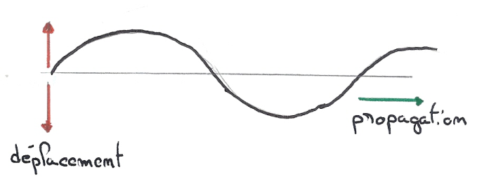
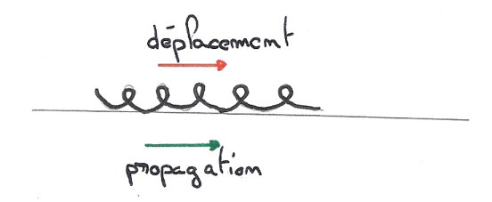
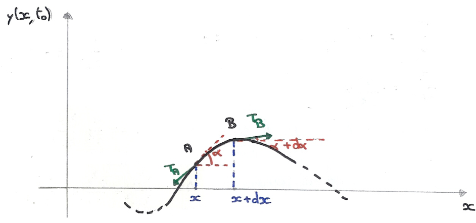
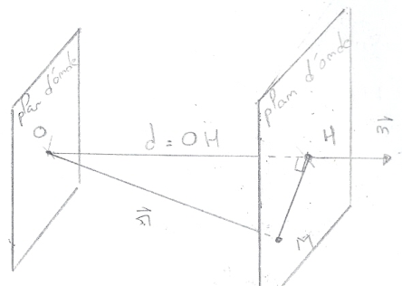

## Ondes dans un milieu élastique

### Notion d'onde

**Définition.** Un milieu élastique est un milieu qui reprend sa forme (ou son état initial) après avoir subi une déformation.

**Exemple.** Une corde tendue pincée en un point, un ressort dont une spire est déplacée, l'air perturbé par un son...

**Propriété.**

- Si un point du milieu subit une brusque déformation d'amplitude, il aura tendance à revenir à l'équilibre en affectant son voisinage. On a ainsi une transmission de proche en proche de la perturbation d'un élément du milieu aux éléments voisins.
- Si la déformation est entretenue d'une manière périodique dans le temps, on dit qu'il y a création et propagation d'une onde dans le milieu.

Pendant le passage de l'onde, le milieu ne se déplace pas dans son ensemble, mais on observe une variation temporaire et spatiale d'une ou plusieurs grandeurs physiques :

- ressort : déplacement des spires ;
- son dans l'air : variation de pression ;
- houle : variation du niveau de la mer.

**Remarque.** En même temps que la quantité de mouvement, l'énergie cinétique est transmise d'un élément au suivant, si bien que l'énergie se propage avec l'onde, et cela sans aucun transport de matière.

**Propriété.** Un milieu matériel est nécessaire pour transmettre des ondes mécaniques. Cependant, deux systèmes physiques peuvent interagir à distance autrement que par un processus élastique entre particules.

**Exemple.** Le son ne se propage pas dans le vide. Cependant, les interactions rayonnement-matière par l'intermédiaire d'ondes électromagnétiques peuvent se propager dans le vide.

### Différents types d'ondes

**Ondes transversale ou longitudinale.**

- **Onde transversale.** Le déplacement est perpendiculaire à la direction de propagation.

- **Onde longitudinale.** Le déplacement est parallèle à la direction de propagation.

**Ondes à 1, 2 ou 3 dimensions.** Il s'agit du nombre de dimensions suivant lesquelles on peut décrire la propagation du déplacement ou de l'énergie :

- **1 dimension.** Un ressort.
- **2 dimensions.** Une onde de surface créée par une pierre tombant dans l'eau.
- **3 dimensions.** Une onde sonore émise par une source ponctuelle.

**Forme de l'onde.** On peut l'illustrer par la forme d'une corde à un instant quelconque après la perturbation :

- ébranlement ou pulse ;
- train d'ondes périodique ;
- onde sinusoïdale.

## Onde progressive sinusoïdale

Soit $O$ la source, constituée par un oscillateur harmonique entretenu de pulsation $\omega$, dont le déplacement au cours du temps est donné par

$$
s = s_0 \cos(\omega t)
$$

en choisissant l'origine du temps de manière à annuler la phase initiale.

À tout instant, le déplacement $s$ d'un point $M$ du milieu dépend de son abscisse $x$. L'état vibratoire de $M$ sera entièrement déterminé si on connaît la fonction $s(M, t)$.

En désignant par $v$ la vitesse de propagation de l'onde, et sachant que le point $M$ ne sera dans l'état du point $O$ qu'au bout d'un temps $t_M = \dfrac{x}{v}$, on peut écrire

$$
s(x, t) = s_0 \cos\left[\omega\left(t - \frac{x}{v}\right)\right]
$$

On voit que dans ce cas (en supposant l'amortissement négligeable et par conséquent l'amplitude de l'onde conservée) le déplacement de $M$ est une fonction sinusoïdale du temps et de l'espace. L'équation précédente peut alors s'écrire

$$
s = s_0 \cos\left[2\pi\left(\frac{t}{T} - \frac{x}{\lambda}\right)\right]
$$

Il y a donc une double périodicité dans le temps (période $T$) et dans l'espace (période $\lambda$).

| Temps | Espace |
| --- | --- |
| $\omega = \dfrac{2\pi}{T}$ | $k = \dfrac{2\pi}{\lambda}$ |
| $\nu = \dfrac{1}{T}$ | $\sigma = \dfrac{1}{\lambda}$ |

L'onde s'écrit alors : $s = s_0 \cos(\omega t - kx)$. En comparant avec la première équation, on obtient la relation

$$
\omega = vk
$$

liant la vitesse de propagation et la longueur d'onde $\left(\lambda = \dfrac{2\pi}{k}\right)$ pour une fréquence donnée.

On peut ajouter aux formes précédentes la forme exponentielle $s = \mathrm{Re}\left(s_0 e^{i(\omega t - kx)}\right)$, parfois très utile pour les calculs. Dans le cas d'une onde progressive plane sinusoïdale, les plans d'onde sont dits "équiphases", car tous les points d'un plan d'onde ont la même phase.

## Équation différentielle des ondes planes unidimensionnelles

**Ces ondes ont certaines propriétés communes.**

- Une grandeur physique $q$, qui varie dans l'espace et le temps, de la forme $q(x, t)$. Elle peut être soit une grandeur scalaire (la variation de pression dans le cas des ondes sonores), soit une grandeur vectorielle (le champ électrique pour les ondes électromagnétiques).
- Une propagation d'énergie qui accompagne l'onde. S'il s'agit d'une onde entretenue, il existe une source quelque part dans l'espace.
- En supposant une propagation à 1 dimension, la grandeur physique $q(x, t)$ obéit à l'équation différentielle (équation d'onde) :

$$
\frac{\partial^2 q}{\partial x^2} = \frac{1}{v^2} \frac{\partial^2 q}{\partial t^2}
$$

dont la résolution, tenant compte des conditions initiales ou des conditions aux limites, permet de suivre l'évolution de l'onde dans l'espace et le temps. Le paramètre $v$, homogène à une vitesse, constitue la vitesse de propagation de l'onde. Cette vitesse dépend essentiellement du milieu où l'onde se propage.

On vérifie aisément que cette équation différentielle est satisfaite pour une onde sinusoïdale :

$$
q = q_0 \cos(\omega t - kx)
$$

On a en effet : $\dfrac{\partial^2 q}{\partial x^2} = -k^2 q$, $\dfrac{\partial^2 q}{\partial t^2} = -\omega^2 q$. Il suffit donc de prendre :

$$
v^2 = \frac{\omega^2}{k^2}
$$

Plus généralement, on peut montrer que la solution générale de l'équation différentielle est de la forme :

$$
q(x, t) = f\left(t - \frac{x}{v}\right) + g\left(t + \frac{x}{v}\right)
$$

où $f$ et $g$ sont des fonctions quelconques représentant des ondes planes progressives : $f\left(t - \dfrac{x}{v}\right)$ correspond à une propagation vers les $x$ croissants et $g\left(t + \dfrac{x}{v}\right)$ à une propagation vers les $x$ décroissants.

**Exemple : onde transversale sur une corde.** Soit une corde tendue à l'équilibre le long de l'axe $Ox$. La masse par unité de longueur de cette corde est $\mu$ et sa tension $T$ (on négligera la force de pesanteur). La corde, ayant été déformée puis abandonnée à elle-même, possède à l'instant $t_0$ la forme représentée sur la figure ci-dessous. On supposera que $\alpha$ est petit ($\sin(\alpha) \sim \tan(\alpha) \sim \alpha$).

En appliquant la deuxième loi de Newton à l'élément infinitésimal de corde $AB$ et en projetant sur l'axe $Oy$, montrer que la déformation $y(x, t)$ vérifie l'équation :

$$
\frac{\partial^2 y}{\partial x^2} - \frac{\mu}{T} \frac{\partial^2 y}{\partial t^2} = 0
$$

Pour le petit élément de corde, on écrit : $\sum \vec{F} = dm\,\vec{\gamma}$, ici $dm = \mu AB$. Or, puisque $\alpha$ est petit, on a $\cos(\alpha) \sim 1$ et $\cos(\alpha) = \dfrac{dx}{AB} \Rightarrow AB = \dfrac{dx}{\cos(\alpha)} \Rightarrow dm = \dfrac{dx}{\cos(\alpha)}\mu \sim \mu\,dx$. On projette sur $\vec{j}$ :

$$
\mu\,dx \frac{\partial^2 y}{\partial t^2} \vec{j} = (\vec{T_a} + \vec{T_b}) \cdot \vec{j} = \big(T_b \sin(\alpha + d\alpha) - T_a \sin(\alpha)\big) \vec{j}
$$

Dans l'approximation des petits déplacements et des petits angles :

$$
\sin(\alpha + d\alpha) \sim \alpha + d\alpha \sim \tan(\alpha + d\alpha) = \left.\frac{\partial y}{\partial x}\right|_{x+dx}
$$

de plus

$$
\tan(\alpha) = \left.\frac{\partial y}{\partial x}\right|_{x}
$$

car $\sin(\alpha) \sim \alpha \sim \tan(\alpha)$. Par définition de la dérivée : $\dfrac{\partial^2 y}{\partial x^2}\,dx = \left.\dfrac{\partial y}{\partial x}\right|_{x+dx} - \left.\dfrac{\partial y}{\partial x}\right|_{x}$. Avec $T_a = T_b = T$, on a

$$
\mu\,dx \frac{\partial^2 y}{\partial t^2} = T\,dx \frac{\partial^2 y}{\partial x^2}
$$

On a donc une équation d'onde

$$
\frac{\partial^2 y}{\partial x^2} = \frac{1}{v^2} \frac{\partial^2 y}{\partial t^2}
$$

## Généralisation de la notion d'onde

Considérons une onde plane sinusoïdale se propageant dans une direction de vecteur unitaire $\vec{n}(\alpha, \beta, \gamma)$, par exemple : $s(\vec{r}, t) = A\sin\left(\omega\left(t - \dfrac{d}{c}\right)\right)$, où $d = \vec{r} \cdot \vec{n} = \alpha x + \beta y + \gamma z$ est la distance parcourue par l'onde à partir de l'instant $t = 0$. On a :

$$
\frac{\partial^2 s}{\partial x^2} = -\alpha^2 \frac{\omega^2}{c^2} s \;;\quad \frac{\partial^2 s}{\partial y^2} = -\beta^2 \frac{\omega^2}{c^2} s \;;\quad \frac{\partial^2 s}{\partial z^2} = -\gamma^2 \frac{\omega^2}{c^2} s \;;\quad \frac{\partial^2 s}{\partial t^2} = -\omega^2 s
$$

Par conséquent, puisque $\vec{n}$ est unitaire : $\Delta s = \dfrac{1}{c^2} \dfrac{\partial^2 s}{\partial t^2}$, où $\Delta$ est l'opérateur laplacien,

$$
\Delta s = \frac{\partial^2 s}{\partial x^2} + \frac{\partial^2 s}{\partial y^2} + \frac{\partial^2 s}{\partial z^2}
$$

L'équation, dite de d'Alembert, est l'équation générale de propagation des ondes : elle est valable pour tout type d'onde, plane ou non. On utilise fréquemment le vecteur d'onde $\vec{k} = \dfrac{\omega}{c}\vec{n} = \dfrac{2\pi}{\lambda}\vec{n}$, ce qui permet d'exprimer l'onde plane sinusoïdale sous la forme :

$$
s(\vec{r}, t) = A\sin(\omega t - \vec{k} \cdot \vec{r})
$$

## Composition des ondes

**La méthode des complexes.** La partie réelle d'une somme de nombres complexes est, comme on le sait, égale à la somme de leurs parties réelles.

Cette constatation permet de trouver simplement le résultat de la superposition d'oscillations harmoniques de même fréquence, par exemple $s_1 = A_1 \cos(\omega t + \phi_1)$ et $s_2 = A_2 \cos(\omega t + \phi_2)$. On écrit

$$
s = s_1 + s_2 = \mathrm{Re}\left(A_1 e^{i(\omega t + \phi_1)} + A_2 e^{i(\omega t + \phi_2)}\right)
$$

Le module et l'argument de l'amplitude complexe sont respectivement l'amplitude et la phase de l'oscillateur réel. Pour trouver $s_1 + s_2$, il suffit de remarquer que les amplitudes complexes s'ajoutent : $\tilde{A} = Ae^{i\phi} = A_1 e^{i\phi_1} + A_2 e^{i\phi_2}$, de sorte que

$$
A^2 = \tilde{A}\tilde{A}^* = (A_1 e^{i\phi_1} + A_2 e^{i\phi_2})(A_1 e^{-i\phi_1} + A_2 e^{-i\phi_2}) = A_1^2 + A_2^2 + A_1 A_2\left(e^{i(\phi_1 - \phi_2)} + e^{-i(\phi_1 - \phi_2)}\right)
$$

Soit $A^2 = A_1^2 + A_2^2 + 2A_1 A_2 \cos(\phi_1 - \phi_2)$.

Le rapport des parties imaginaire et réelle de $\tilde{A}$ donne :

$$
\tan(\phi) = \frac{A_1 \sin(\phi_1) + A_2 \sin(\phi_2)}{A_1 \cos(\phi_1) + A_2 \cos(\phi_2)}
$$

Dans le cas particulier où $A_1 = A_2$, on a :

$$
\tilde{A} = A_1(e^{i\phi_1} + e^{i\phi_2}) = A_1 e^{i(\phi_1 + \phi_2)/2}\left(e^{i(\phi_1 - \phi_2)/2} + e^{-i(\phi_1 - \phi_2)/2}\right) \Rightarrow \tilde{A} = 2A_1 \cos\left(\frac{\phi_1 - \phi_2}{2}\right) e^{i(\phi_1 + \phi_2)/2}
$$

de sorte que :

$$
A = 2A_1 \cos\left(\frac{\phi_1 - \phi_2}{2}\right) \quad \text{et} \quad \phi = \frac{\phi_1 + \phi_2}{2}
$$

**Remarque.** Cette méthode ne peut pas s'appliquer à un produit d'oscillateurs, car la partie réelle d'un produit n'est pas égale au produit des parties réelles.

**Réflexion d'une onde plane sinusoïdale.** Considérons une telle onde qui se propage suivant $Ox$ et qui s'exprime par :

$$
s_1 = s_0 \cos(\omega t - kx)
$$

Si, en un point donné que nous prenons comme origine des abscisses, cette onde rencontre un plan rigide perpendiculaire à $Ox$, il se forme une onde réfléchie qui se propage vers les $x$ négatifs, et qui est de la forme :

$$
s_2 = s_0' \cos(\omega t + kx + \phi)
$$

En admettant que $s_0' = s_0$, ce qui résulte de la conservation de l'énergie, on peut écrire :

$$
s_2 = s_0 \cos(\omega t + kx + \phi)
$$

Une condition aux limites impérative est que, au point de contact avec le plan rigide, le milieu élastique ne peut se déplacer, quel que soit $t$. C'est le cas par exemple d'une corde vibrante fixée à une extrémité. En $x = 0$, on doit donc avoir

$$
s_1 + s_2 = s_0\big(\cos(\omega t) + \cos(\omega t + \phi)\big) = 0
$$

or $\cos(\omega t) + \cos(\omega t + \phi) = 2\cos\left(\omega t + \dfrac{\phi}{2}\right)\cos\left(\dfrac{\phi}{2}\right) = 0 \Rightarrow \phi = \pi$. Par conséquent, l'onde réfléchie a pour équation :

$$
s_2 = s_0 \cos(\omega t + kx + \pi) = -s_0 \cos(\omega t + kx)
$$

La réflexion de l'onde se traduit par un changement de sens de la direction de propagation et par un changement de signe, c'est-à-dire un déphasage de $\pi$.

### Ondes stationnaires

**Cas de 2 ondes : incidente et réfléchie.** La composition des ondes incidente et réfléchie précédentes s'obtient en appliquant le principe de superposition, avec $\cos(a) - \cos(b) = -2\sin\left(\dfrac{a+b}{2}\right)\sin\left(\dfrac{a-b}{2}\right)$ :

$$
\begin{aligned}
s = s_1 + s_2 &= s_0\big(\cos(\omega t - kx) - \cos(\omega t + kx)\big) \\
&= 2s_0 \sin(\omega t)\sin(kx) \\
&= 2s_0 \sin\left(\frac{2\pi}{T} t\right)\sin\left(\frac{2\pi}{\lambda} x\right)
\end{aligned}
$$

Cette équation montre que tous les points vibrants sont en phase. Il n'y a pas de propagation. On obtient un système d'ondes stationnaires.

**Nœuds de vibration.** Le déplacement est bien nul en $x = 0$, sur l'obstacle, quel que soit le temps $t$, mais il est également nul en une suite de points pour lesquels :

$$
\sin\left(\frac{2\pi}{\lambda} x\right) = 0
$$

Ces points constituent les nœuds de vibration, donnés par :

$$
x_N = n\frac{\lambda}{2} \quad \forall n \in \mathbb{N}
$$

**Ventres de vibration.** Les points correspondant à un déplacement maximum constituent les ventres de vibration. Ils s'intercalent entre les nœuds et sont donnés par :

$$
x_V = (2n + 1)\frac{\lambda}{4} \quad \forall n \in \mathbb{N}
$$

**Résonateurs à fréquences multiples : cordes vibrantes.** Dans l'expérience de Melde, une corde vibrante, dont une extrémité est fixée, est excitée à l'autre extrémité par un vibreur sinusoïdal. Pour certaines valeurs de la fréquence, il y a résonance, c'est-à-dire que l'on observe des ondes stationnaires de grande amplitude donnant à la corde un aspect en fuseaux, avec un nœud à chaque extrémité. L'interprétation est la suivante : l'onde progressive émise par le vibreur subit une infinité de réflexions à chaque extrémité, et il y a superposition d'une infinité d'ondes progressives sinusoïdales se propageant dans les 2 sens.

On peut donc penser que l'amplitude de l'onde stationnaire qui en résulte est du même type qu'avec deux ondes, soit :

$$
A(x) = A_m |\sin(kx + \alpha)|
$$

ce qui donne là aussi une alternance de nœuds et de ventres distants de $\dfrac{\lambda}{4}$. Mais cette fois $A_m$ n'est pas égale à $2a$ : elle lui est très supérieure, de sorte que la source apparaît pratiquement comme un nœud. On doit donc avoir :

$$
\begin{aligned}
&A_m |\sin(\alpha)| = a \quad \text{au niveau du vibreur} \\
&A_m \sin(kl + \alpha) = 0 \quad \text{nœud à l'extrémité} \\
&\Rightarrow kl + \alpha = n\pi
\end{aligned}
$$

Il en résulte que $A_m = \dfrac{a}{|\sin(\alpha)|} = \dfrac{a}{|\sin(n\pi - kl)|}$ devient infini si $kl$ est un multiple entier de $\pi$.

La condition de résonance est donc, compte tenu de $\lambda = \dfrac{2\pi}{k} = \dfrac{c}{v}$ :

$$
l = p\frac{\lambda}{2} \quad \text{où} \quad v = p\frac{c}{2l}
$$

On note que $c = \sqrt{\dfrac{F}{\mu}} \Rightarrow \lambda = \dfrac{1}{v}\sqrt{\dfrac{F}{\mu}}$ et $l = p\dfrac{1}{2v}\sqrt{\dfrac{F}{\mu}}$. À chaque valeur entière de $p$ correspond une valeur particulière de $F$.

En fait, $A_m$ est limité par l'amortissement, tout comme l'intensité du courant dans un circuit RLC à la résonance. Finalement, l'amplitude de la corde vibrante est :

$$
A(x) = A_m |\sin(kx)|
$$

Si l'on pince la corde tendue en l'absence du vibreur, on constate qu'elle est en résonance avec l'une des fréquences précédentes. Les modes de vibration correspondants sont appelés modes propres ou encore modes normaux de la corde. La fréquence la plus faible correspond au mode fondamental, les autres aux modes harmoniques.

## Compléments

**Remarque 1.** On rappelle l'équation d'onde à une dimension :

$$
\frac{\partial^2 \Psi}{\partial x^2} - \frac{1}{v^2} \frac{\partial^2 \Psi}{\partial t^2} = 0
$$

La solution générale est sous la forme : $\Psi\left(t - \dfrac{x}{v}\right)$ et $\Psi\left(t + \dfrac{x}{v}\right)$ sont solutions de l'équation d'onde.

$\Psi\left(t - \dfrac{x}{v}\right)$ : propagation vers les $x$ croissants quand $t$ augmente. Supposons qu'à $t = t_0$, en $x = x_0$, la perturbation soit $\Psi\left(t_0 - \dfrac{x_0}{v}\right) = \Psi_0$. Comme le signal se propage sans déformation, à $t_1 > t_0$ on retrouve $\Psi_0$ en $x_1$, donc :

$$
\Psi\left(t_1 - \frac{x_1}{v}\right) = \Psi_0 \Rightarrow t_1 - \frac{x_1}{v} = t_0 - \frac{x_0}{v} \Rightarrow t_1 - t_0 = \frac{1}{v}(x_1 - x_0) > 0
$$

L'onde $\Psi\left(t - \dfrac{x}{v}\right)$ se propage le long de l'axe $Ox$ dans le sens positif à la vitesse $v$.

**Remarque 2.** La solution particulière est l'onde plane uniforme monochromatique ; sa forme générale est

$$
\Psi(\vec{r}, t) = A_m \cos(\omega t - \vec{k} \cdot \vec{r} + \phi)
$$

Cette onde se propage dans la direction du vecteur $\vec{k}$, appelé vecteur d'onde, à la vitesse $v = \dfrac{\omega}{k}$. Pour les calculs linéaires, on pourra utiliser la représentation complexe :

$$
\tilde{\Psi}(\vec{r}, t) = A_m e^{i(\omega t - \vec{k} \cdot \vec{r} + \phi)}
$$

**Remarque 3.** Pour un problème à symétrie sphérique (sources ponctuelles émettant dans un milieu isotrope), l'onde plane n'est plus une solution satisfaisante. En particulier, l'amplitude dépend de $r$, distance à la source, et du temps $t$, mais pas de la direction.

$$
\Delta\Psi(r, t) - \frac{1}{v^2} \frac{\partial^2 \Psi(r, t)}{\partial t^2} = 0
\;\Rightarrow\;
\frac{1}{r^2} \frac{\partial}{\partial r}\left(r^2 \frac{\partial \Psi}{\partial r}\right) - \frac{1}{v^2} \frac{\partial^2 \Psi}{\partial t^2} = 0
$$

En posant $\phi = r\Psi$, on obtient $\dfrac{\partial^2 \phi}{\partial r^2} - \dfrac{1}{v^2} \dfrac{\partial^2 \phi}{\partial t^2} = 0$. On trouve donc une équation qui est l'équation d'onde à une dimension, donc

$$
\phi(r, t) = f\left(t - \frac{r}{v}\right) + g\left(t + \frac{r}{v}\right) \Rightarrow \Psi(r, t) = \frac{1}{r} f\left(t - \frac{r}{v}\right) + \frac{1}{r} g\left(t + \frac{r}{v}\right)
$$

Le terme $\dfrac{1}{r} f\left(t - \dfrac{r}{v}\right)$ correspond à une onde sphérique divergente, le terme $\dfrac{1}{r} g\left(t + \dfrac{r}{v}\right)$ correspond à une onde sphérique convergente ($r$ diminue quand $t$ augmente). La solution est donc sous la forme

$$
\Psi(r, t) = \frac{A_n}{r} \cos(\omega t - kr + \phi)
$$
