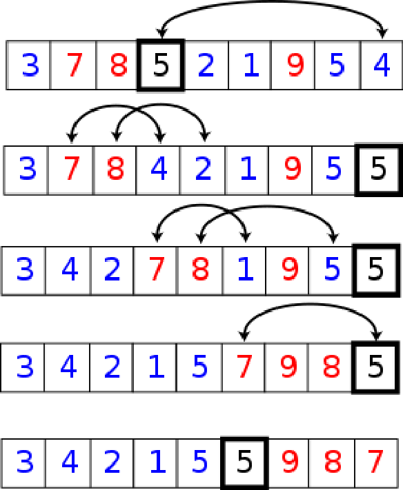
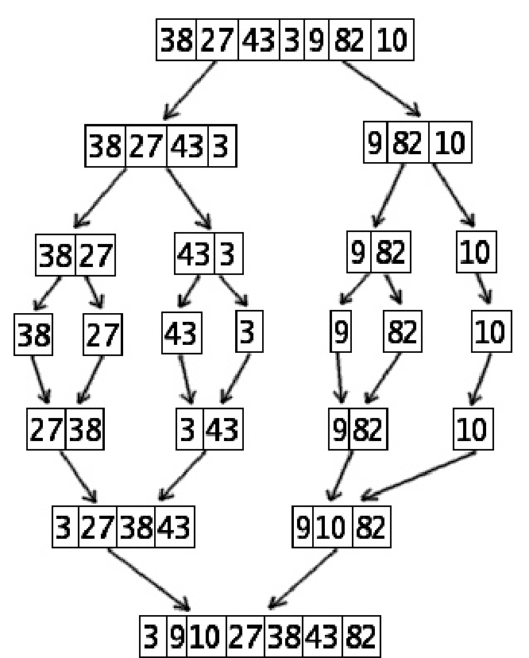

**Définition : complexité.** La complexité est le nombre d'exécutions d'instructions élémentaires nécessaires pour obtenir la réponse (exacte) au pire cas, en fonction de la taille d'entrée.

**Algorithme type.**

- Entrée : une suite (une liste) d'objets comparables (entiers, réels, mots...)
- Sortie : une suite (une liste) des mêmes objets triés

**Définition : opération élémentaire.** Une opération élémentaire est une comparaison de deux objets, une addition de deux scalaires, etc.

```python
def triNaif(L):
    Trie=[]
    while len(L)>0:
        m=L[0]
        for e in L:
            if e>m:
                m=e
        Trie=Trie+[m]
        L.remove(m)
    return Trie
```

Calculons la complexité :

- La création de liste et le `return` ont une complexité constante.
- La boucle `while` se répète $n$ fois.
- Les opérations dans la boucle `while` se répètent $n$ fois.
- La boucle `for` a un nombre constant d'opérations par élément de $L$ : c'est donc une complexité linéaire par rapport à $len(L)$.

Ainsi on a

$$
C = c_1 + c_2 n + c_3\big(n + (n-1) + \dots + 3 + 2 + 1\big) = c_1 + c_2' n + c_3' n^2 = O(n^2)
$$

## Outils de comparaison

**$T(n) = O(f(n))$.** On dit que $T$ est $O$ de $f$ si et seulement si

$$
\lim_{n \to +\infty} \frac{T(n)}{f(n)} < \infty
$$

c'est-à-dire $\exists N, \exists c > 0, \; T(n) \leq c f(n) \; \forall n \geq N$.

**$T(n) = \Omega(f(n))$.** On dit que $T$ est $\Omega$ de $f$ si et seulement si

$$
T(n) = \Omega(f(n)) \Leftrightarrow \lim_{n \to \infty} \frac{T(n)}{f(n)} > 0
$$

**$T(n) = \theta(f(n))$.** On dit que $T$ est $\theta$ de $f$ si et seulement si

$$
0 < \lim_{n \to \infty} \frac{T(n)}{f(n)} < \infty
$$

On remarque que $T$ est en $\theta$ de $f$ si et seulement si $T$ est en $\Omega$ et en $O$ de $f$.

**Rappel.** On rappelle que le nombre d'ordres possibles pour une liste de $n$ éléments vaut $n!$.

## Quick sort

**Principe.**



**Réalisation.**

```python
def quickSort(L, début=0, fin=None):
    if fin==None:
        fin=len(L)-1
    if début>=fin:
        return
    pivot=L[randint(début,fin)]
    seuil=partitionner(L,début,fin,pivot)
    quickSort(L,début,seuil-1)
    quickSort(L,seuil,fin)

def partitionner(L,début,fin,pivot):
    i=début
    j=fin
    while i<j:
        while L[i]<pivot:
            i=i+1
        while L[j]>pivot:
            j=j-1
        if i<j:
            a=L[i]
            L[i]=L[j]
            L[j]=a
    return i
```

## Merge sort

**Principe.**



```python
def fusion(L1,L2):
    i=0
    j=0
    L=[]
    while i<len(L1) and j<len(L2):
        if L1[i]<L2[j]:
            L.append(L1[i])
            i=i+1
        else:
            L.append(L2[j])
            j=j+1
    while len(L1)>i:
        L.append(L1[i])
        i=i+1
    while len(L2)>j:
        L.append(L2[j])
        j=j+1
    return L

def casser(L):
    L_c=[]
    i=0
    while len(L)>0:
        x=L.pop(i)
        L_c=L_c+[[x]]
    return L_c

def mergeSort(L):
    cpt=0
    L=casser(L)
    while len(L)>2:
        x=L.pop(0)
        y=L.pop(1)
        L.append(fusion(x,y))
    if len(L)==2:
        x=L.pop(0)
        y=L.pop(0)
        return fusion(x,y)
```

**Analyse de la complexité.** On cherche la complexité de `mergeSort`, définie par la complexité pour trier 2 listes à $n/2$ éléments et la complexité pour fusionner les 2 listes. On a donc :

$$
T(n) = 2T(n/2) + c\,n = 2\big(2T(n/4) + c(n/2)\big) + cn = 4T(n/4) + 2cn
$$

Par récurrence on obtient

$$
T(2^k) = 2^k T(1) + k c 2^k = nT(1) + cn\log_2(n)
$$

Donc $T(n) = O(n\log_2(n))$.

## Master Theorem

Quelle est la complexité d'une procédure définie ainsi :

```text
p(entrée de taille n) :
    si n<n_0 :
        trouver la réponse directement
    sinon
        décomposer l'entrée en a objets, chacun de taille n/b
        appeler p() pour chacun de ces objets
        combiner les résultats partiels pour trouver la réponse à retourner
```

La complexité d'un tel algorithme est la somme de la complexité des appels récursifs de $p$ et de celle de la combinaison des résultats partiels.

**Master Theorem.** Soit $c_0 = \log_b(a)$.

- Si $g(n) = O(n^c)$ avec $c < c_0$, alors $T(n) = \theta(n^{c_0})$
- Si $g(n) = \Omega(n^c)$ avec $c > c_0$, alors $T(n) = \theta(g(n))$
- Sinon : $g(n) = \theta(n^{c_0} \log^k(n))$ et
  - si $k > -1$, alors $T(n) = \theta(n^{c_0} \log^{k+1}(n))$
  - si $k = -1$, alors $T(n) = \theta(n^{c_0} \log(\log(n)))$
  - si $k < -1$, alors $T(n) = \theta(n^{c_0})$
