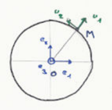
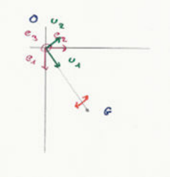
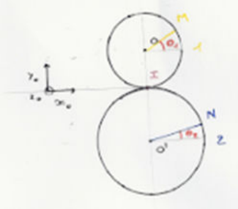
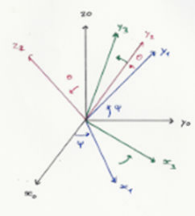
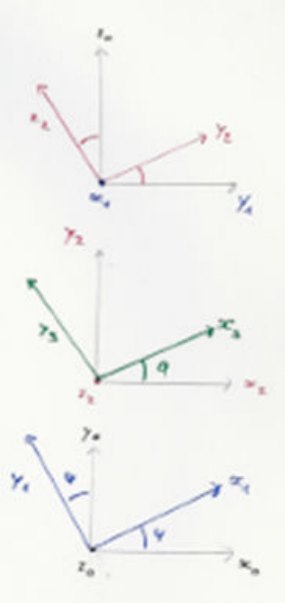

## Bref retour en cinématique du point

Repère de référence $R_0 = 0$ en position $\overrightarrow{OM}(t)$, l'ensemble des positions de $M$ représente la trajectoire. Sa vitesse est donc $\vec V_{M \in 1|0} = \vec V_{M10} = \dfrac{d\overrightarrow{OM}(t)}{dt}\Big|_0$. Son accélération est donc $\vec\gamma_{M \in 1|R_0} = \vec\gamma_{M10} = \dfrac{d^2\overrightarrow{OM}(t)}{dt^2}\Big|_0$.

**Mouvement circulaire.** Trajectoire $\mathcal C(O, R)$.

$$
\begin{aligned}
\overrightarrow{OM} = R \vec u_1, \quad \vec V_{M \in 1|0} &= \frac{d_0(R \vec u_1)}{dt} \\
&= R \frac{d_0}{dt}\big(\cos(\theta) \vec e_1 + \sin(\theta) \vec e_2\big) \\
&= R\big(d\cos(\theta) \cdot d(\theta) \vec e_1 + d\sin(\theta) d(\theta) \vec e_2\big) \\
&= R\dot\theta\big(-\sin(\theta) \vec e_1 + \cos(\theta) \vec e_2\big) \\
&= R\dot\theta \vec u_2
\end{aligned}
$$

On pose $\vec\Omega = \dot\theta \vec e_3$. Ainsi $\vec\Omega \wedge \overrightarrow{OH} = \dot\theta \vec e_3 \wedge R \vec u_1 = R\dot\theta \vec u_2$. $\dfrac{d_0 \vec u_1}{dt} = \dot\theta \vec u_2$. $\vec\Omega \wedge \vec u_1 = \dot\theta \vec e_3 \wedge \vec u_1 = \dot\theta \vec u_2$. $\dfrac{d_0 \vec u_1}{dt} = \vec\Omega_{10} \wedge \vec u_1$, $\vec V_{N10} = \vec\Omega_{10} \wedge \overrightarrow{ON}$.

$\vec V_{M10} - \vec V_{N10} = \vec\Omega_{10} \wedge (\overrightarrow{OM} - \overrightarrow{ON}) \Leftrightarrow \vec V_{M10} = \vec V_{N10} + \vec\Omega_{10} \wedge \overrightarrow{NM}$.

Vitesse de rotation de 1 à 0 :

$$
\begin{cases} \vec\Omega_{10} = \dot\theta \vec e_3 \\ \vec V_{M10} = R\dot\theta \vec u_2 \end{cases} = \{V_{10}\} \ \text{torseur cinématique.}
$$

**Mouvement de 1 à 0 : torseur cinématique.**

$$
\{V_{10}\} = \begin{cases} \vec\Omega_{10} \\ \vec V_{O10} = \vec 0 \end{cases}
\to
\begin{cases} \vec\Omega_{10} \\ \vec V_{M10} = \vec V_{O10} + \vec\Omega_{10} \wedge \overrightarrow{OM} \end{cases}
$$

$\vec V_{M10} \cdot \overrightarrow{NM} = \vec V_{N10} \cdot \overrightarrow{NM} + (\vec\Omega_{10} \wedge \overrightarrow{NM}) \cdot \overrightarrow{NH}$.

**Digression fondamentale.** Soit un vecteur $\vec u = X \vec u_1 + Y \vec u_2 + 0 \vec u_3$. On calcule les dérivées du vecteur $\vec u$ dans les repères 1 et 0 : $\dfrac{d\vec u}{dt}\Big|_1 = \dot X \vec u_1 + \dot Y \vec u_2$ et

$$
\frac{d\vec u}{dt}\Big|_0 = \dot X \vec u_1 + X \frac{d_0 \vec u_1}{dt} + \dot Y \vec u_2 + Y \frac{d_0 \vec u_2}{dt} = \frac{d\vec u}{dt}\Big|_1 + X\dot\theta \vec u_2 + Y(-\dot\theta \vec u_1) = \frac{d\vec u}{dt}\Big|_1 + \dot\theta(-Y \vec u_1 + X \vec u_2)
$$

On pose $\vec\Omega = \dot\theta \vec e_3$, on forme

$$
\vec\Omega \wedge \vec u = \dot\theta \vec e_3 (X \vec u_1 + Y \vec u_2) = \dot\theta\big(X \underbrace{\vec e_3 \wedge \vec u_1}_{\vec u_2} + Y \underbrace{\vec e_3 \wedge \vec u_2}_{-\vec u_1}\big)
$$

## Cinématique du solide

La cinématique du solide s'intéresse aux solides indéformables, elle repose sur le repérage (choix du repère) et sur le paramétrage qui permettent de décrire le mouvement.

On a $\overrightarrow{MN}$ constant dans 1 donc

$$
\begin{aligned}
&\frac{d_1 \overrightarrow{MN}}{dt} = \vec 0 \Leftrightarrow \frac{d_0 \overrightarrow{MN}}{dt} = \frac{d_1 \overrightarrow{MN}}{dt} + \vec\Omega_{10} \wedge \overrightarrow{MN} \\
\Leftrightarrow\ &\frac{d_0(\overrightarrow{MO} + \overrightarrow{ON})}{dt} = \frac{d_0 \overrightarrow{ON}}{dt} - \frac{d_0 \overrightarrow{OM}}{dt} \Leftrightarrow \frac{d_0 \overrightarrow{ON}}{dt} - \frac{d_0 \overrightarrow{OM}}{dt} = \vec\Omega_{10} \wedge \overrightarrow{MN} \\
\Leftrightarrow\ &\frac{d_0 \overrightarrow{ON}}{dt} = \frac{d_0 \overrightarrow{OM}}{dt} + \vec\Omega_{10} \wedge \overrightarrow{MN}
\end{aligned}
$$

Ainsi :

$$
\vec V_{N \in 1|0} = \vec V_{M \in 1|0} + \vec\Omega_{10} \wedge \overrightarrow{MN}
$$

**Torseur cinématique.** La rotation est selon $\vec\Omega_{10}$, on définit la vitesse des points grâce à

$$
\vec V_{M \in 1|0} \to \vec V_{N \in 1|0} \cdot \overrightarrow{NM} = \vec V_{M \in 1|0} \cdot \overrightarrow{NM} + (\vec\Omega_{10} \wedge \overrightarrow{MN}) \cdot \overrightarrow{NM}
$$

Il y a donc équiprojectivité, ce qui permet de définir le torseur cinématique :

$$
\{V_{10}\} = \begin{cases} \vec\Omega_{10} = \dot\theta \vec e_3 \\ \vec V_{O \in 1|0} = \vec 0 \end{cases}
\to
\begin{cases} \vec\Omega_{10} \\ \vec V_{G \in 1|0} = \vec V_{O \in 1|0} + \vec\Omega_{10} \wedge \overrightarrow{OG} = \dot\theta \vec e_3 \wedge L \vec u_1 = L\dot\theta \vec u_2 \end{cases}
$$

$$
\begin{aligned}
\vec V_{O \in 1|0} &= \vec 0 \\
\vec V_{G \in 1|0} &= L\dot\theta \vec u_2 \\
\vec V_{M \in 1|0} &= \frac{L}{2}\dot\theta \vec u_2
\end{aligned}
$$

**Accélérations.**

$$
\{V_{10}\} = \begin{cases} \vec\Omega_{10} \\ \vec V_{O10} \end{cases}
\to
\begin{cases} \vec\Omega_{10} \\ \vec V_{M10} = \vec V_{O10} + \vec\Omega_{10} \wedge \overrightarrow{OM} \end{cases}
$$

$$
\begin{aligned}
&\frac{d_0 \vec V_{M10}}{dt} = \frac{d_0 \vec V_{O10}}{dt} + \frac{d_0(\vec\Omega_{10} \wedge \overrightarrow{OM})}{dt}
\Leftrightarrow \vec a_{M10} \cdot \overrightarrow{OM} = \vec a_{O10} \cdot \overrightarrow{OM} + \Big(\frac{d_0 \vec\Omega_{10}}{dt} \wedge \overrightarrow{OM}\Big) \cdot \overrightarrow{OM} + \Big(\vec\Omega_{10} \wedge \frac{d_0 \overrightarrow{OM}}{dt}\Big) \cdot \overrightarrow{OM} \\
\Leftrightarrow\ &\vec a_{G10} = \frac{d_0 \vec V_{G10}}{dt} = L\Big(\ddot\theta \vec u_2 + \dot\theta \underbrace{\frac{d_0 \vec u_2}{dt}}_{-\dot\theta \vec u_1}\Big)
\Leftrightarrow \vec a_{G \in 1|0} = -L\dot\theta^2 \vec u_1 + L\ddot\theta \vec u_2
\end{aligned}
$$

**Composition de mouvements.** Le mouvement de 2 par rapport à 1 est relatif. Le mouvement de 1 par rapport à 0 est le mouvement d'entraînement et le mouvement de 2 par rapport à 0 est absolu. Le repère 0 est le repère absolu, le repère 1 est le repère intermédiaire ou relatif.

**Mouvement inverse.** Le vecteur $\vec W$ se définit par

$$
\begin{cases} \dfrac{d_2 \vec W}{dt} = \dfrac{d_1 \vec W}{dt} + \vec\Omega_{12} \wedge \vec W \\ \dfrac{d_1 \vec W}{dt} = \dfrac{d_0 \vec W}{dt} + \vec\Omega_{21} \wedge \vec W \end{cases}
$$

Ainsi :

$$
\vec 0 = (\vec\Omega_{12} + \vec\Omega_{21}) \wedge \vec W \Rightarrow \vec\Omega_{21} = -\vec\Omega_{12}
$$

**Composition des rotations.**

$$
\begin{cases} \dfrac{d_2 \vec W}{dt} = \dfrac{d_1 \vec W}{dt} + \vec\Omega_{12} \wedge \vec W \\ \dfrac{d_1 \vec W}{dt} = \dfrac{d_0 \vec W}{dt} + \vec\Omega_{01} \wedge \vec W \\ \dfrac{d_0 \vec W}{dt} = \dfrac{d_2 \vec W}{dt} + \vec\Omega_{20} \wedge \vec W \end{cases}
$$

**Position - vitesse.**

$$
\overrightarrow{OH} = \overrightarrow{OO_1} + \overrightarrow{O_1H} \Leftrightarrow \frac{d_0 \overrightarrow{OH}}{dt} = \frac{d_0 \overrightarrow{OO_1}}{dt} + \frac{d_0 \overrightarrow{O_1H}}{dt}
$$

$$
\vec V_{M \in 2|0} = \vec V_{O_1 \in 1|0} + \underbrace{\frac{d_1 \overrightarrow{O_1M}}{dt}}_{\vec V_{M \in 2|1}} + \vec\Omega_{10} \wedge \overrightarrow{O_1M} = \vec V_{M \in 2|1} + \underbrace{\vec V_{O_1 \in 1|0} + \vec\Omega_{10} \wedge \overrightarrow{O_1M}}_{\vec V_{M \in 1|0}}
$$

Donc

$$
\vec V_{M \in 2|0} = \vec V_{M \in 2|1} + \vec V_{M \in 1|0}
$$

**Torseur.** Le torseur cinématique :

$$
\{V_{20}\}_{M_1} = \begin{cases} \vec\Omega_{20} = \vec\Omega_{21} + \vec\Omega_{10} \\ \vec V_{M \in 2|0} = \vec V_{M \in 2|1} + \vec V_{M \in 1|0} \end{cases}
= \begin{cases} \vec\Omega_{21} \\ \vec V_{M \in 2|1} \end{cases}
+ \begin{cases} \vec\Omega_{10} \\ \vec V_{M \in 1|0} \end{cases}
= \{V_{21}\}_M + \{V_{10}\}_M
$$

**Accélération.**

$$
\frac{d_0}{dt} \vec V_{M \in 2|0} = \frac{d_0}{dt} \vec V_{O_1 \in 1|0} + \frac{d_0}{dt} \vec\Omega_{10} \wedge \overrightarrow{O_1M} + \frac{d_0}{dt} \vec V_{M \in 2|1}
$$

Ainsi, par définition, on obtient :

$$
\vec\gamma_{M \in 2|0} = \vec\gamma_{O_1 \in 1|0} + \frac{d_0}{dt} \vec\Omega_{10} \wedge \overrightarrow{O_1M} + \vec\Omega_{10} \wedge \frac{d_0}{dt} \overrightarrow{O_1M} + \frac{d_1}{dt} \vec V_{M \in 2|1} + \vec\Omega_{10} \wedge \vec V_{M \in 2|1}
$$

On a donc

$$
\vec\gamma_{M \in 2|0} = \vec\gamma_{M \in 2|1} + \vec\gamma_{O_1 \in 1|0} + \frac{d_0}{dt} \vec\Omega_{10} \wedge \overrightarrow{O_1M} + \vec\Omega_{10} \wedge \Big(\frac{d_1 \overrightarrow{O_1M}}{dt} + \vec\Omega_{10} \wedge \overrightarrow{O_1M}\Big) + \vec\Omega_{10} \wedge \vec V_{M \in 2|1}
$$

$$
\underbrace{\vec\gamma_{M \in 2|0}}_{\text{absolue}} = \underbrace{\vec\gamma_{M \in 2|1}}_{\text{relative}} + \underbrace{\vec\gamma_{O_1 \in 1|0} + \frac{d_0 \vec\Omega_{10}}{dt} \wedge \overrightarrow{O_1M} + \vec\Omega_{10} \wedge (\vec\Omega_{10} \wedge \overrightarrow{O_1M})}_{\text{accélération d'entraînement}} + \underbrace{2(\vec\Omega_{10} \wedge \vec V_{M \in 2|1})}_{\text{Coriolis}}
$$

**Exercice : mouvement planétaire.** $\{V_{20}\}_K = \{V_{21}\}_K + \{V_{10}\}_K$. On procède au choix judicieux de $O'$.

$$
\begin{cases} \vec\Omega_{20} \\ \vec V_{O' \in 2|0} \end{cases}
= \begin{cases} \vec\Omega_{21} = \dot\theta_{21} \vec z_0 \\ \vec V_{O' \in 2|1} = \vec 0 \end{cases}
+ \begin{cases} \vec\Omega_{10} = \dot\theta_{10} \vec z_0 \\ \vec V_{O' \in 1|0} = \vec V_{O \in 1|0} + \vec\Omega_{10} \wedge \overrightarrow{OO'} = \dot\theta \vec z_0 \wedge R \vec x_1 = R\dot\theta_{10} \vec y_1 \end{cases}
$$

$$
\{V_{20}\}_{O'} = \begin{cases} \vec\Omega_{20} = \big\{\dot\theta_{21} + \dot\theta_{10}\big\} \vec z_0 \\ \vec V_{O' \in 2|0} = R\dot\theta_{10} \vec y_1 \end{cases}
\to
\begin{cases} \text{idem} \\ \vec V_{M \in 2|0} = \vec V_{O' \in 2|0} + \vec\Omega_{20} \wedge \overrightarrow{OH} = R\dot\theta_{10} \vec y_1 + \underbrace{(\dot\theta_{21} + \dot\theta_{10}) \vec z_0 \wedge R' \vec x_2}_{R'(\dot\theta_{21} + \dot\theta_{10}) \vec y_2} \end{cases}
$$

On a l'accélération absolue : $\vec\gamma_{M \in 2|0} = \dfrac{d_0 \vec V_{M \in 2|0}}{dt}$, l'accélération relative : $\vec\gamma_{M \in 2|1} = \dfrac{d_1 \vec V_{M \in 2|1}}{dt}$. Finalement on a l'accélération de Coriolis : $\vec\gamma_M = 2\vec\Omega_{\text{entraînement}} \wedge \vec V_{M \in 2|1}$.

**Exercice : 2 roues crantées.**

On a une rotation sans glissement en $I$, ainsi on obtient $\vec v_{I \in 2|1} = \vec v_{I21} = \vec 0$. En décomposant le mouvement on obtient : $\vec v_{I20} + \vec v_{I01} = \vec 0 \Leftrightarrow \vec v_{I20} = \vec v_{I10}$. On peut donc en déduire que :

$$
\vec v_{I10} = \vec v_{O10} + \overrightarrow{IO} \wedge \vec\Omega_{10} = \vec v_{O10} + R_1 \vec y_0 \wedge \dot\theta_1 \vec z_0 = \vec v_{O10} + R_1 \dot\theta_1 \vec x_0
$$

$$
\vec v_{I20} = \vec v_{O'20} + \overrightarrow{IO'} \wedge \vec\Omega_{20} = \vec v_{O'20} - R_2 \vec y_0 \wedge \dot\theta_2 \vec z_0 = \vec v_{O'20} - R_2 \dot\theta_2 \vec x_0
$$

$$
\vec\Omega_{21} = \vec\Omega_{20} + \vec\Omega_{01} = (\dot\theta_2 - \dot\theta_1) \vec z_0
$$

$$
\{V_{21}\}_I = \begin{cases} \vec\Omega_{21} \\ \vec v_{I21} = \vec 0 \end{cases}
$$

$I$ est appelé le centre de rotation instantané.

**Exercice : solide à point fixe.** On étudie un système constitué d'une rotule avec 3 axes de rotation ; on utilise le paramétrage d'Euler.

$$
\{V_{30}\} = \begin{cases} \vec\Omega_{30} = ? \\ \vec v_{C30} = \vec 0 \end{cases}
$$

- $\vec\Omega_{10} = \dot\psi \vec z_{01}$
- $\vec\Omega_{21} = \dot\theta \vec x_{21}$
- $\vec\Omega_{32} = \dot\phi \vec z_{32}$

Par composition on obtient :

$$
\begin{aligned}
\vec\Omega_{30} &= \vec\Omega_{32} + \vec\Omega_{21} + \vec\Omega_{10} \\
&= \dot\phi \vec z_2 + \dot\theta \vec x_1 + \dot\psi \vec z_1 \\
&= -\sin(\theta) \vec y_1 + \cos(\theta) \vec z_1
\end{aligned}
$$
