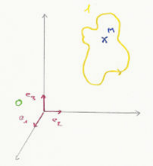

## La quantité de mouvement

Soit une masse ponctuelle, alors la quantité de mouvement est définie par :

$$
m \cdot \vec v_{M|O}
$$

Soit un ensemble de masses ponctuelles, alors la quantité de mouvement est définie par :

$$
\sum_{i=1}^{n} m_i \vec v_{M_i|0}
$$

Soit un système discret, alors la quantité de mouvement est définie par :

$$
\sum_{i=1}^{n} m_i \vec v_{M_i|0}
$$

En effet, par la règle du barycentre on obtient : $m_T \cdot \overrightarrow{OG} = \displaystyle\sum_{i=1}^{n} m_i \overrightarrow{OM_i}$. On a donc pour un système discret la quantité de mouvement définie par

$$
m_T \cdot \vec G|0
$$

Pour des masses élémentaires contenues dans un solide, c'est-à-dire un système continu, la quantité de mouvement se calcule grâce à la somme des masses élémentaires $dm \vec V_{M_1|0}$. Ainsi la quantité de mouvement est définie par

$$
\int_1 \vec v_{M_1|0} \cdot dm = \int_1 \frac{d_0 \overrightarrow{OM}}{dt} \cdot dm = \frac{d_0}{dt} \Big\{ \int_1 \overrightarrow{OM} dt \Big\}
$$

Par conséquent :

$$
m_T \cdot \overrightarrow{OG}_T = \int_1 \overrightarrow{OM} \cdot dm \quad \text{théorème du barycentre}
$$

$$
\int_1 dm \Rightarrow \vec P_{10} = \frac{d_0}{dt} \big\{ m_1 \cdot \overrightarrow{OG} \big\} = m_1 \frac{d_0 \overrightarrow{OG}}{dt} = m_1 \vec v_{G \in 1|0}
$$

$$
\vec P_{10} = \int_1 \vec v_{M \in 1|0} \, dm = m_1 \vec v_{G \in 1|0}
$$

## Moment

On définit le moment de la quantité de mouvement en $O$ par

$$
\overrightarrow{OM} \wedge \vec v_{M|O} \cdot m = \sum_{i=1}^{n} \overrightarrow{OM_i} \wedge \vec v_{M \in i|0} \cdot m_i
$$

Pour un système continu on obtient

$$
\vec\sigma_{O10} = \int_1 \overrightarrow{OM} \wedge \vec v_{M \in 1|0} \cdot dm
$$

On l'exprime en $O'$ :

$$
\vec\sigma_{O'10} = \int_1 \overrightarrow{O'M} \wedge \vec V_{M10} \, dm = \int_1 \overrightarrow{O'O} \wedge \vec v_{M10} \, dm + \int_1 \overrightarrow{OM} \wedge \vec v_{M10} \, dm = \overrightarrow{O'O} \wedge \vec P_{10} + \vec\sigma_{O10}
$$

On conclut donc que

$$
\vec\sigma_{O'10} = \vec\sigma_{O10} + \overrightarrow{O'O} \wedge \vec P_{10}
$$

## Calcul du moment cinétique

On a

$$
\{C_{10}\} = \begin{cases} \vec P_{10} = m_1 \vec V_{G10} \\ \vec\sigma_{O10} = \int_1 \overrightarrow{OM} \wedge \vec V_{M10} \, dm \end{cases}
\to
\begin{cases} \text{idem} \\ \vec\sigma_{O'10} = \vec\sigma_{O10} + \overrightarrow{O'O} \wedge \vec p_{10} \end{cases}
$$

En un point du solide, en $G$ centre de masse :

$$
\vec\sigma_{K10} = \vec\sigma_{G10} + \overrightarrow{KG} \wedge \vec p_{10}
$$

Avec

$$
\begin{aligned}
\vec\sigma_{G10} &= \int_1 \overrightarrow{GM} \wedge \vec V_{M10} \, dm = \int_1 \overrightarrow{GM} \wedge (\vec V_{G10} + \vec\Omega_{10} \wedge \overrightarrow{GM}) \, dm \\
&= \int_1 \overrightarrow{GM} \wedge \vec V_{G10} \, dm + \int_1 \overrightarrow{GM} \wedge (\vec\Omega_{10} \wedge \overrightarrow{GM}) \, dm = \int_1 -\vec V_{G10} \wedge \overrightarrow{GM} \, dm + \int_1 \big[(\overrightarrow{GM} \cdot \overrightarrow{GH}) \vec\Omega_{10} - (\overrightarrow{GH} \cdot \vec\Omega_{10}) \cdot \overrightarrow{GH}\big] dm
\end{aligned}
$$

Or $\displaystyle\int_1 -\vec V_{G10} \wedge \overrightarrow{GH} \, dm = -\vec V_{G10} \wedge \int_1 \overrightarrow{GM} \, dm = \vec 0$. Car par le théorème du barycentre on a $m \cdot \overrightarrow{OG} = \int_1 \overrightarrow{OG} \cdot dm$ et donc en $G$ on a $m \overrightarrow{GG} = \int_1 \overrightarrow{GM} \cdot dm = 0$.

On s'intéresse à $\int_1 \big[(\overrightarrow{GM} \cdot \overrightarrow{GH}) \vec\Omega_{10} - (\overrightarrow{GH} \cdot \vec\Omega_{10}) \cdot \overrightarrow{GH}\big] dm$ sur $R_1(G, \vec x_1, \vec x_2, \vec x_3)$. On a $\overrightarrow{GH} = x \vec x_1 + y \vec y_1 + z \vec z_1$ et $\vec\Omega_{10} = \omega_x \vec x_1 + \omega_y \vec y_1 + \omega_z \vec z_1$.

Puisqu'on a l'intégrale nulle par le théorème du barycentre on peut écrire :

$$
\begin{aligned}
\vec\sigma_{G10} &= \int_1 \big[(x^2 + y^2 + z^2)(\omega_x \vec x_1 + \omega_y \vec y_1 + \omega_z \vec z_1) - (x\omega_x + y\omega_y + z\omega_z)(x \vec x_1 + y \vec y_1 + z \vec z_1)\big] dm \\
&= \int_1 \big[\vec x_1\big(x^2\omega_x - x^2\omega_x + (y^2 + z^2)\omega_x\big) - \vec x_1 xy\omega_y - \vec x_1 xz\omega_z + \vec y_1 (z^2 + x^2)\omega_y - \vec y_1 xy\omega_x - \vec y_1 yz\omega_z \\
&\qquad + \vec z_1 (x^2 + y^2)\omega_z - \vec z_1 zx\omega_x - \vec z_1 zy\omega_y\big] dm \\
&= \vec x_1 \Big\{ \omega_x \int_1 (y^2 + z^2) dm - \omega_y \int_1 xy\,dm - \omega_z \int_1 xz\,dm \Big\} \\
&\quad + \vec y_1 \Big\{ -\omega_x \int_1 xy\,dm + \omega_y \int_1 (z^2 + x^2) dm - \omega_z \int_1 yz\,dm \Big\} \\
&\quad + \vec z_1 \Big\{ -\omega_x \int_1 xz\,dm - \omega_y \int_1 yz\,dm + \omega_z \int_1 (x^2 + y^2) dm \Big\}
\end{aligned}
$$

$$
\vec\sigma_{G10} = \begin{pmatrix}
\int_1 (y^2 + z^2) dm & -\int_1 xy\,dm & -\int_1 xz\,dm \\
-\int_1 xy\,dm & \int_1 (z^2 + x^2) dm & -\int_1 yz\,dm \\
-\int_1 xz\,dm & -\int_1 yz\,dm & \int_1 (x^2 + y^2) dm
\end{pmatrix}
\begin{pmatrix} \omega_x \\ \omega_y \\ \omega_z \end{pmatrix}
$$

On peut donc la réduire à

$$
\begin{pmatrix} A_G & -F_G & -E_G \\ -F_G & B_G & -D_G \\ -E_G & -D_G & C_G \end{pmatrix}
$$

En un point du solide, en $F$, dans le mouvement de 1 par rapport à 0, on a $\vec V_{F10} = \vec 0$. On calcule $\vec\sigma_{K10}$ :

$$
\begin{aligned}
\vec\sigma_{K10} &= \vec\sigma_{F10} + \overrightarrow{KF} \wedge \vec p_{10} \\
\vec\sigma_{F10} &= \int_1 \overrightarrow{FM} \wedge \vec V_{M10} \, dm = \int_1 \overrightarrow{FM} \wedge (\vec V_{F10} + \vec\Omega_{10} \wedge \overrightarrow{FM}) \, dm \\
\vec\sigma_{F10} &= \int_1 \overrightarrow{FM} \wedge (\vec\Omega_{10} \wedge \overrightarrow{FM}) \, dm \\
\vec\sigma_{F10} &= \overline{\overline{I}}^{\,1}_{Fb_1} \cdot \vec\Omega_{10}
\end{aligned}
$$

où $\overrightarrow{FM} = x \vec x_1 + y \vec y_1 + z \vec z_1$ et $\vec\Omega_{10} = \omega_x \vec x_1 + \omega_y \vec y_1 + \omega_z \vec z_1$.

## Énergie cinétique

Pour la masse élémentaire, l'énergie cinétique est $\frac{1}{2} dm \cdot \vec V_{M10}^2$. Pour le solide 1 on a $E_{C10} = \frac{1}{2}\int_1 \vec V_{M10}^2 \cdot dm$. On obtient donc la relation de calcul

$$
\begin{aligned}
2E_{C10} &= \int_1 \vec V_{M10}^2 \, dm = \int_1 (\vec V_{A10} + \vec\Omega_{10} \wedge \overrightarrow{AM}) \cdot \vec V_{M10} \, dm = \int_1 \vec V_{A10} \cdot \vec V_{M10} \, dm + \int_1 (\vec\Omega_{10} \wedge \overrightarrow{AM}) \vec V_{M10} \, dm \\
&= \vec V_{A10} \cdot \int_1 \vec V_{M10} \, dm + \int_1 \vec\Omega_{10} (\overrightarrow{AM} \wedge \vec V_{M10}) \, dm = \vec V_{A10} \cdot \vec p_{10} + \vec\Omega_{10} \cdot \vec\sigma_{A10}
\end{aligned}
$$

On peut donc réécrire l'énergie cinétique :

$$
2E_{C10} = \begin{cases} \vec\Omega_{10} \\ \vec V_{A10} \end{cases} \times \begin{cases} \vec p_{10} \\ \vec\sigma_{A10} \end{cases}
\Leftrightarrow 2E_{C10} = \{V_{10}\}_A \times \{C_{10}\}_A = \{V_{10}\}_G \times \{C_{10}\}_G
$$

Au point $G$ on a

$$
2E_{C10} = \begin{cases} \vec\Omega_{10} \\ \vec V_{G10} \end{cases} \times \begin{cases} m \vec V_{G10} \\ \vec\sigma_{G10} \end{cases} = m \vec V_{G10}^2 + \vec\Omega_{10} \cdot \vec\sigma_{G10}
$$

Au point $F$ fixe on a $\vec V_{F10} = \vec 0$, ainsi

$$
2E_{C10} = \begin{cases} \vec\Omega_{10} \\ \vec V_{F10} \end{cases} \times \begin{cases} m \vec V_{G10} \\ \vec\sigma_{F10} \end{cases} = \vec\Omega_{10} \cdot \vec\sigma_{F10}
$$

Lors du mouvement de translation de 1 par rapport à 0, on a $\Omega_{10} = 0$, donc

$$
2E_{C10} = \begin{cases} \vec 0 \\ \vec V_{G10} \end{cases} \times \begin{cases} m \vec V_{G10} \\ - \end{cases} = m \vec V_{G10}^2
$$

Lors du mouvement de rotation autour d'un axe fixe, on a

$$
2E_{C10} = \begin{cases} \vec\Omega_{10} \\ \vec V_{F10} = \vec 0 \end{cases} \times \begin{cases} m \vec V_{G10} \\ \vec\sigma_{F10} \end{cases} = \vec\Omega_{10} \cdot \vec\sigma_{F10}
$$

donc $2E_{C10} = \vec\Omega_{10} \big(\overline{\overline{I}}^{\,1}_{F,b_1} \cdot \vec\Omega_{10}\big)$. Et au final :

$$
2E_{C10} = \vec\Omega_{10} \cdot \begin{pmatrix} A & -F & -E \\ -F & B & -D \\ -E & -D & C \end{pmatrix} \begin{pmatrix} \omega_x \\ \omega_y \\ \omega_z \end{pmatrix}
$$

Donc $\vec\Omega_{10} = \omega_x \vec x_1 + \omega_y \vec y_1 + \omega_z \vec z_1$ et donc

$$
2E_{C10} = \omega_z \vec z_1 \cdot (-E\omega_z \vec x_1 - D\omega_z \vec y_1 + C\omega_z \vec z_1) = C\omega_z^2
$$

## Éléments d'inertie : théorèmes de Huygens

On a $\overrightarrow{KM} = \overrightarrow{KG} + \overrightarrow{GM}$, donc

$$
\begin{pmatrix} X \\ Y \\ Z \end{pmatrix} = \begin{pmatrix} a \\ b \\ c \end{pmatrix} + \begin{pmatrix} x \\ y \\ z \end{pmatrix}
$$

donc $x = a + X$, $dx = dX$, $dy = dY$ et $dz = dZ$, ainsi $\rho\,dx\,dy\,dz = \rho\,dX\,dY\,dZ$.

On calcule le moment d'inertie :

$$
A_K = \int_1 (y^2 + z^2) dm = \int_1 (y^2 + b^2 + 2by + z^2 + c^2 + 2cz) dm = \int_1 (y^2 + z^2) dm + (b^2 + c^2) \int_1 dm + 2b \int_1 y\,dm + 2c \int z\,dm = A_G + (b^2 + c^2) m
$$

Par le théorème du barycentre, en effet, $m \overrightarrow{GG} = \int_1 \overrightarrow{GM} dm = \int_1 (x \vec x_1 + y \vec y_1 + z \vec z_1) dm \Leftrightarrow 0 = \int_1 y\,dm$. Ainsi

$$
\begin{cases} A_K = A_G + m(b^2 + c^2) \\ B_K = B_G + m(c^2 + a^2) \\ C_K = C_G + m(a^2 + b^2) \end{cases}
$$

Pour les produits d'inertie on a

$$
D_K = \int_1 yz\,dm = \int_1 (y + b)(z + c) dm = \int_1 yz\,dm + bc \int_1 dm + b \int_1 z\,dm + c \int_1 y\,dm = D_G + mbc
$$

Ainsi on a

$$
\begin{cases} D_K = D_G + mbc \\ E_K = E_G + mca \\ F_K = F_G + mab \end{cases}
$$

Au final on a

$$
\begin{pmatrix} A_K & -F_K & -E_K \\ & B_K & -D_K \\ & & C_K \end{pmatrix}
= \begin{pmatrix} A_G & -F_G & -E_G \\ & B_G & -D_G \\ & & C_G \end{pmatrix}
+ m \begin{pmatrix} b^2 + c^2 & -ab & -ca \\ & c^2 + a^2 & -bc \\ & & a^2 + b^2 \end{pmatrix}
$$

$$
\boxed{\overline{\overline{I}}^{\,1}_{K_1 b_1} = \overline{\overline{I}}^{\,1}_{G, b_1} + \overline{\overline{H}}^{\,1}_{G, b_1 \to K, b_1}}
$$
