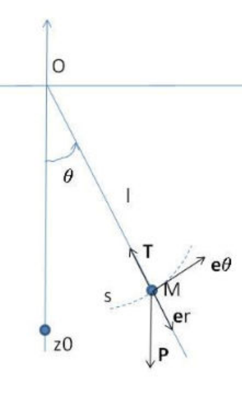

## Moment dynamique

**Étude cinétique.** Soit la vitesse $\vec V_{M10}$, on a donc :

- $\vec p_{10} = \int_1 \vec V_{M10} \, dm = m \cdot \vec V_{G10}$
- $\vec\sigma_{P10} = \int_1 \overrightarrow{PM} \wedge \vec V_{M10} \, dm$
- Si $P$ est le centre de gravité, $\vec\sigma_{G10} = \overline{\overline{I}}^{\,1}_{Gb_1} \cdot \vec\Omega_{10}$
- Si $P$ est un point fixe, $\vec\sigma_{F10} = \overline{\overline{I}}^{\,1}_{Fb_1} \cdot \vec\Omega_{10}$

**Étude dynamique.** Soit l'accélération $\vec\Gamma_{M10}$, on a donc :

- (résultante dynamique) $\vec d_{10} = \int_1 \vec\Gamma_{M10} \, dm = \int_1 \vec d_0 dt \vec V_{M10} \, dm = \dfrac{d_0}{dt} \int_1 \vec V_{M10} \, dm = \dfrac{d_0}{dt}(m \vec V_{G10}) = m \vec\Gamma_{G10}$.
- (moment dynamique) $\vec\delta_{P10} = \int_1 \overrightarrow{PM} \wedge \vec\Gamma_{M10} \, dm$
- Pour un point quelconque $K$ on a $\delta_{K10} = \int_1 \overrightarrow{KM} \wedge \vec\Gamma_{M10} \, dm = \int_1 \overrightarrow{KP} \wedge \vec\Gamma_{M10} \, dm + \int_1 \overrightarrow{PM} \wedge \vec\Gamma_{M10} \, dm$
- (torseur dynamique)

  $$
  \{D_{10}\} = \begin{cases} \vec d_{10} = m \vec\Gamma_{G10} \\ \vec\delta_{P10} = . \end{cases}
  $$

**Calcul du moment dynamique.**

$$
\begin{aligned}
\vec\delta_{P10} &= \int_1 \overrightarrow{PH} \wedge \vec\Gamma_{M10} \, dm = \int_1 \overrightarrow{PM} \wedge \frac{d_0 \vec V_{M10}}{dt} \, dm \\
&= \int \Big(\frac{d_0}{dt}(\overrightarrow{PM} \wedge \vec V_{M10}) - \frac{d_0 \overrightarrow{PM}}{dt} \wedge \vec V_{M10}\Big) dm \\
&= \int_1 \frac{d_0}{dt}(\overrightarrow{PM} \wedge \vec V_{M10}) \, dm - \int_1 (\vec V_{M10} - \vec V_{P10}) \wedge \vec V_{M10} \, dm \\
&= \frac{d_0}{dt} \int_1 \overrightarrow{PM} \wedge \vec V_{M10} \, dm + \int_1 \vec V_{P10} \wedge \vec V_{M10} \, dm \\
&= \frac{d_0}{dt} \vec\sigma_{P10} + \vec V_{P10} \wedge \int_1 \vec V_{M10} \, dm
\end{aligned}
$$

$$
\vec\delta_{P10} = \frac{d_0}{dt} \vec\sigma_{P10} + \vec V_{P10} \wedge m \vec V_{G10}
$$

On va considérer que $P$ appartient à 1 : soit c'est le centre de gravité, alors $\vec\delta_{G10} = \dfrac{d_0}{dt} \vec\sigma_{G10}$ ; soit c'est un point fixe, alors $\vec\delta_{F10} = \dfrac{d_0}{dt} \vec\sigma_{F10}$.

## Principe fondamental de la dynamique

**Énoncé.** Le principe fondamental de la dynamique sur le solide 2 (de la centrifugeuse) s'exprime ainsi : le torseur des actions des forces extérieures de 2 sur 2 équivaut au torseur dynamique de 2 par rapport à 0. Ainsi le membre de droite peut se réécrire

$$
\{D_{20}\}_{G_2} = \begin{cases} \vec d_{20} = m_2 \vec\gamma_{G20} \\ \vec\delta_{G \in 2|0} = \dfrac{d_0}{dt} \vec\sigma_{G \in 2|0} \ \text{avec} \ \vec\sigma_{G \in 2|0} = \overline{\overline{I}}^{\,2}_{Gb_2} \cdot \vec\Omega_{20} \end{cases}
$$

Le membre de gauche peut aussi se réécrire

$$
\{P_2\}_{G_2} = \begin{cases} -m_2 g \vec z_1 \\ \vec 0 \end{cases}
$$

que l'on ajoute à

$$
\{A_{12}\} = \begin{cases} \vec R_{12} = x_{12} \vec x_2 + y_{12} \vec y_2 + z_{12} \vec z_2 \\ \vec\varpi_{A \in 1|2} = L_{12} \vec x_2 + M_{12} \vec y_2 + N_{12} \vec z_2 \end{cases}
$$

Cela conduit à l'expression du principe fondamental de la dynamique :

$$
\{P_2\}_{G_2} + \{A_{12}\}_{A \to G_2} = \{D_{20}\}_{G_2}
$$

Cela conduit à deux théorèmes, celui de la résultante dynamique et celui du moment dynamique.

Dans le problème de la centrifugeuse, on peut isoler 2, faire le bilan des actions extérieures sur 2 et en déduire le principe fondamental de la dynamique à 2 par rapport à 0. De plus on peut isoler 1, faire le bilan des actions extérieures sur 1 et en déduire le principe fondamental de la dynamique de 1 à 0. De plus, si on isole 1 et 2 et que l'on fait le bilan des forces extérieures sur 1 plus 2, on a le principe fondamental de la dynamique à 1 et 2, on retrouve le résultat précédent.

$\vec d_{10} = \int_1 \vec\gamma_{M \in 1|0} \, dm$ et $\vec d_{20} = \int_2 \vec\gamma_{M \in 2|0} \, dm$, ainsi $\vec d_{12|0} = \vec d_{10} + \vec d_{20} = \int_1 \vec\gamma_{M \in 1|0} \, dm + \int_2 \vec\gamma_{M \in 2|0} \, dm$. De manière analogue on a $\vec\delta_{12|0} = \vec\delta_{10} + \vec\delta_{20}$.

**Exemple : le pendule simple.**

$$
\{V_{10}\} = \begin{cases} \vec\Omega_{10} = \dot\theta \vec z_0 \\ \vec V_{O \in 1|0} = \vec 0 \end{cases}
$$

$$
\{C_{10}\} = \begin{cases} \vec p_{10} = m_1 l \dot\theta \vec\phi_1 \\ \vec\sigma_{O \in 1|0} = \overline{\overline{I}}^{\,1}_{Ob_1} \cdot \dot\theta \vec z_0 \end{cases}
$$

$$
\{D_{10}\} = \begin{cases} \vec d_{10} = m_1 l(-\dot\theta^2 \vec x_1 + \ddot\theta \vec\phi_1) \\ \vec\delta_{O \in 1|0} = \dfrac{d_0}{dt} \vec\sigma_{O \in 1|0} \end{cases}
$$

$$
\{D_{10}\}_O = \{P_1\}_{G \to O} + \{A_{01}\}_O
$$

On détermine la matrice d'inertie ; les deux premières colonnes sont nulles car elles sont multipliées par

$$
\Omega_{10} = \begin{pmatrix} 0 \\ 0 \\ \dot\theta \end{pmatrix}
$$

Il reste donc $-E$, $-D$ et $C$, or $-E$ et $-F$ sont impaires en $z$ et on intègre sur un domaine symétrique, il ne reste donc que $C$. Donc $\vec\sigma_{O10} = C\dot\theta \vec z_0$ et donc $\vec\delta_{O \in 1|0} = C\ddot\theta \vec z_0$. On peut donc réécrire le principe fondamental de la dynamique :

$$
\begin{cases} m_1 l(-\dot\theta^2 \vec x_1 + \ddot\theta \vec y_1) \\ \vec\delta_{O \in 1|0} = C\ddot\theta \vec z_0 \end{cases}
= \begin{cases} \vec d_{10} = mg \vec x_0 \\ \vec\delta_{O \in 1|0} = \overrightarrow{OG} \wedge mg \vec x_0 \end{cases}
+ \begin{cases} \vec R_{01} = x_{01} \vec x_1 + y_{01} \vec y_1 + z_{01} \vec z_1 \\ \vec m_{O \in 0|1} = L_{01} \vec x_1 + M_{01} \vec y_1 + N_{01} \vec z_1 \end{cases}
$$

On calcule la résultante selon la base 1, on a donc

$$
\begin{cases} -m_1 l \dot\theta^2 = mg\cos(\theta) + x_{01} \\ m_1 l \ddot\theta = -mg\sin(\theta) + y_{01} \end{cases}
$$

On calcule le moment selon la base 1 : $C\ddot\theta = -mgl\sin(\theta) + 0$, c'est l'équation du mouvement.

On résout l'équation du mouvement :

$$
\ddot\theta + \frac{mgl}{C} \sin\theta = 0
$$

La solution est de la forme $\theta = A\sin(\omega_0 t) + B\cos(\omega_0 t)$.

## Théorème de l'énergie cinétique

**Énoncé - démonstration.** $E_{C \in 1|0} = \frac{1}{2} dm \cdot \vec V_{M \in 1|0}^2 \, dm$ et $2E_{C \in 1|0} = \{V_{10}\} \times \{C_{10}\}$, on a donc

$$
\begin{aligned}
\frac{d}{dt} E_{C \in 1|0} &= \frac{d}{dt}\Big(\int_1 \frac{1}{2} \vec V_{M \in 1|0}^2 \, dm\Big) = \int_1 \frac{d}{dt}\Big(\frac{1}{2} \vec V_{M \in 1|0}^2\Big) dm = \int_1 \vec V_{M \in 1|0} \cdot \frac{d}{dt} \vec V_{M \in 1|0} \, dm = \int_1 (\vec V_{X \in 1|0} + \vec\Omega_{10} \wedge \overrightarrow{XM}) \cdot \vec\gamma_{M \in 1|0} \, dm \\
&= \int_1 \vec V_{X \in 1|0} \cdot \vec\gamma_{M \in 1|0} \, dm + \int_1 (\vec\Omega_{10} \wedge \overrightarrow{XM}) \cdot \vec\gamma_{M \in 1|0} \, dm = \vec V_{X \in 1|0} \cdot \int \vec\gamma_{M \in 1|0} \, dm + \int_1 \vec\Omega_{10} (\overrightarrow{XM} \wedge \vec\gamma_{M \in 1|0}) \, dm \\
&= \vec V_{X \in 1|0} \cdot \vec d_{10} + \vec\Omega_{10} \vec\delta_{X \in 1|0}
\end{aligned}
$$

On a donc

$$
\frac{d}{dt} E_{C \in 1|0} = \vec V_{X \in 1|0} \cdot \vec d_{10} + \vec\Omega_{10} \cdot \vec\delta_{X \in 1|0}
$$

$$
\frac{d}{dt} E_{C \in 1|0} = \{V_{10}\} \{D_{10}\}
$$

Énoncé du principe fondamental de la dynamique :

$$
\{D_{10}\} \{V_{10}\} = \big\{A_{\overline{1}|1}\big\} \{V_{10}\}
$$

$$
\frac{d}{dt} E_{C \in 1|0} = \begin{cases} \vec R_{\overline{1}|1} \\ \vec m_{y \in \overline{1}|1} \end{cases} \times \begin{cases} \vec\Omega_{10} \\ \vec V_{y \in 1|0} \end{cases}
$$

On peut donc en déduire

$$
\frac{d}{dt} E_{C \in 1|0} = P_{\overline{1}|1}
$$

**Exemple : pendule simple.** $2E_{C \in 1|0} = \{V_{10}\} \times \{C_{10}\}$

$$
2E_{C \in 1|0} = \begin{cases} \vec\Omega_{10} = \dot\theta \vec z \\ \vec V_{G \in 1|0} = L\dot\theta \vec y_1 \end{cases}
\times \begin{cases} \vec p_{10} = m_1 L \dot\theta \vec y_1 \\ \vec\sigma_{G \in 1|0} \end{cases}
= \overline{\overline{I}}^{\,1}_{Gb_1} \cdot \vec\Omega_{10} = m_1 L^2 \dot\theta^2
$$

$$
\frac{d}{dt} 2E_{C \in 1|0} = m_1 L^2 2\dot\theta\ddot\theta
$$

Actions $\overline{1}|1$ à distance :

$$
\begin{cases} mg \vec x_0 \\ \vec 0 \end{cases}_G
\begin{cases} \vec\Omega_{10} \\ \vec V_{G \in 1|0} = L\dot\theta \vec y_1 \end{cases}
= mgL\dot\theta \vec x_0 \vec y_1 = -mgL\dot\theta\sin(\theta)
$$

et de contact :

$$
\begin{cases} x_{01} \vec x_1 + y_{01} \vec y_1 + z_{01} \vec z_1 \\ L_{01} \vec x_1 + M_{01} \vec y_1 + N_{01} \vec z_1 \end{cases}
\times \begin{cases} \vec\Omega_{10} = \dot\theta \vec z \\ \vec V_{O \in 1|0} = \vec 0 \end{cases} = 0
$$

Ainsi on peut écrire

$$
m_1 L^2 \dot\theta\ddot\theta = -m_1 g L \dot\theta \sin(\theta)
$$

$$
\ddot\theta + \frac{g}{L} \sin(\theta) = 0 \quad \text{équation du mouvement}
$$
