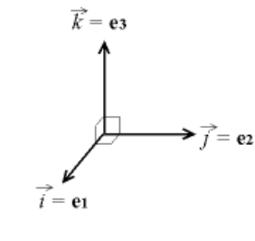
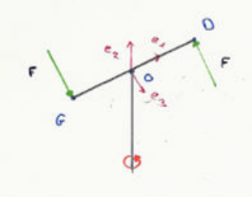

On identifie une base orthonormée directe $b = (\vec e_1, \vec e_2, \vec e_3)$ et un repère $R = (O, \vec e_1, \vec e_2, \vec e_3)$.

$$
A \begin{pmatrix} x_A \\ y_A \\ z_A \end{pmatrix}
\quad \text{et} \quad
\overrightarrow{OA} \begin{pmatrix} x_A \\ y_A \\ z_A \end{pmatrix}
$$

## Vecteur

**Produit scalaire.** $\overrightarrow{OA} \cdot \overrightarrow{OB} = x_A x_B + y_A y_B + z_A z_B = \|\overrightarrow{OA}\| \, \|\overrightarrow{OB}\| \cos(\overrightarrow{OA}, \overrightarrow{OB})$

**Produit vectoriel.**

$$
\overrightarrow{OA} \wedge \overrightarrow{OB} = \|\overrightarrow{OA}\| \, \|\overrightarrow{OB}\| \sin(\overrightarrow{OA}, \overrightarrow{OB})\, \vec n
= \begin{vmatrix} x_A & \cdot & x_B \\ y_A & \wedge & y_B \\ z_A & \cdot & z_B \end{vmatrix}
= \begin{pmatrix} y_A z_B - y_B z_A \\ z_A x_B - z_B x_A \\ x_A y_B - x_B y_A \end{pmatrix}
$$

**Produit mixte.** $(\overrightarrow{OA} \wedge \overrightarrow{OB}) \cdot \overrightarrow{OC} = \overrightarrow{OA} \cdot (\overrightarrow{OB} \wedge \overrightarrow{OC}) = (\overrightarrow{OB} \wedge \overrightarrow{OC}) \cdot \overrightarrow{OA} = \overrightarrow{OB} \cdot (\overrightarrow{OC} \wedge \overrightarrow{OA})$.

**Moment d'un vecteur en un point.** $\vec{\mathcal M}_O \overrightarrow{BC} = \overrightarrow{OB} \wedge \overrightarrow{BC} = (\overrightarrow{OA} + \overrightarrow{AB}) \wedge \overrightarrow{BC} = \overrightarrow{OA} \wedge \overrightarrow{BC} + \overrightarrow{AB} \wedge \overrightarrow{BC}$.

$\vec{\mathcal M}_O \overrightarrow{BC} \cdot \vec u = (\overrightarrow{OB} \wedge \overrightarrow{BC}) \cdot \vec u$.

## Torseur

**Somme.** $\vec S = \overrightarrow{BG} + \overrightarrow{B_2C_2} + \dots + \overrightarrow{B_nC_n} = \displaystyle\sum_{i=1}^{n} \overrightarrow{B_iC_i}$.

**Moment en $O$.** $\vec{\mathcal M}_O = \overrightarrow{OB_1} \wedge \overrightarrow{B_1C} + \dots + \overrightarrow{OB_n} \wedge \overrightarrow{B_nC} = \displaystyle\sum_{i=1}^{n} \overrightarrow{OA_i} \wedge \overrightarrow{B_iC_i}$

**Torseur.**

$$
\begin{cases} \vec S \\ \vec{\mathcal M}_O \end{cases} = \{T\}_O
$$

De $O$ en $O'$ :

$$
\begin{cases} \vec S \to \vec S' \ \text{inchangé - invariant} \\ \vec{\mathcal M}_O \to \vec{\mathcal M}'_O = \overrightarrow{O'A} \wedge \overrightarrow{B_1C} + \dots + \overrightarrow{O'A_n} \wedge \overrightarrow{B_nC_n} \end{cases}
$$

$$
\vec{\mathcal M}_{O'} = (\overrightarrow{O'O} \wedge \overrightarrow{B_1C_1}) + \overrightarrow{OA_1} \wedge \overrightarrow{B_1C_1} + \dots + (\overrightarrow{O'O} \wedge \overrightarrow{B_nC_n}) + \overrightarrow{OA_n} \wedge \overrightarrow{B_nC_n}
\Rightarrow \vec{\mathcal M}_{O'} = \vec{\mathcal M}_O + \overrightarrow{O'O} \wedge \vec S
$$

$$
\{T\}_O = \begin{cases} \vec S \\ \vec{\mathcal M}_O \end{cases}
\to
\{T\}_{O'} = \begin{cases} \vec S \\ \vec{\mathcal M}'_O = \vec{\mathcal M}_O + \overrightarrow{OO'} \wedge \vec S \end{cases}
$$

**Torseur nul.** $\vec S$ et $\vec{\mathcal M}_O = \vec 0 \Leftrightarrow \vec{\mathcal M}_{O'} = \vec{\mathcal M}_O + \overrightarrow{OS} \wedge \vec S$.

**Torseur glisseur.**

$$
\begin{cases} \vec S \neq 0 \\ \vec{\mathcal M}_O = \vec 0 \end{cases}
\to
\begin{cases} \vec S \\ \vec{\mathcal M}_{O'} = \vec 0 + \overrightarrow{O'O} \wedge \vec S \end{cases}
$$

**Torseur couple.**

$$
\begin{cases} \vec S = \vec 0 \\ \vec{\mathcal M}_{O'} = \vec{\mathcal M}_O + \overrightarrow{O'O} \wedge \vec S \end{cases}
\qquad
\{T\}_O = \begin{cases} \vec S \\ \vec{\mathcal M}_O \end{cases}
$$

alors $\vec{\mathcal M}_{O'} \cdot \overrightarrow{O'O} = \vec{\mathcal M}_O \cdot \overrightarrow{O'O} + (\overrightarrow{O'O} \wedge \vec S) \cdot \overrightarrow{O'O}$ si $\overrightarrow{O'O} = O'O \cdot \vec u$.

$$
\text{Équiprojectivité : } \vec{\mathcal M}_{O'} \cdot O'O \cdot \vec u = \vec{\mathcal M}_O \cdot O'O \cdot \vec u
$$

**Propriétés de deux torseurs.** Soit

$$
\{T_1\}_O = \begin{cases} \vec S_1 \\ \vec{\mathcal M}_{O,1} \end{cases}
\quad \text{et} \quad
\{T_2\}_O = \begin{cases} \vec S_2 \\ \vec{\mathcal M}_{O,2} \end{cases}
$$

- **Somme.**

  $$
  \{T_1\}_O + \{T_2\}_O = \begin{cases} \vec S_1 + \vec S_2 \\ \vec{\mathcal M}_{O,1} + \vec{\mathcal M}_{O,2} \end{cases}
  $$

- **Produit par un scalaire.**

  $$
  \lambda \{T_1\}_O = \begin{cases} \lambda \vec S_1 \\ \lambda \vec{\mathcal M}_{O,1} \end{cases}
  $$

- **Produit de torseurs (comoment).**

  $$
  \{T_1\}_O \times \{T_2\}_O = \begin{cases} \vec S_1 \\ \vec{\mathcal M}_{O,1} \end{cases} \times \begin{cases} \vec S_2 \\ \vec{\mathcal M}_{O,2} \end{cases} = \vec S_1 \cdot \vec{\mathcal M}_{O,2} + \vec S_2 \cdot \vec{\mathcal M}_{O,1}
  $$

**Exemple.**

- en $D$ :

  $$
  \{T_1\}_D = \begin{cases} -F \vec e_3 \\ \vec{\mathcal M}_D = \overrightarrow{DD} \wedge (-F \vec e_3) = \vec 0 \end{cases}
  $$

- en $G$ :

  $$
  \{T_2\}_G = \begin{cases} F \vec e_3 \\ \vec{\mathcal M}_G = \overrightarrow{GG} \wedge F \vec e_3 = \vec 0 \end{cases}
  $$

$$
\begin{aligned}
\{T_1\}_O + \{T_2\}_O &= \begin{cases} -F \vec e_3 \\ \vec{\mathcal M}_O = \vec{\mathcal M}_D + \overrightarrow{OD} \wedge -F \vec e_3 + a \vec e_1 \wedge -F \vec e_3 \end{cases}
+ \begin{cases} F \vec e_3 \\ \vec{\mathcal M}_O = \vec{\mathcal M}_G + \overrightarrow{OG} \wedge F \vec e_3 - a \vec e_1 \wedge F \vec e_3 \end{cases} \\
&= \begin{cases} \vec 0 \\ -2a \vec e_1 \wedge F \vec e_3 = 2aF \vec e_2 \end{cases}
\end{aligned}
$$
