Ces notes reprennent l'[étude descriptive du corps pur diphasé](./corps-pur-diphase.md) sous un autre angle, avec des diagrammes tracés en cours et quelques compléments.

## Diagrammes de phases

**Introduction.**

- Un corps pur est constitué d'une seule espèce ($He$, $H_2O$, $CH_3CH_2OH$).
- Il peut exister sous plusieurs phases (deux ici) et passer de l'une à l'autre : c'est une transition de phase, ou changement d'état.
- Pour s'y retrouver, on étudie les diagrammes de phases.

### Les trois états de la matière

Il existe trois états de la matière : solide, liquide et vapeur.

$$
\text{Solide} \underset{\text{solidification}}{\overset{\text{fusion}}{\rightleftarrows}} \text{Liquide}
\qquad
\text{Solide} \underset{\text{condensation}}{\overset{\text{sublimation}}{\rightleftarrows}} \text{Vapeur}
\qquad
\text{Liquide} \underset{\text{liquéfaction}}{\overset{\text{vaporisation}}{\rightleftarrows}} \text{Vapeur}
$$

### Phase et variance

**Phase.** Une phase est un système homogène à l'état d'équilibre thermodynamique.

**Variance.** Les grandeurs thermodynamiques peuvent être des paramètres intensifs (pression, température) ou extensifs (volume, nombre d'atomes). La variance est le nombre de paramètres intensifs indépendants nécessaires pour décrire l'état du système.

- La phase d'un système n'est pas modifiée par sa quantité de matière : elle est donc déterminée par des paramètres intensifs.
- Rappel, la loi des gaz parfaits : $\underbrace{P}_{i}\,\underbrace{V}_{e} = \underbrace{N}_{e} k_B \underbrace{T}_{i}$. Si l'on choisit deux paramètres intensifs (par exemple $P$ et $T$), la masse volumique $\rho$ est fixée par la nature.

**Loi de la variance.** $v = 3 - \varphi$ : un corps pur monophasé est décrit par 2 variables intensives ($v = 2$), diphasé par 1 ($v = 1$), triphasé par aucune ($v = 0$).

### Diagramme de phases $(P, T)$

**Le diagramme (pression, température).** On chauffe de l'eau liquide pour différentes pressions : les changements d'état ont lieu à température et pression constantes.

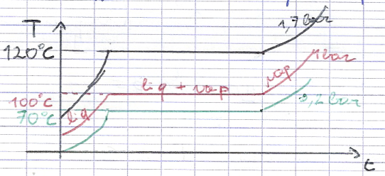

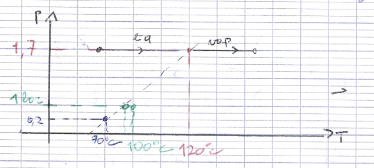

En réitérant l'opération et en reportant les valeurs sur un diagramme $(P, T)$, on obtient :

- **Points** $A$, $B$, $D$ : états du système à une phase, $v = 2$ ; $A'$, $B'$ : deux phases, $v = 1$ ; $C$ : point critique ; $T$ : point triple, trois phases, $v = 0$.
- **Courbes** : $A \to B$, changement d'état (fusion) ; $B \to D$, changement d'état (vaporisation).

**Les points spéciaux $T$ et $C$.** $T(T_T, P_T)$ est le point triple, lieu de convergence des trois courbes d'équilibre diphasique.

- Isobare : pour $P < P_T$, $S \leftrightarrow G$ ; pour $P > P_T$, $S \leftrightarrow L \leftrightarrow V$.
- Isotherme : pour $T < T_T$, $S \leftrightarrow G$ ; pour $T > T_T$, $S \leftrightarrow L \leftrightarrow G$.

$C(T_C, P_C)$ est le point critique : au-delà, on ne peut plus différencier l'état liquide de l'état gazeux.

**Cas particulier de l'eau.** La grande majorité des corps purs ont un diagramme comme le premier ci-dessous ; l'eau, elle, a un diagramme différent.

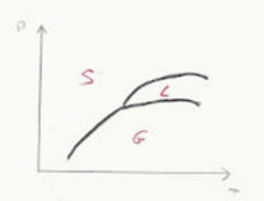

**Diagrammes réels.**

- La courbe solide + liquide est très pentue (limite verticale).
- Les valeurs de $(T_C, P_C)$ et $(T_T, P_T)$ sont très dispersées d'un corps à l'autre.

### Le diagramme $(P, T, v)$

**Rappel.** $v = \dfrac{1}{\rho} = \dfrac{V}{m}$ est le volume massique, en $\text{m}^3/\text{kg}$ (ou $v_{mol} = \dfrac{V}{n}$).

**Problématique.** La transition de phase est peu lisible sur le diagramme $(P, T)$.

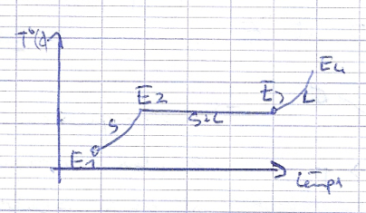

$E_2$ = glace + un peu de liquide et $E_3$ = liquide + un peu de glace sont au même point du diagramme $(P, T)$ : on perd de l'information. Il faut donc un diagramme $(P, T, v)$. C'est un espace à trois paramètres intensifs ; comme $v \leq 2$ (une seule phase au maximum), on obtient une nappe à deux dimensions dans l'espace $(P, T, v)$, ce qui permet trois projections : $(P, T)$, $(P, v)$ et $(T, v)$.

### Diagramme $(T, v)$

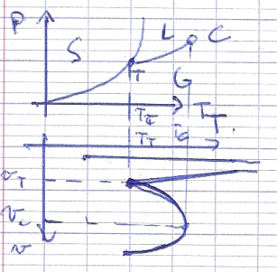

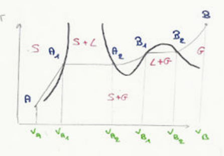

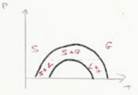

### Exemple de transformation

Fonte d'un glaçon de $CO_2$ : on procède à un chauffage isobare, à la pression $P$, d'un glaçon de $CO_2$.

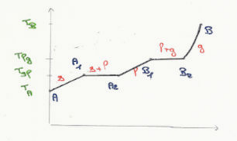

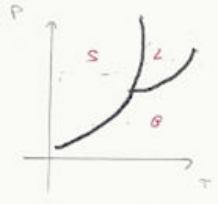

## Fonctions d'état et transition de phase

### Généralités

Un corps pur diphasé est un système composé de deux sous-systèmes, chacun sous une phase.

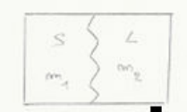

$$
m = m_1 + m_2 \qquad U = U_1 + U_2 \qquad H = H_1 + H_2 \qquad S = S_1 + S_2
$$

- En massique pour les systèmes 1 et 2 : $U_1 = m_1 u_1$ et $U_2 = m_2 u_2$.
- En massique pour le système total : $U = m u$, or $U = U_1 + U_2 \Rightarrow m u = m_1 u_1 + m_2 u_2 \Rightarrow u = x_1 u_1 + x_2 u_2 = x_1 u_1 + (1 - x_1) u_2$.

De même, $h = x_1 h_1 + (1 - x_1) h_2$ et $s = x_1 s_1 + (1 - x_1) s_2$.

**Exemple.** Soit une cuve contenant 1 kg d'eau gazeuse et 2 kg d'eau liquide, le tout à 100 °C. On a $u_1 = u^{eau}_{liq}(T, P) = 418{,}94\ \text{kJ/kg}$ et $u_2 = u^{eau}_{vap}(T, P) = 2506{,}5\ \text{kJ/kg}$. Donc

$$
u = \frac{2}{3} \times 418{,}94 + \frac{1}{3} \times 2506{,}5 = 1114{,}8\ \text{kJ/kg}
$$

### Enthalpie de changement d'état

**Définition.** On appelle enthalpie de changement d'état (ou chaleur latente) l'enthalpie massique nécessaire pour réaliser la transformation de l'état 1 vers l'état 2 d'un corps pur en maintenant $P$ et $T$ constants. On la note $h_{1 \to 2}(T)$.

**Remarque.** $h_{1 \to 2}(T) = \Delta h = h_2(T) - h_1(T)$ ; de plus, $h_{1 \to 2}(T) = -h_{2 \to 1}(T)$.

### Énergie interne de changement d'état

$H = U + PV \Leftrightarrow \dfrac{H}{m} = \dfrac{U}{m} + \dfrac{PV}{m} \Leftrightarrow h = u + Pv$.

Pour un changement d'état à pression constante :

$$
h_{1 \to 2} = h_2 - h_1 = (u_2 + P v_2) - (u_1 + P v_1) = u_2 - u_1 + P(v_2 - v_1)
\Rightarrow h_{1 \to 2}(T) = u_{1 \to 2}(T) + P(v_2 - v_1)
$$

### Entropie de changement d'état

**Définition.** On pose $s_{1 \to 2}(T) = s_2 - s_1$ et on cherche le lien entre $h_{1 \to 2}$ et $s_{1 \to 2}$ à partir de

$$
dU = T\,dS - P\,dV \qquad dH = T\,dS + V\,dP
$$

En massique, $dh = T\,ds + v\,dP$ ; pour un changement d'état isobare, $dP = 0$, donc $dh = T\,ds \Rightarrow ds = \dfrac{dh}{T} \Rightarrow \Delta s_{1 \to 2} = \int_1^2 ds$. Le changement d'état entre 1 et 2 étant isotherme :

$$
s_{1 \to 2}(T) = \int_1^2 \frac{dh}{T} = \frac{1}{T} \int_1^2 dh = \frac{1}{T}(h_2 - h_1) = \frac{h_{1 \to 2}(T)}{T}
$$

### Variations infinitésimales

Pour un corps pur diphasé, $h_i = (1 - x_2) h_1 + x_2 h_2$ et $h_f = (1 - x_2 - dx_2) h_1 + (x_2 + dx_2) h_2$, donc

$$
dh = h_f - h_i = h_1\big(1 - x_2 - dx_2 - (1 - x_2)\big) + h_2 (x_2 + dx_2 - x_2) = dx_2 (h_2 - h_1)
\Rightarrow dh = h_{1 \to 2}(T)\,dx_2
$$

Trois cas :

1. $dh = h_{fus}(T)\,dx_L$ ;
2. $dh = h_{vap}(T)\,dx_V$ ;
3. $dh = h_{sub}(T)\,dx_V$.

Et pour l'entropie :

$$
ds = s_{1 \to 2}(T)\,dx_2 = \frac{h_{1 \to 2}(T)}{T}\,dx_2
$$

### Conséquences sur les diagrammes de phase

- Au point triple, les trois états sont présents. À la température $T_T$ et à la pression $P_T$, appliquons la transformation Solide → Liquide → Gaz → Solide, qui fait intervenir successivement $h_{fus}(T_T)$, $h_{vap}(T_T)$ et $-h_{sub}(T_T)$. Le cycle ramène à l'état initial :

  $$
  \Delta h = h_f - h_i = 0 \Rightarrow h_{fus}(T_T) + h_{vap}(T_T) - h_{sub}(T_T) = 0 \Rightarrow h_{sub}(T_T) = h_{fus}(T_T) + h_{vap}(T_T)
  $$

- Relation de Clapeyron : dans le diagramme $(P, T)$, on peut montrer que

  $$
  h_{1 \to 2}(T_0) = T_0 (v_2 - v_1) \frac{\partial P}{\partial T}(T_0)
  \qquad \text{où} \qquad
  \frac{\partial P}{\partial T}(T_0) = \frac{h_{1 \to 2}}{T_0 (v_2 - v_1)}
  $$

## Étude de la transition liquide-vapeur

### Pression de vapeur saturante

**Définition.** C'est la pression à laquelle a lieu l'équilibre liquide-vapeur à $T$ donnée ; on la note $P^{sat}(T)$. À $T_0$ fixée :

- si $P > P^{sat}(T_0)$ : liquide ;
- si $P = P^{sat}(T_0)$ : liquide + vapeur ;
- si $P < P^{sat}(T_0)$ : vapeur.

### Diagramme de Clapeyron $(P, V)$ et isothermes d'Andrews

À $T$ constante, on augmente la pression et on mesure $P$ et $V$ en relevant l'état du système. Les isothermes obtenues dans le plan $(P, v)$ sont les isothermes d'Andrews.

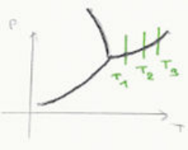

**Description.**

- Pour $T < T_C$ :
  - si $V > V(V)$, le corps est gazeux : la pression est faible et le volume élevé ;
  - en $V$, on observe les premières gouttes de liquide, et $P = P^{sat}(T_1)$ ;
  - si $V(L) < V < V(V)$, le corps est à la fois gazeux et liquide : c'est le palier de vaporisation ;
  - en $L$, on observe les dernières bulles de vapeur ;
  - si $V < V(L)$, le corps est liquide : la pression est élevée et le volume faible.
- Pour $T = T_C$, on observe un point d'inflexion : $\left.\dfrac{\partial P}{\partial V}\right|_{T = T_C} = 0$ et $\left.\dfrac{\partial^2 P}{\partial v^2}\right|_{T = T_C} = 0$.
- Pour $T > T_C$, on a un fluide supercritique.

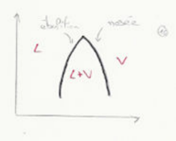

**Règle des moments.** Les coordonnées des courbes de saturation sont $v(V) = v_V$ et $v(L) = v_L$ à $T_0$.

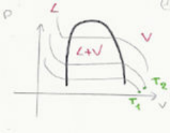

Ainsi, avec $V = v_L + v_V = m_L v_L + m_V v_V$ et $V = m\,v(M)$ :

$$
v(M) = \frac{m_L}{m} v_L + \frac{m_V}{m} v_V
$$

En notant $x = x_V$ et $x_L = 1 - x_V$ :

$$
v(M) = x v_V + (1 - x) v_L
\qquad
x(M) = \frac{v(M) - v_L}{v_V - v_L} = \frac{LM}{LV}
$$

De même pour $h$, $u$ et $s$, par exemple $h(M) = x h_V + (1 - x) h_L$.

### Diagrammes $(T, s)$ et $(P, h)$

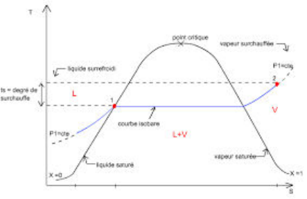

$$
s(M) = x s_V + (1 - x) s_L
\qquad
x = \frac{s(M) - s(L)}{s(V) - s(L)} = \frac{LM}{LV}
$$

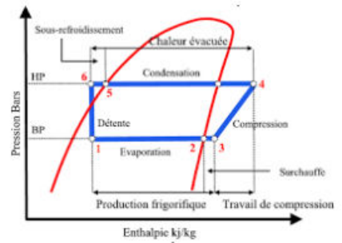

### Interprétation physique de $h_{vap}(T)$

On considère une transformation liquide → vapeur réversible et isotherme à $T$. Le système est quasi statique : c'est une suite d'états d'équilibre à $P = P^{sat}(T)$. La transformation est isobare, donc le transfert thermique vaut $Q_{rev} = \Delta H$ :

$$
\Delta H = m \Delta h \Leftrightarrow \Delta H = m (h_V - h_L) \Leftrightarrow \Delta H = m\,h_{vap}(T) \Rightarrow Q_{rev} = m\,h_{vap}(T)
$$

$h_{vap}(T)$ est la quantité d'énergie à fournir à 1 kg de corps pur liquide pour qu'il se transforme en vapeur, de manière réversible, à $P$ constante.

**Remarque.** Eau liquide à 20 °C (1 bar) → eau liquide à 100 °C → eau vapeur à 100 °C → eau vapeur à 180 °C : $\Delta H_1 = m\,C_{p,liq}(T_f - T_i)$, $\Delta H_2 = m\,h_{vap}(T)$ et $\Delta H_3 = m\,C_{p,vap}(T_f - T_i)$.

$$
h_{vap}(T) = T (v_V - v_L) \frac{\partial P^{sat}(T)}{\partial T}
$$

Près de $T_c$, $v_V \sim v_L \Rightarrow h_{vap}(T) \to 0$.

### Mélange idéal de gaz parfaits

- $PV = n_{tot} R T$ avec $n_{tot} = \displaystyle\sum_{i=1}^{N} n_i$ pour $N$ gaz parfaits. On définit la fraction molaire $x_i = \dfrac{n_i}{n_{tot}}$ et la pression partielle

  $$
  P_i = x_i P
  $$

  Par exemple, pour un air sec à 20 % de $O_2$ et 80 % de $N_2$ sous 1 bar, $P_{O_2} = 0{,}2$ bar et $P_{N_2} = 0{,}8$ bar.

- L'humidité relative est définie par

  $$
  HR(\%) = \frac{P_{H_2O}}{P^{sat}_{H_2O}(T)}
  $$

Pour les bilans d'enthalpie, d'énergie et d'entropie, voir la [dernière section de l'étude du corps pur diphasé](./corps-pur-diphase.md#bilan-denthalpie-dénergie-et-dentropie).
