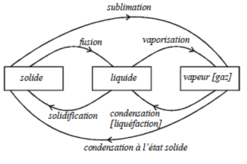
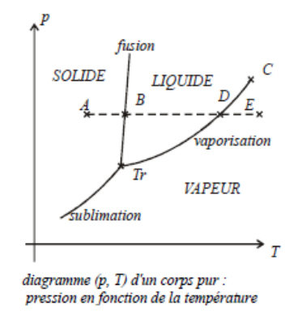
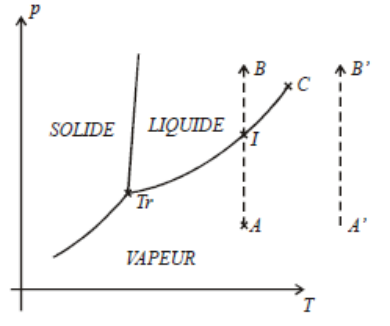
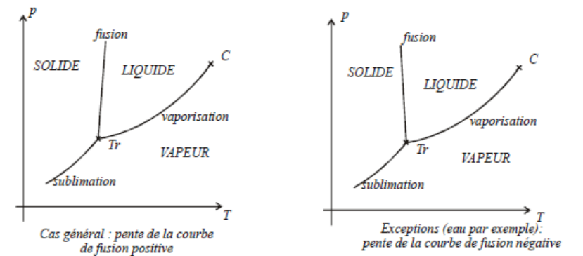
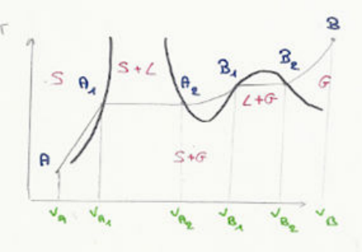
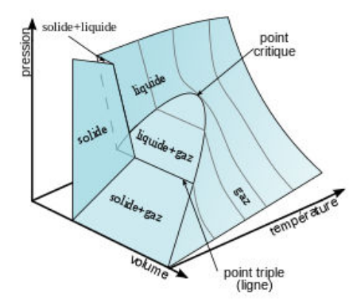
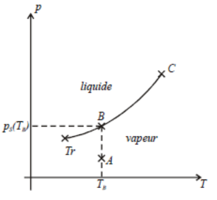
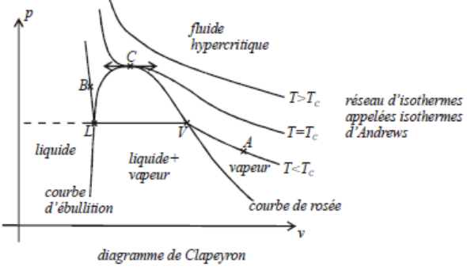
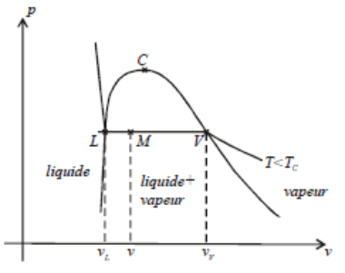
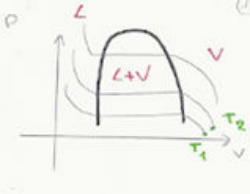

## Définitions

Un corps pur peut exister sous différentes phases : solide, liquide, gaz, superfluide (liquide sans aucune viscosité obtenu par diminution de la température), plasma (ionisation d'un gaz par augmentation de la température, voir cours d'électromagnétisme).

On étudiera les phases solide, liquide et vapeur. On appelle changement d'état (ou changement de phase) une transformation où tout le système ou une partie du système passe d'une phase à une autre.

La surfusion est l'état d'un système qui reste en phase liquide alors que sa température est plus basse que son point de fusion. C'est un état métastable : une petite perturbation peut suffire pour déclencher le changement d'état liquide-solide.

**Loi de la variance.** Pour un corps pur présent sous $\varphi$ phases :

$$
v = 3 - \varphi
$$

- La phase d'un corps pur monophasé est déterminée par 2 variables intensives : $v = 2$.
- La phase d'un corps pur diphasé est déterminée par 1 variable intensive : $v = 1$.
- La phase d'un corps pur triphasé n'est déterminée par aucune variable intensive : $v = 0$.

## Diagramme $(p, T)$ d'un corps pur

Comment définir un système diphasé ? On dispose de deux boîtes séparées par une cloison ; la pression et la température sont intensives. Dans un compartiment, il y a $N_1$ molécules de la phase 1, de masse $m_1$, et dans l'autre $N_2$ molécules de la phase 2, de masse $m_2$.

|  | Masse | Moles | Titre massique | Titre molaire |
| :-- | :-: | :-: | :-: | :-: |
| Phase 1 | $m_1$ | $n_1 = \dfrac{m_1}{M}$ | $x_1 = \dfrac{m_1}{m}$ | $x_1^{mol} = \dfrac{n_1}{n}$ |
| Phase 2 | $m_2$ | $n_2 = \dfrac{m_2}{M}$ | $x_2 = \dfrac{m_2}{m}$ | $x_2^{mol} = \dfrac{n_2}{n}$ |
| Total | $m = m_1 + m_2$ | $n = n_1 + n_2$ | $x_1 + x_2 = 1$ | $x_1^{mol} + x_2^{mol} = 1$ |

On rappelle que le volume massique est défini par $v = \dfrac{1}{\rho} = \dfrac{V}{m}$.

### Construction du diagramme

On considère un corps pur de masse $m$ initialement à l'état solide (point $A$) qui subit une transformation isobare réversible. Le premier principe de la thermodynamique s'écrit $\Delta H = Q$. La pression $p$ est imposée par l'expérience. Le système reçoit effectivement un transfert thermique ($Q > 0$) qui lui permet :

- d'augmenter la température du solide ($A \to B$) : **la variance vaut 2** (on peut choisir $p$ et $T$) ;
- de provoquer la fusion du solide. **Lors du changement d'état (point $B$)**, on constate expérimentalement que la température ne varie pas. **La variance vaut 1. Le changement d'état est isobare et isotherme au point $B$.** $Q_{reçu}$ sert à casser les liaisons pour passer de l'état solide à l'état liquide ;
- une fois que tout le solide s'est transformé en liquide, $Q_{reçu}$ sert à augmenter la température jusqu'au point $D$ ;
- en $D$, la variance vaut 1 : la vaporisation est elle aussi isobare et isotherme ;
- une fois que tout le liquide s'est transformé en vapeur, $Q_{reçu}$ sert à augmenter la température jusqu'au point $E$.

Pour de faibles pressions, on peut passer directement de l'état solide à l'état vapeur : c'est la sublimation.

### Interprétation

**Courbes de fusion, vaporisation et sublimation.** On a trois courbes : fusion, vaporisation, sublimation. Pour chaque courbe, la variance vaut 1. On a donc une relation caractéristique entre la pression et la température de changement d'état, que l'on écrit sous la forme

$$
p = f(T)
$$

Les courbes de solidification et de condensation sont confondues avec les courbes de fusion, de vaporisation et de sublimation.

**Point triple.** Les trois phases coexistent à $T$ et $p$ constants. Les courbes de fusion, de sublimation et de vaporisation se rejoignent en ce point. La variance est nulle au point triple : la température et la pression sont caractéristiques du corps pur.

**Point critique.** La courbe de vaporisation se termine au point $C$, appelé point critique.

**Étude de deux types de transformations.**

- On considère la transformation $A \to B$ isotherme réversible. Le système passe par le point $I$, sur la courbe de vaporisation : en ce point, il y a deux phases, liquide et vapeur. Si on continue à augmenter la pression ($I \to B$), il n'y a plus qu'une seule phase (liquide).
- On considère la transformation $A' \to B'$ : le système ne passe jamais par la courbe de vaporisation. On n'observe à aucun moment de changement de phase.

**Interprétation physique.**

- Les propriétés physiques du liquide et de la vapeur sont différentes pour $T < T_c$ et $p < p_c$. Quand on se rapproche du point critique, les différences entre les propriétés physiques des phases liquide et vapeur diminuent, et elles sont nulles au point critique.
- Au-delà du point critique ($T \geq T_c$ ou $p \geq p_c$), les propriétés physiques du liquide et de la vapeur sont identiques : on ne peut plus distinguer le liquide de la vapeur.

**Bilan : deux types de diagrammes $(p, T)$.** La pente de la courbe de fusion est quasi verticale. La pente de la courbe de vaporisation est plus petite que celle de la courbe de sublimation au point triple. Dans le cas le plus général, la pente de la courbe de fusion est positive. Pour quelques exceptions (l'eau par exemple), elle est négative.

### Quelques diagrammes supplémentaires

## Enthalpies et entropies de transition de phase

### Enthalpie de transition de phase

**Définition.** On considère un solide et un liquide à la température et à la pression du changement d'état solide-liquide. La variance vaut 1 : la pression est donc reliée à la température par la relation $p = f(T)$.

On définit l'enthalpie massique de fusion, notée $h_{S \to L}(T)$, à la température $T$ du changement d'état :

$$
h_{S \to L}(T) = h_L(T) - h_S(T)
$$

Dans certains exercices, l'enthalpie massique de fusion est appelée chaleur latente massique de fusion $l_f$. On définit de même les enthalpies massiques de vaporisation et de sublimation ; ces quantités sont positives. Les enthalpies massiques de solidification, de condensation et de sublimation inverse sont égales à l'opposé des enthalpies massiques de fusion, de vaporisation et de sublimation.

**Relation entre les enthalpies massiques de transition de phase au point triple.** Au point triple, les trois états solide, liquide et vapeur peuvent coexister. La variance vaut 0. On a

$$
h_V(T_{Tr}) - h_S(T_{Tr}) = \big(h_V(T_{Tr}) - h_L(T_{Tr})\big) + \big(h_L(T_{Tr}) - h_S(T_{Tr})\big)
$$

On en déduit immédiatement qu'au point triple

$$
h_{sub}(T_{Tr}) = h_{fus}(T_{Tr}) + h_{vap}(T_{Tr})
$$

De plus, la relation de Clapeyron donne

$$
h_{sub} = T_0 (v_V - v_S) \frac{\partial P}{\partial T}(T_0)
$$

### Entropie de transition de phase

On considère un solide et un liquide à la température et à la pression du changement d'état solide-liquide. La variance vaut 1 : la pression est donc reliée à la température par la relation $p = f(T)$.

On définit $s_{S \to L}(T)$, **l'entropie massique de fusion**, à la température $T$ du changement d'état :

$$
s_{S \to L}(T) = s_L(T) - s_S(T)
$$

On définit de même l'entropie massique de vaporisation et l'entropie massique de sublimation ; ces quantités sont positives. Les entropies massiques de solidification, de condensation et de sublimation inverse sont égales à l'opposé des entropies massiques de fusion, de vaporisation et de sublimation.

### Relations entre enthalpies et entropies massiques de transition de phase

Les enthalpies et entropies massiques de transition de phase sont des variations de fonctions d'état : elles ne dépendent pas du chemin suivi. On envisage une transformation réversible, isotherme et isobare, qui fait passer une masse $m$ de l'état 1 (solide) à l'état 2 (liquide) à la pression $p = f(T)$ :

$$
\begin{cases} \text{état 1} \\ \text{masse } m \text{ solide} \end{cases}
\xrightarrow{T,\, p \text{ constants}}
\begin{cases} \text{état 2} \\ \text{masse } m \text{ liquide} \end{cases}
$$

$$
\Delta H = Q = H_2 - H_1 = m h_L - m h_S = m h_{fus}
$$

La transformation est réversible et isotherme, on a donc :

$$
dS = \frac{\delta Q}{T}
$$

Comme $T$ est constante :

$$
\Delta S = \frac{Q}{T} = \frac{m h_{fus}}{T} = m s_{fus}
$$

Après simplification par $m$, on obtient

$$
s_{fus}(T) = \frac{h_{fus}(T)}{T}
$$

Cette relation est valable aussi pour la sublimation et la vaporisation.

On rappelle les identités thermodynamiques :

$$
dU = T\,dS - p\,dV \qquad dH = T\,dS + V\,dp
$$

## Étude de l'équilibre liquide-vapeur

Le changement d'état liquide-vapeur peut être réalisé de plusieurs façons : vaporisation dans le vide, vaporisation dans un gaz…

### Vaporisation dans le vide

On considère une chambre de vaporisation où la température $T$ est maintenue constante et dans laquelle on a fait le vide absolu.

- On introduit une goutte d'eau liquide. Elle se vaporise instantanément (point $A$).
- On continue à introduire de l'eau liquide. Elle se vaporise instantanément et la pression $p$ augmente : on se déplace sur la courbe $AB$.
- Il arrive un moment où l'eau liquide ajoutée ne se vaporise plus. La pression à laquelle cesse la vaporisation est appelée pression de vapeur saturante, notée $p_{sat}$. On a un équilibre liquide-vapeur.

Au point $A$, on a de la vapeur sèche ; au point $B$, un mélange liquide-vapeur, et la vapeur est dite humide.

Sur le diagramme $(p, T)$, on voit que l'on a nécessairement $p_{\text{vapeur sèche}}(T) < p_{sat}(T)$ : la pression de vapeur sèche à une température $T$ est toujours inférieure à la pression de vapeur saturante.

### Diagramme de Clapeyron $(p, v)$ d'un corps pur

Le diagramme de Clapeyron s'utilise pour des systèmes fermés (ou clos). On représente la pression $p$ du corps pur en fonction du volume massique $v$.

**Isothermes d'Andrews.** On peut tracer plusieurs courbes $(p, v)$ à des températures différentes. On obtient un réseau d'isothermes, appelées isothermes d'Andrews.

1. Isotherme $A \to V \to L \to B$. On comprime le système en maintenant la température constante.
   - $A \to V$ : la variance vaut 2. On a de la vapeur sèche ; on peut fixer librement la pression et la température. La pente des isothermes dans ce domaine est beaucoup plus faible que dans le domaine de la phase liquide pure : les gaz sont beaucoup plus compressibles que les liquides.
   - $V$ : première goutte de liquide.
   - $V \to L$ : la variance vaut 1. La température étant fixée, la pression reste constante au cours du changement d'état vapeur → liquide. On observe expérimentalement deux phases séparées.
   - $L$ : dernière bulle de vapeur.
   - $L \to B$ : la variance vaut 2. On a du liquide. La courbe est quasi verticale : le liquide est quasiment incompressible.

   L'ensemble des points $L$ est appelé courbe d'ébullition, l'ensemble des points $V$ courbe de rosée. La réunion des deux courbes s'appelle la courbe de saturation.

2. Vocabulaire utilisé :
   - point $B$ : liquide ;
   - $L$ : liquide saturant ;
   - palier d'équilibre liquide-vapeur : sur ce palier, la pression $p$ est la pression de vapeur saturante. Elle ne dépend que de la température $T$, et la variance vaut 1 ;
   - $A$ : vapeur sèche.

**Théorème des moments.** Soit un point $M$ sur le palier d'équilibre liquide-vapeur, à la température $T$ et à la pression de vapeur saturante $p = f(T) = p_S(T)$. Le volume du système est la somme des volumes du liquide et de la vapeur : $V = V_L + V_V$. Avec les grandeurs massiques, $m v = m_L v_L + m_V v_V$. On divise par $m$ :

$$
v = \frac{m_L}{m} v_L + \frac{m_V}{m} v_V
$$

On définit $x_V = \dfrac{m_V}{m}$ le titre massique en vapeur et $x_L = \dfrac{m_L}{m}$ le titre massique en liquide. Comme $m = m_L + m_V$, on en déduit que

$$
x_V + x_L = 1
$$

On obtient alors

$$
v = x_V v_V + (1 - x_V) v_L
$$

On en déduit $x_V$ en fonction de $v$, $v_V$ et $v_L$ : c'est le théorème des moments.

$$
x_V = \frac{v - v_L}{v_V - v_L} = \frac{LM}{LV}
$$

On peut écrire un théorème des moments pour le volume, mais aussi pour l'énergie interne, l'enthalpie et l'entropie :

$$
\begin{aligned}
u &= x_V u_{vap} + (1 - x_V) u_{liq} \\
h &= x_V h_{vap} + (1 - x_V) h_{liq} \\
s &= x_V s_{vap} + (1 - x_V) s_{liq}
\end{aligned}
$$

### Diagramme entropique $(T, s)$ d'un corps pur

Le diagramme entropique s'utilise pour des systèmes fermés (ou clos). On représente la température $T$ du corps pur en fonction de l'entropie massique $s$.

**Isobare $A \to L \to V \to B$.** On considère un système fermé de masse $m$ qui reçoit un transfert thermique à pression constante.

- $A \to L$ : la variance vaut 2, on a du liquide.
- $L$ : première bulle de vapeur. L'ensemble des points $L$ est la **courbe d'ébullition**.
- $L \to V$ : palier d'équilibre liquide-vapeur. La variance vaut 1. La pression est égale à la pression de vapeur saturante.
- $V$ : dernière goutte de liquide. L'ensemble des points $V$ est la **courbe de rosée**.
- $V \to B$ : vapeur. La variance vaut 2. On peut fixer librement la pression et la température.

**Théorème des moments.** Il s'applique de manière identique au diagramme de Clapeyron.

## Bilan d'enthalpie, d'énergie et d'entropie

Il s'agit de calculer $\Delta H$, $\Delta U$ et $\Delta S$ pour une masse $m$.

**Outils.**

- On trouve dans les tables thermodynamiques $u$, $h$, $s$, $v$ pour la transformation liquide-vapeur sur les courbes de saturation, ainsi que $h_{vap}(T)$, $h_{fus}(T)$, $h_{sub}(T)$ et $P^{sat}(T)$.
- $u$, $h$ et $s$ sont des fonctions d'état : $\Delta u$, $\Delta h$ et $\Delta s$ ne dépendent pas du chemin suivi.
- Les modèles des liquides, des solides et des gaz :
  - les phases condensées (liquides et solides) : $\begin{cases} du = c\,dT \\ dh = c\,dT \end{cases}$ avec $c_p \sim c_V \sim c$ ;
  - la loi des gaz parfaits : $\begin{cases} PV = nRT \\ Pv = \dfrac{RT}{M} \end{cases}$ avec $c_V = \dfrac{3}{2}\dfrac{R}{M}$, $c_P = \dfrac{5}{2}\dfrac{R}{M}$, $U = C_v T$, $H = C_p T$, $u = c_v T$, $h = c_p T$, $du = c_v\,dT$ et $dh = c_p\,dT$.

**Exemple de calcul.** On a $\Delta U_{AB} = m \Delta u_{AB}$, $\Delta H_{AB} = m \Delta h_{AB}$ et $\Delta S_{AB} = m \Delta s_{AB}$. L'enthalpie est une fonction d'état : on peut la calculer sur le chemin de notre choix, donc $\Delta h_{AB} = \Delta h_{AB'} + \Delta h_{B'B}$.

1. $A \to B'$. On utilise le modèle du liquide incompressible, car on n'a que du liquide :

   $$
   \begin{cases} du = c\,dT \\ dh = c\,dT \end{cases}
   \Rightarrow \Delta h_{AB'} = \int_{h_A}^{h_{B'}} dh = c\,(T_{B'} - T_A)
   $$

2. $B' \to B$. On a un changement d'état entre liquide et vapeur, donc $dh = h_{1 \to 2}\,dx_2$, soit $dh = h_{vap}(T)\,dx$ :

   $$
   \Delta h_{B'B} = \int_{h_{B'}}^{h_B} dh = \int_{x_{B'}}^{x_B} h_{vap}(T_B)\,dx = h_{vap}(T_B)(x_B - x_{B'}) = h_{vap}(T_B)\,x_B
   $$

3. $A \to B'$. On cherche $ds$ lorsque le corps est en phase condensée liquide :

   $$
   \begin{cases} du = c\,dT \\ dh = c\,dT \end{cases}
   \quad \text{et} \quad
   \begin{cases} du = T\,ds - P\,dv \\ dh = T\,ds + v\,dP \end{cases}
   $$

   donc $du = T\,ds$ et $du = dh$, d'où

   $$
   ds = \frac{dh}{T} = \frac{c\,dT}{T}
   \qquad
   \Delta s_{AB'} = \int_A^{B'} ds = \int_{T_A}^{T_B} \frac{c\,dT}{T} = c \ln\left(\frac{T_B}{T_A}\right)
   $$

4. $B' \to B$.

   $$
   ds_{1 \to 2} = \frac{dh_{1 \to 2}}{T} = \frac{h_{vap}(T_B)\,dx}{T_B}
   \qquad
   \Delta s_{B'B} = \int_{B'}^{B} ds = \int_{x_{B'}}^{x_B} \frac{h_{vap}(T_B)}{T_B}\,dx = \frac{h_{vap}(T_B)}{T_B}\,x_B
   $$

On obtient

$$
\Delta S_{AB} = m c \ln\left(\frac{T_B}{T_A}\right) + \frac{m h_{vap}(T_B)}{T_B}\,x_B
$$

Reste $\Delta U_{AB}$ :

$$
\Delta U_{AB} = m c\,(T_B - T_A) + m h_{vap}(T_B)\,x_B - P^{sat}(T_B)\,(v_B - v_{B'})
$$

où $v_B = x_B v_v(T_B) + (1 - x_B) v_L(T_B)$ et $v_{B'} = v_L(T_B)$, d'où

$$
\Delta U_{AB} = m c\,(T_B - T_A) + m h_{vap}(T_B)\,x_B - m x_B P^{sat}(T_B)\,\big[v_v(T_B) - v_L(T_B)\big]
$$
