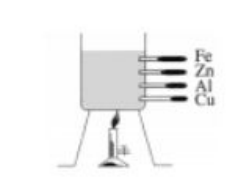
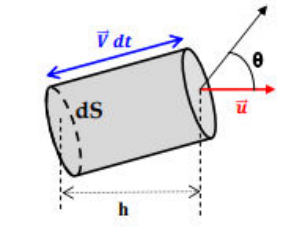
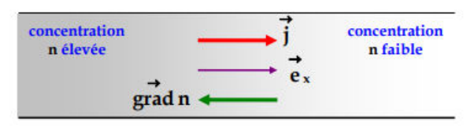
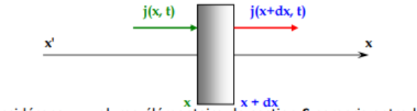
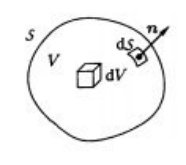
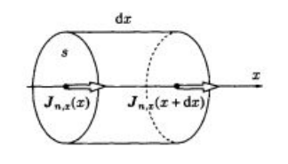

## Les différents modes de transfert thermique

La quantité de chaleur, ou transfert thermique, est l'énergie de nature microscopique échangée à travers la surface qui délimite un système. Il existe trois modes de transfert thermique.

### La conduction ou diffusion thermique

**Mise en évidence expérimentale : l'expérience d'Ingen-Housz.** L'expérience du physicien hollandais J. Ingen-Housz, qui date de 1789, permet de comparer la diffusion thermique dans plusieurs matériaux métalliques. On la réalise facilement en enduisant de cire des tiges métalliques dont une extrémité est en contact avec un thermostat, par exemple un bain d'eau bouillante.

On constate que la température, en des points homologues des tiges, augmente au cours du temps, mais plus ou moins rapidement d'une tige à l'autre. À tout instant de l'expérience, les longueurs de cire fondue permettent de comparer le comportement thermique de chaque matériau : la plus grande longueur est obtenue avec le matériau le plus conducteur de la chaleur, ici le cuivre.

Ainsi, lorsqu'une différence de température existe dans un matériau, un flux thermique orienté des zones chaudes vers les zones froides tend à uniformiser la température. Comme il n'y a ici ni déplacement global de matière, ni variation de l'énergie macroscopique, ni travail reçu, ce flux thermique est un flux d'énergie interne non convectif.

**La diffusion thermique.** Elle existe dans tous les corps, solides ou fluides. La partie la plus froide s'échauffe au contact de la partie la plus chaude du corps. Cette élévation de température correspond à un accroissement de :

- l'énergie microscopique de vibration du réseau cristallin, pour les solides ;
- l'énergie cinétique microscopique d'agitation désordonnée des molécules d'un fluide, due aux chocs incessants entre ces molécules.

Ce transfert thermique ne s'accompagne pas, à l'échelle macroscopique, de mouvement de matière. C'est le seul mécanisme qui intervient dans les solides homogènes et opaques. Dans les fluides, la conduction est souvent masquée par le phénomène de convection. Un milieu dont la température n'est pas homogène est au moins le siège de transferts thermiques par conduction.

**Conclusion.** Un phénomène de diffusion thermique apparaît donc comme un transfert thermique sans mouvement macroscopique du support. Ce transfert se produit dans un système initialement hors équilibre, des régions chaudes vers les régions froides ; il tend donc à uniformiser la température. Le phénomène de diffusion est irréversible.

**Notion d'équilibre thermodynamique local.** Dans ces processus de diffusion thermique, on ne peut plus parler de la température du corps : des thermomètres placés en divers points n'indiquent pas la même température. On suppose que l'on peut définir en chaque point du système une température locale, même s'il n'est pas en équilibre thermique globalement : cette hypothèse nécessite un équilibre local. Pour les gaz, cela correspond au cas où, localement, la distribution des vitesses est bien décrite par une distribution de Maxwell associée à une température locale $T$.

## Flux de particules et courant volumique de particules

Considérons un milieu quelconque (gaz, liquide, solide) dans lequel diffusent des particules.

Par définition, le flux $\phi$ de particules à travers la surface $S$ est le nombre de particules qui traversent la surface $S$ par unité de temps : $\phi = \dfrac{dN}{dt} \Rightarrow dN = \phi\,dt$.

$\phi$ s'écrit aussi sous la forme $d\phi = \vec{j} \cdot \vec{dS} \Rightarrow dN = \vec{j} \cdot \vec{dS}\,dt$, où $\vec{j} = n \vec{V}$ est le vecteur densité de courant de particules, $\vec{V}$ la vitesse des particules et $n$ la concentration de particules (nombre de particules par unité de volume). $\|\vec{j}\|$ s'exprime en $\text{m}^{-2}.\text{s}^{-1}$.

- Pour une surface élémentaire $dS$, on écrit $d^2N = d\phi\,dt$.
- $\phi$ est une grandeur algébrique.
- Soit $d^2N$ le nombre de particules de vitesse moyenne $\vec{V}$ (vitesse de diffusion) qui traversent l'élément de surface $\vec{dS} = dS\,\vec{u}$ pendant la durée $dt$ (entre $t$ et $t + dt$), où $\vec{u}$ est le vecteur unitaire porté par la normale à $dS$.

Ce nombre est celui contenu dans le cylindre de base $dS$ et de hauteur $h = \vec{u} \cdot \vec{V}\,dt = V \cos(\theta)\,dt$, où $\theta$ est l'angle entre $\vec{dS}$ et $\vec{V}$. Ce cylindre a pour volume

$$
dV = dS\,V\,dt \cos(\theta) = \vec{V} \cdot \vec{dS}\,dt
$$

d'où

$$
d^2N = \frac{N}{V}\,dS\,\vec{u} \cdot \vec{V}\,dt
\qquad \text{soit} \qquad
d\phi = \frac{d^2N}{dt} = n \vec{V} \cdot \vec{dS} = \vec{j} \cdot \vec{dS}
$$

Le flux total à travers une surface $S$ est $\phi = \iint_S \vec{j} \cdot \vec{u}\,dS = \iint_S \vec{j} \cdot \vec{dS}$, et donc $dN = \left(\iint_S \vec{j} \cdot \vec{dS}\right) dt$.

Le flux de particules $\phi$ est le nombre de particules qui traversent une surface $S$ par unité de temps. Pendant une durée $dt$, le nombre de particules $dN$ qui traversent une surface $S$ est donné par $dN = \phi\,dt$, avec $\phi$ le flux du vecteur densité de courant de particules à travers $S$ :

$$
\phi = \iint_S \vec{j} \cdot \vec{dS}
\qquad \text{avec} \qquad
\vec{j} = n \vec{V}
$$

## La loi de Fick

Considérons un milieu où la concentration de particules $n(x, t)$ ne dépend que d'une seule coordonnée d'espace $x$ et du temps $t$.

La loi de Fick, loi expérimentale établie vers 1856 par Adolphe Fick, stipule que

$$
j = -D \frac{\partial n}{\partial x}
$$

Le coefficient $D$, toujours positif, est appelé coefficient de diffusion ou diffusivité du corps étudié. Il s'exprime en $\text{m}^2.\text{s}^{-1}$. Sous forme vectorielle, la loi de Fick s'écrit

$$
\vec{j}(M, t) = -D\,\overrightarrow{\text{grad}}\,n(M, t)
$$

**Remarques.**

- La loi de Fick n'est plus valable si le gradient de densité est trop important, s'il varie trop vite dans le temps, ou si le milieu est anisotrope (la diffusivité dépend alors de la direction de l'espace).
- Le coefficient de diffusion $D$ dépend de la nature des particules qui diffusent et de celle du milieu dans lequel elles se déplacent.
- Il dépend aussi de la température et de la pression.
- Si le milieu est homogène, $\dfrac{\partial n}{\partial x} = 0$, donc $j = 0$.
- Analogie entre la loi de Fick et la loi d'Ohm : $I = \iint_S \vec{j} \cdot \vec{dS} = \iint_S \gamma \vec{E} \cdot \vec{dS}$, avec $\gamma$ en $\text{S.m}^{-1}$ et $\vec{j}$ le courant volumique des charges électriques. Le flux de particules à travers une surface rappelle l'intensité $I$ du courant : $\phi \equiv I$.

## Équation de la diffusion

### Diffusion à une dimension

- On considère des milieux où il n'y a ni création ni destruction de particules.
- On considère le cas où la concentration ne dépend que de la coordonnée d'espace $x$ et du temps $t$ : $n = n(x, t)$.
- Soit $\phi(x, t)$ le flux de particules traversant une surface $S$ normale à $Ox$, orientée selon les $x$ croissants. On a $\phi(x, t) = j(x, t) S$, où $\vec{j}(x, t) = j(x, t)\,\vec{u}_x$ est le vecteur densité de courant de particules.

Considérons un volume élémentaire de section $S$ compris entre les abscisses $x$ et $x + dx$. Ce volume contient $dN = n S\,dx$ particules. Faisons le bilan du nombre de particules entre les instants $t$ et $t + dt$. À l'abscisse $x$, il entre dans le système $\delta N_e = \phi(x, t)\,dt = j(x, t) S\,dt$ particules. À l'abscisse $x + dx$, il en sort $\delta N_s = \phi(x + dx, t)\,dt = j(x + dx, t) S\,dt$. Comme il n'y a ni création ni destruction de particules, la différence entre ces deux nombres est égale à la variation du nombre $dN$ de particules contenues dans le volume élémentaire $dV = S\,dx$ pendant la durée $dt$ :

$$
\begin{aligned}
\delta N_e - \delta N_s &= dN(t + dt) - dN(t) \\
\Rightarrow dN(t + dt) - dN(t) &= \{j(x, t) - j(x + dx, t)\} S\,dt = -\frac{\partial j(x, t)}{\partial x} S\,dt\,dx \\
\Rightarrow dN(t + dt, x) - dN(t, x) &= \{n(t + dt, x) - n(t, x)\} S\,dx = \frac{\partial n(x, t)}{\partial t} dt\,S\,dx \\
\Rightarrow \frac{\partial n}{\partial t} dt\,S\,dx &= -\frac{\partial j(x, t)}{\partial x} S\,dx\,dt
\Rightarrow \frac{\partial n(x, t)}{\partial t} = -\frac{\partial j(x, t)}{\partial x}
\end{aligned}
$$

Cette équation exprime la conservation de la matière : c'est l'équation locale de conservation. D'après la loi de Fick, $j = -D \dfrac{\partial n}{\partial x} \Rightarrow \dfrac{\partial n(x, t)}{\partial t} = D \dfrac{\partial^2 n(x, t)}{\partial x^2}$ : c'est l'équation de la diffusion à une dimension. On a supposé ici que le coefficient de diffusion $D$ est indépendant de $x$.

Ainsi, à une dimension, la concentration $n(x, t)$ vérifie l'équation de la diffusion

$$
\frac{\partial n}{\partial t} = D \frac{\partial^2 n}{\partial x^2}
$$

### Équation de la diffusion à trois dimensions

Considérons le cas général où la concentration $n$ dépend des trois coordonnées de l'espace :

$$
\frac{\partial n}{\partial t} = -\text{div}\,\vec{j} = -\text{div}\big[-D\,\overrightarrow{\text{grad}}(n)\big]
\Rightarrow \frac{\partial n}{\partial t} = \text{div}\big[D\,\overrightarrow{\text{grad}}(n)\big]
\Rightarrow \frac{\partial n}{\partial t} = D \Delta n
$$

En coordonnées cartésiennes, $\Delta n = \dfrac{\partial^2 n}{\partial x^2} + \dfrac{\partial^2 n}{\partial y^2} + \dfrac{\partial^2 n}{\partial z^2}$.

Dans le cas où $n_a$ particules sont créées ou absorbées par unité de volume et par unité de temps, $\dfrac{\partial n}{\partial t} = D \Delta n + n_a$. En régime stationnaire, l'équation de diffusion se réduit à $\Delta n = -\dfrac{n_a}{D}$. Cette équation rappelle l'équation de Poisson que vérifie le potentiel électrostatique, $\Delta V = -\dfrac{\rho}{\varepsilon_0}$. Si $n_a = 0$, l'équation obtenue est bien connue : c'est l'équation de Laplace.

**Démonstration.** Considérons un volume quelconque $v$, indéformable et fixe, limité par une surface fermée.

- À l'instant $t$, le nombre de particules est $N(t) = \iiint_v n(M, t)\,dv$.
- À l'instant $t + dt$, il vaut $N(t + dt) = \iiint_v n(M, t + dt)\,dv$.

La variation du nombre de particules contenues dans le volume entre $t$ et $t + dt$ est donc

$$
dN = N(t + dt) - N(t) = \frac{d}{dt}\left(\iiint_v n(M, t)\,dv\right) dt
\Rightarrow dN = \left(\iiint_v \frac{\partial n(M, t)}{\partial t}\,dv\right) dt
$$

À trois dimensions, $\dfrac{dN}{dt}$ est l'opposé du débit sortant, soit, par le **théorème d'Ostrogradski** :

$$
\frac{dN}{dt} = -\oiint \vec{j} \cdot \vec{dS} = -\iiint \text{div}(\vec{j})\,dV
$$

Ainsi $\iiint_v \dfrac{\partial n(M, t)}{\partial t}\,dv = -\iiint_v \text{div}(\vec{j})\,dv$, donc $\dfrac{\partial n(M, t)}{\partial t} = -\text{div}\,\vec{j}$. Avec la loi de Fick, on retrouve $\dfrac{\partial n}{\partial t} = D \Delta n$. Dans le cas où il y a destruction ou création de particules, l'équation précédente s'écrit

$$
\frac{\partial n(M, t)}{\partial t} = -\text{div}(\vec{j}) + n_a
\qquad \text{avec} \qquad n_a = n_p + n_d
$$

### Résolution de l'équation de diffusion

Trouver une solution de l'équation de diffusion implique d'appliquer les conditions aux limites et les conditions initiales pour obtenir une solution unique.

**Cas du régime permanent.** En régime permanent (indépendant du temps), $n = n(x) \Rightarrow \dfrac{\partial n}{\partial t} = 0$. En l'absence de source, $\Delta n = 0 \Rightarrow \dfrac{d^2 n(x)}{dx^2} = 0 \Rightarrow \dfrac{dj}{dx} = 0$.

Le vecteur densité de particules ne dépend ni de $x$ ni de $t$ : c'est un vecteur constant dans le domaine considéré. De plus, $\dfrac{dn(x)}{dx} = \text{cte} = -\dfrac{j}{D} \Rightarrow n(x) = -\dfrac{j}{D} x + n(0)$ : la densité volumique de particules est une fonction affine de $x$.

**Exemple.** *Déterminer, en régime permanent, le flux de particules dans un tuyau de longueur $L$ et de section $S$. La concentration des molécules qui diffusent est maintenue constante aux extrémités : en $x = 0$, $n = n_1$, et en $x = L$, $n = n_2 < n_1$.*

En régime permanent, $n$ ne dépend pas du temps, donc $\dfrac{d^2 n(x)}{dx^2} = 0$ et $\dfrac{dn(x)}{dx} = \text{cte}$. Ainsi $n(x) = C_1 x + C_2$ ; en $x = 0$, $n = C_2 = n_1$, et en $x = L$, $n = C_1 L + n_1 = n_2$. D'où

$$
C_1 = \frac{n_2 - n_1}{L}
\Rightarrow n(x) = \frac{n_2 - n_1}{L} x + n_1
\Rightarrow j = -D \frac{\partial n}{\partial x} = D \frac{n_1 - n_2}{L}
$$

Le flux de particules qui traversent le tuyau est $\phi = jS = \dfrac{DS}{L}(n_1 - n_2)$.

**Cas du régime dépendant du temps.** La résolution de l'équation de diffusion n'est pas simple en général. La solution dépend de constantes d'intégration déterminées par les conditions aux limites temporelles et spatiales, qui donnent une solution unique.

Suivant les conditions aux limites imposées, on peut chercher des solutions particulières de la forme $n(x, t) = f(x) g(t)$ : c'est la méthode de séparation des variables.

On suppose qu'à l'instant $t = 0$, $N_0$ particules diffusantes par unité de surface sont concentrées en $x = 0$. La solution est alors

$$
n(x, t) = \frac{N_0}{2\sqrt{\pi D t}} \exp\left(-\frac{x^2}{4 D t}\right)
$$

Dans le cas où la concentration des particules diffusantes est maintenue constante, égale à $N_0$, en $x = 0$, avec $n(x > 0, 0) = 0$, la solution s'écrit

$$
n(x, t) = N_0 \left[1 - \frac{2}{\sqrt{\pi}} \int_0^u \exp(-v^2)\,dv\right]
\qquad \text{avec} \qquad u = \frac{x}{2\sqrt{D t}}
$$

Ces solutions vérifient rarement les conditions aux limites imposées par le problème étudié. Cependant, l'équation de diffusion est une équation différentielle linéaire : si l'on connaît des solutions particulières $n_i(x, t)$, toute combinaison $n(x, t) = \sum_i a_i n_i(x, t)$ est aussi une solution.

## Diffusion thermique

### Modes de transfert de l'énergie thermique

**Le rayonnement.** Un corps chaud émet un rayonnement électromagnétique qui transporte de l'énergie. Ce transfert ne nécessite pas la présence d'un milieu matériel : il peut se produire dans le vide.

**La convection.** Elle est due à un déplacement global de matière et concerne les liquides et les gaz.

- Dans les fluides, une variation de température modifie localement la masse volumique, ce qui entraîne un mouvement d'ensemble du fluide (les parties chaudes, plus légères, ont tendance à s'élever) : c'est la convection naturelle.
- Un fluide peut aussi être mis en mouvement de manière artificielle pour accélérer les échanges thermiques : c'est la convection forcée.

**La conduction ou diffusion thermique.** Voir plus haut : elle existe dans tous les corps, sans mouvement macroscopique de matière, et c'est le seul mécanisme à l'œuvre dans les solides homogènes et opaques.

### Vecteur densité de courant thermique

Soit un milieu (gaz, solide ou liquide) de volume $V$ délimité par une surface $S$, et $T(\vec{r}, t)$ la température dans ce milieu (on suppose donc qu'elle est définie localement). Soit $\delta^2 Q(\vec{r}, t)$ la quantité d'énergie qui traverse par conduction l'élément de surface $\vec{dS}$ (centré sur $M$) entre $t$ et $t + dt$.

Physiquement, $\delta^2 Q$ est d'autant plus important que $dS$ et $dt$ sont grands. On admet que l'on peut écrire

$$
\delta^2 Q(\vec{r}, t) = \vec{j}_{th}(\vec{r}, t) \cdot \vec{dS}\,dt = \delta\phi(\vec{r}, t)\,dt
\qquad \text{avec} \qquad
\delta\phi(\vec{r}, t) = \frac{\delta^2 Q(\vec{r}, t)}{dt} = \vec{j}_{th}(\vec{r}, t) \cdot \vec{dS}
$$

Le flux thermique $\phi$ est la quantité d'énergie qui traverse une surface $S$ par unité de temps. Pendant une durée $dt$, l'énergie qui traverse $S$ vaut $\delta Q = \phi\,dt$. $\phi$ est le flux du vecteur densité de courant thermique $\vec{j}_{th}$ à travers la surface $S$ :

$$
\delta\phi = \vec{j}_{th} \cdot \vec{dS}
\qquad \text{ou} \qquad
\phi = \oiint \vec{j}_{th} \cdot \vec{dS}
$$

### Loi de Fourier

Cette loi, établie expérimentalement par Fourier, est de nature phénoménologique, comme les lois d'Ohm et de Fick : c'est une loi constitutive et non structurelle. Elle traduit l'approximation linéaire, c'est-à-dire la proportionnalité entre le courant volumique thermique $\vec{j}_{th}(\vec{r}, t)$ et le gradient de la température $T(\vec{r}, t)$ :

$$
\vec{j}_{th} = -K\,\overrightarrow{\text{grad}}\,T
\qquad \text{avec } K \text{ la conductivité thermique}
$$

### Équation de la diffusion thermique

On considère un corps homogène de masse volumique $\rho$, de conductivité thermique $K$ et de capacité thermique massique $c$. Les grandeurs $\rho$, $K$ et $c$ sont supposées constantes dans le domaine de température étudié.

**Conduction pure unidimensionnelle.** La température du matériau $T$ ne dépend que de l'abscisse $x$ et du temps $t$. Soit un cylindre élémentaire de section $S$ compris entre les abscisses $x$ et $x + dx$.

On effectue un bilan énergétique dans ce cylindre entre $t$ et $t + dt$, en supposant qu'il n'y a pas d'apport d'énergie autre que par conduction :

- à l'abscisse $x$, il entre une énergie $\delta Q_e = j_{th}(x, t) S\,dt$ ;
- à l'abscisse $x + dx$, il sort une énergie $\delta Q_s = j_{th}(x + dx, t) S\,dt$.

D'après le premier principe appliqué au cylindre élémentaire :

$$
\begin{aligned}
dU = (\rho S\,dx)\,c\,dT &= \delta Q + \delta W = \delta Q = \delta Q_e - \delta Q_s \\
&= j_{th}(x, t) S\,dt - j_{th}(x + dx, t) S\,dt = -\frac{\partial j_{th}}{\partial x} dx\,S\,dt
\end{aligned}
$$

$dT$ représente la variation de température du système entre $t$ et $t + dt$, donc $dT = \dfrac{\partial T}{\partial t} dt$, d'où

$$
(\rho S\,dx)\,c\,\frac{\partial T}{\partial t} dt = -\frac{\partial j_{th}}{\partial x} dx\,S\,dt
\Rightarrow \rho c \frac{\partial T}{\partial t} = -\frac{\partial j_{th}}{\partial x}
$$

D'après la loi de Fourier, $j_{th} = -K \dfrac{\partial T}{\partial x}$, donc $\rho c \dfrac{\partial T}{\partial t} = K \dfrac{\partial^2 T}{\partial x^2}$. Lorsque la conduction à une dimension est le seul transfert thermique, la température $T(x, t)$ vérifie l'équation de la diffusion thermique, ou équation de la chaleur :

$$
\frac{\partial^2 T}{\partial x^2} = \frac{\rho c}{K} \frac{\partial T}{\partial t}
$$

### Généralisation

Il existe parfois d'autres apports d'énergie. Le matériau peut par exemple être parcouru par un courant électrique : le volume $S\,dx$, de résistance $dR$, traversé par un courant $I = jS$, reçoit par effet Joule pendant la durée $dt$ une énergie $\delta Q_J = dR\,I^2\,dt = \dfrac{1}{\sigma} j^2 S\,dx\,dt$. Le bilan énergétique s'écrit alors

$$
\rho\,dx\,c\,dT = -\frac{\partial j_{th}}{\partial x} dx\,S\,dt + \delta Q_{autres}
\qquad
\rho c S \frac{\partial T}{\partial t} dx\,dt = K \frac{\partial^2 T}{\partial x^2} S\,dx\,dt + \delta Q_{autres}
$$

### Cas à trois dimensions

À trois dimensions, on raisonne sur un volume $V$ délimité par la surface fermée $S$. Le premier principe appliqué entre $t$ et $t + dt$ s'écrit

$$
dU = \iiint_V \rho c\,dT\,d\tau = -\oiint_S \vec{j}_{th} \cdot \vec{dS}\,dt + \delta Q_{autres}
\qquad
dt \iiint_V \rho c \frac{\partial T}{\partial t} d\tau = -\iiint_V \text{div}(\vec{j}_{th})\,d\tau\,dt + \delta Q_{autres}
$$

Dans la plupart des cas, l'apport d'énergie autre que par conduction s'exprime avec la puissance volumique $p_{autres}$ que reçoit localement le corps étudié :

$$
dt \iiint_V \rho c \frac{\partial T}{\partial t} d\tau = -\iiint_V \text{div}(\vec{j}_{th})\,d\tau\,dt + \iiint_V p_{autres}\,d\tau\,dt
$$

d'où, avec la loi de Fourier :

$$
\rho c \frac{\partial T}{\partial t} = -\text{div}(\vec{j}_{th}) + p_{autres} = K \Delta T + p_{autres}
$$

Avec $p_{autres}$ la puissance thermique volumique reçue par des mécanismes autres que la conduction, l'équation de la diffusion thermique (ou équation de la chaleur) s'écrit dans le cas général

$$
\rho c \frac{\partial T}{\partial t} = K \Delta T + p_{autres}
$$

### Résolution de l'équation de diffusion

L'équation de la diffusion thermique permet de déterminer l'évolution de la température $T(M, t)$ en fonction des coordonnées du point $M$ et du temps $t$.

Sa résolution exacte n'est possible que dans certains cas particuliers ; en général, il faut recourir à des méthodes numériques. La même équation s'applique à des problèmes physiques très différents : ce sont les conditions aux limites spatiales et temporelles qui déterminent une solution unique.

Dans tous les cas, le phénomène est irréversible : l'équation de la diffusion thermique n'est pas invariante par le changement de variable $t \to -t$.

### Régime stationnaire

On suppose ici qu'il n'y a pas d'autre transfert thermique que la conduction. En régime stationnaire (indépendant du temps), l'équation de la chaleur se simplifie :

$$
\Delta T = 0
$$

**Cas d'une tige isolée.** Soit une tige homogène cylindrique de section $S$ et de longueur $L$, dont les extrémités sont maintenues aux températures $T_1$ et $T_2$ ($T_1 > T_2$). On suppose de plus qu'il n'y a aucun échange thermique entre la tige et le milieu extérieur par la surface latérale (isolation thermique).

Le régime est stationnaire : la température est indépendante du temps. Le problème est unidimensionnel : la température ne dépend que de $x$. L'équation de la chaleur s'écrit alors

$$
\frac{\partial^2 T}{\partial x^2} = 0
$$

La température est donc une fonction affine de $x$ : $T(x) = ax + b$. Les conditions aux limites déterminent $a$ et $b$ :

$$
T(0) = T_1 \text{ et } T(L) = T_2 \Rightarrow T(x) = \frac{T_2 - T_1}{L} x + T_1
$$

Soit $K$ la conductivité thermique du matériau de la tige. Le vecteur densité de courant thermique $\vec{j}_{th}$ à travers la section $S$ est

$$
\vec{j}_{th} = -K\,\overrightarrow{\text{grad}}(T) = K \frac{T_1 - T_2}{L} \vec{e}_x
$$

et le flux thermique $\phi$ qui traverse la tige, constant, vaut

$$
\phi = \iint \vec{j}_{th} \cdot \vec{dS} = K \frac{T_1 - T_2}{L} S
$$

### Résistance thermique

Pour la tige étudiée en régime permanent, on définit la résistance thermique $R_{th}$ :

$$
R_{th} = \frac{T_1 - T_2}{\phi} = \frac{1}{K} \frac{L}{S}
$$

En régime permanent, les conductions électrique et thermique sont formellement analogues : la loi d'Ohm correspond à la loi de Fourier, et le régime interdit l'accumulation d'énergie (conduction thermique) ou de charge électrique (conduction électrique). Cette analogie permet de définir la résistance thermique dans un cas plus général : le flux thermique existant en régime permanent entre les faces d'entrée et de sortie d'un conducteur thermique qui suit la loi de Fourier est proportionnel à leur différence de température, et

$$
R_{th} = \frac{1}{G_{th}} = \frac{T_1 - T_2}{\phi}
$$
