## Généralités

**Définition.** Une machine thermodynamique est un système fonctionnant grâce à un fluide auquel on fait subir des transformations cycliques, au cours desquelles il y a échange d'énergie avec le milieu extérieur. Le milieu extérieur est constitué de $n$ sources de chaleur échangeant de la chaleur avec le fluide, et d'un système mécanique échangeant du travail avec le fluide.

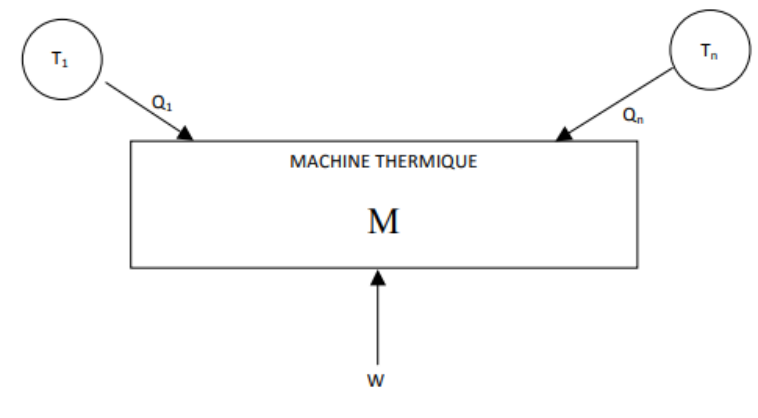

### Classification

**Machine monotherme.** C'est un système thermodynamique en contact avec une seule source. Thomson a démontré en 1852 que les moteurs monothermes n'existent pas.

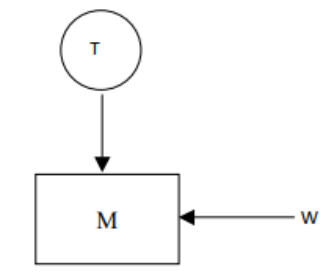

**Machines cycliques.** L'état initial et l'état final sont confondus : $\Delta U = 0$ et $\Delta S = 0$. Il s'y produit des échanges de travail $W$ et d'énergie $Q$. Sur un cycle, on a donc $\Delta U = W + Q = 0$. Deux cas sont possibles : soit un **moteur** ($W < 0$ et $Q > 0$), soit un **récepteur** ($W > 0$ et $Q < 0$).

**Machines dithermes.** C'est un système thermodynamique en contact avec une source chaude et une source froide.

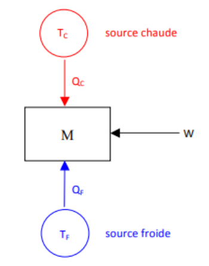

**Étude théorique : bilan d'énergie et d'entropie.** L'énergie du système fermé est définie par

$$
\Delta U = W + Q
$$

Sur un cycle, $\Delta U = 0$. On note $Q_c$ les échanges avec la source chaude à $T_c$ et $Q_f$ les échanges avec la source froide à $T_f$. Le premier principe donne

$$
W + Q_c + Q_f = 0
$$

L'entropie du système fermé est définie par le second principe :

$$
\Delta S = S_{ech} + S_{créée}
$$

Le système échange de l'entropie avec les deux sources pendant ces échanges :

$$
dS_{ech} = \frac{\delta Q}{T_{source}}
\Rightarrow
S_{ech} = \int \frac{\delta Q}{T_{source}} = \int \frac{\delta Q}{T_c} + \int \frac{\delta Q}{T_f} = \frac{1}{T_c} \int \delta Q + \frac{1}{T_f} \int \delta Q = \frac{Q_c}{T_c} + \frac{Q_f}{T_f}
$$

$$
\Delta S = \frac{Q_c}{T_c} + \frac{Q_f}{T_f} + S_{créée} = 0
$$

d'où l'inégalité de Clausius :

$$
\frac{Q_c}{T_c} + \frac{Q_f}{T_f} \leq 0
$$

On peut généraliser à $N$ sources aux températures $T_i$ : $\displaystyle\sum_{i=1}^{N} \frac{Q_i}{T_i} \leq 0$. Dans le cas où $N = 1$, on retrouve qu'il n'existe pas de moteur monotherme :

$$
\begin{cases} W + Q = 0 \\ \dfrac{Q}{T_{source}} \leq 0 \end{cases}
\Rightarrow Q < 0 \Rightarrow W > 0
$$

## Moteur ditherme

### Sens des transferts thermiques

Le premier principe donne $\Delta U = W + Q_c + Q_f = 0$ (car la transformation est cyclique), ainsi

$$
Q_c + Q_f = -W
$$

Or $-W > 0$ car c'est un moteur, donc $Q_c + Q_f > 0$.

Raisonnons par l'absurde et supposons $Q_c < 0$. Alors

$$
\begin{aligned}
Q_f &> -Q_c > 0 \\
\Rightarrow \frac{Q_f}{T_f} &> -\frac{Q_c}{T_f} > -\frac{Q_c}{T_c} \\
\Rightarrow \frac{Q_f}{T_f} + \frac{Q_c}{T_c} &> 0
\end{aligned}
$$

La dernière ligne est impossible d'après le second principe (inégalité de Clausius). En conclusion, $Q_c > 0$ et $Q_f \leq -\dfrac{T_f}{T_c} < 0$ : **le moteur ditherme reçoit de la chaleur de la source chaude et en fournit à la source froide.** Le schéma de principe du **moteur ditherme** est donc le suivant.

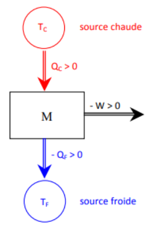

### Efficacité et rendement : théorème de Carnot

**Définition.** L'efficacité est le rapport de l'énergie utile sur l'énergie dépensée pour le fonctionnement :

$$
e = \frac{\text{utile}}{\text{dépensée}}
$$

**Calcul.** D'après le premier principe, $-W = Q_c + Q_f$, ainsi

$$
e = \frac{-W}{Q_c} = 1 + \frac{Q_f}{Q_c} < 1
\quad \text{car} \quad
\begin{cases} Q_f < 0 \\ Q_c > 0 \end{cases}
$$

De plus :

$$
\begin{aligned}
&\frac{Q_c}{T_c} + \frac{Q_f}{T_f} \leq 0 \\
\Rightarrow\ &\frac{Q_f}{T_f} \leq -\frac{Q_c}{T_c} \\
\Rightarrow\ &\frac{Q_f}{Q_c} \leq -\frac{T_f}{T_c} \quad \text{car } Q_c > 0
\end{aligned}
$$

Finalement :

$$
e \leq 1 - \frac{T_f}{T_c}
$$

Il y a égalité si le cycle est réversible. On appelle cette efficacité théorique maximale l'efficacité de Carnot :

$$
e_c = 1 - \frac{T_f}{T_c}
$$

D'où le théorème de Carnot : tous les moteurs dithermes réversibles ont le même rendement, qui ne dépend que des températures des sources. Le rendement des moteurs non réversibles est inférieur à celui des moteurs réversibles.

## Récepteurs dithermes

Un récepteur ditherme est caractérisé par $W > 0$, $Q_c < 0$ et $Q_f > 0$. Le principe est d'inverser le sens naturel du transfert de chaleur en fournissant du travail au récepteur.

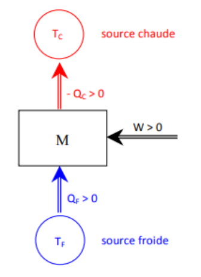

### Réfrigérateur et climatiseur

Le but est de refroidir la source froide $T_f$. L'efficacité se définit par $e = \dfrac{\text{utile}}{\text{dépensé}}$ ; dans le cas d'un réfrigérateur :

$$
e = \frac{Q_f}{W}
$$

D'après le premier principe, $W = -Q_f - Q_c$, ainsi

$$
e = \frac{Q_f}{-Q_f - Q_c} = \frac{-1}{1 + \dfrac{Q_c}{Q_f}}
$$

Or

$$
\begin{aligned}
&\frac{Q_c}{T_c} + \frac{Q_f}{T_f} \leq 0 \\
\Rightarrow\ &\frac{Q_c}{T_c} \leq -\frac{Q_f}{T_f} \\
\Rightarrow\ &\frac{Q_c}{Q_f} \leq -\frac{T_c}{T_f} \quad \text{car } Q_f > 0
\end{aligned}
$$

En conclusion :

$$
\frac{1}{1 + \dfrac{Q_c}{Q_f}} \geq \frac{1}{1 - \dfrac{T_c}{T_f}}
\qquad
e_c = \frac{1}{\dfrac{T_c}{T_f} - 1}
$$

### Pompe à chaleur

Le but est de chauffer la source chaude $T_c$ (piscine, habitation…). Dans le cas d'une pompe à chaleur :

$$
e = \frac{-Q_c}{W}
$$

D'après le premier principe, $W = -Q_f - Q_c$, ainsi

$$
e = \frac{-Q_c}{-Q_c - Q_f} = \frac{1}{1 + \dfrac{Q_f}{Q_c}}
$$

Or

$$
\begin{aligned}
&\frac{Q_c}{T_c} + \frac{Q_f}{T_f} \leq 0 \\
\Rightarrow\ &\frac{Q_f}{T_f} \leq -\frac{Q_c}{T_c} \\
\Rightarrow\ &\frac{Q_f}{Q_c} \geq -\frac{T_f}{T_c} \quad \text{car } Q_c < 0
\end{aligned}
$$

En conclusion :

$$
e_c = \frac{1}{1 - \dfrac{T_f}{T_c}}
$$

## Cycle de Carnot

### Théorème de Carnot

L'efficacité d'une machine ditherme cyclique réelle est inférieure ou égale à celle d'une machine ditherme cyclique réversible fonctionnant avec les deux mêmes sources. Cette machine est appelée machine de Carnot.

### Cycle de Carnot

Un cycle de Carnot est un cycle ditherme réversible. La seule solution est de combiner deux isentropiques et deux isothermes.

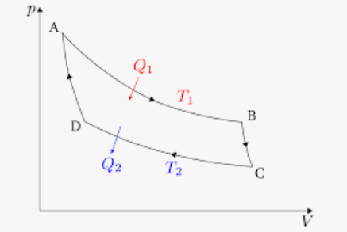

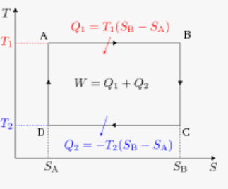

**Remarque sur le sens de parcours.** On a $\delta W = -p_{ext}\,dV$ ; si la transformation est réversible, elle est quasi statique et $P = P_{ext}$. Donc, sur un cycle :

$$
W = -\oint P\,dV = -\text{Aire du cycle dans } (P, V)
$$

Si l'aire est positive et le travail négatif, la machine est un moteur. Si l'aire est négative et le travail positif, c'est un récepteur.

**Bilan.** Sens antihoraire : l'aire est négative, le travail positif, donc récepteur. Sens horaire : l'aire est positive, le travail négatif, donc moteur.

## Exemples de machines réelles

### Le moteur à explosion (ou à combustion interne)

**Description du cycle.** C'est un cycle à 4 temps. Il entraîne un piston mobile et deux soupapes qui permettent l'admission de l'essence et l'évacuation des gaz.

**Remarque.** Le cycle est parcouru dans le sens horaire : c'est donc un moteur.

**Modélisation.** On étudie le système formé de l'air, du carburant et des gaz d'échappement, que l'on assimile à un gaz parfait avec $\gamma = 1{,}4$. On applique une source chaude à $T_c$ en contact avec le système : $Q_c = Q_{CD}$.

- L'admission est isobare et isotherme ($T_A = T_B$).
- La compression et la détente sont adiabatiques et réversibles : ce sont des isentropiques.
- L'explosion est isochore.

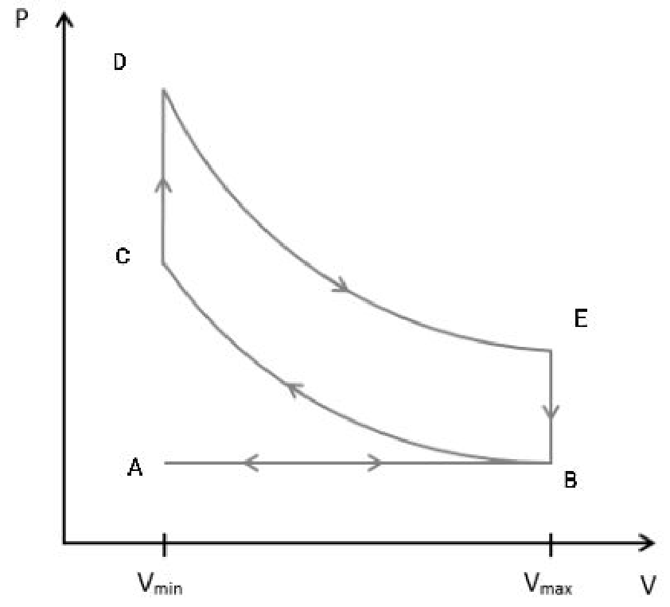

Le cycle est bien parcouru dans le sens horaire avec un travail négatif : c'est un moteur.

**Efficacité.**

$$
e = \frac{-W}{Q_c} = 1 + \frac{Q_f}{Q_c}
$$

Ici, $e = 1 + \dfrac{Q_{EB}}{Q_{CD}}$. On calcule $Q_{CD}$ : de $C$ à $D$, le volume est constant, donc

$$
dU = \delta W + \delta Q = -p_{ext}\,dV + \delta Q
\qquad
\Delta U_{CD} = Q_{CD} = Q_c
$$

Pour un gaz parfait, $\Delta U = C_v (T_f - T_i)$, ici

$$
Q_{CD} = \Delta U_{CD} = \frac{nR}{\gamma - 1}(T_D - T_C)
$$

On procède de même pour $Q_{EB}$ :

$$
Q_{EB} = \Delta U_{EB} = \frac{nR}{\gamma - 1}(T_B - T_E) < 0
\qquad
e = 1 + \frac{T_B - T_E}{T_D - T_C}
$$

Sur $BC$ et $DE$, adiabatiques réversibles, $PV^\gamma = \text{cte}$ et $TV^{\gamma - 1} = \text{cte}$. Sur $BC$, $T_B V_B^{\gamma - 1} = T_C V_C^{\gamma - 1}$, et sur $DE$, $T_D V_D^{\gamma - 1} = T_E V_E^{\gamma - 1}$. On note $a = \dfrac{V_{max}}{V_{min}}$ le taux de compression. Ainsi

$$
\begin{cases} T_E = T_D \dfrac{1}{a^{\gamma - 1}} \\ T_C = T_B\, a^{\gamma - 1} \end{cases}
\qquad
e = 1 + \frac{T_B - T_D \dfrac{1}{a^{\gamma - 1}}}{T_D - T_B\, a^{\gamma - 1}} = \dots = 1 - \frac{1}{a^{\gamma - 1}}
$$

En conclusion, pour le cycle de **Beau de Rochas** :

$$
e = 1 - \frac{1}{a^{\gamma - 1}} = 1 - \left(\frac{V_{min}}{V_{max}}\right)^{\gamma - 1}
$$

Par exemple, si $a = 6$, $e = 0{,}51$. En comparaison, avec $T_C = 3400\ \text{K}$ et $T_f = 300\ \text{K}$ : $e_{réel} = 10\,\%$, $e_{BdR} = 51\,\%$ et $e_c = 90\,\%$.

### Un récepteur : le réfrigérateur

**Principe.**

$$
W + Q_c + Q_f = 0
$$

Un fluide (l'isobutane $C_4H_{10}$, 20 000 fois moins nocif que le fréon $CF_2Cl_2$) subit un cycle (système fermé) avec possibilité de changement d'état.

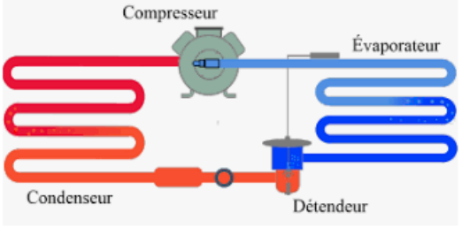

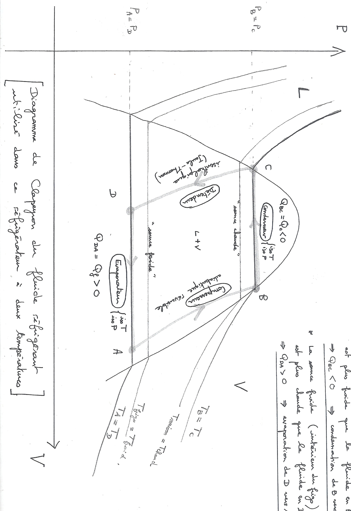

**Cycle.** Il comporte quatre étapes : une compression suivie d'un changement d'état dans le condenseur, qui joue le rôle de source chaude, puis une détente et un changement d'état dans l'évaporateur, qui joue le rôle de source froide.

**Calcul de l'efficacité thermodynamique.** On dispose des données suivantes :

$$
\begin{cases} h_{vap}(263\ \text{K}) = 159\ \text{kJ.kg}^{-1} \\ h_{vap}(305\ \text{K}) = 139\ \text{kJ.kg}^{-1} \end{cases}
\qquad
\begin{cases} x_A = 0{,}98 \\ x_D = 0{,}24 \\ x_B = 1 \\ x_C = 0 \end{cases}
$$

On cherche à déterminer l'efficacité $e = \dfrac{Q_f}{W}$. Le système qui transite de $A$ à $B$ n'est pas fermé.

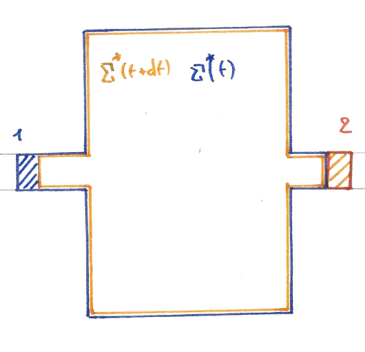

On imagine un système fermé évoluant entre $t$ et $t + dt$ : $\Sigma(t) = \Sigma^* + dm$ et $\Sigma(t + dt) = \Sigma'^* + dm'$. En régime stationnaire, $\Sigma^* = \Sigma'^*$, donc $dm = dm'$.

L'évolution de ce système fermé entre $t$ et $t + dt$ donne $dU = U_f - U_i = \big(U(\Sigma^*) + dm\,u_2\big) - \big(U(\Sigma^*) + dm\,u_1\big)$, donc $dU = dm\,u_2 - dm\,u_1 = dm\,(u_2 - u_1)$.

En appliquant le premier principe à ce système fermé :

$$
dU = \delta W + \delta Q = \delta W_{pression} + \delta W_{autres} + \delta Q
$$

En 1, $\delta W^1_{pression} = -p_1\,dV_1$, avec $dV_1 < 0$ et $dV_1 = -v_1\,dm$, donc $\delta W^1_{pression} = p_1 v_1\,dm$. De même, en 2, $\delta W^2_{pression} = -p_2 v_2\,dm$. D'où

$$
dU = p_1 v_1\,dm - p_2 v_2\,dm + \delta W_{autres} + \delta Q
$$

Donc $dm\,(u_2 - u_1) = p_1 v_1\,dm - p_2 v_2\,dm + \delta W_{autres} + \delta Q$, et

$$
\delta Q + \delta W_{autres} = dm\big[(u_2 + p_2 v_2) - (u_1 + p_1 v_1)\big]
\Leftrightarrow
dm\,(h_2 - h_1) = \delta W_{autres} + \delta Q
$$

On pose $\delta W_{autres} = dm\,w_{autres}$ et $\delta Q = dm\,q$. Avec ces notations :

$$
\Delta h = w_{autres} + q
$$

**Remarques.**

- En multipliant par $D_m$ (le débit massique, en $\text{kg.s}^{-1}$), $D_m \Delta h = w_{autres} D_m + q D_m$, que l'on peut réécrire

  $$
  D_m \Delta h = P_{autres} + P_{thermique}
  $$

- Généralisation avec les énergies cinétique $e_c$ et potentielle $e_p$ :

  $$
  \Delta e_c + \Delta e_p + \Delta h = w_{autres} + q
  $$

- Cas classiques : pour la détente de Joule-Kelvin (voir S2), $\Delta h = w_{autres} + q$ avec $w = 0$ (aucun travail) et $q = 0$ (calorifugé), donc $\Delta h = 0$. Pour le compresseur, $\Delta h = w_{cp} + q$ ; il est calorifugé, donc $q = 0$ et $w_{cp} = \Delta h$.

**Retour sur le cycle du réfrigérateur.** De $A$ à $B$, on a une compression isentropique :

$$
\Delta h = h_B - h_A = w^{AB}_{autres} + q_{AB}
$$

donc $w_{cp} = h_B - h_A$. De $B$ à $C$, on a un changement d'état :

$$
\Delta h = h_C - h_B = -h_{vap}(303\ \text{K})
$$

De $C$ à $D$, on a une détente de Joule-Kelvin, donc $\Delta h = 0$. Enfin, de $D$ à $A$, on a un changement d'état partiel ($x_D = 0{,}24$ à $x_A = 0{,}98$) :

$$
dh = h_{vap}(T)\,dx \Leftrightarrow \Delta h = h_{vap}(263\ \text{K})\,(x_A - x_D)
$$

**Bilan.**

$$
e = \frac{Q_f}{W} = \frac{q_f}{w} = \frac{q_f}{-q_c - q_f} = \frac{q_{DA}}{-q_{BC} - q_{DA}} = 5{,}6
$$

En comparaison, l'efficacité de Carnot vaut $e_c = \dfrac{T_f}{T_{ch} - T_f} = 8{,}9$ : l'irréversibilité provient de la détente de Joule-Kelvin.
