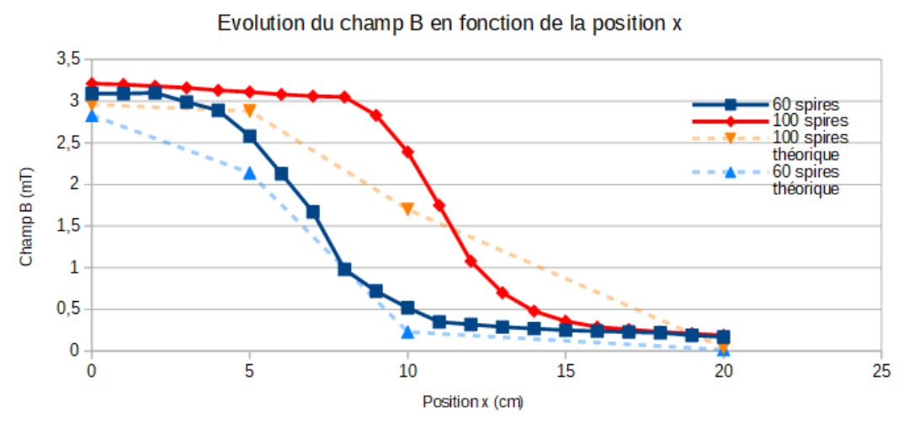
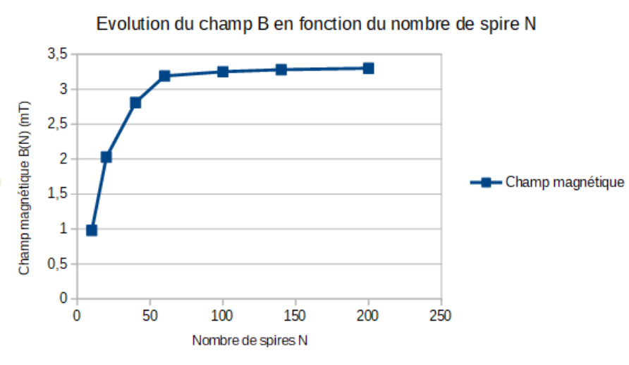
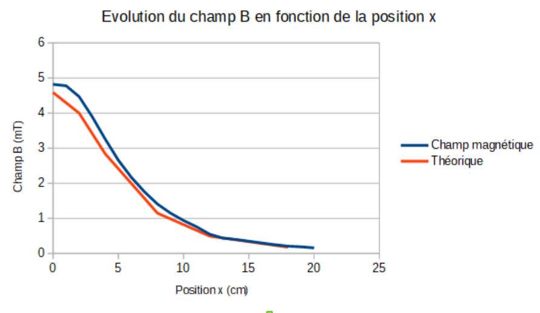
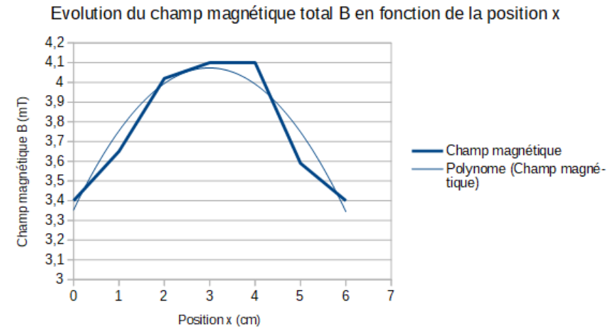
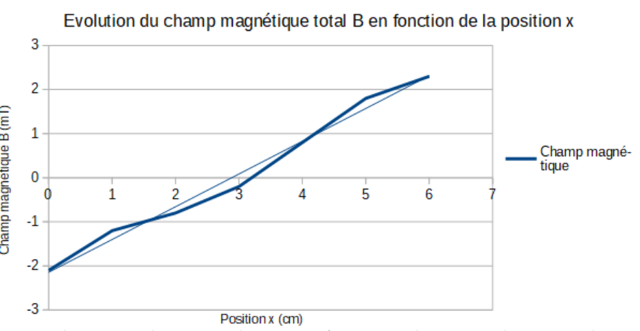

## Champ magnétique créé par une distribution de courant

### Champ magnétique en un point de l'axe d'une spire circulaire

En appliquant la loi de Biot et Savart, l'expression du champ magnétique $\vec B$ au point $P$ d'abscisse $x$ est dirigée suivant l'axe $Ox$ et a pour valeur

$$
B(x) = \frac{\mu_0 I}{2R} \sin^3 \beta
$$

où $\mu_0$ est la perméabilité du vide, $I$ l'intensité du courant dans la spire (en ampère) et $R$ le rayon de la spire (en mètre). De plus, $\beta$ est l'angle sous lequel, du point $P$, on voit le rayon $R$ de la spire. Ainsi, en utilisant la trigonométrie :

$$
B(x) = \frac{\mu_0 I}{2} \frac{R^2}{(x^2 + R^2)^{3/2}}
$$

Si la bobine contient $N$ spires, l'expression précédente est multipliée par $N$.

### Champ magnétique créé en un point de son axe par un solénoïde de longueur L

Le champ magnétique $\vec B$ orienté selon l'axe $(Ox)$, défini par son abscisse $x$ par les angles $\beta_1$ et $\beta_2$, a pour norme

$$
B(M) = \mu_0 \frac{nI}{2}\big(\cos(\beta_1) - \cos(\beta_2)\big)
$$

avec $n$ le nombre de spires par unité de longueur et $I$ l'intensité du courant. Nous pouvons noter que si la longueur $L$ du solénoïde est très supérieure à son diamètre et si le point $M$ se trouve dans la région centrale, on a

$$
B \cong \mu_0 n I
$$

Nous retrouvons le champ magnétique créé par un solénoïde de longueur infinie.

### Théorème d'Ampère

Le théorème d'Ampère permet d'exprimer la circulation du vecteur $\vec B$ sur un contour géométrique fermé sur lui-même et placé dans le champ magnétique. La circulation $C$ sur un contour fermé $\Gamma$ est définie par

$$
C = \int_\Gamma \vec B \cdot \vec{dl} = \oint \vec B \cdot \vec{dl}
$$

$$
C = \mu_0 \sum I = \mu_0 N I
$$

## Matériel - mesure de champ magnétique

Pour mesurer nos champs magnétiques, nous utilisons un teslamètre. Cet appareil est une sonde à effet Hall, elle est composée d'un ruban métallique parcouru par un courant d'intensité $I$ constante qui est placé dans le champ $\vec B$ à mesurer. Ce champ exerce une action électromagnétique sur des charges conductrices en mouvement. Leur trajectoire moyenne subit alors une inflexion dans le plan perpendiculaire à $\vec B$. Ainsi il en résulte une dissymétrie de répartition des charges dans le volume du ruban, ce qui va provoquer le champ de Hall. En régime permanent, l'action du champ électrostatique $\vec E_H$ sur les porteurs de charges compense celle du champ magnétique $\vec B$. L'existence de $\vec E_H$ crée une différence de potentiel $U_H$.

Détaillons la mesure du champ électrique de Hall, définissons le vecteur densité de courant $\vec j = -ne\vec v$. Nous pouvons en déduire $\vec v = -\dfrac{\vec j}{ne}$.

Ainsi la force s'exerçant sur une particule chargée dans un champ électromagnétique $(\vec E, \vec B)$ est la force de Lorentz

$$
\vec F = q(\vec E + \vec v \wedge \vec B)
$$

Ici il y a seulement la composante magnétique, c'est donc la force de Laplace

$$
\vec F_{Lap} = q(\vec v \wedge \vec B) = -e\Big[-\frac{j \vec e_x}{ne} \wedge B \vec e_z\Big] = -\frac{jB}{n} \vec e_y
$$

Comme décrit précédemment, il y a création d'un champ électrique dit de Hall, $\vec E_H$, ainsi la force associée compense la force de Laplace. Nous avons donc en régime permanent $\vec F_H + \vec F_L = \vec 0$ et de ce fait les électrons se déplacent toujours parallèlement à $Ox$ puisque $\vec j$ est parallèle à $\vec e_x$. Ainsi

$$
\vec F_H + \vec F_L = \vec 0 \Leftrightarrow q\vec E_H + q\vec v \wedge \vec B = \vec 0
$$

$$
\vec E_H = -\frac{jB}{ne} \vec e_y
$$

Nous pouvons donc déterminer $U_H = V_N - V_M = \int_M^N dV$ or $\vec E_H = -\overrightarrow{\text{grad}}(V) = -\dfrac{dV}{dy} \vec e_y \Rightarrow dV = -\vec E_H \, dy \, \vec e_y$.

Nous avons donc $U_H = \dfrac{1}{neh} IB$ ; la mesure de $U_H$ et $I$ permet donc d'obtenir $B$.

## Manipulation

### Mise en fonctionnement du teslamètre

Pour réaliser les nombreuses mesures de ce TP, nous mesurons à chaque fois la valeur à vide indiquée par le teslamètre, c'est-à-dire la valeur sans aucun champ magnétique. Cette valeur à vide est une erreur systématique du teslamètre, nous la retrancherons à nos mesures lorsque celle-ci sera supérieure à l'incertitude des mesures.

Ainsi, nous allons déterminer l'incertitude $\Delta B$ du champ magnétique. Lors de ce TP nous avons uniquement utilisé le calibre $20\ \text{mT}$. L'incertitude de notre teslamètre est donc de $2\,\%$ du champ magnétique. Nous devons rajouter à cette incertitude 3 unités de résolution (c'est-à-dire $0{,}1\ \text{mT}$).

L'incertitude du champ magnétique $\Delta B$ est donc

$$
\Delta B = 0{,}02 B + 0{,}3 \ \text{en mT}
$$

### Mesures

Nous nous plaçons dans le premier cas : la bobine est alimentée avec un courant de $5\ \text{A}$, nous nous plaçons successivement à $N = 60$ puis $N = 100$, puis nous faisons les mesures pour $x$ allant de $0\ \text{cm}$ jusqu'à $20\ \text{cm}$.

Nous relevons les mesures visibles en annexe. Et nous traçons le graphique suivant :

Nous nous plaçons ensuite dans le deuxième cas : la bobine est alimentée avec un courant de $5\ \text{A}$, nous changeons désormais le nombre de spires de 10 à 200 spires.

Nous relevons les mesures visibles en annexe. Et nous traçons le graphique suivant :

### Exploitation

Nous cherchons à exprimer théoriquement l'expression de la norme du champ magnétique $\vec B$ suivant l'axe $(Ox)$ au point $M$ pour un enroulement de longueur $L$. Pour cela, nous nous aidons de la formule donnée dans le fascicule de TP

$$
B(M) = \mu_0 \frac{nI}{2}\big(\cos(\beta_1) - \cos(\beta_2)\big)
$$

Chaque angle est repéré sur la figure 2 du fascicule de TP.

Nous pouvons ainsi déterminer l'expression des cosinus des deux angles $\beta_1$ et $\beta_2$. On définit l'angle $\alpha$ comme l'angle complémentaire de l'angle $\beta_2$ afin d'obtenir un angle égal à $\pi\ \text{rad}$ sur l'axe $(Ox)$.

Ainsi nous avons $\alpha = \pi - \beta_2$, nous obtenons

$$
\cos(\beta_2) = \cos(\pi - \alpha) = \cos(\pi)\cos(\alpha) + \sin(\pi)\sin(\alpha) = -\cos(\alpha)
$$

En utilisant les formules de trigonométrie et le théorème de Pythagore, nous pouvons exprimer $\cos(\alpha)$ en fonction de $x$ et de $L$ :

$$
\cos(\alpha) = \frac{\dfrac{L}{2} + x}{\sqrt{R^2 + \left(\dfrac{L}{2} + x\right)^2}}
$$

Nous pouvons en déduire une expression de $\cos(\beta_2)$ :

$$
\cos(\beta_2) = -\frac{\dfrac{L}{2} + x}{\sqrt{R^2 + \left(\dfrac{L}{2} + x\right)^2}}
$$

Par un raisonnement analogue avec l'angle $\beta_1$, nous obtenons l'expression suivante :

$$
\cos(\beta_1) = \frac{\dfrac{L}{2} - x}{\sqrt{R^2 + \left(\dfrac{L}{2} - x\right)^2}}
$$

Nous remplaçons dans l'expression du champ magnétique en fonction de $\beta_1$ et $\beta_2$ par les expressions que nous venons d'établir, nous obtenons alors

$$
B(M) = \mu_0 \frac{nI}{2}\left(\frac{\dfrac{L}{2} - x}{\sqrt{R^2 + \left(\dfrac{L}{2} - x\right)^2}} + \frac{\dfrac{L}{2} + x}{\sqrt{R^2 + \left(\dfrac{L}{2} + x\right)^2}}\right)
$$

Or nous savons que le nombre de spires noté $n$ par unité de longueur se définit par le rapport du nombre de spires du solénoïde $N$ sur sa longueur totale $L$, ainsi $n = \dfrac{N}{L}$. Nous obtenons donc

$$
B(M) = \mu_0 \frac{NI}{2L}\left(\frac{\dfrac{L}{2} - x}{\sqrt{R^2 + \left(\dfrac{L}{2} - x\right)^2}} + \frac{\dfrac{L}{2} + x}{\sqrt{R^2 + \left(\dfrac{L}{2} + x\right)^2}}\right)
$$

Grâce à cette formule ci-dessus, nous pouvons calculer les différentes valeurs théoriques du champ magnétique $B$ pour plusieurs positions $x$.

Nous déterminons $L$ pour $N = 60$ spires et $N = 100$ spires. Nous savons que pour $N = 200$ spires, nous avons $L = 412\ \text{mm}$, donc nous pouvons en déduire que pour 60 spires, $L = \dfrac{60 \times 412}{200} = 123{,}6\ \text{mm}$, donc $L = 0{,}124\ \text{m}$. Pour $N = 100$ spires, $L = \dfrac{100 \times 412}{200} = 206\ \text{mm}$, donc $L = 0{,}206\ \text{m}$.

Ainsi, les valeurs théoriques pour certaines valeurs de $x$ sont représentées dans les tableaux ci-dessous. Les valeurs théoriques sont également visibles sur le graphique. De plus, nous devons tenir compte de l'erreur systématique de mesure du teslamètre lorsque celle-ci est supérieure aux incertitudes sur $B$. En moyenne, notre erreur systématique est de $0{,}18\ \text{mT}$ pour $N = 60$ spires et $0{,}12\ \text{mT}$ pour $N = 100$ spires.

**Pour $N = 60$ spires.**

| Position $x$ (en cm) | 0 | 5 | 10 | 20 |
| --- | --- | --- | --- | --- |
| $B$ expérimental (en mT) | $3{,}09 \pm 0{,}36$ | $2{,}58 \pm 0{,}35$ | $0{,}52 \pm 0{,}31$ | $0{,}17 \pm 0{,}30$ |
| $B$ théorique (en mT) | 2,83 | 2,14 | 0,23 | 0,0174 |

**Pour $N = 100$ spires.**

| Position $x$ (en cm) | 0 | 5 | 10 | 20 |
| --- | --- | --- | --- | --- |
| $B$ expérimental (en mT) | $3{,}21 \pm 0{,}36$ | $3{,}11 \pm 0{,}36$ | $2{,}39 \pm 0{,}35$ | $0{,}19 \pm 0{,}30$ |
| $B$ théorique (en mT) | 2,96 | 2,88 | 1,7 | 0,043 |

Nous remarquons que nos valeurs expérimentales comptées avec leurs incertitudes sont tout de même proches de nos valeurs théoriques calculées. Nous pouvons constater donc que le modèle expérimental utilisé lors de cette expérience semble relativement précis et juste. Cependant, dans la partie centrale des enroulements, des écarts plus importants entre les valeurs théoriques et les valeurs expérimentales sont remarquables. Ils sont dus à l'incertitude sur la position $x$ causée par la précision du matériel et les erreurs humaines.

Grâce à l'expression du champ $B(x)$ établie plus haut et en considérant $x = 0$, nous recherchons une condition afin que le solénoïde puisse être considéré comme "infiniment long".

$$
B(x = 0) = \mu_0 \frac{NI}{2L} \frac{L}{\sqrt{R^2 + \left(\dfrac{L}{2}\right)^2}}
$$

Le solénoïde est considéré comme infini si sa longueur $L$ est très supérieure à son diamètre. La condition sur $L$ et $R$ recherchée pour que le solénoïde soit infini est donc $L \gg 2R$, donc $L + 2R \to L$. Nous obtenons donc l'expression suivante

$$
B(x = 0) \cong \mu_0 \frac{NI}{L}
$$

En utilisant le fait que $n = \dfrac{N}{L}$, nous obtenons $B \cong \mu_0 n I$ ; cette formule est bien identique à celle du fascicule de TP.

Nous constatons qu'avec les valeurs théoriques, le solénoïde utilisé a un rapport $\dfrac{N}{L}$ égal à 485,44 spires par mètre avec $N = 100$ spires et $L = 0{,}206\ \text{m}$. Ainsi le rapport théorique $\dfrac{L}{R}$ vaut $\dfrac{L}{R} = \dfrac{0{,}206}{0{,}025} = 8{,}24$.

Grâce à la courbe $B = f(N)$, nous remarquons un palier à partir de $N = 100$, c'est-à-dire que le champ $B$ se stabilise lorsque $N > 100$. Nous pouvons donc considérer le solénoïde comme infini pour $N = 100$ spires.

Nous avons donc $L = \dfrac{N}{n}$ avec $N = 100$ ; d'après la formule que nous avons montrée précédemment, nous avons $n = \dfrac{N}{L} = \dfrac{B}{I\mu_0} \cong 485{,}42 \pm 57{,}29$ spires par mètre.

Avec, pour $N = 100$ spires, $I = 5\ \text{A}$ et $\mu_0 = 4\pi \times 10^{-7}$ : $B = 3{,}05 \pm 0{,}36\ \text{mT}$.

Ainsi, nous obtenons $L = 0{,}21\ \text{m}$ et donc la valeur expérimentale de $\dfrac{L}{R}$ est égale à

$$
\frac{L}{R} = \frac{0{,}21}{0{,}025} = 8{,}40
$$

La valeur théorique du rapport $\dfrac{L}{R}$ est égale à 8,24 et la valeur expérimentale vaut 8,40 ; ces deux valeurs sont relativement proches, compte tenu des incertitudes de mesure.

L'erreur relative correspondante est $\Delta \dfrac{L}{R} = \dfrac{8{,}40 - 8{,}24}{8{,}24} = 0{,}02$.

Nous obtenons une erreur relative de $2\,\%$ entre la condition expérimentale et la condition théorique ; nous pouvons attribuer ce pourcentage d'erreur à la mesure approximative du champ $B$ (matérielle et humaine).

### Étude d'une bobine circulaire

**Mesure.**

Grâce à cette formule ci-dessous, nous pouvons calculer les différentes valeurs théoriques du champ magnétique $B$ pour plusieurs positions $x$.

$$
B(x) = N \mu_0 \frac{I}{2} \frac{R^2}{(x^2 + R^2)^{\frac{3}{2}}}
$$

Pour chaque calcul, nous prenons comme valeurs : $N = 95$ spires avec $I = 5\ \text{A}$ et $R = 0{,}065\ \text{m}$.

Ainsi, les valeurs théoriques pour certaines valeurs de $x$ sont représentées dans le tableau ci-dessous. De plus, nous devons tenir compte de l'erreur systématique de mesure du teslamètre lorsque celle-ci est supérieure aux incertitudes sur $B$. Pour la série de mesures à $N = 95$ spires :

| Position $x$ (en cm) | 0 | 2 | 4 | 8 | 12 | 18 |
| --- | --- | --- | --- | --- | --- | --- |
| $B$ expérimental (en mT) | $4{,}82 \pm 0{,}41$ | $4{,}47 \pm 0{,}40$ | $3{,}26 \pm 0{,}38$ | $1{,}41 \pm 0{,}34$ | $0{,}55 \pm 0{,}32$ | $0{,}21 \pm 0{,}31$ |
| $B$ théorique (en mT) | 4,59 | 4,00 | 2,84 | 1,15 | 0,496 | 0,179 |

Nous pouvons remarquer que les valeurs théoriques sont assez proches des valeurs expérimentales, en étant tout de même plus faibles. Ce léger écart est maximal lorsque les $x$ sont très faibles, alors qu'ils sont presque égaux pour les $x$ allant de 8 à 18 cm.

L'extremum est situé en $x = 0$, avec une valeur de $B = 4{,}59\ \text{mT}$ en théorie et de $B = 4{,}82 \pm 0{,}41$ en valeur expérimentale.

Les légères incertitudes sur les mesures peuvent être la cause de ce léger écart.

Nous pouvons conclure que cette estimation théorique des champs n'est possible que lorsque les $x$ sont suffisamment élevés.

## Théorème d'Ampère

**a)**

$$
C_1 = \int_{-\infty}^{+\infty} \vec B \, \vec{dx} = \int_{-\infty}^{+\infty} \frac{\mu_0 N I}{2} \frac{R^2}{(R^2 + x^2)^{\frac{3}{2}}} dx
$$

Nous effectuons le changement de variable $x = \dfrac{R}{\tan\beta}$, donc $dx = \dfrac{-R}{\sin^2\beta} d\beta$. De plus, lorsque $x \to +\infty$, $\dfrac{R}{\tan(\beta)} \to +\infty$, ainsi $\tan(\beta) = 0^+$ donc $\beta = 0$.

De manière analogue, $x \to -\infty$, $\dfrac{R}{\tan(\beta)} \to -\infty$, ainsi $\tan(\beta) = 0^-$ donc $\beta = \pi$.

Nous allons désormais changer la fonction d'intégration :

$$
\begin{aligned}
\frac{\mu_0 N I}{2} \frac{R^2}{(R^2 + x^2)^{\frac{3}{2}}}
&= -\frac{\mu_0 N I}{2} \frac{R^2}{\left(R^2 + \dfrac{R^2}{\tan^2(\beta)}\right)^{\frac{3}{2}}} \frac{R}{\sin^2(\beta)} d\beta \\
&= -\frac{\mu_0 N I}{2} \frac{R^2}{R^3 \left(1 + \dfrac{1}{\tan^2(\beta)}\right)^{\frac{3}{2}}} \frac{R}{\sin^2(\beta)} d\beta \\
&\phantom{=} -\frac{\mu_0 N I}{2} \frac{1}{\left(1 + \dfrac{1}{\tan^2(\beta)}\right)^{\frac{3}{2}}} d\beta \\
&= -\frac{\mu_0 N I}{2} \frac{\tan^3(\beta)}{(\tan^2(\beta) + 1)^{\frac{3}{2}}} \frac{1}{\sin^2(\beta)} d\beta \\
&= -\frac{\mu_0 N I}{2} \frac{\sin(\beta)}{(\tan^2(\beta) + 1)^{\frac{3}{2}}} \frac{1}{\cos^3(\beta)} d\beta \\
&= -\frac{\mu_0 N I \sin(\beta)}{2} d\beta
\end{aligned}
$$

Au final nous avons donc

$$
C_1 = \int_\pi^0 -\frac{\mu_0 N I \sin(\beta)}{2} d\beta = \mu_0 N \frac{I}{2} \big[\cos(\beta)\big]_\pi^0 = \mu_0 N I
$$

L'application numérique donne $C_1 = 5{,}969 \times 10^{-4}\ \text{T.m}$.

**b)** $C_2 = \displaystyle\sum_{x=-18}^{x=18} \vec B(x) \vec{\Delta x} = 2 \sum_{x=0}^{x=18} \vec B(x) \vec{\Delta x}$ car le champ $B(x)$ est symétrique par rapport au centre ($x = 0$). Nous obtenons donc $C_2 = (6{,}916 \pm 1{,}325) \times 10^{-4}\ \text{T.m}$ ; les deux valeurs sont relativement proches, l'écart relatif est de $16\,\%$, nous en déduisons donc que les mesures expérimentales sont en accord avec les valeurs théoriques (compte tenu des incertitudes et des erreurs humaines et matérielles).

$C_3 = \int_{-\infty}^{-18} B(x) dx + \int_{18}^{+\infty} B(x) dx = 2 \int_{18}^{\infty} B(x) dx$ (par symétrie par rapport au centre $x = 0$).

$C_3 = \dfrac{\mu_0 N I}{2} \displaystyle\int_{18}^{\infty} \frac{R^2}{(R^2 + x^2)^{\frac{3}{2}}} dx$. Nous posons $x = \dfrac{R}{\tan(\beta)}$ de manière analogue à la question a), nous avons

$$
C_3 = \mu_0 N I \big[\cos(\beta)\big]^0_{\arctan\left(\frac{6{,}5}{18}\right)}
$$

L'application numérique nous donne $C_3 = 3{,}55 \times 10^{-5}\ \text{T.m}$.

En théorie, nous devrions obtenir $C_1 = C_2 + C_3$, or nous avons $C_2 + C_3 = 7{,}271 \times 10^{-4}\ \text{T.m}$ et $C_1 = 5{,}969 \times 10^{-4}\ \text{T.m}$.

Ainsi, nous constatons d'après les résultats précédents que la somme $(C_2 + C_3)$ est supérieure à $C_1$. De plus, les valeurs de $C_2$ et $C_1$ sont relativement proches en tenant compte des incertitudes sur les mesures. Également, la valeur de $C_3$ est négligeable devant celles de $C_2$ et de $C_1$, en effet $C_3 \ll C_2$ et $C_3 \ll C_1$. Nous pouvons donc logiquement négliger cette dernière partie puisqu'elle est bien inférieure à la précédente. Ainsi, pour calculer la circulation de $B$ le long de la bobine, il suffit d'additionner les valeurs expérimentales, en négligeant les valeurs en dehors de la bobine.

## Bobine de Helmholtz

### Théorie

Une bobine de Helmholtz est une association de deux bobines parcourues par un courant $I$, de même rayon $R$ et séparées d'une distance $R$. Par la loi de Biot et Savart, chaque bobine crée un champ magnétique.

**Pour la bobine centrée en $x = +R/2$.**

$$
B_1(x) = \frac{\mu_0 N I_1 R^2}{2(R^2 + (x - R/2)^2)^{\frac{3}{2}}}
$$

**Pour la bobine centrée en $x = -R/2$.**

$$
B_2(x) = \frac{\mu_0 N I_2 R^2}{2(R^2 + (x + R/2)^2)^{\frac{3}{2}}}
$$

Par le théorème de superposition nous avons

$$
B_{tot}(x) = B_1(x) + B_2(x)
$$

Nous allons regarder les champs quand $x = 0\ \text{cm}$.

Si les deux courants sont dans le même sens, nous avons $I_1 = I_2$ :

$$
B_{tot}(x = 0) = B_1(x = 0) + B_2(x = 0) = \left(\frac{4}{5}\right)^{\frac{3}{2}} \frac{\mu_0 N I}{R}
$$

Nous avons donc présence d'un maximum du champ magnétique quand $x = 0$. Dans notre cas, en prenant $N = 95$ spires, $\mu_0 = 4\pi \times 10^{-7}\ \text{SI}$, $I = 5\ \text{A}$ et $R = 6{,}5\ \text{cm}$, on trouve $B_{max}(x = 0) = 6{,}57\ \text{mT}$.

Si les deux courants sont dans le sens opposé, nous avons $I_1 = -I_2$, donc

$$
B_{tot}(x = 0) = \frac{\mu_0 N I}{2} R^2 \left(\frac{1}{\left(R^2 + \frac{R^2}{4}\right)^{\frac{3}{2}}} - \frac{1}{\left(R^2 + \frac{R^2}{4}\right)^{\frac{3}{2}}}\right) = 0
$$

Nous avons donc le champ nul quand $x = 0\ \text{cm}$.

### Mesure

**Configuration Helmholtz.**

Nous pouvons remarquer que notre maximum est atteint entre $x = 3\ \text{cm}$ et $x = 4\ \text{cm}$ sachant que la bobine a un rayon de $6{,}5\ \text{cm}$, c'est cohérent avec la théorie ; de plus, ce maximum vaut $4{,}1 \pm 0{,}38\ \text{mT}$, nous avons donc une erreur relative de $37\,\%$. Cette erreur est due au fait que nous ne connaissons pas la valeur précise du maximum (elle est entre 3 cm et 4 cm mais nous ne connaissons pas sa valeur, nous aurions dû faire des mesures tous les 0,5 cm au lieu de tous les 1 cm). Le comportement est cependant cohérent avec la théorie.

**Configuration anti-Helmholtz.**

Nous pouvons remarquer que la courbe passe en 0 entre 3 et 4 cm, ce qui est cohérent avec la théorie.

## Annexes

**Mesure du champ magnétique pour $N = 60$ spires.**

| Position (cm) | Champ magnétique (mT) | Incertitude (mT) |
| --- | --- | --- |
| 0 | 3.09 | 0.36 |
| 1 | 3.09 | 0.36 |
| 2 | 3.1 | 0.36 |
| 3 | 2.99 | 0.36 |
| 4 | 2.89 | 0.36 |
| 5 | 2.58 | 0.35 |
| 6 | 2.13 | 0.34 |
| 7 | 1.67 | 0.33 |
| 8 | 0.98 | 0.32 |
| 9 | 0.72 | 0.31 |
| 10 | 0.52 | 0.31 |
| 11 | 0.35 | 0.31 |
| 12 | 0.32 | 0.31 |
| 13 | 0.29 | 0.31 |
| 14 | 0.27 | 0.31 |
| 15 | 0.25 | 0.31 |
| 16 | 0.24 | 0.30 |
| 17 | 0.23 | 0.30 |
| 18 | 0.22 | 0.30 |
| 19 | 0.19 | 0.30 |
| 20 | 0.17 | 0.30 |

**Mesure du champ magnétique pour $N = 100$ spires.**

| Position (cm) | Champ magnétique (mT) | Incertitude (mT) |
| --- | --- | --- |
| 0 | 3.21 | 0.36 |
| 1 | 3.20 | 0.36 |
| 2 | 3.18 | 0.36 |
| 3 | 3.16 | 0.36 |
| 4 | 3.13 | 0.36 |
| 5 | 3.11 | 0.36 |
| 6 | 3.08 | 0.36 |
| 7 | 3.06 | 0.36 |
| 8 | 3.05 | 0.36 |
| 9 | 2.83 | 0.36 |
| 10 | 2.39 | 0.35 |
| 11 | 1.75 | 0.33 |
| 12 | 1.08 | 0.32 |
| 13 | 0.7 | 0.31 |
| 14 | 0.48 | 0.31 |
| 15 | 0.36 | 0.31 |
| 16 | 0.29 | 0.31 |
| 17 | 0.26 | 0.31 |
| 18 | 0.23 | 0.30 |
| 19 | 0.21 | 0.30 |
| 20 | 0.19 | 0.30 |

**Mesure du champ magnétique pour $N$ allant de 10 à 200 spires.**

| Nombre de spires $N$ | Champ magnétique (mT) | Incertitude (mT) |
| --- | --- | --- |
| 10 | 0.98 | 0.32 |
| 20 | 2.03 | 0.34 |
| 40 | 2.81 | 0.36 |
| 60 | 3.19 | 0.36 |
| 100 | 3.25 | 0.36 |
| 140 | 3.28 | 0.37 |
| 200 | 3.3 | 0.36 |

**Mesure du champ magnétique pour $N = 60$ spires.** La valeur moyenne à vide est de $0{,}68\ \text{mT}$, elle a donc été retranchée.

| Position (cm) | Champ magnétique (mT) | Incertitude (mT) |
| --- | --- | --- |
| 0 | 4.82 | 0.41 |
| 1 | 4.78 | 0.41 |
| 2 | 4.47 | 0.40 |
| 3 | 3.9 | 0.39 |
| 4 | 3.26 | 0.38 |
| 5 | 2.66 | 0.37 |
| 6 | 2.17 | 0.36 |
| 7 | 1.76 | 0.35 |
| 8 | 1.41 | 0.34 |
| 9 | 1.15 | 0.34 |
| 10 | 0.94 | 0.33 |
| 11 | 0.76 | 0.33 |
| 12 | 0.55 | 0.32 |
| 13 | 0.44 | 0.32 |
| 14 | 0.40 | 0.32 |
| 15 | 0.35 | 0.32 |
| 16 | 0.30 | 0.31 |
| 17 | 0.25 | 0.31 |
| 18 | 0.21 | 0.31 |
| 19 | 0.19 | 0.31 |
| 20 | 0.16 | 0.31 |

**Mesure du champ magnétique en configuration Helmholtz.**

| Position (cm) | Champ magnétique (mT) | Incertitude (mT) |
| --- | --- | --- |
| 0 | 3.4 | 0.37 |
| 1 | 3.65 | 0.37 |
| 2 | 4.02 | 0.38 |
| 3 | 4.1 | 0.38 |
| 4 | 4.1 | 0.38 |
| 5 | 3.59 | 0.37 |
| 6 | 3.4 | 0.37 |

**Mesure du champ magnétique en configuration anti-Helmholtz.**

| Position (cm) | Champ magnétique (mT) | Incertitude (mT) |
| --- | --- | --- |
| 0 | -2.1 | 0.26 |
| 1 | -1.2 | 0.28 |
| 2 | -0.8 | 0.28 |
| 3 | -0.2 | 0.30 |
| 4 | 0.8 | 0.32 |
| 5 | 1.80 | 0.34 |
| 6 | 2.30 | 0.35 |
