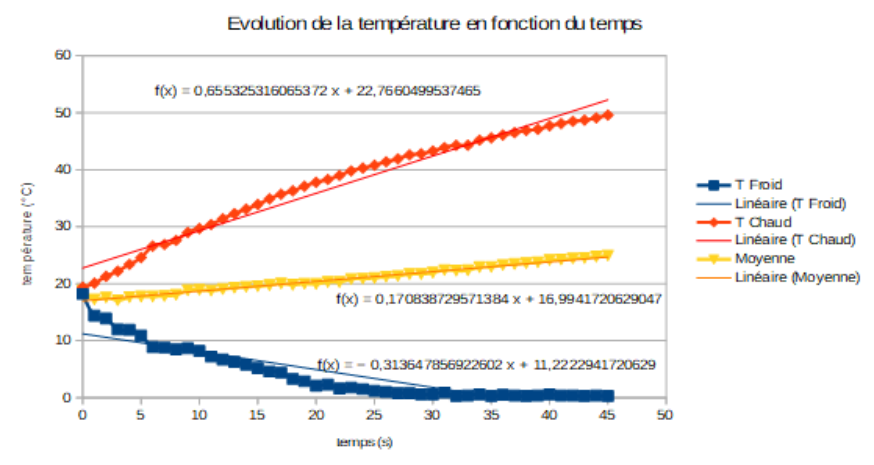
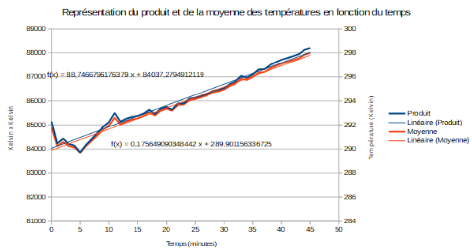
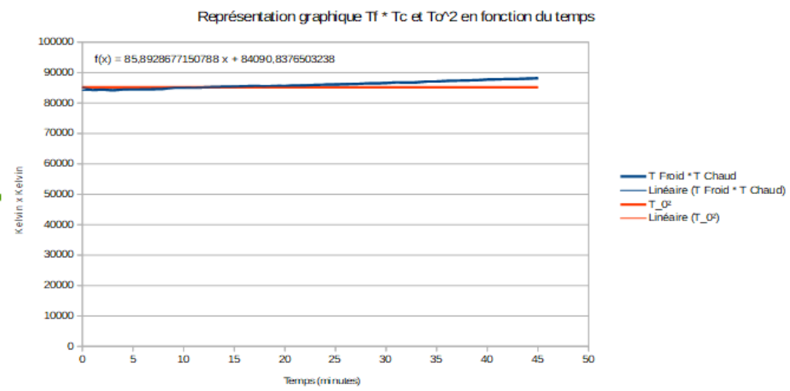
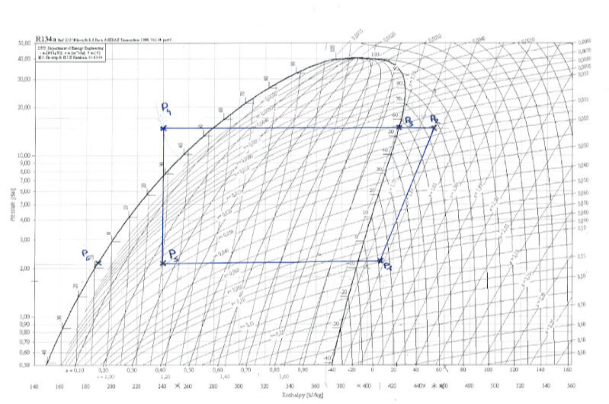
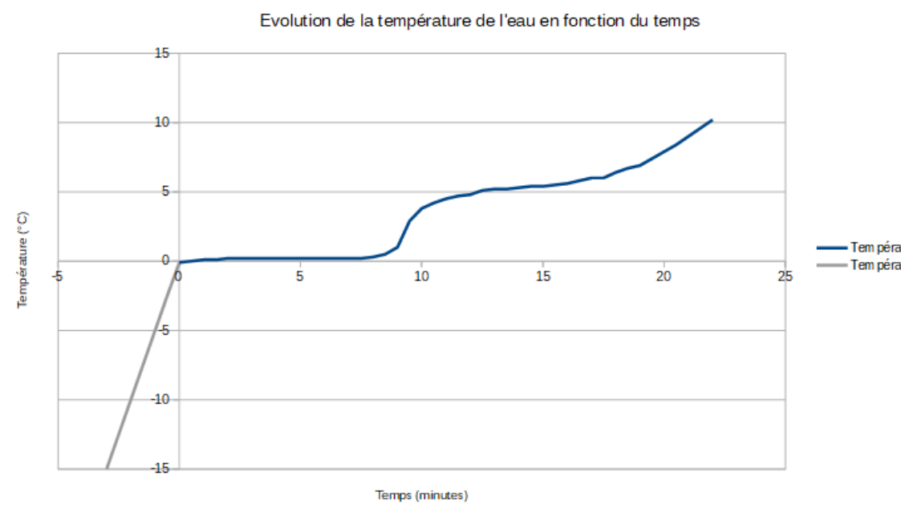

## Pompe à chaleur

### Introduction

L'intérêt de ce TP est de comprendre le fonctionnement d'une pompe à chaleur et de calculer son efficacité. L'étude se divise en deux parties : tout d'abord une analyse du régime transitoire, puis une analyse du régime permanent. Pour commencer l'expérience, nous remplissons les deux réservoirs d'eau de 4 litres, ce qui permet à l'évaporateur et au condenseur d'être immergés. Nous commençons l'expérience lorsque les 2 réservoirs ont une température approximativement égale.

### Régime transitoire

Nous allons désormais observer les variations de températures de la source chaude et de la source froide. Nous mesurons toutes les minutes jusqu'à stabilisation (45 minutes).

Nous pouvons assimiler les courbes $T_C$ et $T_F$ à deux fonctions affines, $T_C$ est croissante et $T_F$ est décroissante. De plus, lorsque $T_F$ diminue, on voit que $T_C$ augmente de manière symétrique, les coefficients directeurs sont de même ordre de grandeur. Nous pouvons donc conclure que la température de la source chaude augmente au cours du temps et que celle de la source froide diminue.

**Remarque.** La moyenne de nos deux températures augmente lors de l'expérience, cela s'explique par le fait que la salle était plus chaude que l'eau à la sortie des tuyaux (l'eau était à $18\ ^\circ\text{C}$ et la salle à $23\ ^\circ\text{C}$), ainsi notre moyenne est légèrement affine au lieu d'être constante et la symétrie entre $T_C$ et $T_F$ est moins flagrante.

Nous pouvons remarquer un plateau de changement d'état sur la courbe de $T_F$ à partir de la minute 30, avec une température proche de $0\ ^\circ\text{C}$ : c'est là où l'eau se solidifie.

Lorsque l'on trace la moyenne et le produit de ces températures, nous pouvons remarquer que ces deux courbes sont similaires.

Si la machine thermique est idéale et que les deux sources ont la même capacité calorifique, alors il n'y a aucune perte de chaleur, donc l'augmentation de la température de la source froide et la température de la source chaude croissent et décroissent parfaitement symétriquement et donc $\dfrac{T_F + T_C}{2} = T_0$. Ainsi $T_F \times T_C$ et $T_0^2$ sont égales théoriquement.

Nous remarquons sur notre graphique que le produit des températures n'est pas confondu avec $T_0^2$, ce qui est normal puisque notre machine n'est pas idéale. Notre machine n'est pas idéale à cause des échanges thermiques avec l'extérieur, par exemple le fait que la salle soit plus chaude que nos réservoirs au début de l'expérience.

### Régime permanent

Nous relevons les températures suivantes :

- $P_E = 2{,}1\ \text{bars}$, $P_C = 15{,}0\ \text{bars}$ ;
- $T_1 = 12{,}4\ ^\circ\text{C}$, $T_2 = 66{,}4\ ^\circ\text{C}$, $T_4 = 38{,}0\ ^\circ\text{C}$, $T_5 = -0{,}4\ ^\circ\text{C}$ ;
- $T_C = 53{,}0\ ^\circ\text{C}$, $T_F = -1{,}0\ ^\circ\text{C}$.

**Point 1.** Nous plaçons sur le diagramme le point 1 correspondant à la pression $P_E$ et à la température $T_1$, nous relevons :

$$
h_1 = 410\ \text{kJ/kg}
$$

**Point 2.** À l'intersection de la droite horizontale $P_C = 15{,}0\ \text{bars}$ et de la courbe $s = \text{cte}$ passant par le point 1, nous plaçons le point 2, nous relevons $T'_2 = 77\ ^\circ\text{C}$ et nous lisons l'enthalpie massique suivante :

$$
h_2 = 455\ \text{kJ/kg}
$$

Cependant, pendant la manipulation, nous relevons $T_2 = 52{,}4\ ^\circ\text{C}$ ; nous remarquons que $T'_2 > T_2$, cela vient du fait que la transformation n'est pas isentropique, c'est une approximation. Et donc sur le graphique, lorsque nous suivons l'isentropique passant par 1, nous avons une erreur par rapport à la manipulation réelle.

**Point 3.** Dans le condenseur, la température de la liquéfaction du gaz se lit sur le graphique en suivant l'isobare du point 2 jusqu'à la frontière du domaine liquide plus vapeur (trait en gras sur le graphique), nous pouvons donc relever la température de liquéfaction $T'_3 = 55\ ^\circ\text{C}$. Durant la manipulation nous avions relevé $T_3 = 55{,}0\ ^\circ\text{C}$.

**Point 4.** À l'intersection de la droite isobare $P_C$ et de la courbe isotherme $T_4 = 38{,}0\ ^\circ\text{C}$, nous plaçons le point 4 et nous relevons l'enthalpie massique :

$$
h_4 = 240\ \text{kJ/kg}
$$

**Point 5.** À l'intersection entre la droite verticale $h_4 = \text{cte}$ et la droite horizontale $P_E = \text{cte}$, nous plaçons le point 5. Nous avons une détente de Joule-Thomson, c'est-à-dire une isenthalpique ; nous relevons $x = 0{,}40$ et $T'_5 = -8\ ^\circ\text{C}$. Nous sommes face au même problème que dans le point 2 : idéalement la détente de Joule-Thomson est une isenthalpique, cependant réellement nous avons des échanges thermiques avec la salle, ainsi $T'_5 < T_5$.

**Point 6.** C'est au point 6 que la vaporisation se termine sous la pression $P_E$, nous relevons $T_6 = -8\ ^\circ\text{C}$.

La variation d'enthalpie est la suivante :

$$
h_s - h_e = w' + q
$$

(où $q$ est la quantité de chaleur massique apportée au système, et $w'$ le travail mécanique massique apporté au système).

L'efficacité de notre pompe à chaleur se trouve à l'aide de la formule

$$
e = \frac{q_{42}}{w_{12}} = \frac{h_4 - h_2}{h_1 - h_2} = 4{,}78
$$

Calculons l'efficacité théorique idéale, c'est-à-dire l'efficacité de Carnot :

$$
e_C = \frac{T_C}{T_C - T_F} = \frac{53{,}0 + 273}{(53{,}0 + 273) - (-1{,}0 + 273)} = 6{,}0
$$

On remarque que $e_C > e$, ainsi notre pompe à chaleur n'est pas idéale, il y a effectivement perte de chaleur et de travail dans notre système.

## Calorimétrie

### Mise en évidence du phénomène de fusion

**Manipulation.** Dans cette partie nous disposons d'un récipient métallique isolé avec une couche de feutre, de gros sel, de la glace pilée, un tube à essai et un thermomètre.

Nous plaçons la glace pilée dans le récipient métallique mélangée avec du gros sel. Nous versons ensuite $2{,}5\ \text{mL}$ d'eau dans un tube à essai et nous plaçons la sonde de température à l'intérieur. Nous insérons ensuite le tube dans le récipient rempli de glace.

Nous attendons que l'eau se change en glace dans le tube, puis nous le laissons se réchauffer à l'air ambiant. Nous mesurons la température toutes les 30 secondes et nous observons l'état physique du système.

**Analyse.**

1. $\rho_{\text{liquide}}^{\text{eau}} = 1000\ \text{kg/m}^3$ et $\rho_{\text{solide}}^{\text{eau}} = 917\ \text{kg/m}^3$. Ainsi $\rho_{\text{solide}}^{\text{eau}} < \rho_{\text{liquide}}^{\text{eau}}$. Cette différence provient du fait que, sous forme liquide, les molécules d'eau sont désordonnées et toutes en contact les unes avec les autres, le volume occupé est minimal (si l'on prend en compte que l'eau liquide est incompressible). Ainsi, pour une masse $m$ fixée, $\rho = \dfrac{m}{V}$ est maximale quand $V$ est minimal.

   Cependant, quand l'eau se solidifie, les molécules s'organisent en mailles moléculaires et forment une structure hexagonale. De plus, une fois rangées, il reste du vide entre les molécules. Ainsi, pour une masse fixée, le volume est plus grand sous forme solide. Nous pouvons donc conclure que $\rho$ est plus petit sous forme solide.

2. Courbe de la température de l'eau :

   

   *Figure 5 – La partie en gris est une partie fictive, voir explications dans l'analyse de la courbe.*

   On distingue 3 périodes sur ce graphique : lors du TP nous n'avons pas mis assez de glace pilée dans notre récipient isolé, ainsi même si l'eau contenue dans le tube à essai a gelé, elle n'a pas atteint des températures négatives importantes ; ainsi la première phase que l'on aurait dû obtenir dans notre graphique n'est pas présente.

   - Pour des raisons évoquées ci-dessus, la première période n'est pas observable sur notre graphique. Cette partie correspond à une forte augmentation de la température de températures négatives jusqu'à $0\ ^\circ\text{C}$. Durant cette période, les premières gouttes de liquide apparaissent suite à un transfert de chaleur effectué avec l'air ambiant vers la glace. Cependant l'eau reste sous forme solide, il n'y a qu'une phase présente.
   - Nous observons ensuite un plateau aux alentours de 0 degré de 0 à 8 minutes. Il s'agit d'un plateau de changement d'état, c'est durant cette période que la fusion va s'opérer. Nous pouvons assimiler cette courbe à une constante, il y a donc deux phases en présence, liquide et solide.
   - Enfin, de 8 minutes à 22 minutes la température va augmenter en suivant une fonction affine ; cette augmentation est due aux échanges thermiques avec l'air. Il n'y a que la phase liquide en présence.

3. La variance $v$ décrit le nombre de paramètres intensifs et indépendants qui caractérisent un état d'équilibre. Les calculs de variance s'effectuent avec la formule

   $$
   v = (c + 2 - \phi)
   $$

   Le système n'est composé que d'eau, donc $c = 1$, et $\phi$ correspond au nombre de phases en présence. Ainsi $v_1(\phi = 1) = 2$, $v_2(\phi = 2) = 1$ et $v_3(\phi = 1) = 2$.

   Le phénomène de fusion est donc mis en évidence : à pression constante, le changement d'état se produit bien autour de $0\ ^\circ\text{C}$.

### Détermination de la chaleur latente de fusion de la glace

**Manipulation.** Dans cette partie, nous disposons d'un calorimètre, nous introduisons $200\ \text{mL}$ d'eau liquide dans le calorimètre et nous attendons l'équilibre thermique. Nous mettons ensuite un morceau cylindre de glace dans ce calorimètre. Nous relevons les différentes températures à l'aide du thermomètre jusqu'à la fonte totale du glaçon.

**Analyse.**

1. On décompose le système en 3 sous-systèmes distincts : le calorimètre, l'eau initialement contenue dans le calorimètre ($200\ \text{mL}$) que nous notons $V_1$ et l'eau initialement sous forme de glace dans le tube ($10\ \text{mL}$) que nous notons $V_2$. Ce tube subit un changement d'état : la fusion. Nous relevons les températures initiales et finales de chacun des sous-systèmes.

   | Sous-système | $T_i$ | $T_f$ |
   | --- | --- | --- |
   | Calorimètre | $T_{1i} = 19{,}5\ ^\circ\text{C}$ | $T_{if} = 15{,}5\ ^\circ\text{C}$ |
   | Eau ($V_1$) | $T_{1i} = 19{,}5\ ^\circ\text{C}$ | $T_{if} = 15{,}5\ ^\circ\text{C}$ |
   | Eau ($V_2$) | $T_{2i} = 0\ ^\circ\text{C}$ | $T_{2f} = 15{,}5\ ^\circ\text{C}$ |

2. Bilan d'enthalpie :

   $$
   \Delta H = \sum_i C_{p,i}(T_{f,i} - T_{0,i}) = C(T_f - T_1) + C_{p,eau}(T_f - T_1) + C_{p,eau}(T_f - T_2)
   $$

   $$
   C = -\frac{m_1 C_{p,eau}^{m_1}(T_f - T_1) + m_2 C_{p,eau}^{m_2}(T_f - T_2)}{(T_f - T_1)}
   $$

   Nous obtenons une capacité thermique $C$ du calorimètre en fonction de $C_{p,eau}, T_f, T_2, T_1, m_1, m_2$.

   La méthode expérimentale pour mesurer la capacité thermique $C$ du calorimètre consiste à mettre une masse d'eau $m_1$ dans le calorimètre (le tout à température ambiante $T_1$). Puis nous ajoutons une masse $m_2$ d'eau à température $T_2$ inférieure à $T_1$. Nous pouvons mesurer $T_F$ et, en connaissant la capacité calorifique de l'eau, nous pouvons en déduire la valeur de la capacité thermique grâce au calcul précédent.

3. Le système englobant tous les sous-systèmes énoncés plus haut est isolé, on a donc

   $$
   \Delta H = \sum_i C_{p,i}(T_{f,i} - T_{0,i}) + L = 0
   $$

   Alors :

   $$
   L_f = -\big[C_{p,eau_1}(T_f - T_{i,eau_1}) + C_{p,eau_2}(T_f - T_{i,eau_2}) + C(T_f - T_{i,\text{calorimètre}})\big]
   $$

   On introduit les capacités calorifiques massiques et la masse volumique de l'eau. De plus $T_{i,eau_1} = T_{0,eau}$, $T_{i,eau_2} = T_{0,glace}$ et $T_{i,\text{calorimètre}} = T_{0,\text{calorimètre}}$. Ainsi

   $$
   L_f = -\big[\rho_{eau} V_{eau} c'_{p,eau}(T_f - T_{0,eau}) + m_{glace} c'_{p,eau}(T_f - T_{0,glace}) + C(T_f - T_{0,\text{calorimètre}})\big]
   $$

   Étant donné que $T_{0,eau} = T_{0,\text{calorimètre}} = T_{1i}$ et $T_{0,glace} = T_{2i}$, on retrouve :

   $$
   L_f = -\big[\rho_{eau} V_{eau} c'_{p,eau}(T_f - T_{1i}) + m_{glace} c'_{p,eau}(T_f - T_{2i}) + C(T_f - T_{1i})\big]
   $$

   De plus $L'_f = \dfrac{L_f}{m_{glace}}$, on retrouve

   $$
   L'_f = -\frac{c'_{p,eau} \rho_{eau} V_{eau}(T_f - T_{1i}) + m_g c'_{p,eau}(T_f - T_{2i}) + C(T_f - T_{1i})}{m_g}
   $$

   En calculant $L'_f$ avec la formule donnée dans le fascicule, on obtient $L'_f = 298\ \text{kJ/kg}$. La valeur tabulée est égale à $L'_f = 333\ \text{kJ/kg}$.

   Nous avons donc une erreur relative de $\Delta = 12\,\%$. Cette différence est obtenue à cause des erreurs de manipulation (erreur de dosage) et des erreurs de mesure (incertitude du matériel).

4. Si le glaçon était à $-10\ ^\circ\text{C}$ au lieu de $0\ ^\circ\text{C}$, la valeur de la chaleur latente massique serait donc plus grande ; cela s'explique en partie par la nécessité d'un apport plus conséquent d'énergie au sous-système dont la glace est à $-10\ ^\circ\text{C}$ afin d'atteindre le changement d'état qu'à ce sous-système à $0\ ^\circ\text{C}$.
