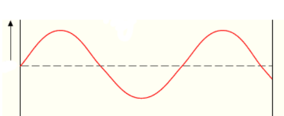
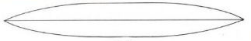
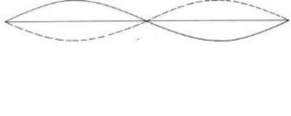
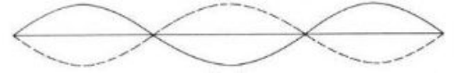
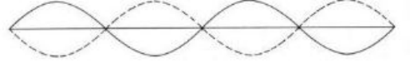
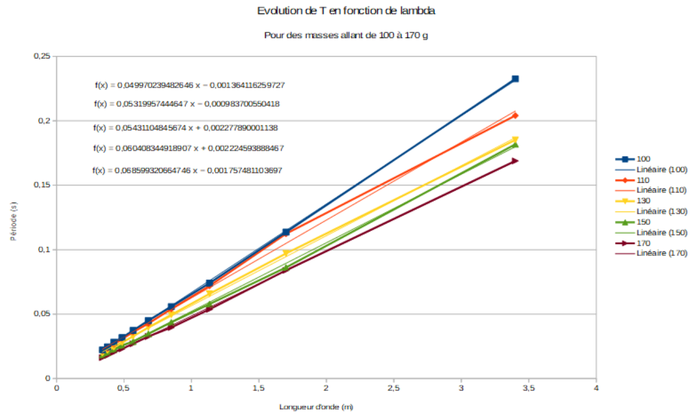
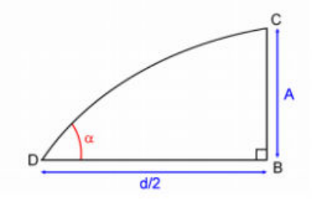
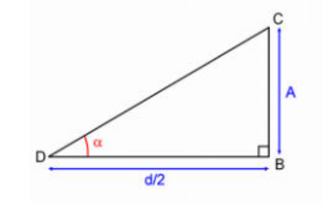
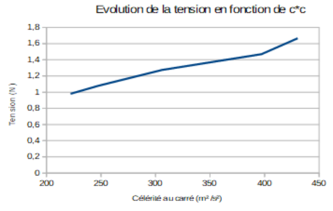
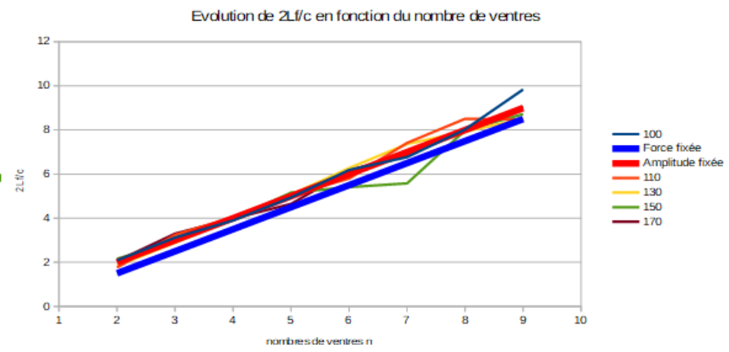

**Objectif.** Nous allons mettre en évidence l'existence d'ondes stationnaires de vibration transverse de la corde de longueur infinie $L$ tendue et excitée par un vibreur électromagnétique. Nous allons vérifier la validité de la loi $c = \sqrt{\dfrac{T_0}{\mu}}$, où $c$ est la célérité des ondes transverses de la corde, $T_0$ la tension de la corde, $\mu$ sa masse linéique. Enfin, nous étudierons les résonances de ce système.

## Description théorique

### Distance entre deux ventres

Soit l'équation d'onde :

$$
u(x, t) = a(x) e^{i\omega t}
$$

avec $a(x) = A_1 e^{jkx} + A_2 e^{-jkx}$. La distance entre deux ventres est indépendante du temps puisque l'onde se propage. Afin de déterminer cette distance $d$, nous pouvons donc travailler uniquement sur $a(x)$. La position d'un ventre est un extremum, donc $\dfrac{d}{dx} a(x) = 0$.

De plus, la condition à la limite $x = 0$ impose $A_2 = -A_1$. Ainsi

$$
\begin{aligned}
\frac{d}{dx}\big(A_1 e^{jk_0x} - A_1 e^{-jk_0x}\big) = 0 &\Rightarrow A_1 jk_0 e^{jk_0x} - A_1(-jk_0) e^{-jk_0x} = 0 \\
&\Rightarrow (A_1 jk_0)\big(e^{jk_0x} + e^{-jk_0x}\big) = 0 \\
&\Rightarrow e^{jk_0x} + e^{-jk_0x} = 0 \\
&\Rightarrow \frac{e^{jk_0x} + e^{-jk_0x}}{2} = 0 \\
&\Rightarrow \cos(k_0x) = 0 \\
&\Rightarrow k_0x = (2n + 1)\frac{\pi}{2}, \ n \in \mathbb{N}
\end{aligned}
$$

Soient $x$ et $x'$ les positions de deux ventres de vibration successifs, telles que

$$
\begin{cases} x = \dfrac{\pi}{2k_0}\big[2(n + 1) + 1\big] \\ x' = \dfrac{\pi}{2k_0}\big[2n + 1\big] \end{cases}
$$

Désignons par $d$ la plus petite distance séparant deux ventres de vibration. Donc

$$
d = x - x' = \frac{\pi}{2k_0}\big[2n + 3 - 2n - 1\big] = \frac{2\pi}{2k_0}
$$

$$
d = \frac{\lambda_0}{2} \quad \text{où} \quad \lambda_0 = \frac{2\pi}{k_0}
$$

### Excitation à déplacement imposé

Soit l'équation d'onde

$$
u(x, t) = \mathcal{R}(u(x, t)) = A \frac{\sin(k_0x)}{\sin(k_0L)} = A \frac{\sin(k_0x)}{\sin(k_0L)} \cos(\omega_0 t)
$$

L'amplitude du déplacement de la corde est maximale si et seulement si $\sin(k_0L)$ est nul. Donc $\sin(k_0L) = 0 \Rightarrow k_0L = n\pi$, or $k_0 = \dfrac{2\pi}{\lambda_0}$ et $\lambda_0 = \dfrac{c}{f_0}$. Donc $k_0 = \dfrac{2\pi f_0}{c}$. Nous avons donc

$$
\frac{2\pi f_0 L}{c} = n\pi \Rightarrow f_0 = n\frac{c}{2L}
$$

### Excitation à force imposée

Soit l'équation d'onde

$$
u(x, t) = \mathcal{R}(u(x, t)) = -\frac{F}{T_0} \frac{\sin(k_0x)}{\cos(k_0L)} \cos(\omega_0 t)
$$

L'amplitude du déplacement à travers la corde est maximale si et seulement si $\cos(k_0L)$ est nul. Donc $\cos(k_0L) = 0 \Rightarrow k_0L = \left(\dfrac{2n - 1}{2}\right)\pi, \forall n \geq 1$, or $k_0 = \dfrac{2\pi f_0}{c}$ ; d'après ce qui précède nous avons

$$
\frac{2\pi f_0 L}{c} = \left(\frac{2n - 1}{2}\right)\pi \Rightarrow \frac{2f_0L}{c} = n - \frac{1}{2} \Rightarrow f_0 = \left(n - \frac{1}{2}\right)\frac{c}{2L}
$$

## Expérience

### Masse linéique de la corde

Nous avons mesuré la longueur $l$ de la corde, sans l'étirer, ainsi que sa masse, puis nous en avons déduit sa masse linéique par la formule $\mu = \dfrac{m}{l}$. Nous avons relevé les résultats suivants : la longueur de la corde est $l = (1{,}65 \pm 10^{-2})\ \text{m}$. L'incertitude liée à la mesure de la longueur est de l'ordre du centimètre. En effet, bien que la règle soit graduée en millimètres, nous devons prendre en compte le fait que la corde est peut-être trop tendue, ou pas assez.

Nous avons relevé la masse de la corde $m = (8{,}9 \pm 10^{-1}) \times 10^{-3}\ \text{kg}$. L'incertitude liée à la pesée est de l'ordre du dixième de gramme car la balance n'affiche qu'une seule décimale.

L'incertitude sur la masse linéique découle de la formule

$$
\Delta\mu = \left|\frac{\partial\mu}{\partial m}\right| \Delta m + \left|\frac{\partial\mu}{\partial l}\right| \Delta l
$$

Après application numérique nous avons : $\mu = (5{,}4 \pm 0{,}06) \times 10^{-3}\ \text{kg.m}^{-1}$.

### Caractère transverse des ondes

Nous pouvons remarquer que la déformation du milieu est perpendiculaire à la direction de propagation de l'onde. L'onde est donc transverse.

### Ventres, nœuds et longueur d'onde

*Figure 1 – 1 ventre à 90 cm, aucun nœud, $\lambda = 332\ \text{cm}$*

*Figure 2 – 2 ventres à 43 cm et 130 cm, 1 nœud à 90 cm, $\lambda = 164\ \text{cm}$*

*Figure 3 – 3 ventres à 27 cm, 87 cm et 143 cm, 2 nœuds à 59 cm et 116 cm, $\lambda = 107\ \text{cm}$*

*Figure 4 – 4 ventres à 20 cm, 68 cm, 109 cm et 149 cm, 3 nœuds à 45 cm, 90 cm et 130 cm, $\lambda = 78\ \text{cm}$*

### Longueurs d'onde à la résonance

Avant nos manipulations, nous avons mesuré la longueur $L$ de la corde tendue, soit la partie située entre le vibreur et la poulie ; ainsi, nous trouvons $L = (1{,}70 \pm 10^{-3})\ \text{m}$.

Nous avons effectué un relevé de fréquences de résonance pour plusieurs nombres de ventres et en pendant à la corde différentes masses. Les mesures sont visibles en annexe.

**Détermination de la célérité de l'onde.** D'une part, nous avons déduit de notre relevé de fréquences les périodes $T$ associées par la relation $T = \dfrac{1}{f}$. D'autre part, nous avons déterminé les longueurs d'onde associées avec la relation $\lambda_0 = \dfrac{2L}{n}$. Ainsi, dans notre expérience, $\lambda_0 = \dfrac{3{,}4}{n}$.

Nous avons tracé les courbes $T = g(\lambda)$ associées aux cinq masses considérées durant le TP et les avons fait figurer sur le même graphe. Les valeurs des couples $(T, \lambda)$ sont en annexe.

Nous pouvons en déduire les valeurs de la célérité de l'onde en considérant les courbes comme étant des droites linéaires. Alors, nous avons la relation $T = a\lambda$, telle que $a = \dfrac{1}{c}$ où $c$ est la célérité de l'onde en question.

Pour déterminer la pente $a$ de chacune des droites obtenues, et ainsi accéder aux différentes célérités, nous avons utilisé la formule suivante :

$$
a = f'(x_1) = \frac{f(x_2) - f(x_0)}{x_2 - x_0} \quad \text{avec} \quad f(x_i) = f(\lambda_i) = T_i
$$

Nous avons ensuite pris la valeur moyenne des pentes, pour chacune des courbes, afin d'avoir une meilleure approximation du coefficient directeur et donc de la célérité. Nous pouvons comparer ces valeurs avec l'équation de la courbe de tendance et voir qu'elles sont cohérentes. Les couples masse-célérité sont visibles en annexe.

**Angle entre la corde et l'horizontale.** Si le nombre de ventres est proche ou égal à 1, alors l'angle entre la corde et l'horizontale est important. A contrario, plus le nombre de ventres est grand, plus cet angle est petit devant l'unité. Considérons un grossissement au niveau d'un nœud.

À la résonance, pour un nombre de ventres suffisamment important, nous pouvons considérer que l'angle $\alpha$ est petit devant l'unité. La courbe décrite par l'équation d'onde au voisinage d'un nœud peut alors être figurée de la manière suivante :

Nous pouvons alors remarquer que $\alpha \sim \tan(\alpha) = A\dfrac{2}{d} = \dfrac{4A}{\lambda_n}$, où $A$ désigne l'amplitude de l'onde et $d$ la distance entre deux nœuds (ou ventres), qui vaut $\dfrac{\lambda_n}{2}$. Or l'approximation $\alpha \sim \tan(\alpha)$ n'est valable que si $\alpha \ll 1$, c'est-à-dire si $\tan(\alpha) \ll \tan(1) = 1{,}56$. Autrement dit, tant que $4A > \frac{3}{2}\lambda_n$, l'angle entre la corde et l'horizontale reste grand.

### Vérification de la loi $c = \sqrt{T_0/\mu}$

Concernant les valeurs des tensions, nous devions les déduire des valeurs des masses. Or, pour convertir une masse $m$, en kilogramme, en une tension $T_0$ en newton, nous utilisons la relation $T_0 = mg$ avec $g = 9{,}8\ \text{N.kg}^{-1}$, plus précise que $g = m \times 10^{-1}$.

Nous pouvons assimiler l'évolution de la tension $T_0$ en fonction de $c^2$ à une droite linéaire.

Nous pouvons déduire la valeur de la masse linéique $\mu$ à partir de cette courbe puisqu'elle correspond au coefficient directeur de la droite. Nous déterminons la pente de manière analogue à la partie précédente, nous avons donc

$$
\mu = f'(x_1) = \frac{f(x_2) - f(x_0)}{x_2 - x_0} \quad \text{avec} \quad f(x_i) = f(c_i^2) = T_0
$$

Nous prenons la valeur moyenne des pentes, ce qui nous donne une approximation du coefficient directeur ; nous arrivons à $\mu_2 = (3{,}09 \pm 0{,}05) \times 10^{-3}\ \text{kg.m}^{-1}$, la valeur théorique attendue est $\mu_1 = (4{,}00 \pm 0{,}08) \times 10^{-3}\ \text{kg.m}^{-1}$.

Nous avons donc un écart relatif de $23\,\%$ ; les deux valeurs ne sont pas trop éloignées puisqu'elles restent du même ordre de grandeur, le gramme par mètre. L'écart constaté peut s'expliquer par les interférences durant les manipulations et les erreurs humaines. Les écarts sont amplifiés par le fait que l'on procède par dérivée discrète pour parvenir à ce résultat. Nous pouvons donc admettre que la loi est valide.

### Résonance et type d'excitation

Pour déterminer le type d'excitation imposé par le vibreur, nous avons dû faire un comparatif des valeurs données par la formule

$$
\frac{2Lf_n}{c}
$$

En effet, si le type d'excitation est à déplacement imposé, alors $\dfrac{2Lf_n}{c} = n$. Si c'est une excitation à force imposée, alors $\dfrac{2Lf_n}{c} = n - \dfrac{1}{2}$.

Les valeurs permettant de tracer ce graphe sont dans l'annexe ; $f_n$ est mesuré dans la recherche des résonances, tout comme les valeurs de $c$.

Nous pouvons constater que toutes nos courbes expérimentales sont confondues avec notre courbe théorique d'amplitude fixée (en rouge), hormis quelques valeurs. La courbe de force fixée est quant à elle plus basse que les autres courbes. Nous en déduisons donc que le vibreur impose à la corde une excitation à amplitude fixée.

## Annexe

**Étude de la résonance.** Longueur de la corde tendue $L$ : $170 \pm 1\ \text{mm}$.

| Nombre de nœuds | 9 | 8 | 7 | 6 | 5 | 4 | 3 | 2 | 1 | 0 |
| --- | --- | --- | --- | --- | --- | --- | --- | --- | --- | --- |
| Longueur d'onde (m) | 0,34 | 0,38 | 0,43 | 0,49 | 0,57 | 0,68 | 0,85 | 1,13 | 1,70 | 3,40 |
| **Masse du pendule 100 g** | | | | | | | | | | |
| Fréquence (Hz) | 44.9 | 40.6 | 35.3 | 31.4 | 26.8 | 22.2 | 17.9 | 13.5 | 8.8 | 4.4 |
| Période (s) | 0,022 | 0,024 | 0,028 | 0,032 | 0,037 | 0,045 | 0,056 | 0,074 | 0,114 | 0,233 |
| Pente $T = f(\lambda)$ | Moyenne : 0.067 | 0,07 | 0,07 | 0,06 | 0,07 | 0,07 | 0,06 | 0,07 | 0,07 | |
| **Masse du pendule 110 g** | | | | | | | | | | |
| Fréquence (Hz) | 46.3 | 42.4 | 37.6 | 32.5 | 27.7 | 23.3 | 18.5 | 13.9 | 8.9 | 4.9 |
| Période (s) | 0,022 | 0,024 | 0,027 | 0,031 | 0,036 | 0,043 | 0,054 | 0,072 | 0,112 | 0,204 |
| Pente $T = f(\lambda)$ | Moyenne : 0.064 | 0,06 | 0,07 | 0,07 | 0,06 | 0,06 | 0,06 | 0,07 | 0,06 | |
| **Masse du pendule 130 g** | | | | | | | | | | |
| Fréquence (Hz) | 51.1 | 45.8 | 41.3 | 35.8 | 30.5 | 25.2 | 20.2 | 15.2 | 10.3 | 5.4 |
| Période (s) | 0,020 | 0,022 | 0,024 | 0,028 | 0,033 | 0,040 | 0,050 | 0,066 | 0,097 | 0,185 |
| Pente $T = f(\lambda)$ | Moyenne : 0.057 | 0,05 | 0,06 | 0,06 | 0,06 | 0,06 | 0,06 | 0,06 | 0,05 | |
| **Masse du pendule 150 g** | | | | | | | | | | |
| Fréquence (Hz) | 54.5 | 50.0 | 44.0 | 38.7 | 34.8 | 28.8 | 22.9 | 17.3 | 11.6 | 5.5 |
| Période (s) | 0,018 | 0,020 | 0,023 | 0,026 | 0,029 | 0,035 | 0,044 | 0,058 | 0,086 | 0,182 |
| Pente $T = f(\lambda)$ | Moyenne : 0.050 | 0,05 | 0,05 | 0,04 | 0,05 | 0,05 | 0,05 | 0,05 | 0,05 | |
| **Masse du pendule 170 g** | | | | | | | | | | |
| Fréquence (Hz) | 61.2 | 55.6 | 49.0 | 43.2 | 37.0 | 30.6 | 25.2 | 18.6 | 11.9 | 5.9 |
| Période (s) | 0,016 | 0,018 | 0,020 | 0,023 | 0,027 | 0,033 | 0,040 | 0,054 | 0,084 | 0,169 |
| Pente $T = f(\lambda)$ | Moyenne : 0.048 | 0,05 | 0,05 | 0,05 | 0,05 | 0,04 | 0,05 | 0,05 | 0,05 | |

| Masse (g) | 100 | 110 | 130 | 150 | 170 |
| --- | --- | --- | --- | --- | --- |
| Célérité ($\text{m.s}^{-1}$) | 14.9 | 15.8 | 17.5 | 19.9 | 20.7 |
| Tension (N) | 0.98 | 1.08 | 1.27 | 1.47 | 1.67 |
| Célérité au carré ($\text{m}^2.\text{s}^{-2}$) | 222.05 | 247.3 | 305.8 | 397.3 | 430.4 |
| Pente de $T = f(c^2)$ | Moyenne : 0.003 | 0.004 | 0.003 | 0.003 | |
| Masse linéique théorique ($\text{kg.m}^{-1}$) | Moyenne : 0.004 | 0.004 | 0.004 | 0.004 | 0.004 |
