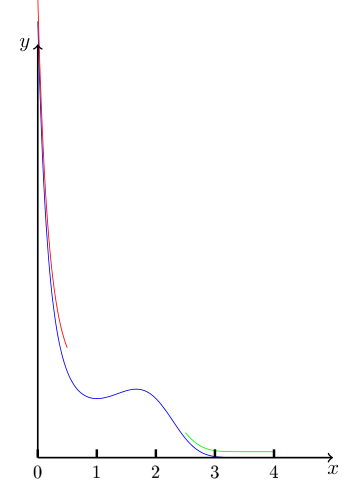

## Définition et exemples

**Rappel.** Dans le chapitre 1, on a défini l'intégrale de Riemann pour des fonctions à valeurs vectorielles bornées et sur un intervalle compact $I$.
Le but de ce chapitre est d'étendre la définition du chapitre 1 à de nouveaux cas, i.e. :

- au cas de fonctions qui ne sont pas bornées sur un intervalle compact ($\dfrac{1}{x}$ sur $[0, 1]$) ;
- au cas d'un intervalle non compact ($[1, +\infty[$).

**Notation.** Soit $\overline{\mathbb{R}} = \mathbb{R} \bigcup \{-\infty, +\infty\}$. Il est muni d'une relation d'ordre totale "$\leq$" obtenue en étendant la relation "$\leq$" sur $\mathbb{R}$ par

$$
x \leq +\infty \quad \forall x \in \overline{\mathbb{R}}
\qquad \text{et} \qquad
-\infty \leq x \quad \forall x \in \overline{\mathbb{R}}
$$

**Définition 6.1.** Soient $I \subseteq \overline{\mathbb{R}}$. Soit $f : I \to \mathbb{R}^n$ bornée et Riemann-intégrable sur chaque sous-intervalle compact de $I$.
L'intégrale de $f$ sur $I$ converge si pour un (et donc tout) choix de $x_0 \in I$, on a que

$$
\lim_{x \to \inf(I)} \int_x^{x_0} f(t)\,dt \in \mathbb{R}^n
\quad \text{et} \quad
\lim_{x \to \sup(I)} \int_{x_0}^{x} f(t)\,dt \in \mathbb{R}^n
$$

Dans ce cas, on appelle *intégrale (impropre) de $f$ sur $]a, b[$* la quantité

$$
\int_I f(t)\,dt = \lim_{x \to \inf(I)} \int_x^{x_0} f(t)\,dt + \lim_{x \to \sup(I)} \int_{x_0}^{x} f(t)\,dt \in \mathbb{R}^n
$$

et on dit que $f$ est *intégrable sur $I$* (ou qu'elle admet une intégrale impropre sur $I$).

**Exemple 6.1.**

$$
\int_0^1 \frac{1}{x}\,dx
$$

(c'est l'"aire" sous le graphe de $\dfrac{1}{x}$ entre 0 et 1)
Calculons l'intégrale (si elle existe).
La fonction $\dfrac{1}{x}$ est bornée et Riemann-intégrable (car continue) sur chaque intervalle fermé $[c, d]$ ($c > 0, d \leq 1$).
Soit $x_0 \in ]0, 1]$, par exemple $x_0 = 1$. On a que

$$
\begin{aligned}
\lim_{x \to 0^+} \int_x^1 \frac{1}{t}\,dt &= \lim_{x \to 0^+} [\ln t]_x^1 \\
&= \lim_{x \to 0^+} -\ln x = +\infty
\end{aligned}
$$

donc la fonction $\dfrac{1}{x}$ n'admet pas d'intégrale impropre sur $]0, 1]$ (l'aire sous la courbe est infinie).

**Remarque 6.1.** Dans la définition, il y a un "*pour un (et donc tout) choix de $x_0 \in I$*".
Supposons que

$$
\lim_{x \to \inf(I)} \int_x^{x_0} f(t)\,dt \in \mathbb{R}^n
\qquad \text{et} \qquad
\lim_{x \to \sup(I)} \int_{x_0}^{x} f(t)\,dt \in \mathbb{R}^n
$$

Alors pour un autre $\tilde{x}_0 \in I$ arbitraire,

$$
\lim_{x \to \inf(I)} \int_x^{\tilde{x}_0} f(t)\,dt \underbrace{=}_{\substack{[x, \tilde{x}_0] \subseteq I \\ \text{et } f \text{ est } \mathcal{R}\text{-intégrable}}} \lim_{x \to \inf(I)} \Bigg(\int_x^{x_0} f(t)\,dt + \underbrace{\int_{x_0}^{\tilde{x}_0} f(t)\,dt}_{\substack{\in \mathbb{R}^n \\ \text{car } f \ \mathcal{R}\text{-intégrable} \\ \text{sur } [x_0, \tilde{x}_0]}}\Bigg) = \int_{x_0}^{\tilde{x}_0} f(t)\,dt + \lim_{x \to \inf(I)} \left(\int_x^{x_0} f(t)\,dt\right)
$$

donc

$$
\lim_{x \to \inf(I)} \int_x^{\tilde{x}_0} f(t)\,dt \in \mathbb{R}^n
\qquad \text{et} \qquad
\lim_{x \to \sup(I)} \int_{\tilde{x}_0}^{x} f(t)\,dt \in \mathbb{R}^n
$$

Donc on conclut par arbitrarité.
D'autre part, si $\displaystyle\lim_{x \to \inf I} \int_x^{x_0} f(t)\,dt \notin \mathbb{R}^n$ pour un certain $x_0 \in I$, on a le même pour tout autre choix de $\tilde{x}_0 \in I$.

**Remarque 6.2.** La définition est compatible avec celle de l'intégrale de Riemann du chapitre 1. En effet, si $f : [a, b] \to \mathbb{R}^n$ est Riemann-intégrable, alors

$$
\lim_{x \to b^-} \int_a^x f(t)\,dt = \int_a^b f(t)\,dt
$$

car le théorème 4.5 dit que la fonction $\displaystyle\int_a^x f(t)\,dt : [a, b] \to \mathbb{R}^n$ est continue.

**Exemple 6.2.** Calculer

$$
\int_{]0, 1]} t \log(t)\,dt
$$

(on ne peut pas utiliser la théorie du chapitre A parce que $t \log(t)$ n'est pas définie en 0). Par définition (comme $t \log(t)$ est continue, donc Riemann-intégrable sur tout sous-intervalle compact de $]0, 1]$), on a

$$
\begin{aligned}
\int_{]0, 1]} f(t)\,dt &= \lim_{x \to 0^+} \int_x^1 f(t)\,dt \\
&= \lim_{x \to 0^+} \left(\int_x^1 t \log(t)\,dt\right) \\
&= \lim_{x \to 0^+} \left(-\frac{x^2}{2} \log(x) - \frac{1}{4}(1 - x^2)\right) = -\frac{1}{4}
\end{aligned}
$$

$$
\begin{aligned}
\int_x^1 t \log(t)\,dt &= \left[\frac{t^2}{2} \log(t)\right]_x^1 - \int_x^1 \frac{t^2}{2} \frac{1}{t}\,dt \\
&= -\frac{x^2}{2} \log(x) - \frac{1}{2} \left[\frac{t^2}{2}\right]_x^1 \\
&= -\frac{x^2}{2} \log(x) - \frac{1}{4}(1 - x^2) \\
&= -\frac{1}{4} + \frac{x^2}{4}(1 - 2\log(x))
\end{aligned}
$$

La fonction $f(t) = t \log(t)$ peut être prolongée par continuité en une fonction $g$ continue sur $[0, 1]$, $g(t) = \begin{cases} f(t) & t \neq 0 \\ 0 & = 0 \end{cases}$ et $\displaystyle\int_{]0, 1]} f(t)\,dt = \int_{]0, 1]} g(t)\,dt = \int_0^1 g(t)\,dt$.

**Exemple 6.3.** Calculer l'aire sous le graphe de la fonction $f(t) = \log(t)$ entre 0 et 1. La fonction $f(t) = \log(t)$ est continue, donc Riemann-intégrable sur chaque sous-intervalle compact de $]0, 1]$, alors $A = \displaystyle\int_{]0, 1]} \log(t)\,dt = \lim_{x \to 0^+} \int_x^1 \log(t)\,dt = \lim_{x \to 0^+} \int_x^1 \log(t)\,dt = \lim_{x \to 0^+} (x - 1 - x \log(x)) = -1$.

**Proposition 6.1.** *Soient $\alpha, \beta \in \mathbb{R}$, alors*

1. *l'intégrale impropre $\displaystyle\int_{[1, +\infty[} \frac{1}{t^\alpha}\,dt$ converge si et seulement si $\alpha > 1$, et dans ce cas $\displaystyle\int_1^{+\infty} \frac{1}{t^\alpha}\,dt = \frac{1}{\alpha - 1}$ ;*
2. *l'intégrale impropre $\displaystyle\int_{]0, 1]} \frac{1}{t^\beta}\,dt$ converge si et seulement si $\beta < 1$, et dans ce cas $\displaystyle\int_0^1 \frac{1}{t^\beta}\,dt = \frac{1}{1 - \beta}$.*

*Démonstration.*

1. La fonction $\dfrac{1}{t^\alpha}$ est continue, donc bornée et Riemann-intégrable sur tout sous-intervalle compact de $[1, +\infty[$. Donc

   $$
   \begin{aligned}
   \int_{[1, +\infty[} \frac{1}{t^\alpha}\,dt &= \lim_{x \to +\infty} \int_1^x \frac{1}{t^\alpha}\,dt \\
   &= \lim_{x \to +\infty} \frac{x^{1-\alpha} - 1}{1 - \alpha}
   \end{aligned}
   $$

   mais si $\alpha \neq 1$

   $$
   \begin{aligned}
   \int_1^x \frac{1}{t^\alpha}\,dt &= \left[\frac{t^{-\alpha+1}}{1 - \alpha}\right]_1^x \\
   &= \frac{x^{1-\alpha} - 1}{1 - \alpha}
   \end{aligned}
   $$

   et $\dfrac{x^{1-\alpha} - 1}{1 - \alpha}$ converge lorsque $x \to +\infty$ si et seulement si $\alpha > 1$.
2. Si $\beta = 1$, $\displaystyle\int_{]0, 1]} \frac{1}{t}\,dt = \lim_{x \to 0^+} \int_x^1 \frac{1}{t}\,dt = \lim_{x \to 0^+} (-\log(x))$.

**Remarque 6.3.**

1. L'intégrale impropre de $\dfrac{1}{t}$ n'existe ni sur $]0, 1]$ ni sur $[1, +\infty[$.
2. Pour tout $\alpha \in \mathbb{R}$, $\displaystyle\int_{]0, +\infty[} \frac{1}{t^\alpha}\,dt$ n'existe pas finie.

**Exemple 6.4.** Calculer

$$
\int_{-\infty}^{+\infty} \frac{t}{1 + t^2}\,dt
$$

Il faut vérifier pour $x_0 = 0$

$$
\begin{cases} \displaystyle\lim_{x \to +\infty} \int_0^x f(t)\,dt \in \mathbb{R} \\[8pt] \displaystyle\lim_{x \to -\infty} \int_x^0 f(t)\,dt \in \mathbb{R} \end{cases}
$$

Il suffit de vérifier la première car $\displaystyle\int_0^x f(t)\,dt = -\int_0^{-x} -f(u)\,du = -\int_{-x}^0 f(u)\,du$.

## Propriétés de l'intégrale impropre

Par "intégrale de $\mathbb{R}$", on voudra dire un ensemble $]a, b[$ ou $[a, b[$ ou $[a, b]$ avec $a, b \in \overline{\mathbb{R}}$ et $a < b$.

**Proposition 7.1.** *Soit $I \in \overline{\mathbb{R}}$ un intervalle et soient $f, g : I \to \mathbb{R}^\kappa$ deux fonctions intégrables sur $I$, $\lambda \in \mathbb{R}$ ; alors*

- *(linéarité) $\lambda f + g$ est intégrable sur $I$ et*

  $$
  \int_I (\lambda f + g)(t)\,dt = \lambda \int_I f(t)\,dt + \int_I g(t)\,dt
  $$

- *(additivité) soit $I = ]a, b[$ ; si $c \in I$, alors*

  $$
  \int_{]a, b[} f(t)\,dt = \int_{]a, c]} f(t)\,dt + \int_{[c, b[} f(t)\,dt
  $$

*Démonstration.*

- $f$ et $g$ sont Riemann-intégrables sur chaque sous-intervalle $[x_1, x_2]$ compact de $I$, donc $\lambda f + g$ l'est aussi (d'après le chapitre A) et par additivité

  $$
  \int_{x_1}^{x_2} (\lambda f + g)(t)\,dt = \lambda \int_{x_1}^{x_2} f(t)\,dt + \int_{x_1}^{x_2} g(t)\,dt
  $$

  Soit $x_0 \in I$, alors pour tout $x \in I$ on a

  $$
  \lim_{x \to \sup(I)} \int_{x_0}^{x} (\lambda f + g)(t)\,dt = \lim_{x \to \sup(I)} \left(\lambda \int_{x_0}^{x} f(t)\,dt + \int_{x_0}^{x} g(t)\,dt\right)
  $$

  Les deux intégrales admettent une limite pour $x \to \sup(f)$ (car $f$ est intégrable sur $I$). Donc

  $$
  = \lambda \lim_{x \to \sup(I)} \int_{x_0}^{x} f(t)\,dt + \lim_{x \to \sup(I)} \int_{x_0}^{x} g(t)\,dt \in \mathbb{R}^n
  $$

  De la même façon pour la limite lorsque $x \to \inf(I)$ ; alors, par définition, $\lambda f + g$ est intégrable sur $I$ et

  $$
  \begin{aligned}
  \int_I (\lambda f + g)(t)\,dt &= \lim_{x \to \sup(I)} \int_{x_0}^{x} (\lambda f + g)(t)\,dt + \lim_{x \to \inf(I)} \int_{x}^{x_0} (\lambda f + g)(t)\,dt \\
  &= \lambda \lim_{x \to \sup(I)} \int_{x_0}^{x} f(t)\,dt + \lim_{x \to \sup(I)} \int_{x_0}^{x} g(t)\,dt + \lambda \lim_{x \to \inf(I)} \int_x^{x_0} f(t)\,dt + \lim_{x \to \inf(I)} \int_x^{x_0} g(t)\,dt \\
  &= \lambda \int_I f(t)\,dt + \int_I g(t)\,dt
  \end{aligned}
  $$

- On peut choisir $c$ dans la définition d'intégrale impropre pour obtenir

  $$
  \int_I f(t)\,dt = \lim_{x \to \inf(f)} \int_x^c f(t)\,dt + \lim_{x \to \sup(f)} \int_x^c f(t)\,dt
  $$

**Remarque 7.1.** La linéarité prouve que l'ensemble $\mathcal{J}(I, \mathbb{R}^n) = \{f : I \to \mathbb{R}^n : \text{intégrables sur } I\}$ est un $\mathbb{R}$-espace vectoriel (de dimension infinie).

**Proposition 7.2** (Théorème fondamental pour les intégrales impropres). *Soit $I \subseteq \overline{\mathbb{R}}$ un intervalle, soit $f$ une fonction continue par morceaux sur $I$, à valeurs dans $\mathbb{R}^n$, intégrable sur $I$. Si $F$ est une antidérivée de $f$ sur $I$, alors*

$$
\int_I f(t)\,dt = \lim_{x \to \sup(I)} F(x) - \lim_{x \to \inf(I)} F(x)
$$

*Démonstration.* Soit $x_0 \in I$

$$
\int_I f(t)\,dt = \lim_{x \to \sup(I)} \int_{x_0}^{x} f(t)\,dt + \lim_{x \to \inf(I)} \int_x^{x_0} f(t)\,dt = \cdots
$$

en appliquant le deuxième théorème fondamental du calcul intégral sur les intervalles compacts $[x_0, x]$ et $[x, x_0]$ ($F$ est une antidérivée de $f$ sur $I$, donc même sur ces intervalles).

$$
\begin{aligned}
\cdots &= \lim_{x \to \sup(I)} (F(x) - F(x_0)) + \lim_{x \to \inf(I)} (F(x_0) - F(x)) \\
&= \lim_{x \to \sup(I)} F(x) - \lim_{x \to \inf(I)} F(x)
\end{aligned}
$$

**Proposition 7.3.** *Soit $I \subseteq \overline{\mathbb{R}}$ un intervalle, et $f : I \to \mathbb{R}$ une fonction continue, positive, intégrable sur $I$ ; alors*

$$
\int_I f(t)\,dt = 0 \Leftrightarrow f = 0
$$

*Démonstration.* D'une part ($\Leftarrow$) : soit $x_0 \in I$, $\displaystyle\int_I f(t)\,dt = \lim_{x \to \inf(I)} \int_x^{x_0} f(t)\,dt + \lim_{x \to \sup(I)} \int_{x_0}^{x} f(t)\,dt = 0$. D'autre part ($\Rightarrow$), on sait que

$$
0 = \lim_{x \to \inf(I)} \int_x^{x_0} f(t)\,dt + \lim_{x \to \sup(I)} \int_{x_0}^{x} f(t)\,dt
$$

Mais $f$ est positive, donc si $\inf(I) \leq x \leq x_0$, alors $\displaystyle\int_x^{x_0} f(t)\,dt \geq 0$.
Et aussi $\displaystyle\lim_{x \to \inf(I)} \int_x^{x_0} f(t)\,dt \geq 0$ ; de même $\displaystyle\lim_{x \to \sup(I)} \int_{x_0}^{x} f(t)\,dt \geq 0$.
Alors on a $\displaystyle\lim_{x \to \sup(I)} \int_{x_0}^{x} f(t)\,dt = 0$ et $\displaystyle\lim_{x \to \inf(I)} \int_x^{x_0} f(t)\,dt = 0$.
De plus, la fonction $F_{x_0} : \begin{cases} [x_0, \sup I[ \to \mathbb{R} \\ x \mapsto \displaystyle\int_{x_0}^{x} f(t)\,dt \end{cases}$ a comme dérivée (par le théorème 4.5) $f$, qui est positive, donc $F_{x_0}$ est croissante sur $[x_0, \sup(I)[$ et $F_{x_0}(x) \geq 0 \ \forall x \in [x_0, \sup(I)[$ et $\displaystyle\lim_{x \to \sup(I)} F_{x_0}(x) = 0$, alors forcément $F_{x_0}(x) = 0$ $\forall x \in [x_0, \sup(I)[$, donc $\displaystyle\int_{x_0}^{x} f(t)\,dt = 0 \ \forall x \in [x_0, \sup(I)[$.
Ainsi, un résultat sur les intégrales des fonctions continues sur un compact donne que $f$ est équivalente à 0 sur $[x_0, x]$. Donc $f$ est équivalente à 0 sur $[x_0, \sup(I)]$. De la même manière, on prouve que $f \equiv 0$ sur $]\inf(f), x_0]$, donc $f \equiv 0$ sur $I$.

**Proposition 7.4** (Intégration par parties). *Soient $I \subseteq \overline{\mathbb{R}}$ un intervalle, $\phi : I \to \mathbb{R}$, $f : I \to \mathbb{R}^n$ deux fonctions continues de classe $C^1$ par morceaux sur $I$ et intégrables sur $I$. Soient $\tilde{\phi}'$ et $\tilde{f}'$ des extensions arbitraires de la dérivée de $\phi$ et $f$ sur $I$. Supposons aussi que*

- *$\displaystyle\lim_{x \to \sup(I)} \phi(x) f(x)$ existe dans $\mathbb{R}^n$ et $\displaystyle\lim_{x \to \inf(I)} \phi(x) f(x)$ existe dans $\mathbb{R}^n$ ;*
- *$\phi(t) \cdot \tilde{f}'(t)$ est intégrable sur $I$ ; alors $\tilde{\phi}'(t) f(t)$ est intégrable sur $I$*

$$
\int_I \tilde{\phi}' f(t)\,dt = \lim_{x \to \sup(I)} \phi(x) f(x) - \lim_{x \to \inf(I)} \phi(x) f(x) - \int_I \phi(t) \tilde{f}'(t)\,dt
$$

*Démonstration.* Soit $x_0 \in I$. On considère pour tout $x \in [x_0, \sup(I)[$

$$
\int_{x_0}^{x} \tilde{\phi}'(t) f(t)\,dt = [\phi f]_{x_0}^{x} - \int_{x_0}^{x} \phi(t) \tilde{f}'(t)\,dt = \phi(x) f(x) - \phi(x_0) f(x_0) - \int_{x_0}^{x} \phi(t) \tilde{f}'(t)\,dt
$$

Les hypothèses 1 et 2 assurent que la limite pour $x \to \sup(I)$ existe dans $\mathbb{R}^n$. De même pour $\displaystyle\lim_{x \to \inf(I)} \int_x^{x_0} \tilde{\phi}'(t) f(t)\,dt$.
L'énoncé alors MANQUE

### Intégrales impropres de fonctions numériques positives

#### Critère d'intégrabilité

**Théorème 7.1.** *Soit $f : I \to \mathbb{R}$ une fonction positive, Riemann-intégrable sur tout sous-intervalle compact de $I$. Alors $f$ est intégrable sur $I$ si et seulement si $\exists M > 0$ tel que $\displaystyle\int_a^b f(t)\,dt \leq M$ pour tout $[a, b] \subseteq I$.*

**Corollaire 7.1.** *Soit $f : I \to \mathbb{R}$ une fonction positive, Riemann-intégrable sur tout sous-intervalle compact de $I$, et supposons que $I$ est un intervalle borné. Si $f$ est bornée, alors elle est intégrable.*

*Démonstration.* Comme $f$ est bornée, il existe $C \in \mathbb{R}$ tel que

$$
0 \leq f(x) \leq C \quad \forall x \in I
$$

Pour tout sous-intervalle compact $[a, b]$ de $I$, on a alors que

$$
\int_a^b f(t)\,dt \underbrace{\leq}_{\text{monotonie}} \int_a^b C\,dt = C(b - a)
$$

Mais $[a, b] \subseteq I$, donc $b - a = \text{vol}([a, b]) \leq \text{vol}(I) \in \mathbb{R}$ car $I$ est borné. Donc $\forall [a, b]$ compact dans $I$

$$
\int_a^b f(t)\,dt \leq C \,\text{vol}(I) = M
$$

Donc, d'après le théorème 7.1, $f$ est intégrable sur $I$.

**Exemple 7.1.** La fonction $f(x) = |\sin(\log(x))|$ sur $]0, 1]$ est intégrable grâce au corollaire. En effet, $f$ est positive, Riemann-intégrable sur tout sous-intervalle compact de $]0, 1]$ (parce qu'elle est continue), $]0, 1]$ est borné et $f$ est bornée sur $]0, 1]$ car $\forall x \in ]0, 1]$, $f(x) \leq 1$.

**Remarque 7.2.** L'énoncé n'est pas vrai si $I$ n'est pas borné. Par exemple, la fonction constamment égale à 1 n'est pas intégrable sur $[0, +\infty[$, même si elle est bornée.

**Remarque 7.3.** Dans le corollaire, la réciproque est fausse. Par exemple, la fonction $\dfrac{1}{\sqrt{x}}$ est intégrable sur l'intervalle borné $]0, 1]$, mais elle n'est pas bornée.

**Corollaire 7.2.** *Soit $I \subseteq \mathbb{R}$ un intervalle, $f : I \to \mathbb{R}$ une fonction positive et continue par morceaux sur $I$. Soit $F : I \to \mathbb{R}$ une antidérivée de $f$ sur $I$ ; alors on a que $f$ est intégrable sur $I$ si et seulement si $F$ est bornée sur $I$.*

*Démonstration.* On a que $f$ est continue par morceaux sur $I$, donc elle est continue par morceaux sur tout sous-intervalle compact de $I$, donc $f$ est Riemann-intégrable sur tout sous-intervalle compact de $I$. On peut utiliser le théorème.
D'une part ($\Rightarrow$), supposons que $f$ est intégrable sur $I$ ; alors le théorème dit que $\exists M > 0$ tel que $\displaystyle\int_a^b f(t)\,dt < M \ \forall [a, b] \subseteq I$ compact. Choisissons $x_0 \in I$ ; le deuxième théorème fondamental du calcul intégral affirme que $\forall x \in I$, $\displaystyle\int_{x_0}^{x} f(t)\,dt = F(x) - F(x_0)$.
Et donc si $x > x_0$, on a

$$
F(x) = F(x_0) + \int_{x_0}^{x} f(t)\,dt < F(x_0) + M
$$

et $F(x) = F(x_0) + \displaystyle\int_{x_0}^{x} f(t)\,dt \geq F_{x_0}$ car $f$ est positive et $x_0 < x$. De même, $F(x_0) - M < F(x) \leq F(x_0) \ \forall x \in I, x < x_0$ ; alors $\forall x \in I$ on a

$$
F(x_0) - M < F(x) < F(x_0) + M
$$

donc $F$ est bornée sur $I$.
D'autre part ($\Leftarrow$), $F$ est bornée par $M$ sur $I$ ; pour tout sous-intervalle compact $[a, b]$ de $I$, le deuxième théorème du calcul intégral donne

$$
\int_a^b f(t)\,dt = F(b) - F(a) \leq M + M = 2M
$$

alors le théorème implique que $f$ est intégrable sur $I$.

**Exemple 7.2.** Soit $f : \mathbb{R} \to \mathbb{R}$, $f(x) = \dfrac{1}{1 + x^2}$.

![Graphe de 1/(1 + x²) sur [-2, 2], aire sous la courbe grisée](./img/cours-p36-1.png)

La fonction $f$ est intégrable sur $\mathbb{R}$ d'après le corollaire, car une antidérivée de $f$ est $F : \mathbb{R} \to \mathbb{R}$, $F(x) = \arctan(x)$, qui est bornée sur $\mathbb{R}$. Par le premier théorème fondamental du calcul intégral généralisé, on a que

$$
\begin{aligned}
\int_{\mathbb{R}} f(t)\,dt &= \lim_{x \to +\infty} F(x) - \lim_{x \to -\infty} F(x) \\
&= \pi/2 - (-\pi/2) \\
&= \pi
\end{aligned}
$$

Cela peut nous servir à calculer la valeur de $\pi$.

#### Comparaisons de fonctions positives

Pour des fonctions générales, on ne connaît pas de primitive ; il peut donc être plus difficile de déterminer si elles sont intégrables ou pas sur un intervalle $I$ quelconque. On peut par contre déduire l'intégrabilité d'une fonction positive en la comparant avec d'autres fonctions.

**Proposition 7.5.** *Soit $I \subseteq \mathbb{R}$ un intervalle, soient $f, g : I \to \mathbb{R}$ deux fonctions positives sur $I$ et $f, g$*

*Démonstration.* Comme $g$ est intégrable sur $I$, le théorème du cours affirme que $\exists M > 0$ tel que $\displaystyle\int_a^b g(t)\,dt < M$ pour tout sous-intervalle compact $[a, b]$ de $I$. La monotonie de l'intégrale de Riemann sur des intervalles compacts donne $\displaystyle\int_a^b f(t)\,dt \leq \int_a^b g(t)\,dt < M$, alors le théorème implique que $f$ est intégrable sur $I$.
Soit $x_0 \in I$ ; on a

$$
\int_I f(t)\,dt = \lim_{x \to \inf(I)} \int_x^{x_0} f(t)\,dt + \lim_{x \to \sup(I)} \int_{x_0}^{x} f(t)\,dt \tag{5}
$$

Pour tout $x \in I$, $x \leq x_0$, on a

$$
\int_x^{x_0} f(t)\,dt \leq \int_x^{x_0} g(t)\,dt
$$

et les limites pour $x \to \inf(I)$ existent des deux côtés, et la limite préserve les inégalités

$$
\lim_{x \to \inf(I)} \int_x^{x_0} f(t)\,dt \leq \lim_{x \to \inf(I)} \int_x^{x_0} g(t)\,dt
$$

De même

$$
\lim_{x \to \sup(I)} \int_{x_0}^{x} f(t)\,dt \leq \lim_{x \to \sup(I)} \int_{x_0}^{x} g(t)\,dt
$$

Donc, dans l'équation 5, on obtient $\displaystyle\int_I f(t)\,dt \leq \int_I g(t)\,dt$. Pour le deuxième point, on remarque qu'il est l'affirmation contraposée de la première.

**Corollaire 7.3.** *Soit $I \subseteq \mathbb{R}$ un intervalle, $f : I \to \mathbb{R}$ positive et Riemann-intégrable sur tout sous-intervalle compact de $I$. Supposons que $\exists a, b \in I, a < b$ avec*

- *$\forall x \in I, x \leq a$, $f(x) \leq c_1 g_1(x)$ avec $c_1 \in \mathbb{R}$ et $g_1 : \{x \in I, x \leq a\} \to \mathbb{R}$ intégrable sur $\{x \in I : x \geq a\} = I_1$ ;*
- *$\forall x \in I, x \geq b$, $f(x) \leq c_2 g_2(x)$ avec $c_2 \in \mathbb{R}$ et $g_2 = \{x \in I, x \geq b\} = I_2 \to \mathbb{R}$ intégrable sur $I_2$ ; alors $f$ est intégrable sur $I$ et*

$$
\int_I f(t)\,dt \leq \int_a^b f(t)\,dt + c_1 \int_{]\inf(I), a]} g_1(t)\,dt + c_2 \int_{[b, \sup(I)[} g_2(t)\,dt
$$

*Démonstration.* D'après la linéarité, $c_1 g_1$ est intégrable sur $I_1$, donc la proposition implique que $f$ est intégrable sur $I_1$ et $\displaystyle\int_{I_1} f(t)\,dt \leq \int_{I_1} c_2 g_2(t)\,dt = \int_{I_1} g_1(t)\,dt$ ; de même, $f$ est intégrable sur $I_2$

$$
\int_{I_1} f(t)\,dt \leq c \int_{I_2} g(t)\,dt
$$

Donc

$$
\lim_{x \to \inf(I)} \int_x^{x_0} f(t)\,dt = \lim_{x \to \inf(I)} \int_x^{x_0} f(t)\,dt + \int_a^b f(t)\,dt
$$

alors $f$ est intégrable sur $I$.

$$
\begin{aligned}
\int_I f(t)\,dt &= \lim_{x \to \inf(I)} \int_x^b f(t)\,dt + \lim_{x \to \sup(I)} \int_b^x f(t)\,dt \\
&= \int_a^b f(t)\,dt + \lim_{x \to \inf(I)} \int_x^a f(t)\,dt + \lim_{x \to \sup(I)} \int_b^x f(t)\,dt \\
&= \int_a^b f(t)\,dt + \int_{I_1} f(t)\,dt + \int_{I_2} f(t)\,dt \\
&\leq \int_a^b f(t)\,dt + c_1 \int_{I_1} g_1(t)\,dt + c_2 \int_{I_2} g_2(t)\,dt
\end{aligned}
$$

**Exemple 7.3** (Exemple 1). $f : [0, +\infty[ \to \mathbb{R}$, $f(t) = \dfrac{e^{-t}}{1 + t^2}$.
Sur $[0, +\infty[$, on a $e^{-t} \leq 1$, donc $f(t) = \dfrac{e^{-t}}{1 + t^2} \leq \dfrac{1}{1 + t^2}$. Mais $f$ et $\dfrac{1}{1 + t^2}$ sont deux fonctions positives qui satisfont les hypothèses de la proposition, donc $f$ est intégrable et

$$
\int_{[0, +\infty[} f(t)\,dt \leq \int_{[0, +\infty[} \frac{1}{1 + t^2}\,dt = \lim_{x \to +\infty} \arctan(x) - \lim_{x \to 0} \arctan(x)
$$

Méthode alternative : sur $[0, +\infty[$, $1 + t^2 \geq 1$, donc $\dfrac{1}{1 + t^2} \leq 1$. Donc $f(t) \leq e^{-t} \ \forall t \in [0, +\infty[$ ; comme avant, comme $e^{-t}$ est intégrable sur $[0, +\infty[$, alors $f$ l'est aussi. D'après la proposition, on a

$$
\int_{[0, +\infty[} f(t)\,dt \leq \int_{[0, +\infty[} e^{-t}\,dt = \lim_{x \to +\infty} (-e^{-t}) - \lim_{x \to 0} (-e^{-t}) = 1
$$

**Exemple 7.4** (Exemple 2). $f : ]0, +\infty[ \to \mathbb{R}$ où $f(t) = \dfrac{\arctan(t)}{t^{3/2}}$ ; on utilisera le corollaire en prenant $a = b = 1$.
La fonction est positive sur $]0, +\infty[$ car $t \geq 0 \Rightarrow \arctan(t) \geq 0$, parce que $\arctan$ est monotone croissante (sa dérivée est positive) et $t^{3/2}$ est positive à $t > 0$. Si $t \in ]0, 1]$

$$
f(t) = \frac{\arctan(t)}{t^{3/2}} = \frac{t + O_{t \to 0}(t^2)}{t^{3/2}} = \frac{1}{\sqrt{t}} + O_{t \to 0}(\sqrt{t})
$$

$f(t) \leq \dfrac{1}{\sqrt{t}} + c\sqrt{t}$ sur $]0, 1]$.
Mais $\dfrac{1}{\sqrt{t}} + c\sqrt{t}$ est intégrable sur $]0, 1]$ par linéarité, et $\dfrac{1}{\sqrt{t}}$ est intégrable, donc $c\sqrt{t}$ est intégrable.

#### Comparaison à une série

On utilise le théorème que l'on a développé pour montrer un critère de convergence des séries.

**Théorème 7.2.** *Soit $f : [0, +\infty[ \to \mathbb{R}$ une fonction positive décroissante et telle que $f$ est Riemann-intégrable sur tout sous-intervalle compact de $[0, +\infty[$ ; alors $\displaystyle\sum_{n=0}^{\infty} f(n)$ converge si et seulement si $f$ est intégrable sur $[0, +\infty[$.*

*Pour DST.* On remarque d'abord que $\forall n \in \mathbb{N}$

$$
f(n + 1) \leq f(x) \leq f(n)
$$

$x \in [n, n + 1]$, car $f$ est décroissante. D'après la monotonie de l'intégrale de Riemann, on a alors que

$$
\int_n^{n+1} f(n + 1)\,dt \leq \int_n^{n+1} f(t)\,dt \leq \int_n^{n+1} f(n)\,dt
$$

$$
f(n + 1) \leq \int_n^{n+1} f(t)\,dt \leq f(n) \tag{6}
$$

D'une part ($\Rightarrow$), supposons que la série converge : $\displaystyle\sum_{n=0}^{\infty} f(n) = M \in \mathbb{R}$. Pour tout sous-intervalle compact $[a, b]$ de $[0, +\infty[$, on a que $\exists m_1, m_2 \in \mathbb{N}$ tels que $[a, b] \subseteq [m_1, m_2]$

$$
\begin{aligned}
\int_a^b f(t)\,dt &= \int_{m_1}^{m_2} f(t)\,dt - \int_{m_1}^{a} f(t)\,dt - \int_b^{m_2} f(t)\,dt \leq \int_{m_1}^{m_2} f(t)\,dt \\
&= \sum_{n=m_1}^{m_2 - 1} \int_n^{n+1} f(t)\,dt \leq \sum_{n=m_1}^{m_2 - 1} f(n) \leq \sum_{n=0}^{\infty} f(n) = M
\end{aligned}
$$

D'après le théorème de caractérisation de l'intégrabilité des fonctions positives, $f$ est intégrable sur $[0, +\infty[$.
D'autre part ($\Leftarrow$), supposons maintenant que $f$ est intégrable ; alors $\exists M \geq 0$ tel que $\forall [a, b]$ sous-intervalle compact de $[0, +\infty[$

$$
\int_a^b f(t)\,dt \leq M
$$

La suite $\left(\displaystyle\sum_{n=0}^{N} f(n)\right)_{N \in \mathbb{N}}$ est

- croissante : en effet, $\displaystyle\sum_{n=0}^{N+1} f(n) - \sum_{n=0}^{N} f(n) = f(N + 1) > 0$ car $f$ est positive ;
- majorée : $\displaystyle\sum_{n=0}^{N} f(n) = f(0) + \sum_{n=1}^{N} f(n) \leq f(0) + \sum_{n=1}^{N} \int_{n-1}^{n} f(t)\,dt = f(0) + \int_0^N f(t)\,dt \leq f(0) + M$

$$
f(n + 1) \leq \int_n^{n+1} f(t)\,dt \leq f(n) \tag{7}
$$

Le théorème de convergence monotone affirme alors que la suite $\left(\displaystyle\sum_{n=0}^{N} f(n)\right)_{n \in \mathbb{N}}$ converge, donc la série converge.

**Théorème 7.3.** *Soit $f : [0, +\infty[ \to \mathbb{R}$ positive, décroissante et Riemann-intégrable sur tout sous-intervalle compact de $[0, +\infty[$ ; alors $\displaystyle\sum_{n=0}^{\infty} f(n)$ converge si et seulement si $f$ est intégrable sur $[0, +\infty[$.*

**Exemple 7.5.** $\alpha \in \mathbb{R}, \alpha > 0$. Pour quelles valeurs de $\alpha \in \mathbb{R}_{\geq 0}$ la série $\displaystyle\sum_{n=1}^{\infty} \frac{1}{n^\alpha}$ converge-t-elle ?
On peut remarquer que $\displaystyle\sum_{n=1}^{+\infty} \frac{1}{n^\alpha} = \sum_{n=0}^{\infty} \frac{1}{(n + 1)^\alpha}$ et appelons $f_\alpha : \begin{cases} [0, +\infty[ \to \mathbb{R} \\ f_\alpha(x) = \dfrac{1}{(x + 1)^\alpha} \end{cases}$

- sur $[0, +\infty[$, $f_\alpha(x) > 0$ ;
- si $x_1, x_2 \in [0, +\infty[$, $x_1 \leq x_2 \Rightarrow x_1 + 1 \leq x_2 + 1 \Rightarrow (x_1 + 1)^\alpha \leq (x_2 + 1)^\alpha \Rightarrow \dfrac{1}{(x_2 + 1)^\alpha} \leq \dfrac{1}{(x_1 + 1)^\alpha} \Rightarrow f_\alpha(x_2) \leq f_\alpha(x_1)$, donc $f_\alpha$ est décroissante.

$f_\alpha$ est continue, donc intégrable sur tout sous-intervalle compact. On peut alors appliquer le théorème : la série converge si et seulement si $f_\alpha$ est intégrable sur $[0, +\infty[$. On remarque que $f_\alpha(x) \sim \dfrac{1}{x^\alpha}$, donc $f_\alpha$ est intégrable si et seulement si $\alpha > 1$.

**Remarque 7.4.** On a donc $\displaystyle\sum_{n=1}^{+\infty} \frac{1}{n^2}$ qui converge vers un nombre réel. Lequel ?

**Remarque 7.5.** On peut aussi définir la série $\tilde{\zeta}(s) = \displaystyle\sum_{n=1}^{\infty} \frac{1}{n^s}$ avec $s \in \mathbb{C}$ et $\text{Re}(s) > 1$ (la série converge).
Il existe une fonction méromorphe $\zeta$ définie sur $\mathbb{C}$ telle qu'elle coïncide avec $\tilde{\zeta}$ sur $\{\text{Re}(s) > 1\}$.

### Normes et intégrales impropres

**Proposition 7.6.** $\displaystyle\lim_{x \to a} f(x) = \underline{l} \in \mathbb{R}^n \Leftrightarrow \lim_{x \to a} f_i(x) = l_i \in \mathbb{R}$

*Démonstration.* $\displaystyle\lim_{x \to \infty} f(x) = (l_1, \cdots, l_n)$ si et seulement si $\displaystyle\lim_{x \to a} \|f(x) - (l_1, \cdots, l_n)\|_\infty = 0$

$$
\lim_{x \to a} \max |f_i(x) - l_i| = 0 \tag{8}
$$

Pour tout $i = 1, \cdots, n$, on a

$$
0 \leq |f_i(x) - l_i| \leq \max |f_i(x) - l_i|
$$

donc si l'équation 8 est vraie, $\displaystyle\lim_{x \to a} \|f_i(x) - l_i\| = 0$, donc $\displaystyle\lim_{x \to a} f(x) = l_i$. Inversement, si $\displaystyle\lim_{x \to a} f_i(x) = l_i$ pour tout $i$, alors $\displaystyle\lim_{x \to a} |f_i(x) - l_i| = 0$.

**Lemme 7.1.** *Soit $I \subseteq \mathbb{R}$ un intervalle et $f : I \to \mathbb{R}^n$ une fonction Riemann-intégrable sur tout intervalle compact de $I$ ; alors $f$ est intégrable sur $I$ si et seulement si toutes les composantes de $f$ sont intégrables sur $I$.*

*Démonstration.* Soit $f$ intégrable sur $I$ si et seulement si $\displaystyle\lim_{x \to \sup(I)} \int_{x_0}^{x} f(t)\,dt$ et $\displaystyle\lim_{x \to \inf(I)} \int_x^{x_0} f(t)\,dt$ existent dans $\mathbb{R}^n$.
Mais $\displaystyle\lim_{x \to a} f(x) = \underline{l} \in \mathbb{R}^n \Leftrightarrow \lim_{x \to a} f_i(x) = l_i \in \mathbb{R}$.
D'après une proposition du cours, $\displaystyle\int_{x_0}^{x} f(t)\,dt = \left(\int_{x_0}^{x} f_1(t)\,dt, \cdots, \int_{x_0}^{x} f_n(t)\,dt\right)$.
Donc si $f$ est intégrable sur $I \Leftrightarrow \displaystyle\lim_{x \to \sup(I)} \int_{x_0}^{x} f_i(t)\,dt$ et $\displaystyle\lim_{x \to \inf(I)} \int_x^{x_0} f_i(t)\,dt$ existent dans $\mathbb{R}$ pour tout $i = 1, \cdots, n$, si et seulement si $f_i$ est intégrable sur $I$ pour tout $i = 1, \cdots, n$.
Inversement, si $\displaystyle\lim_{x \to a} f_i(x) = l_i \ \forall i$, alors $\displaystyle\lim_{x \to a} |f_i(x) - l_i| = 0 \Leftrightarrow 0 \leq \max |f_i(x) - l_i| \leq \sum_i |f_i(x) - l_i| \Leftrightarrow 0 \leq \lim_{x \to a} \max |f_i(x) - l_i| \leq \sum_i \lim_{x \to a} |f_i(x) - l_i| = 0$.

**Proposition 7.7.** *Soit $I$ un intervalle réel, $f : I \to \mathbb{R}^n$ est Riemann-intégrable et soit $\|\cdot\|$ une norme de $\mathbb{R}^n$. Alors, si $\|f\|$ est intégrable sur $I$, alors $f$ est intégrable sur $I$*

$$
\left\|\int_I f(t)\,dt\right\| \leq \int_I \|f(t)\|\,dt
$$

*Démonstration.* Par équivalence des normes, $\exists A \in \mathbb{R}_{>0}$ tel que $\|x\|_\infty \leq A \|$ MANQUE $Z |f_i|$ qui est intégrable sur $I$ ; $f_i + |f_i|$ est intégrable sur $I$, mais $f_i = (f_i + |f_i|) - |f_i|$ et donc $f_i$ est intégrable par linéarité de l'intégrabilité.
Le lemme implique alors que $f$ est intégrable sur $I$, toutes ses coordonnées le sont.
Fixons $x_0 \in I$. Soit $\varepsilon > 0$ ; alors $\exists x_1, x_2 \in I$ tels que

$$
\left\|\int_x^{x_0} f(t)\,dt - \lim_{x \to \inf(I)} \int_{x_1}^{x_0} f(t)\,dt\right\| < \frac{\epsilon}{2}
$$

$$
\left\|\int_{x_0}^{x_2} - \lim_{x \to \sup(I)} \int_{x_0}^{x} f(t)\,dt\right\| < \frac{\varepsilon}{2}
$$

Donc $\forall y_1, y_2 \in I$, $\inf(I) \leq y_1 \leq x_1$ et $x_2 \leq y_2 \leq \sup(I)$.

$$
\begin{aligned}
\left\|\int_I f(t)\,dt\right\| &= \left\|\lim_{x \to \inf(I)} \int_x^{x_0} f(t)\,dt + \lim_{x \to \sup(I)} \int_{x_0}^{x} f(t)\,dt\right\| \\
&= \left\|\lim_{x \to \inf(I)} \int_x^{x_0} f(t)\,dt - \int_{y_1}^{x_0} f(t)\,dt + \int_{y_1}^{x_0} f(t)\,dt + \lim_{x \to \sup(I)} \int_{x_0}^{x} f(t)\,dt - \int_{x_0}^{y_2} f(t)\,dt + \int_{x_0}^{y_2}\right\| \\
&\leq \epsilon + \left\|\int_{y_1}^{x_0} f(t)\,dt\right\| + \left\|\int_{x_0}^{y_2} f(t)\,dt\right\| \\
&\leq \epsilon + \int_{y_1}^{x_0} \|f(t)\|\,dt + \int_{x_0}^{y_2} \|f(t)\|\,dt \\
&\leq \epsilon + \lim_{x \to \inf(I)} \int_x^{x_0} \|f(t)\|\,dt + \lim_{y \to \sup(I)} \int_{x_0}^{y} \|f(t)\|\,dt \\
&= \epsilon + \int_I \|f(t)\|\,dt
\end{aligned}
$$

**Exemple 7.6.** $f(x) = \sin(\log(x))$ est intégrable sur $]0, 1]$ car on a vu que $|\sin(\log(x))|$ est intégrable sur $]0, 1]$. Le théorème qu'on vient de prouver dit que si MANQUE

**Remarque 7.6.** La réciproque dans le théorème précédent est fausse ; voir par exemple

$$
\begin{cases} f : [\pi, +\infty[ \to \mathbb{R} \\ f(t) = \dfrac{\sin(t)}{t} \end{cases}
$$

La fonction $f$ est intégrable sur $[\pi, +\infty[$, mais $|f|$ ne l'est pas.
Si $f$ est intégrable sur $[\pi, +\infty[$

$$
\int_\pi^x f(t)\,dt = \int_\pi^x \frac{\sin(t)}{t}\,dt = \left[-\frac{\cos(t)}{t}\right]_\pi^x - \int_\pi^x \frac{\cos(t)}{t^2}\,dt = \frac{-\cos(x)}{x} - \frac{1}{\pi} - \int_\pi^x \frac{\cos(t)}{t^2}\,dt
$$

Mais $\left|\dfrac{\cos(t)}{t^2}\right| \leq \dfrac{1}{t^2}$, qui est intégrable sur $[\pi, +\infty[$, donc intégrable sur $[\pi, +\infty[$ ; donc par comparaison et par le théorème, $\dfrac{\cos(t)}{t^2}$ est intégrable sur $[\pi, +\infty[$, donc $\displaystyle\lim_{x \to \infty} \int_\pi^x \frac{\cos(t)}{t^2}\,dt$ existe, finie.
Alors $\displaystyle\int_\pi^x f(t)\,dt$ admet une limite finie quand $x \to \infty$, donc elle est intégrable sur $[0, +\infty[$. En effet, pour $n \in \mathbb{N}$

$$
\begin{aligned}
\int_\pi^{n\pi} |f(t)|\,dt &= \sum_{k=1}^{n-1} \int_{k\pi}^{(k+1)\pi} f(t)\,dt \\
&= \sum_{k=1}^{n-1} \int_{k\pi}^{(k+1)\pi} \frac{|\sin(t)|}{t}\,dt \\
&= \sum_{k=1}^{n-1} \int_{k\pi}^{(k+1)\pi} \frac{(-1)^k \sin(t)}{t}\,dt \\
&\geq \sum_{k=1}^{n-1} \frac{(-1)^k}{(k + 1)\pi} \int_{k\pi}^{(k+1)\pi} \sin(t)\,dt \\
&\geq \sum_{k=1}^{n-1} \frac{(-1)^k}{(k + 1)\pi} (\cos(k\pi) - \cos((k + 1)\pi)) \\
&= \frac{2}{\pi} \sum_{k=1}^{n-1} \frac{1}{1 + k} \to \infty
\end{aligned}
$$

Donc $\forall M > 0$, il existe un intervalle compact $[\pi, n\pi]$ tel que $\displaystyle\int_\pi^{n\pi} |f(t)|\,dt > M$. Donc, par caractérisation de l'intégrabilité d'une fonction positive, $|f|$ n'est pas intégrable sur $[\pi, +\infty[$.

## Limites et intégrales

Le but de cette section est de savoir si, étant donné une suite de fonctions, on a

$$
\lim_{n \to \infty} \int_I f_n(t)\,dt = \int_I \lim_{n \to +\infty} f_n(t)\,dt
$$

**Exemple 8.1.** Soit, pour tout $n \in \mathbb{N}$, $f_n(t) = \begin{cases} 1 & \text{sur } [n, n + 1] \\ 0 & \text{autrement} \end{cases}$. Pour tout $t \in [0, +\infty[$, $\displaystyle\lim_{n \to +\infty} f_n = 0$, donc $\displaystyle\lim_{n \to \infty} f_n \equiv 0$. On a donc

$$
\lim_{n \to \infty} \int_{[0, +\infty[} f_n(t)\,dt = \lim_{n \to \infty} 1 = 1 \neq 0 = \int_{[0, +\infty[} \lim_{N \to \infty} f_n(t)\,dt
$$

L'égalité n'est pas toujours vraie. Par contre, on a un théorème nous donnant des conditions pour pouvoir conclure.

**Théorème 8.1** (Convergence dominée de Lebesgue). *Soient $I$ un intervalle réel, $f, f_l : I \to \mathbb{R}^n$ des fonctions Riemann-intégrables sur chaque sous-intervalle compact de $I$, $\forall l \in \mathbb{N}$.
On suppose qu'il existe une fonction $g : I \to \mathbb{R}$ intégrable sur $I$ telle que $\|f_l(t)\| \leq g(t) \ \forall t \in I$ (avec $\|\cdot\|$ une norme arbitraire de $\mathbb{R}^n$). Supposons que $\forall t \in I$, $\displaystyle\lim_{l \to \infty} f_l(t) = f(t)$. Alors les fonctions $f_l$ et $f$ sont intégrables sur $I$ et on a*

$$
\lim_{l \to \infty} \int_I f_l(t)\,dt = \int_I f(t)\,dt
$$
