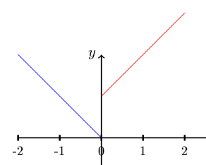
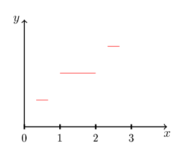

## Les théorèmes fondamentaux du calcul intégral

On va explorer la relation entre la dérivée et l'intégrale de Riemann d'une fonction vectorielle.

**But.** Prouver que

$$
\int_a^b f(t)\,dt = [F]_a^b
$$

**Définition 4.11.** Soit $f : [a, b] \to \mathbb{R}^n$ une fonction vectorielle. Une **antidérivée** de $f$ est une fonction $F : [a, b] \to \mathbb{R}^n$ continue et telle que pour tout point $x \in [a, b]$ où $f$ est continue, on a $F$ dérivable en $x$ et $F'(x) = f(x)$.

**Exemple 4.5.** Soit $f : \begin{cases} [-2, 2] \to \mathbb{R} \\ \chi_{]0, 2]} - \chi_{[-2, 0[} \end{cases}$, alors :

$$
f(x) = \begin{cases} 1 & \text{si } x \in ]0, 2] \\ 0 & \text{si } x = 0 \\ -1 & \text{si } x \in [-2, 0[ \end{cases}
$$

![Graphe de f, égale à -1 sur [-2, 0[ et à 1 sur ]0, 2]](./img/cours-p20-1.png)

Une antidérivée de $f$ est

$$
F : \begin{cases} [-2, 2] \to \mathbb{R} \\ x \mapsto |x| \end{cases}
$$

![Graphe de la fonction valeur absolue sur [-2, 2]](./img/cours-p20-2.png)

Cependant la fonction $[-2, 2] \to \mathbb{R}$ :

$$
G(x) = \begin{cases} x + 1 & \text{si } x \in ]0, 2] \\ -x & \text{si } x \in [-2, 0] \end{cases}
$$

n'est pas une antidérivée de $f$ car $G$ n'est pas continue.

**Remarque 4.4.** Si $F$ est une antidérivée de $f$ et $\underline{c} \in \mathbb{R}^n$, alors $F + \underline{c}$ est aussi une antidérivée de $f$, parce que $F + \underline{c}$ est continue (car somme de fonctions continues) et $\forall x$ où $f$ est continue, $F + \underline{c}$ est dérivable en $x$ et $(F + \underline{c})'(x) = F'(x) + 0 = f(x)$.

**Remarque 4.5.** Si $f \in \mathcal{CM}^0([a, b], \mathbb{R}^n)$ et $F$ est une antidérivée de $f$, alors $F \in \mathcal{CM}^1([a, b], \mathbb{R}^n)$. En effet, $\exists a = a_0 < a_1 < \cdots < a_r = b$ telle que $f_{|]a_i, a_{i+1}[}$ est continue $\forall i \in \{0, \cdots, r - 1\}$, alors $\displaystyle\lim_{x \to a_i^+} f(x)$ et $\displaystyle\lim_{x \to a_{i+1}^-} f(x)$ existent et sont finies. Mais alors $F$ est continue, $F_{|]a_i, a_{i+1}[}$ est dérivable et de dérivée continue (d'après la définition d'antidérivée), $(F_{|]a_i, a_{i+1}[})' = f_{|]a_i, a_{i+1}[} \ \forall i \in \{0, \cdots, r - 1\}$ ; de plus

$$
\begin{cases} \displaystyle\lim_{x \to a_i^+} F'(x) = \lim_{x \to a_i^+} f(x) \\[6pt] \displaystyle\lim_{x \to a_{i+1}^-} F'(x) = \lim_{x \to a_{i+1}^-} f(x) \end{cases}
$$

existent, finies, $\forall i \in \{0, \cdots, r - 1\}$.

Est-ce que l'on peut toujours trouver des antidérivées ?

**Théorème 4.5** (Premier théorème fondamental du calcul intégral). *Soit $f : [a, b] \to \mathbb{R}^n$ une fonction Riemann-intégrable sur $[a, b]$. La fonction*

$$
F_a : \begin{cases} [a, b] \to \mathbb{R}^n \\ x \mapsto \displaystyle\int_a^x f(t)\,dt \end{cases}
$$

*est une antidérivée de $f$ qui s'annule en $x = a$.*

*Démonstration.* Prouvons que $F_a$ est continue

$$
\forall \varepsilon > 0, \exists \delta > 0, \ |x - x_0| < \delta \Rightarrow \|F(x) - F(x_0)\| < \varepsilon
$$

Soit $\|.\|$ une norme de $\mathbb{R}^n$ et fixons $\varepsilon > 0$. Soit $\delta = \dfrac{\varepsilon}{\sup_{[a, b]} \|f\|}$ (si $\sup_{[a, b]} \|f\| \neq 0$ ; mais si $\sup_{[a, b]} \|f\| = 0$ alors $f \equiv 0 \Rightarrow F_a \equiv \text{cte}$ continue).
Soit $x \in [a, b]$ : $|x - x_0| < \delta = \dfrac{\epsilon}{\sup_{[a, b]} \|f\|}$, alors

$$
\|F_a(x) - F_a(x_0)\| = \left\|\int_a^x f(t)\,dt - \int_a^{x_0} f(t)\,dt\right\| = \left\|\int_{x_0}^{x} f(t)\,dt\right\| \leq |x - x_0| \sup_{[a, b]} \|f\| < \frac{\epsilon}{\sup_{[a, b]} \|f\|} \sup_{[a, b]} \|f\| = \epsilon
$$

Donc $F_a$ est continue en $x_0$, ce qui implique, par arbitrariété du choix de $x_0$, que $F_a$ est continue sur $[a, b]$.
Il reste à démontrer que si $x_0$ est un point où $f$ est continue, alors $F$ est dérivable en $x_0$ et $F'(x_0) = f(x_0)$

$$
\forall \epsilon > 0 \ \exists \delta > 0 : |x - x_0| < \delta \Rightarrow \left\|\frac{F_a(x) - F_a(x_0)}{x - x_0} - f(x_0)\right\| < \epsilon
$$

Soit $\epsilon > 0$. Comme $f$ est continue en $x_0$, $\exists \delta > 0$, $|x - x_0| < \delta \Rightarrow \|f(x) - f(x_0)\| < \epsilon$. Donc

$$
\begin{aligned}
\left\|\frac{F_a(x) - F_a(x_0)}{x - x_0} - f(x_0)\right\| &= \left\|\frac{1}{x - x_0} \int_{x_0}^{x} f(t)\,dt - f(x_0)\right\| \\
&= \left\|\frac{1}{x - x_0} \int_{x_0}^{x} f(t)\,dt - \frac{1}{x - x_0} \int_{x_0}^{x} f(x_0)\,dt\right\| \\
&= \left\|\frac{1}{x - x_0} \int_{x_0}^{x} (f(t) - f(x_0))\,dt\right\| \\
&= \frac{1}{|x - x_0|} \left\|\int_{x_0}^{x} (f(t) - f(x_0))\,dt\right\| \\
&\leq \frac{1}{|x - x_0|} \int_{x_0}^{x} \|f(t) - f(x_0)\|\,dt
\end{aligned}
$$

Remarquons maintenant que $\forall t \in [x_0, x]$, $|t - x_0| \leq |x - x_0| < \delta$, donc $\|f(t) - f(x_0)\| < \epsilon$, donc par monotonie de l'intégrale

$$
\leq \frac{1}{|x - x_0|} \int_{x_0}^{x} \epsilon\,dt = \frac{1}{|x - x_0|} \epsilon |x - x_0| = \epsilon
$$

Donc $F_a$ est dérivable en $x_0$ de dérivée $f(x_0)$, donc $F_a$ est une antidérivée de $f$.

**Remarque 4.6.** Soit $f : [a, b] \to \mathbb{R}^n$ une fonction Riemann-intégrable sur $[a, b]$ et $c \in [a, b]$, alors

$$
F_c : \begin{cases} [a, b] \to \mathbb{R}^n \\ F_c(x) = \displaystyle\int_c^x f(t)\,dt \end{cases}
$$

est aussi une antidérivée de $f$.
En effet, par l'additivité

$$
\begin{aligned}
F_c(x) &= \int_c^x f(t)\,dt \\
&= \int_a^x f(t)\,dt - \int_a^c f(t)\,dt \\
&= F_a(x) - \text{vecteur constant}
\end{aligned}
$$

Et d'après la remarque précédente, on a que $F_c = F_a + \text{vecteur constant}$ est aussi une antidérivée de $f$ (car $F_a$ l'est).

**Théorème 4.6** (Deuxième théorème fondamental du calcul intégral). *Soit $f : [a, b] \to \mathbb{R}^n$ une fonction bornée et continue par morceaux sur $[a, b]$, alors*

1. *si $F_1, F_2$ sont deux antidérivées de $f$, alors $F_1 = F_2 + \text{vecteur constant}$ (deux antidérivées de $f$ diffèrent par une constante) ;*
2. *la fonction $F_a$ introduite dans le théorème 4.5 précédent est l'unique antidérivée de $f$ qui s'annule en $x = a$ ;*
3. *si $F$ est une antidérivée de $f$, alors*

   $$
   \int_a^b f(t)\,dt = [F]_a^b = F(b) - F(a)
   $$

*Démonstration.*

1. Soient $F_1, F_2$ deux antidérivées de $f$ ; alors $F_1$ et $F_2$ sont continues et de classe $\mathcal{C}^1$ par morceaux d'après la remarque précédente. Ainsi $F_1 - F_2$ est continue et de classe $\mathcal{C}^1$ par morceaux. Si $x \in [a, b]$ est un point de continuité pour $f$, $F_1 - F_2$ est dérivable en $x$ et $(F_1 - F_2)'(x) = F'_1(x) - F'_2(x) = f(x) - f(x) = 0$. Donc $F_1 - F_2$ est continue, de classe $\mathcal{C}^1$ par morceaux et de dérivée nulle où dérivable, donc par la proposition, $F_1 - F_2 = \text{vecteur constant}$.
2. La fonction $F_a$ est une antidérivée de $f$ (voir le 1)) et

   $$
   F_a(a) = \int_a^a f(t)\,dt = 0
   $$

   Soit $F$ une antidérivée de $f$ qui s'annule en $x = a$. D'après 1), on doit avoir que $F = F_a + \underline{c}$ avec $\underline{c} \in \mathbb{R}^n$. Mais $\underline{0} = F(a) = F_a(a) + \underline{c} = \underline{c}$, donc $\underline{c} = \underline{0} \Rightarrow F = F_a$.
3. Soit $F$ une antidérivée de $f$, alors $F = F_a + \underline{c}$ pour $\underline{c} \in \mathbb{R}^n$, alors

   $$
   F(b) - F(a) = (F_a(b) + \underline{c}) - (F_a(a) + \underline{c}) = F_a(b) + \underline{c} - F_a(a) - \underline{c} = F_a(b) - F_a(a) = \int_a^b f(t)\,dt
   $$

**Remarque 4.7.** Ce théorème n'est pas forcément vrai pour des fonctions Riemann-intégrables générales. Par exemple, prenons l'ensemble de Cantor.

$$
C := \bigcap_{n=1}^{\infty} E_n
$$

On sait que $C$ est fermé et que sa mesure de Lebesgue est 0, mais il est non dénombrable. On définit une fonction $f : [0, 1] \to \mathbb{R}$ comme suit (premières étapes représentées) :

La fonction $f$ est continue pour tout $x \in C$ et $\forall x \notin C$, $f$ est dérivable en $x$ et $f'(x) = 0$. Donc $f$ est une antidérivée de $\chi_C$, mais la propriété 3) n'est pas vraie parce que

$$
\int_0^1 \chi_C(t)\,dt = 0
$$

(théorème de la mesure de Lebesgue) et donc on n'a pas $f(1) - f(0) = 1$.

## Méthodes d'intégration

**Notation.** Si une fonction est de classe $\mathcal{C}^1$ par morceaux sur un intervalle $I$, on notera par $\tilde{f}'$ une extension arbitraire de la dérivée de $f$. Plus précisément, $\exists a_0 = a < a_1 < \cdots < a_r = b$ avec $f_{|]a_i, a_{i+1}[}$ de classe $\mathcal{C}^1$ (donc dérivable) $\forall i \in \{0, \cdots, r - 1\}$, alors $\tilde{f}' : [a, b] \to \mathbb{R}$ est n'importe quelle fonction telle que $\tilde{f}'(x) = f'(x) \ \forall x$ où $f$ est dérivable.

**Exemple 4.6.** Si $f(x) = |x|$ alors $\tilde{f}'(x) = \begin{cases} 1 & \text{si } x > 0 \\ \alpha & \text{si } x = 0 \\ -1 & \text{si } x < 0 \end{cases} \quad \forall \alpha \in \mathbb{R}$.

**Proposition 4.6.** *Soit $f : [a, b] \to \mathbb{R}^n$ une fonction continue et de classe $\mathcal{C}^1$ par morceaux sur $[a, b]$, alors*

$$
\int_a^b \tilde{f}'(t)\,dt = f(b) - f(a)
$$

*Démonstration.* $f$ est une antidérivée de $\tilde{f}'$ et on peut utiliser le deuxième théorème fondamental de l'analyse.
On a en effet que $f$ est continue ; si $x \in [a, b]$ est un point de continuité de $\tilde{f}'$, alors $f$ est dérivable en $x$ et $f'(x) = \tilde{f}'(x)$ aussi. $\tilde{f}'$ est continue par morceaux parce que $f$ est de classe $\mathcal{C}^1$ par morceaux. Donc, d'après le deuxième théorème fondamental du calcul intégral,

$$
\int_a^b \tilde{f}'\,dt = [f]_a^b = f(b) - f(a)
$$

**Remarque 4.8.** L'égalité n'est pas vraie en général sans demander que $f$ soit continue. Par exemple :

$$
f : \begin{cases} [0, 2] \to \mathbb{R} \\ x \mapsto \chi_{[1, 2]} \end{cases}
$$

![Graphe de la fonction caractéristique de [1, 2] sur [0, 2]](./img/cours-p23-1.png)

et soit $\tilde{f}' \equiv 0$. La fonction $f$ est de classe $\mathcal{C}^1$ par morceaux, mais $\displaystyle\int_0^2 \tilde{f}'(t)\,dt = 0$. On utilisera cette proposition pour prouver la formule d'intégration par parties et la formule de changement de variables (pour fonctions vectorielles).

**Proposition 4.7** (Intégration par parties). *Soient $\phi : [a, b] \to \mathbb{R}$ et $f : [a, b] \to \mathbb{R}^n$ deux fonctions continues et de classe $\mathcal{C}^1$ par morceaux sur $[a, b]$, alors*

$$
\int_a^b \tilde{\phi}'(t) f(t)\,dt = [\phi f]_a^b - \int_a^b \phi(t) \tilde{f}'(t)\,dt
$$

*Démonstration.* La fonction

$$
\phi \cdot f : \begin{cases} [a, b] \to \mathbb{R}^n \\ t \mapsto \phi(t) \cdot f(t) \end{cases}
$$

est continue et de classe $\mathcal{C}^1$ par morceaux. Quand elle est définie, la dérivée de $\phi \cdot f$ est

$$
\begin{aligned}
(\phi f)'(x) &= ((\phi f_1)'(x), \cdots, (\phi f_n)'(x)) \\
&= (\phi'(x) f_1(x) + \phi(x) f'_1(x), \cdots, \phi'(x) f_n(x) + \phi(x) f'_n(x)) \\
&= \phi'(x)(f_1(x), \cdots, f_n(x)) + \phi(x)(f'_1(x), \cdots, f'_n(x)) \\
&= \phi'(x) f(x) + \phi(x) f'(x)
\end{aligned}
$$

Donc

$$
\tilde{(\phi f)}' = \tilde{\phi}' \cdot f + \phi \cdot \tilde{f}'
$$

Maintenant, d'après la proposition précédente, comme $\phi \cdot f$ est continue et $\mathcal{C}^1$ par morceaux, on a

$$
[\phi f]_a^b = \int_a^b \tilde{(\phi f)}'(t)\,dt = \int_a^b (\tilde{\phi}' f + \phi \tilde{f}')(t)\,dt = \int_a^b \tilde{\phi}'(t) f(t)\,dt + \int_a^b \phi(t) \tilde{f}'(t)\,dt
$$

**Exemple 4.7.**

$$
\begin{aligned}
\int_0^1 t \cdot \begin{pmatrix} \arctan(t) \\ 1 \end{pmatrix} dt &= \left[\frac{t^2}{2} \begin{pmatrix} \arctan(t) \\ 1 \end{pmatrix}\right]_0^1 - \int_0^1 \frac{t^2}{2} \begin{pmatrix} \dfrac{1}{1 + t^2} \\ 0 \end{pmatrix} dt \\
&= \frac{1}{2} \begin{pmatrix} \dfrac{\pi}{4} \\ 1 \end{pmatrix} - \frac{1}{2} \int_0^1 \begin{pmatrix} \dfrac{t^2 + 1 - 1}{1 + t^2} \\ 0 \end{pmatrix} dt
\end{aligned}
$$

**Proposition 4.8** (Changement de variables). *Soient $\phi : [a, b] \to [c, d]$ une fonction de classe $\mathcal{C}^1$ sur $[a, b]$ et $f : [c, d] \to \mathbb{R}^n$ une fonction continue par morceaux sur $[c, d]$, alors*

$$
\int_{\phi(a)}^{\phi(b)} f(t)\,dt = \int_a^b f(\phi(t)) \phi'(t)\,dt
$$

*Démonstration.* Posons $F : [c, d] \to \mathbb{R}^n$ une antidérivée de $f$. La fonction $F \circ \phi : [a, b] \to \mathbb{R}^n$ est continue (parce que $F$ et $\phi$ sont continues) et de classe $\mathcal{C}^1$ par morceaux (parce que $\phi$ est de classe $\mathcal{C}^1$ et $F$ est de classe $\mathcal{C}^1$ par morceaux car antidérivée d'une fonction continue par morceaux).
Aussi, pour tout $x \in [a, b]$ où $F \circ \phi$ est dérivable

$$
\begin{aligned}
\widetilde{(F \circ \phi)'}(x) &= (F \circ \phi)'(x) \\
&= \phi'(x) \cdot F'(\phi(x)) \\
&= \phi'(x) \cdot f(\phi(x))
\end{aligned}
$$

alors la proposition nous dit que

$$
\begin{aligned}
\int_a^b f(\phi(t)) \phi'(t)\,dt &= \int_a^b \widetilde{(F \circ \phi)'}(t)\,dt \\
&= (F \circ \phi)(b) - (F \circ \phi)(a) \\
&= F(\phi(b)) - F(\phi(a)) \\
&\underbrace{=}_{\text{II TFdCI}} \int_{\phi(a)}^{\phi(b)} f(t)\,dt
\end{aligned}
$$

### Des applications de la formule de changement de variables aux fonctions périodiques

Rappelons qu'une fonction $f : \mathbb{R} \to \mathbb{R}^n$ est dite $T$-périodique, ou périodique de période $T$, avec $T \in \mathbb{R}$, si $\forall x \in \mathbb{R}$ on a $f(x + T) = f(x)$.

**Exemple 4.8.** Sinus est $2\pi$-périodique parce que $\sin(x + 2\pi) = \sin(x) \ \forall x \in \mathbb{R}$.

**Remarque 4.9.** Une fonction $f$ est $T$-périodique si et seulement si son graphe est stable par la translation

$$
x \mapsto x + T
$$

Si $f$ est continue par morceaux et $T$-périodique, alors l'intégrale de $f$ sur tout intervalle de volume $T$ est la même, c'est-à-dire $\forall a \in \mathbb{R}$, $\displaystyle\int_a^{a+T} f(t)\,dt = \int_0^T f(t)\,dt$.

*Démonstration.* Comme $\mathbb{R} = \displaystyle\bigcup_{n \in \mathbb{Z}} [(n - 1)T, nT]$, alors $a \in \mathbb{R} \Rightarrow \exists n \in \mathbb{N}$ tel que $a \in [(n - 1)T, nT]$. Alors l'additivité de l'intégrale donne

$$
\int_a^{a+T} f(t)\,dt = \int_a^{nT} f(t)\,dt + \int_{nT}^{a+T} f(t)\,dt
$$

La formule de changement des variables dit que

$$
\begin{aligned}
\int_a^{nT} f(t)\,dt &= \int_a^{nT} f(t + T)\,dt \\
&= \int_a^{nT} f(\phi_T(t)) \cdot \phi'_T(t)\,dt \\
&= \int_{\phi_T(a)}^{\phi_T(nT)} f(t)\,dt = \int_{a+T}^{(n+1)T} f(t)\,dt
\end{aligned}
$$

où $\phi_T : x \mapsto x + T$. Alors

$$
\begin{aligned}
\int_a^{a+T} f(t)\,dt &= \int_{a+T}^{(n+1)T} f(t)\,dt + \int_{nT}^{a+T} f(t)\,dt \\
&= \int_{nT}^{(n+1)T} f(t)\,dt \\
&= \int_{nT}^{T + nT} f(t - nT)\,dt \\
&= \int_{\phi_{-nT}(nT)}^{\phi_{-nT}(nT + T)} f(t)\,dt \\
&= \int_0^T f(t)\,dt
\end{aligned}
$$

Donc si $I$ et $J$ sont deux intervalles de volume $T$, $I = [a, a + T]$ et $J = [b, b + T]$ pour certains $a, b \in \mathbb{R}$, alors

$$
\int_a^{a+T} f(t)\,dt = \int_0^T f(t)\,dt = \int_b^{b+T} f(t)\,dt
$$

donc les intégrales de $f$ sur $I$ et $J$ coïncident.

Soit $f : \mathbb{R} \to \mathbb{R}$ une fonction $T$-périodique, continue par morceaux, d'antidérivée $F$ ; alors $F$ est $T$-périodique si et seulement si la moyenne de $f$ sur une période est nulle (i.e. $\displaystyle\int_0^T f(t)\,dt = 0$).

*Démonstration.* $F$ est $T$-périodique

$$
\begin{aligned}
&\Leftrightarrow F(x) = F(x + T) \ \forall x \in \mathbb{R} \\
&\Leftrightarrow F(x + T) - F(x) = 0 \ \forall x \in \mathbb{R}
\end{aligned}
$$

Mais $F(x + T) - F(x) = [F]_x^{x+T} = \displaystyle\int_x^{x+T} f(t)\,dt = \int_0^T f(t)\,dt$. Par exemple, comme $\displaystyle\int_0^{2\pi} \sin(t)\,dt = 0$, alors une antidérivée de $\sin$ est aussi $2\pi$-périodique (pas surprenant, c'est $-\cos$). Par contre, soit $f : \mathbb{R} \to \mathbb{R}$, $f(x) := \sin(x) + 1$. Elle est $2\pi$-périodique, mais

$$
\int_0^{2\pi} f(t)\,dt = \int_0^{2\pi} \sin(t)\,dt + \int_0^{2\pi} 1\,dt = 2\pi \neq 0
$$

## Deux applications de l'intégrale

On va prouver deux théorèmes classiques, mais dans le contexte plus général des fonctions vectorielles continues par morceaux.

**Théorème 4.7** (Inégalité des accroissements finis). *L'idée est de donner une relation entre la pente de la droite $(a, f(a)), (b, f(b))$ et la dérivée de $f$ dans l'intervalle $[a, b]$.
Soient $\|.\|$ une norme sur $\mathbb{R}^n$ et $f : [a, b] \to \mathbb{R}^n$ qui satisfait*

1. *$f$ continue sur $[a, b]$ ;*
2. *$f$ dérivable sur $]a, b[$ sauf pour un nombre (au plus) fini de points ;*
3. *$\exists c \in \mathbb{R}^+$ tel que $\|f'(t)\| \leq c \ \forall t \in [a, b]$ où $f$ est dérivable ; alors $\|f(b) - f(a)\| \leq c(b - a)$.*

*Démonstration.*

1. On suppose d'abord que $f$ est dérivable partout sur $]a, b[$ et on prouve l'inégalité pour une telle fonction. Soit $\epsilon > 0$ ; comme $f$ est continue en $a$ et en $b$, $\exists \delta > 0$ tel que $\|f(a) - f(a + \delta)\| < \epsilon$ et $\|f(b) - f(b - \delta)\| < \epsilon$. On peut supposer $\delta < \dfrac{b - a}{2}$ ; dans ce cas $a + \delta < b - \delta$ et $[a + \delta, b - \delta] \subseteq ]a, b[$ (car $\delta > 0$), donc $f$ est dérivable sur $[a + \delta, b - \delta]$, alors

   $$
   \begin{aligned}
   \|f(b) - f(a)\| &= \|f(b) - f(b - \delta) + f(b - \delta) - f(a) - f(a + \delta) + f(a + \delta)\| \\
   &\leq \|f(b) - f(b - \delta)\| + \|f(a + \delta) - f(a)\| + \|f(b - \delta) - f(a + \delta)\| \\
   &< \|f(b - \delta) - f(a + \delta)\| + 2\epsilon \\
   &= \left\|\int_{a+\delta}^{b-\delta} f'(t)\,dt\right\| + 2\epsilon \\
   &\leq \int_{a+\delta}^{b-\delta} \|f'(t)\|\,dt + 2\epsilon \\
   &\leq \int_{a+\delta}^{b-\delta} c\,dt + 2\epsilon \\
   &= c(b - a - 2\delta) + 2\epsilon \\
   &< c(b - a) + 2\epsilon
   \end{aligned}
   $$

   Donc $\forall \epsilon > 0$

   $$
   \|f(b) - f(a)\| < c(b - a) + 2\epsilon
   $$

   donc $\|f(b) - f(a)\| \leq c(b - a)$.

2. Dans le cas général, soient $a = c_0 < c < \cdots < c_r = b$ tels que $f$ est dérivable dans $]c_i, c_{i+1}[$ $\forall i \in \{0, \cdots, r\}$ ; donc la restriction $f_{|[c_i, c_{i+1}]}$ est continue et dérivable sur $]c_i, c_{i+1}[$ et satisfait $\|f'_{|]c_i, c_{i+1}[}(t)\| \leq c \ \forall t \in ]c_i, c_{i+1}[$, donc $f_{|[c_i, c_{i+1}]}$ satisfait les hypothèses du 1) et alors

   $$
   \|f(c_{i+1}) - f(c_i)\| \leq c(c_{i+1} - c_i) \tag{4}
   $$

   $\forall i \in \{0, \cdots, r - 1\}$, alors

   $$
   \begin{aligned}
   \|f(b) - f(a)\| &= \|f(c_r) - f(c_{r-1}) + f(c_{r-1}) - f(c_{r-2}) + \cdots - f(c_1) + f(c_1) - f(c_0)\| \\
   &\leq \sum_{i=0}^{r-1} \|f(c_{i+1}) - f(c_i)\| \\
   &\underbrace{\leq}_{(4)} \sum_{i=0}^{r-1} C(c_{i+1} - c_i) = C \sum_{i=0}^{r-1} (c_{i+1} - c_i) \\
   &= C(c_r - c_{r-1} + c_{r-1} - c_{r-2} + \cdots + c_1 - c_0) \\
   &= C(b - a)
   \end{aligned}
   $$

**Remarque 4.10.** Soit $f : [a, b] \to \mathbb{R}^n$ une fonction continue et de classe $\mathcal{C}^1$ par morceaux ; alors sur chaque intervalle de dérivabilité, la dérivée s'étend à une fonction continue sur un intervalle compact, donc

$$
C_f = \sup\{\|f'(t)\|, t \in [a, b], f \text{ dérivable en } t\} < \infty
$$

La fonction $f$ satisfait les hypothèses du théorème 4.7 avec ce choix de $C$, alors

$$
\|f(b) - f(a)\| \leq C_f (b - a)
$$

**Remarque 4.11.** L'inégalité de la remarque peut être stricte. Par exemple $f : \begin{cases} [0, 2\pi] \to \mathbb{R} \\ x \mapsto \sin(x) \end{cases}$. On a que

$$
C_f = \sup_{[0, 2\pi]} \{\|\cos(t)\|\} = 1
$$

Donc la remarque dit que

$$
0 = \|f(2\pi) - f(0)\| \leq 2\pi
$$

**Théorème 4.8** (Prolongement des fonctions de classe $C^k$). *Soient $I$ un intervalle réel, $x_0 \in I$ et $f : I \to \mathbb{R}^n$ satisfaisant*

1. *$f$ continue sur $I$ ;*
2. *$f$ est de classe $C^k$ sur $I \setminus \{x_0\}$ ;*
3. *$\forall r \in \{1, \cdots, k\}$, la limite de $f^{(r)}$ pour $x \to x_0$ existe, finie*

   $$
   l_r = \lim_{x \to x_0} f^{(r)}(x)
   $$

*alors $f$ est de classe $C^k$ sur $I$ et $f^{(r)}(x_0) = l_r \ \forall r \in \{1, \cdots, k\}$.*

*Démonstration.* On prouve le théorème par récurrence sur $k$. Pour $k = 0$, il n'y a rien à prouver. Supposons alors que le théorème est vrai pour tout naturel jusqu'à $k$ et on va le prouver pour $k + 1$.
Soit alors $f$ une fonction continue sur $I$, de classe $\mathcal{C}^{k+1}$ sur $I \setminus \{x_0\}$ et avec $l_r = \displaystyle\lim_{x \to x_0} f^{(r)}(x) \in \mathbb{R}^n \ \forall r \in \{1, \cdots, k + 1\}$. Donc par hypothèse de récurrence, on sait que $f$ est de classe $C^k$ sur $I$, donc soit $f^{(k)} : I \to \mathbb{R}^n$ continue. On veut prouver que $f^{(k)}$ est de classe $\mathcal{C}^{1}$ sur $I$ (cela implique que $f$ est dérivable $k + 1$ fois sur $I$ avec $f^{(k+1)}$ continue).
Soit maintenant $g : I \to \mathbb{R}^n$

$$
g(x) = \begin{cases} f^{(k+1)}(x) & \text{si } x \neq x_0 \\ l_{k+1} & \text{si } x = x_0 \end{cases}
$$

alors $g$ est une fonction continue sur $I$ d'après l'hypothèse 3), donc continue sur un petit intervalle $[a, b]$ contenant $x_0$ ; considérons

$$
G : \begin{cases} [a, b] \to \mathbb{R}^n \\ x \mapsto \displaystyle\int_a^x g(t)\,dt \end{cases}
$$

Comme $f^{(k)}$ est continue sur $I$, donc

$$
\begin{aligned}
f^{(k)}(x_0) = \lim_{x \to x_0^-} f^{(k)}(x) &= \lim_{x \to x_0^-} \left(\int_a^x f^{(k+1)}(t)\,dt + f^{(k)}(a)\right) \\
&= \lim_{x \to x_0^-} \left(\int_a^x g(t)\,dt + f^{(k)}(a)\right) \\
&= \lim_{x \to x_0^-} G(x) + f^{(k)}(a) = G(x_0) + f^{(k)}(a)
\end{aligned}
$$

alors pour tout $x \in [a, b]$, $x \leq x_0$, $G(x) = f^{(k)}(x) - f^{(k)}(a)$, et de manière similaire pour tout $x \in [a, b]$, $x \geq x_0$, $G(x) = f^{(k)}(x) - f^{(k)}(b)$, alors $\forall x \in [a, b]$, $G(x) = f^{(k)}(x) + \text{cte}$.
Mais $G$ est de classe $\mathcal{C}^1$ (d'après le premier théorème fondamental) car $G$ est dérivable sur $[a, b]$ et $G' = g$ continue. Alors $f^{(k)}$ est aussi de classe $\mathcal{C}^1$ sur $[a, b]$, donc sur $I$, et donc $f$ est de classe $\mathcal{C}^{k+1}$.
Alors $f^{(k+1)}(x_0) = \displaystyle\lim_{x \to x_0} f^{(k+1)}(x) = l_{k+1}$.
