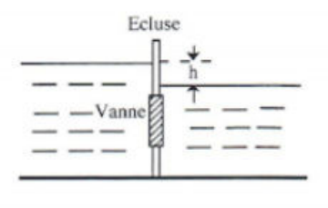
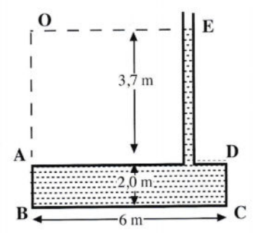
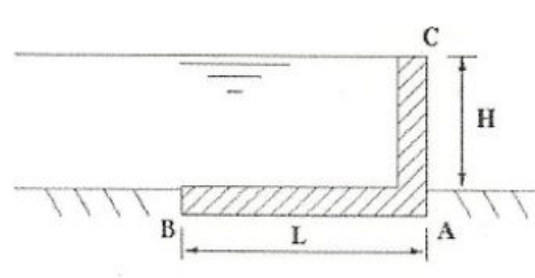
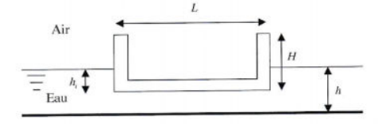
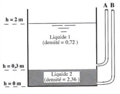
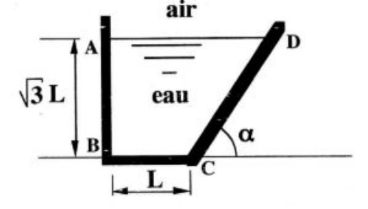
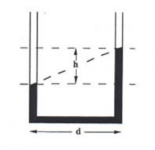
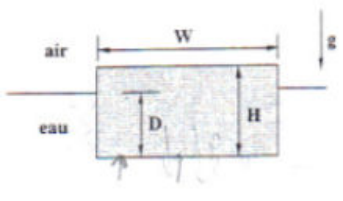
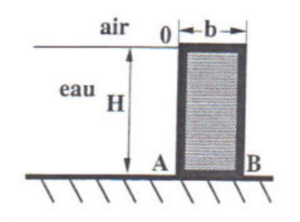

## Exercice 1 : vanne d'écluse

Une écluse sépare deux masses d'eau. La différence de hauteur est la dénivellation notée $h$. On désigne par $p_0$ la pression atmosphérique, $\rho$ la masse volumique de l'eau et $g$ l'accélération de pesanteur.

1. Déterminer le diagramme des forces élémentaires de pression sur l'écluse.
2. Calculer, en fonction de $h$, la résultante des forces de pression exercées sur une vanne de section $S$. Quel est son point d'application ?

### Corrigé 1

1. Sur la vanne, le diagramme de pression correspond à un rectangle ; sur la hauteur $h$, il y a un fluide à gauche et non à droite, le diagramme est donc un triangle, la pression est de $\rho gz$.
2. $dF = p\,dS = \rho gh\,dS \Rightarrow F = \rho ghS$ où $S = L \times H$.

   $$
   OG.F = \int_S z\,dF \Rightarrow \frac{1}{F} \int_0^H \rho ghLz\,dz = \frac{1}{F} \rho ghL \times \frac{H^2}{2} = \frac{H}{2}
   $$

   La force s'applique donc au centre de la vanne.

## Exercice 2 : réservoir à conduit

L'eau monte jusqu'au niveau $E$ dans le conduit, d'aire $0{,}10\ m^2$, fixé au réservoir $ABCD$ de la figure. On négligera le poids du réservoir, du conduit et la pression atmosphérique.

1. Déterminer et positionner la force résultante agissant sur la surface $AB$, qui a $2{,}50\ m$ de large.
2. Déterminer la force totale s'exerçant sur le fond du réservoir.
3. Comparer cette force totale avec le poids total de l'eau, expliquer la différence et écrire l'équilibre du système.

### Corrigé 2

1. $dF = p\,dS \Rightarrow F_{AB} = \displaystyle\int_S p\,dS = \int_0^{2{,}5} \left(\int_{3{,}7}^{5{,}7} p\,dz\right) dx \Rightarrow F_{AB} = 2{,}5 \times \frac{\rho g}{2}(5{,}7^2 - 3{,}7^2) = 2{,}3 \times 10^5\ N$.

   On cherche le point d'application :

   $$
   \begin{aligned}
   \overrightarrow{OG} \wedge \vec{F} &= \int_S \overrightarrow{OA_i} \wedge d\vec{F} \\
   OG.F_{AB} &= \int_S OA_i\,dF_{AB} \quad \text{(car ils sont orthogonaux)} \\
   &= \int_S z^2 \rho g\,dS \\
   &= \frac{1}{F_{AB}} \times \int_0^{2{,}5} dx \int_{3{,}7}^{5{,}7} \rho gz^2\,dz = 4{,}77\ m
   \end{aligned}
   $$

2. $F_{BC} = \displaystyle\int_S p\,dS = \rho g \times 5{,}7 \times \int_S dS \Rightarrow F_{BC} = 8{,}39 \times 10^5\ N$.
3. $P = gM = g(\rho \times 6 \times 2{,}5 \times 2 + \rho \times 3{,}7 \times 0{,}1) = 2{,}98 \times 10^5\ N$.

   Il faut remarquer que $\vec{F}_{tot}$ n'est pas égal à $\vec{F}_{BC}$ ; cependant, $\vec{F}_{tot} = \vec{F}_{BC} + \vec{F}_{DA}$. On cherche $\vec{F}_{DA}$.

   $$
   \begin{aligned}
   F_{DA} &= \int_S p\,dS \\
   &= \rho g \times 3{,}7 \times \int_S dS \\
   &= 5{,}41 \times 10^5\ N
   \end{aligned}
   $$

   Au final, on a bien $\sum \vec{F} = 0$, le système est donc à l'équilibre.

## Exercice 3 : barrage en équerre

Un barrage de hauteur $H$ en forme de dièdre parfaitement rigide en béton armé ou en métal, dont on négligera le poids, reste en équilibre grâce aux forces de pression qui agissent sur la base de ce dièdre de largeur $L$. La pression atmosphérique est négligée et on admettra que les réactions du sol sur le barrage varient linéairement le long de la base entre une pression maximale en $A$ et une pression nulle en $B$.

1. Déterminer le diagramme des pressions sur ce barrage.
2. Calculer la longueur $L$ nécessaire à l'équilibre du barrage :

   (a) en négligeant les réactions du sol sur le barrage ;

   (b) en prenant en compte ces réactions.

### Corrigé 3

1. Un trapèze sur $CA$ provoqué par le fluide, un rectangle sur $AB$ provoqué par le fluide, un rectangle sur $CA$ provoqué par l'air, un triangle sur $BA$ (maximum en $A$) provoqué par le sol.
2. Le barrage est équilibré, on a donc $\sum \vec{F} = \vec{0} \Leftrightarrow \sum \vec{\mathcal{M}}(\vec{F}) = \vec{0}$.

   (a) On calcule $\vec{F}_{AB} = \displaystyle\int_S p\,dS = LlH\rho g \Rightarrow BG = \frac{L}{2}$ et $\vec{F}_{AC} = \displaystyle\int_S p\,dS = \int_0^H l\rho gz\,dz = l\rho g \frac{H^2}{2} \Rightarrow CG' = \frac{2}{3}H$.

   On a donc à l'équilibre

   $$
   \overrightarrow{AG} \wedge \vec{F}_{AB} + \overrightarrow{AG'} \wedge \vec{F}_{AC} = \vec{0} \Rightarrow \frac{L}{2} \times LlH\rho g - \frac{H}{3} \times l\rho g \frac{H^2}{2} = 0 \Rightarrow \rho gHl\left(\frac{L^2}{2} - \frac{H^2}{6}\right) = 0 \Rightarrow H = L\sqrt{3}
   $$

   (b) Sur l'axe $z$, l'équilibre implique $\vec{F}_{AB} = \vec{R}_{sol} \Rightarrow \vec{R}_{sol} = LlH\rho g \Rightarrow BG'' = \dfrac{2}{3}L$. On obtient donc à l'équilibre

   $$
   L = H
   $$

## Exercice 4 : flottabilité d'une barge

Une barge parallélépipédique ouverte de longueur $L$, de largeur $l$, de hauteur $H$ et de masse $m$ flotte dans l'eau douce.

1. Déterminer $h_i$, la hauteur d'immersion de la barge dans l'eau.
2. Quelle masse $m_p$ de pierre faut-il placer dans la barge pour la faire reposer au fond d'un bassin dont la profondeur d'eau est $h$, plus petite que $H$ ?

On prendra $L = 10\ m$, $l = 4\ m$, $H = 5\ m$, $m = 54000\ kg$, $h = 4\ m$, $\rho_{eau} = 1000\ kg.m^{-3}$.

### Corrigé 4

1. On est à l'équilibre, donc la poussée d'Archimède compense le poids de la barge ; on a donc

   $$
   \begin{aligned}
   m\vec{g} - \rho\vec{g}V &= \vec{0} \\
   m &= \rho \times (L \times l \times h_i) \\
   h_i &= \frac{m}{\rho Ll} = 1{,}35\ m
   \end{aligned}
   $$

2. On a le même principe qu'à la première question ; cependant, la masse est désormais la masse de la barge plus la masse de pierre, on a donc

   $$
   \begin{aligned}
   m + M &= \rho \times (L \times l \times h) \\
   M &= \rho Llh - m \\
   &= 106000\ kg
   \end{aligned}
   $$

## Exercice 5 : deux liquides non miscibles dans un réservoir

Un réservoir ouvert possède deux piézomètres $A$ et $B$ et contient deux liquides non miscibles.

1. Quelle est la hauteur de la surface liquide dans le piézomètre $A$ ?
2. Quelle est la hauteur de la surface liquide dans le piézomètre $B$ ?
3. En négligeant la pression atmosphérique, déterminer la pression dans le fond du réservoir.

### Corrigé 5

1. On veut $p(h = 2\ m) = p_A$, on applique donc la loi de l'hydrostatique :

   $$
   \begin{aligned}
   p_0 - \rho gh &= p_0 - \rho gh_A \\
   h_A &= 2\ m
   \end{aligned}
   $$

2. On veut $p(h = 0\ m) = p_F$, avec $F$ un point au fond du piézomètre $B$ ; on applique donc la loi de l'hydrostatique :

   $$
   \begin{aligned}
   p_0 + (\rho_1 g \times 1{,}7 + \rho_2 g \times 0{,}3) &= p_0 + \rho_2 gh_B \\
   h_B &= 0{,}82\ m
   \end{aligned}
   $$

3. On applique la loi de l'hydrostatique entre un point à la surface du réservoir et un point au fond du réservoir ; on a donc $p_{fond} = p_0 + \rho_1 g \times 1{,}7 + \rho_2 g \times 0{,}3 = p_0 + \rho_2 gh_B$. En négligeant $p_0$, on trouve que la pression au fond du réservoir vaut $\rho_2 gh_B = 18953\ Pa$.

## Exercice 6 : réservoir à paroi inclinée

Un réservoir de largeur $l$ est rempli d'eau. On veut caractériser l'action de l'eau sur chacune des parois $AB$, $BC$ et $CD$ de ce réservoir. La paroi $CD$ est inclinée d'un angle $\alpha$ par rapport à l'horizontale. $\sqrt{3}L$ est la hauteur de la surface libre par rapport à la base du réservoir. On désigne par $\rho$ la masse volumique de l'eau et $g$ l'accélération de la pesanteur ; la pression atmosphérique $p_0$ sera négligée.

1. Tracer le diagramme des forces de pression exercées par le fluide sur ce réservoir.
2. Calculer les résultantes $F_{AB}$, $F_{BC}$ et $F_{CD}$, et leur point d'application, des forces de pression qui s'exercent sur les parois $AB$, $BC$ et $CD$.
3. Calculer la résultante $F$, et son point d'application, des forces de pression exercées par le fluide sur ce réservoir.

On prendra $g = 9{,}81\ m.s^{-2}$ et $\rho = 1000\ kg.m^{-3}$ et on donne $L = 20\ m$, $\alpha = 45^\circ$ et $l = 100\ m$.

### Corrigé 6

1. On a un rectangle sur le fond du réservoir, un triangle sur $AB$ avec un maximum en $B$, un triangle incliné d'un angle $\alpha$ sur $CD$ avec un maximum en $C$.
2. On cherche à calculer les différentes forces :

   $$
   \begin{aligned}
   F_{AB} &= \int_0^l \left(\int_0^{\sqrt{3}L} \rho gz\,dz\right) dx = l \times \frac{\rho g}{2}(\sqrt{3}L)^2 = 5{,}886 \times 10^8\ N \\
   OG.F &= \int_S z\,dF = \int_0^{\sqrt{3}L} z \times l\rho gz\,dz = l \times \frac{\rho g}{3}(\sqrt{3}L)^3
   \quad \Rightarrow \quad OG = \frac{2}{3}(\sqrt{3}L) = 23{,}09\ m
   \end{aligned}
   $$

   $$
   \begin{aligned}
   F_{BC} &= \int_0^l \left(\int_0^L p\,dy\right) dx = l \times L \times \sqrt{3}L\rho g = 6{,}796 \times 10^8\ N \\
   BG.F &= \int_S y\,dF = \int_0^l \left(\int_0^L \sqrt{3}L\rho g \times y\,dy\right) dx = l \times \sqrt{3}L \frac{\rho g}{2} L^2
   \quad \Rightarrow \quad BG = \frac{L}{2} = 10\ m
   \end{aligned}
   $$

   $$
   \begin{aligned}
   F_{CD} &= \int_0^l \int_0^{\sqrt{3}L} \rho gz \frac{dz}{\sin(\alpha)} = l \times \frac{\rho g}{2} \frac{(\sqrt{3}L)^2}{\sin(\alpha)} = 8{,}324 \times 10^8\ N \\
   OG.F &= \int_S z\,dF = \int_0^{\sqrt{3}L} z\rho gzl \frac{dz}{\sin(\alpha)} = \frac{l}{\sin(\alpha)} \times \frac{\rho g}{3} \times (\sqrt{3}L)^3
   \quad \Rightarrow \quad OG = \frac{2}{3}(\sqrt{3}L) = 23{,}09\ m
   \end{aligned}
   $$

3. $\vec{F}_{tot} = \sum \vec{F} = \vec{F}_{AB} + \vec{F}_{BC} + \vec{F}_{CD} = \rho g\sqrt{3}lL^2\vec{z} + \dfrac{3}{2}\rho glL^2 \dfrac{\vec{z}}{\tan(\alpha)}$. On a donc $F_{tot} = 1{,}268 \times 10^9\ N$. La force s'applique au centre de gravité du réservoir.

## Exercice 7 : accéléromètre à liquide

Il est possible de connaître l'accélération $a$ d'un véhicule à partir de la différence $h$ des niveaux d'un liquide dans les branches d'un tube en U qu'il transporte. La distance des branches du tube est $d$. Quelle est la valeur de l'accélération ? Application numérique : $h/d = 0{,}577$.

### Corrigé 7

On applique le principe fondamental de la dynamique :

$$
-\overrightarrow{\text{grad}}\,p + \rho\vec{\gamma} = \vec{0}
$$

avec $\vec{\gamma} = \vec{g} - \vec{a}$

$$
\overrightarrow{\text{grad}}\,p = \rho(\vec{g} - \vec{a})
$$

$$
\frac{\partial p}{\partial x}\vec{e}_x + \frac{\partial p}{\partial y}\vec{e}_y + \frac{\partial p}{\partial z}\vec{e}_z = -\rho(g\vec{e}_y - a\vec{e}_x)
$$

$$
\begin{cases} \dfrac{\partial p}{\partial x} = \rho a \\[2mm] \dfrac{\partial p}{\partial y} = -\rho g \\[2mm] \dfrac{\partial p}{\partial z} = 0 \end{cases}
\Rightarrow p = -\rho(gy - ax) + cte
$$

Sur une surface isobare, on a $dp = 0$, et donc on obtient

$$
\rho a\,dx - \rho g\,dy = 0 \Leftrightarrow a = g\frac{dy}{dx} = 5{,}66\ m.s^{-2}
$$

## Exercice 8 : morceau de savon

Un morceau de savon flotte à la surface de l'eau. Son fond est immergé d'une distance $D$ sous la surface de l'eau. Ce morceau a une largeur $W$, une épaisseur $H$ et une longueur $L$ normale au plan de la figure. Déterminer la densité du savon, rapport entre sa masse volumique et celle de l'eau.

### Corrigé 8

Le système est à l'équilibre, donc $\sum \vec{F} = 0$ ; ainsi le poids compense la force d'Archimède, donc

$$
\begin{aligned}
m\vec{g} - \rho\vec{g}V &= \vec{0} \\
\rho_S LHW - \rho_e LDW &= 0 \\
d &= \frac{D}{H}
\end{aligned}
$$

## Exercice 9 : barrage à poids

Un barrage parallélépipédique de hauteur $H$, de largeur $L$, parfaitement rigide en béton armé, reste en équilibre grâce aux réactions du sol qui agissent sur la base du barrage de longueur $b$. C'est donc le poids propre du barrage qui assure sa stabilité et empêche le basculement autour du point $B$. La pression atmosphérique est négligée et on admettra que les réactions du sol sur le barrage varient linéairement le long de la base entre une pression maximale en $B$ et une pression nulle en $A$.

1. Calculer la résultante $F$ des forces de pression qui s'exercent sur la paroi $OA$ de ce barrage et la hauteur de son point d'application.
2. Quelles sont les forces extérieures qui agissent sur le barrage ?
3. En considérant l'équilibre de ce barrage, déterminer la réaction horizontale du sol $G$ empêchant le glissement du barrage et la résultante $V$ des réactions verticales du sol sur le barrage.
4. Quelle est la position du point d'application $C$ de la résultante $V$ des réactions verticales du sol sur le barrage ? Quelle est la valeur de la réaction du sol au point $B$ ?
5. En considérant l'équilibre de ce barrage, et en particulier la somme nulle des moments au point $A$ par exemple, calculer la longueur $b$ minimale nécessaire à l'équilibre du barrage.
