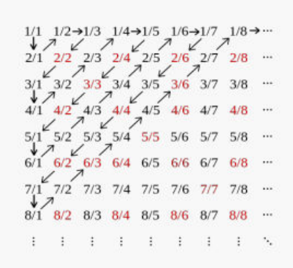

## Expériences aléatoires

En probabilité, le point de départ est ce qu'on appelle habituellement une expérience aléatoire (ou épreuve). Une telle expérience aléatoire $\mathcal{E}$ est caractérisée par :

- un espace des résultats possibles $\Omega$ ;
- un ensemble d'événements $\mathcal{F}$ (partie de $\Omega$, sous-ensemble de $\Omega$) qui doit vérifier les propriétés d'une **tribu** ;
- la donnée d'une probabilité sur $\Omega$ (application de $\mathcal{F} \to [0, 1]$ qui doit vérifier 2 axiomes).

**3 exemples d'expériences aléatoires.**

1. $\mathcal{E}_1$ : on lance un dé équilibré.
2. $\mathcal{E}_2$ : on lance une pièce qui a une probabilité $p > 0$ de retomber sur face jusqu'à obtenir le premier face.
3. $\mathcal{E}_3$ : un générateur de nombres aléatoires renvoie un nombre réel compris entre 0 et 1 (exemple de ALEA() dans un tableur).

## L'espace des résultats possibles

**Définition.** L'ensemble des résultats possibles d'une expérience aléatoire est appelé ensemble des **événements élémentaires** ou encore univers des possibles. On le note généralement $\Omega$.

1. $\mathcal{E}_1$ : $\Omega_1 = \lbrace 1, 2, 3, 4, 5, 6 \rbrace$, $\Omega_1$ est un ensemble fini, $card(\Omega_1) = \#\Omega_1 = 6$.
2. $\mathcal{E}_2$ : $\Omega_2 = \lbrace (F), (P, F), (P, P, F), \dots, (P, \dots, P, F), \dots \rbrace \cup \lbrace (P, \dots, P, \dots) \rbrace$.
3. $\mathcal{E}_3$ : $\Omega_3 = [0, 1]$.

Les ensembles $\Omega_2$ et $\Omega_3$ sont tous les 2 infinis, mais $\Omega_2$ est dénombrable alors que $[0, 1]$ ne l'est pas.

## Ensembles dénombrables

Historiquement, il existe deux définitions de la notion d'ensemble dénombrable.

**Définition 1.** On dit qu'un ensemble $E$ est dénombrable s'il est en bijection avec $\mathbb{N}$ (on dit aussi que $E$ est équipotent à $\mathbb{N}$). C'est la définition originale de *Georg Cantor*.

**Définition 2.** On dit que $E$ est dénombrable s'il est en bijection avec une partie de $\mathbb{N}$. Avec cette définition, les ensembles finis sont dénombrables. On parlera alors d'ensemble infini dénombrable pour le cas d'un ensemble infini.

Si on retient la définition 1, les ensembles dénombrables sont toujours infinis. Pour regrouper les notions d'ensemble fini et d'ensemble dénombrable, on parle d'ensemble **au plus dénombrable** ; dans ce cours, on utilisera la définition 1.

**Remarque.** En probabilité, on dit aussi parfois qu'un ensemble fini ou dénombrable est un ensemble discret (probabilité **discrète**). Mais cela ne correspond pas à la « vraie » définition d'un ensemble discret. On dit qu'un sous-ensemble $D \subset \mathbb{R}$ est discret si pour tout $x \in D$, $\exists \varepsilon > 0$ tel que $]x - \varepsilon, x + \varepsilon[ \cap D = \lbrace x \rbrace$.

**Propriété.** On peut montrer qu'un sous-ensemble de $\mathbb{R}$ discret est fini ou dénombrable, mais la réciproque est clairement fausse. Soit $E = \left\lbrace \dfrac{1}{n}, n \geq 1 \right\rbrace \cup \lbrace 0 \rbrace$. $E$ est dénombrable (évident) mais $E$ n'est pas discret au sens de la définition précédente. En effet, on ne peut trouver $\varepsilon > 0$ tel que $]-\varepsilon, \varepsilon[ \cap E = \lbrace 0 \rbrace$ (0 est ce que l'on appelle un point d'accumulation).

### Exemples d'ensembles dénombrables

1. $\mathbb{N}^*$ est dénombrable.

   *Démonstration.* On considère

   $$
   f : \begin{cases} \mathbb{N} \to \mathbb{N}^* \\ n \mapsto f(n) = n + 1 \end{cases}
   $$

2. $\mathbb{Z}$ est dénombrable.

   *Démonstration.* On peut écrire $\mathbb{Z} = \lbrace 0, -1, 1, -2, 2, \dots \rbrace$. On considère

   $$
   f : \begin{cases} \mathbb{N} \to \mathbb{Z} \\ n \mapsto f(n) = \begin{cases} n/2 & \text{si } n \text{ pair} \\ -\dfrac{n + 1}{2} & \text{si } n \text{ impair} \end{cases} \end{cases}
   $$

   On peut aussi écrire $f(n) = (-1)^n E\left(\dfrac{n + 1}{2}\right)$.

3. $\mathbb{N}^2$ est dénombrable.

   

   $\Pi(0, 0) = 0, \Pi(1, 0) = 1, \Pi(0, 1) = 2, \Pi(0, 2) = 3, \Pi(1, 1) = 4 \dots$ définit une bijection de $\mathbb{N}^2 \to \mathbb{N}$.

   On peut aussi remarquer que la fonction $\phi(k, l) = 2^k(2l + 1)$ définit une bijection de $\mathbb{N}^2 \to \mathbb{N}^*$.

On voit bien qu'intuitivement, on peut dire qu'un ensemble $E$ est dénombrable si on peut numéroter de façon exhaustive tous ses éléments, autrement dit si on peut représenter les éléments de $E$ sous la forme d'une suite, ou encore si on peut « compter » $E$ (*countable set*).

**Définitions.** Si $E$ est un ensemble dénombrable et si $\phi : \mathbb{N} \to E$ est une bijection, on dit que la suite $\phi(0), \phi(1), \dots, \phi(n), \dots$ est une **énumération de $E$**.

### Propriétés des ensembles dénombrables

**Théorème I.1.** Toute partie infinie de $\mathbb{N}$ est dénombrable.

**Théorème I.2.** Un ensemble est fini ou dénombrable si et seulement s'il est en bijection avec une partie de $\mathbb{N}$.

**Théorème I.3.** Toute partie d'un ensemble dénombrable est au plus dénombrable.

**Corollaire 1.** S'il existe une injection d'un ensemble $E$ dans un ensemble dénombrable, alors $E$ est au plus dénombrable.

### Produit cartésien d'ensembles dénombrables

**Théorème I.4.** Si $E$ et $F$ sont des ensembles dénombrables, alors $E \times F$ est dénombrable.

**Corollaire 2.** Si $E_1, \dots, E_n$ sont des ensembles dénombrables, alors $E_1 \times \dots \times E_n$ est dénombrable.

**Exemple.** $\mathbb{Q}^*_+$ est dénombrable. Soit $\phi : \dfrac{p}{q} \to (p, q)$ où $\dfrac{p}{q}$ est irréductible. On voit bien que $\phi$ est injective de $\mathbb{Q}^*_+$ dans $\mathbb{N} \times \mathbb{N}$ (c'est-à-dire si $s$ et $s'$ sont deux rationnels positifs, $\phi(s) = \phi(s') \Rightarrow s = s'$). Or $\mathbb{N} \times \mathbb{N}$ est dénombrable, donc $\mathbb{Q}^*_+$ est dénombrable par le corollaire 1.

**Théorème I.5.** (Réunion) Soit $(E_i)_{i \in I}$ une famille d'ensembles dénombrables. Si $\forall i$, $E_i$ est au plus dénombrable et si $I$ est également dénombrable, alors $\bigcup_{i \in I} E_i$ est au plus dénombrable.

**Un exemple d'ensemble non dénombrable.** Soit $E \subset \mathbb{R}_+$ l'ensemble des nombres s'écrivant sous la forme

$$
x = \sum_{i=1}^{+\infty} \frac{\varepsilon_i}{10^i}, \quad \text{où } \varepsilon_i \in \lbrace 0, 1 \rbrace
$$

Exemple : $x = 0{,}01001110\dots$ Supposons que $E$ est dénombrable. Alors on peut trouver une bijection de $\mathbb{N}^* \to E$ :

$$
\begin{aligned}
f(1) &= 0{,}\varepsilon^1_1 \varepsilon^1_2 \dots \varepsilon^1_n \dots \\
f(2) &= 0{,}\varepsilon^2_1 \varepsilon^2_2 \dots \varepsilon^2_n \dots \\
&\ \ \vdots \\
f(n) &= 0{,}\varepsilon^n_1 \varepsilon^n_2 \dots \varepsilon^n_n \dots
\end{aligned}
$$

(énumère tout l'ensemble $E$). Soit alors $x = 0{,}\varepsilon'_1 \varepsilon'_2 \dots \varepsilon'_n \dots$ avec $\forall i \geq 1$, $\varepsilon'_i = 1 - \varepsilon^i_i$ ($\forall n \geq 1$, $\varepsilon'_n = 1 - \varepsilon^n_n$). Alors on voit qu'on ne peut pas avoir $x = f(n)$ pour $n \in \mathbb{N}^*$. Donc $E$ n'est pas dénombrable. Donc $\lbrace 0, 1 \rbrace^{\mathbb{N}}$, ou encore $[0, 1]$, ou bien $\mathbb{R}$, ne sont pas dénombrables.

## Tribus

**Définition.** Soit un espace $\Omega$. On dit qu'un ensemble $\mathcal{F}$ de parties (sous-ensembles) de $\Omega$ est une tribu si :

1. $\Omega \in \mathcal{F}$ ;
2. $A \in \mathcal{F} \Rightarrow A^c \in \mathcal{F}$ (stabilité par passage au complémentaire) ;
3. pour toute suite $(A_n)_{n \geq 1}$ d'éléments de $\mathcal{F}$, $\displaystyle\bigcup_{n=1}^{+\infty} A_n \in \mathcal{F}$ (stabilité par réunion dénombrable).

**Définitions.** On appelle ensemble des parties de $\Omega$ l'ensemble de tous les sous-ensembles de $\Omega$, y compris $\emptyset$ et $\Omega$ lui-même. On le note $\mathcal{P}(\Omega)$.

**Remarque.** $\mathcal{P}(\Omega)$ est une tribu sur $\Omega$ (c'est la plus grande), $\mathcal{F} = \lbrace \emptyset, \Omega \rbrace$ est une tribu (c'est la plus petite).

**Définition.** Soit un espace $\Omega$ muni d'une tribu $\mathcal{F}$ (espace « probabilisable »). On appelle événement tout élément de $\mathcal{F}$, c'est-à-dire toute partie de $\Omega$ appartenant à $\mathcal{F}$.

**Remarque.** En pratique, quand $\Omega$ est au plus dénombrable, on verra qu'on peut définir une probabilité pour toute partie de $\Omega$, et on pourra donc prendre $\mathcal{F} = \mathcal{P}(\Omega)$.

**Exemples de tribus.** Soit $\Omega = \lbrace a, b, c \rbrace$.

$\mathcal{F}_1 = \lbrace \emptyset, \lbrace a \rbrace, \lbrace b, c \rbrace, \Omega \rbrace$, $\mathcal{F}_2 = \lbrace \emptyset, \lbrace b \rbrace, \lbrace a, c \rbrace, \Omega \rbrace$.

Plus généralement, $\forall A \subset \Omega$, $\mathcal{F} = \lbrace \emptyset, A, A^c, \Omega \rbrace$ est une tribu. $\mathcal{G} = \lbrace \emptyset, \lbrace a \rbrace, \lbrace b \rbrace, \Omega \rbrace$ n'est pas une tribu.

**Tribu borélienne.** Soit $\Omega = \mathbb{R}$ et $\mathcal{M} = \lbrace ]-\infty, t], t \in \mathbb{R} \rbrace$. La plus petite tribu contenant $\mathcal{M}$ est appelée tribu borélienne sur $\mathbb{R}$ et on la note $\mathcal{B}(\mathbb{R})$. Les éléments de $\mathcal{B}(\mathbb{R})$ sont appelés « boréliens ».

**Propriétés élémentaires.** Soit $\mathcal{F}$ une tribu.

1. $\emptyset \in \mathcal{F}$ (car $\emptyset = \Omega^c$).
2. Soit $(A_n)_{n \geq 1}$ une suite d'éléments de $\mathcal{F}$. Alors $\displaystyle\bigcap_{n=1}^{\infty} A_n \in \mathcal{F}$ (stabilité par intersection dénombrable).

   *Démonstration.* $\displaystyle\bigcap_{n=1}^{\infty} A_n = \left(\bigcup_{n=1}^{\infty} A_n^c\right)^c$.

3. Soit $A$ et $B$ dans $\mathcal{F}$. Alors $A \setminus B = A \cap B^c \in \mathcal{F}$ (car $A \cap B^c = A \cap B^c \cap \Omega \cap \Omega \cap \dots \cap \Omega \dots$).

## Probabilité

**Définition.** Soit $\Omega$ un espace muni d'une tribu d'événements $\mathcal{F}$. On appelle probabilité sur $(\Omega, \mathcal{F})$ toute application

$$
P : \begin{cases} \mathcal{F} \to [0, 1] \\ A \in \mathcal{F} \mapsto P(A) \end{cases}
$$

vérifiant les axiomes suivants :

1. $P(\Omega) = 1$ ;
2. soit $(A_i)_{i \geq 1}$ une suite d'événements tels que $A_i \cap A_j = \emptyset$, $\forall i \neq j$ (on parle d'événements 2 à 2 disjoints), alors $P\left(\displaystyle\bigcup_{i=1}^{\infty} A_i\right) = \displaystyle\sum_{i=1}^{\infty} P(A_i)$ (propriété de $\sigma$-additivité).

**Définition.** Le triplet $(\Omega, \mathcal{F}, P)$ est appelé **espace probabilisé**.

**Première conséquence.** Probabilité sur un espace au plus dénombrable. Dans le cas $\Omega = \lbrace \omega_1, \dots, \omega_n, \dots \rbrace$, on peut définir une probabilité sur $(\Omega, \mathcal{P}(\Omega))$ en définissant les valeurs de $P(\omega_i)$, $\forall i$. En effet, soit $A \in \mathcal{P}(\Omega)$, alors on peut toujours écrire

$$
A = \bigcup_{\lbrace i, \omega_i \in A \rbrace} \lbrace \omega_i \rbrace
$$

Or $\lbrace \omega_i \rbrace \cap \lbrace \omega_j \rbrace = \emptyset$ $\forall i \neq j$, donc d'après l'axiome 2

$$
P(A) = \sum_{i, \omega_i \in A} P(\omega_i)
$$

Dans le cas où $\Omega$ est fini ou dénombrable, il est donc naturel de poser $\mathcal{F} = \mathcal{P}(\Omega)$.

**Exemples de probabilités.**

1. $\mathcal{E}_1$ : $P(1) = 1/6, \dots, P(6) = 1/6$.
2. $\mathcal{E}_2$ : $P_2(F) = p$, $P_2((P, F)) = (1 - p) \times p$, $P_2((P, \dots, P, F)) = (1 - p)^{n-1} \times p$, $P_2((P, \dots, P, \dots)) = 0$.
3. Pour l'expérience $\mathcal{E}_3$ (génération de nombres aléatoires), $\Omega_3 = [0, 1]$ n'est pas dénombrable. On pose $\mathcal{F} = \mathcal{B}(\mathbb{R})_{|[0,1]} = \lbrace A \cap [0, 1], A \in \mathcal{B}(\mathbb{R}) \rbrace$. On peut montrer qu'il existe une (unique) probabilité $P$ sur $(\Omega_3, \mathcal{F}_3)$ vérifiant

   $$
   \forall (a, b) \in [0, 1] \times [0, 1], \quad P([a, b]) = b - a \qquad \text{(loi uniforme)}
   $$

   On voit bien dans ce cas que $\forall x \in [0, 1]$, $P(X = x) = 0$ (voir preuve plus tard) et qu'on ne peut définir $P$ par la donnée de $P(X = x)$, $x \in \Omega$.

**Remarque.** $X$ est une variable aléatoire de loi uniforme sur $[0, 1]$. La densité est la fonction

$$
f(x) = \mathbb{1}_{[0,1]}(x) = \begin{cases} 1 & \text{si } x \in [0, 1] \\ 0 & \text{sinon} \end{cases}
$$

### Propriétés des probabilités

1. (a) $P(\emptyset) = 0$.

   *Démonstration.* $\emptyset \cup \Omega = \Omega$ et $\emptyset \cap \Omega = \emptyset$, donc $P(\Omega) + P(\emptyset) = P(\Omega)$, donc $P(\emptyset) = 0$.

   (b) $P(A^c) = 1 - P(A)$.

   *Démonstration.* $A \cup A^c = \Omega$ et $A \cap A^c = \emptyset$, donc $P(A) + P(A^c) = P(\Omega) \Rightarrow P(A^c) = P(\Omega) - P(A) = 1 - P(A)$.

2. Soit $A_1, \dots, A_n$ $n$ événements 2 à 2 disjoints. Alors $P\left(\displaystyle\bigcup_{i=1}^{n} A_i\right) = \displaystyle\sum_{i=1}^{n} P(A_i)$ (car $A_1 \cup \dots \cup A_n = A_1 \cup \dots \cup A_n \cup \emptyset \cup \dots \cup \emptyset \dots$).
3. $P(A \cup B) = P(A) + P(B \setminus A)$.

   *Démonstration.* $A \cup (B \setminus A) = A \cup (B \cap A^c) = (A \cup B) \cap \underbrace{(A \cup A^c)}_{= \Omega} = A \cup B$ et $A \cap (B \setminus A) = A \cap B \cap A^c = \emptyset$.

4. Si $A \subset B$, alors $P(B \setminus A) = P(B) - P(A)$ (et donc $P(A) \leq P(B)$).
5. $P(B \setminus A) = P(B) - P(A \cap B)$.

   *Démonstration.*

   $$
   \begin{aligned}
   B \setminus A &= B \cap A^c \\
   &= (B \cap A^c) \cup (B \cap B^c) \\
   &= B \cap (A^c \cup B^c) \\
   &= B \cap (A \cap B)^c \\
   &= B \setminus (A \cap B)
   \end{aligned}
   $$

   Or $A \cap B \subset B$, d'où $P(B \setminus A) = P(B \setminus (A \cap B)) \underset{\text{par } 4}{=} P(B) - P(A \cap B)$.

6. Donc $P(A \cup B) = P(A) + P(B \setminus A) = P(A) + P(B) - P(A \cap B)$.
7. **Sous-additivité.**

   $$
   P\left(\bigcup_{n=1}^{\infty} A_n\right) \leq \sum_{n=1}^{\infty} P(A_n)
   $$

   *Démonstration.* Si on pose $B_1 = A_1$, $\forall n \geq 2$, $B_n = A_n \setminus (A_1 \cup A_2 \cup \dots \cup A_{n-1})$. On a $\displaystyle\bigcup_{n=1}^{\infty} A_n = \bigcup_{n=1}^{\infty} B_n$ et les événements $(B_n)_{n \geq 1}$ sont deux à deux disjoints. D'autre part, $\forall n$, $B_n \subset A_n$, donc

   $$
   P\left(\bigcup_{n=1}^{\infty} A_n\right) = P\left(\bigcup_{n=1}^{\infty} B_n\right) = \sum_{n=1}^{\infty} P(B_n) \leq \sum_{n=1}^{\infty} P(A_n)
   $$

8. **Monotonie.**

   (a) Soit $(A_n)_{n \geq 1}$ avec $A_n \subset A_{n+1}$. Alors

   $$
   P\left(\bigcup_{n=1}^{\infty} A_n\right) = \lim_{n \to +\infty} P(A_n)
   $$

   *Démonstration.* Soit $B_n = A_n \setminus (A_1 \cup \dots \cup A_{n-1})$ ; on a $A_n = A_1 \cup \dots \cup A_n = B_1 \cup \dots \cup B_n$, $\forall n$, et $\displaystyle\bigcup_{n=1}^{\infty} A_n = \bigcup_{n=1}^{\infty} B_n$. Donc

   $$
   \begin{aligned}
   P\left(\bigcup_{n=1}^{\infty} A_n\right) &= P\left(\bigcup_{n=1}^{\infty} B_n\right) \\
   &= \sum_{n=1}^{\infty} P(B_n) \\
   &= \lim_{n \to +\infty} \sum_{i=1}^{n} P(B_i) \\
   &= \lim_{n \to +\infty} P\left(\bigcup_{i=1}^{n} B_i\right) \\
   &= \lim_{n \to +\infty} P(B_1 \cup \dots \cup B_n) \\
   &= \lim_{n \to +\infty} P(A_n)
   \end{aligned}
   $$

   (b) Soit $(A_n)_{n \geq 1}$ avec $A_{n+1} \subset A_n$. Alors

   $$
   P\left(\bigcap_{n=1}^{\infty} A_n\right) = \lim_{n \to +\infty} P(A_n)
   $$

   *Démonstration.* $A_n^c \subset A_{n+1}^c$ (suite croissante), $P(A_n) + P(A_n^c) = 1$. D'après 8.a,

   $$
   P(A_n^c) \to P\left(\bigcup_{n=1}^{\infty} A_n^c\right) \Leftrightarrow 1 - P(A_n) \to 1 - P\left(\bigcap_{n=1}^{\infty} A_n\right) \Leftrightarrow P(A_n) \to P\left(\bigcap_{n=1}^{\infty} A_n\right)
   $$

On peut utiliser 8.b pour montrer que, dans le cas de la probabilité sur $[0, 1]$ donnée en exemple, on a bien $P(\lbrace x \rbrace) = P([x, x]) = 0$, $\forall x \in ]0, 1[$ ; on peut écrire $\lbrace x \rbrace = \displaystyle\bigcap_{n=1}^{\infty} \left[x - \frac{1}{n}, x + \frac{1}{n}\right]$

$$
\Rightarrow P(\lbrace x \rbrace) = \lim_{n \to +\infty} P\left(\left[x - \frac{1}{n}, x + \frac{1}{n}\right]\right) = \lim_{n \to +\infty} \frac{2}{n} = 0
$$

**Autre application.** Expérience $\mathcal{E}_2$ (on lance une pièce jusqu'à obtenir face).

$$
P((P, \dots, P)) = (\text{probabilité de ne jamais obtenir face})
$$

On a $(P, \dots, P, \dots) = \displaystyle\bigcap_{n \geq 1} A_n$ avec $A_n = (P, \dots, P)$ = on obtient pile $n$ fois de suite. On voit que $A_{n+1} \subset A_n$. D'où, d'après 8.b,

$$
\begin{aligned}
P((P, \dots, P, \dots)) &= \lim_{n \to +\infty} P(A_n) \\
&= \lim_{n \to +\infty} (1 - p)^n \\
&= 0 \quad (p > 0)
\end{aligned}
$$

## Indépendance et conditionnement

Intuitivement, 2 événements seront dits indépendants si la réalisation de l'un ne modifie pas la probabilité de l'autre.

**Définition.** On dit que deux événements $A$ et $B$ sont indépendants pour la probabilité $P$ si

$$
P(A \cap B) = P(A) \times P(B)
$$

**Remarque.** On voit que l'indépendance n'est pas une qualité intrinsèque des événements, elle dépend de la probabilité considérée.

**Exemple.** Soit $\Omega = \lbrace 1, 2, 3, 4, 5, 6 \rbrace$ muni de la tribu $\mathcal{P}(\Omega)$. Soit $A = \lbrace 1, 2 \rbrace$ et $B = \lbrace 2, 3 \rbrace$ 2 événements. Soit $P_1$ et $P_2$ deux probabilités sur $(\Omega, \mathcal{P}(\Omega))$ définies par

| $i$ | 1 | 2 | 3 | 4 | 5 | 6 |
| --- | --- | --- | --- | --- | --- | --- |
| $P_1(i)$ | $1/6$ | $1/6$ | $1/6$ | $1/6$ | $1/6$ | $1/6$ |
| $P_2(i)$ | $1/6$ | $1/6$ | $1/3$ | $1/9$ | $1/9$ | $1/9$ |

Étudions l'indépendance de $A$ et $B$ pour $P_1$ et $P_2$. On a $P_1(A) = \dfrac{1}{3} = P_1(B)$ ; de plus $P_1(A \cap B) = \dfrac{1}{6} \neq \dfrac{1}{9}$, donc $A$ et $B$ ne sont pas indépendants pour $P_1$.

On a $P_2(A) = \dfrac{1}{3}$ et $P_2(B) = \dfrac{1}{2}$ ; de plus $P_2(A \cap B) = \dfrac{1}{6} = P_2(A) P_2(B)$, donc $A$ et $B$ sont indépendants pour $P_2$.

**Proposition.** Si $A$ et $B$ sont indépendants pour la probabilité $P$, alors $A$ et $B^c$, $A^c$ et $B$, $A^c$ et $B^c$ sont indépendants pour $P$.

*Démonstration.* $P(A \cap B^c) + P(A \cap B) = P(A) \Leftrightarrow P(A \cap B^c) = P(A) - P(A \cap B) = P(A) - P(A)P(B) = P(A) \underbrace{(1 - P(B))}_{= P(B^c)}$.

**Indépendance d'une famille d'événements.** Soit $I$ un ensemble (ou une suite d'événements) d'indices fini ou dénombrable. On dit que les événements $(A_i)_{i \in I}$ sont indépendants (ou mutuellement indépendants) si $\forall p \geq 2$, $\forall i_1, \dots, i_p \in I$ (avec $i_j \neq i_k$ $\forall j \neq k$)

$$
P(A_{i_1} \cap \dots \cap A_{i_p}) = P(A_{i_1}) \times \dots \times P(A_{i_p})
$$

**Exemple.** Trois événements $A, B, C$ sont (mutuellement) indépendants si $P(A \cap B) = P(A)P(B)$, $P(A \cap C) = P(A)P(C)$, $P(B \cap C) = P(B)P(C)$ et

$$
P(A \cap B \cap C) = P(A)P(B)P(C)
$$

**Définition.** On dit que les événements $(A_i)_{i \in I}$ sont 2 à 2 indépendants si $\forall i \neq j$, $A_i$ et $A_j$ sont indépendants.

**Exemple fondamental : épreuves répétées.** Soit $\mathcal{E}$ une expérience aléatoire caractérisée par l'espace probabilisé $(\Omega, \mathcal{F}, P)$. On appelle épreuve répétée $n$ fois l'épreuve (l'expérience aléatoire) $\mathcal{E}^n$ caractérisée par l'espace probabilisé $(\Omega^n, \mathcal{F}^{\otimes n}, P^{\otimes n})$ où :

- $\Omega^n = \lbrace (\omega_1, \dots, \omega_n), \omega_i \in \Omega, 1 \leq i \leq n \rbrace$ ;
- $\mathcal{F}^{\otimes n}$ est la plus petite tribu contenant les ensembles de la forme $A_1 \times \dots \times A_n$ avec $A_i \in \mathcal{F}$, $\forall i$ (tribu produit) ;
- $P^{\otimes n}$ est l'unique probabilité sur $(\Omega^n, \mathcal{F}^{\otimes n})$ telle que $\forall A_1, \dots, A_n \in \mathcal{F}$

$$
P^{\otimes n}(A_1 \times \dots \times A_n) = P(A_1) \times \dots \times P(A_n) \qquad \text{(probabilité produit)}
$$

**Propriété.** Soit $\tilde{A}_1 = A_1 \times \Omega \times \dots \times \Omega$ (j'obtiens un résultat dans $A_1$ à la première occurrence),

$$
\begin{aligned}
\tilde{A}_2 &= \Omega \times A_2 \times \Omega \times \dots \times \Omega \\
&\ \ \vdots \\
\tilde{A}_n &= \Omega \times \Omega \times \dots \times \Omega \times A_n
\end{aligned}
$$

Alors on voit que $\tilde{A}_1 \cap \dots \cap \tilde{A}_n = A_1 \times A_2 \times \dots \times A_n$, d'où

$$
P^{\otimes n}(\tilde{A}_1 \cap \dots \cap \tilde{A}_n) = P(A_1) \times \dots \times P(A_n) = P^{\otimes n}(\tilde{A}_1) \times \dots \times P^{\otimes n}(\tilde{A}_n)
$$

On voit donc que $\tilde{A}_1, \dots, \tilde{A}_n$ sont indépendants pour $P^{\otimes n}$. C'est pourquoi l'indépendance est souvent postulée dans ce cas de figure. Par exemple, si on lance un dé deux fois de suite, les événements relatifs au premier lancer sont indépendants de ceux relatifs au second lancer. Si $A$ = « le premier lancer est pair » et $B$ = « le premier lancer donne 6 », on admet que $P(A \cap B) = P(A).P(B)$.

**Définition.** Soit $(\Omega, \mathcal{F}, P)$ un espace probabilisé et $A \in \mathcal{F}$ avec $P(A) > 0$. On appelle **probabilité conditionnelle sachant $A$** l'application notée $P_A$ et définie par

$$
P_A : \begin{cases} \mathcal{F} \to [0, 1] \\ B \mapsto P_A(B) = \dfrac{P(A \cap B)}{P(A)} \end{cases}
$$

**Remarque.** On note aussi parfois $P_A(B) = P(B|A)$.

**Remarque.**

1. $P_A$ est bien une probabilité :

   $$
   P_A(\Omega) = \frac{P(A \cap \Omega)}{P(A)} = \frac{P(A)}{P(A)} = 1
   $$

2. Soit $(B_n)_{n \geq 1}$ deux à deux disjoints :

   $$
   \begin{aligned}
   P_A\left(\bigcup_{n=1}^{\infty} B_n\right) &= \frac{P\left(\left(\bigcup_{n=1}^{\infty} B_n\right) \cap A\right)}{P(A)} \\
   &= \frac{P\left(\bigcup_{n=1}^{\infty} (A \cap B_n)\right)}{P(A)} \\
   &= \frac{\sum_{n=1}^{\infty} P(A \cap B_n)}{P(A)} \\
   &= \sum_{n=1}^{\infty} \frac{P(A \cap B_n)}{P(A)} \\
   &= \sum_{n=1}^{\infty} P_A(B_n)
   \end{aligned}
   $$

**Proposition.** Soit $A$ et $B$ deux événements avec $P(A) > 0$. Alors $A$ et $B$ sont indépendants si et seulement si $P_A(B) = P(B)$.

*Démonstration.* $P_A(B) = \dfrac{P(A \cap B)}{P(A)} = \dfrac{P(A)P(B)}{P(A)} = P(B)$ (si $P(B) > 0$, $A$ et $B$ indépendants $\Leftrightarrow P_B(A) = P(A)$).

**Formule des probabilités composées.** Soit $A_1, \dots, A_n \in \mathcal{F}$ tels que $P(A_1 \cap \dots \cap A_{n-1}) > 0$. Alors :

1. $P\left(\displaystyle\bigcap_{i=1}^{n} A_i\right) = P(A_1 \cap \dots \cap A_n) = P(A_1).P(A_2|A_1).P(A_3|A_1 \cap A_2) \times \dots \times P(A_n|A_1 \cap \dots \cap A_{n-1})$.
2. Si on a une suite d'événements $(A_i)_{i \geq 1}$ avec $P\left(\displaystyle\bigcap_{i=1}^{n} A_i\right) > 0$, $\forall n$, alors

   $$
   \begin{aligned}
   P\left(\bigcap_{i=1}^{\infty} A_i\right) &= P(A_1) \times P(A_2|A_1) \times \dots \times P(A_n|A_1 \cap \dots \cap A_{n-1}) \times \dots \\
   &= \prod_{i=1}^{\infty} P(A_i|A_1 \cap \dots \cap A_{i-1})
   \end{aligned}
   $$

*Démonstration.* 1) est évident. Pour montrer 2) à partir de 1), on remarque que $P\left(\displaystyle\bigcap_{i=1}^{\infty} A_i\right) = \lim_{n \to +\infty} P\left(\bigcap_{i=1}^{n} A_i\right)$ (propriété 8.b).

**Définition.** Soit $I$ fini ou dénombrable. On dit que $(A_i)_{i \in I}$ forme un système complet d'événements si et seulement si les 3 conditions suivantes sont vérifiées :

- $\forall i \in I$, $A_i \neq \emptyset$ ;
- $\forall i \neq j$, $A_i \cap A_j = \emptyset$ ;
- $\displaystyle\bigcup_{i \in I} A_i = \Omega$.

On dit que $(A_i)_{i \in I}$ forme une **partition** de $\Omega$.

**Théorème I.6.** (Formule des probabilités totales) Soit $(A_i)_{i \in I}$ un système complet d'événements d'un espace probabilisé $(\Omega, \mathcal{F}, P)$ tel que $\forall i \in I$, $P(A_i) > 0$, et soit $E \in \mathcal{F}$ un événement quelconque. Alors

$$
P(E) = \sum_{i \in I} P(E|A_i)P(A_i) = \sum_{i \in I} P_{A_i}(E)P(A_i)
$$

*Démonstration.*

$$
\begin{aligned}
P(E) &= P(\Omega \cap E) \\
&= P\left(\left(\bigcup_i A_i\right) \cap E\right) \\
&= P\left(\bigcup_i (A_i \cap E)\right) \\
&= \sum_i P(A_i \cap E) \\
&= \sum_i P(E|A_i).P(A_i)
\end{aligned}
$$

**Remarque.** La formule reste vraie si on suppose que $P\left(\bigcup_{i \in I} A_i\right) = 1$ (sans nécessairement avoir $\bigcup_{i \in I} A_i = \Omega$). En effet, $P(E) = P\left(\left(\bigcup A_i\right) \cap E\right) + P\left(\left(\bigcup A_i\right)^c \cap E\right)$, or $P\left(\left(\bigcup A_i\right)^c\right) = 1 - P\left(\bigcup A_i\right) = 0 \Rightarrow P\left(\left(\bigcup A_i\right)^c \cap E\right) = 0$.

**Corollaire 5.1.** (Formule de Bayes) Soit $(A_i)_{i \in I}$ un système complet d'événements d'un espace probabilisé $(\Omega, \mathcal{F}, P)$ tel que $P(A_i) > 0$, $\forall i$. Soit $E \in \mathcal{F}$ avec $P(E) > 0$, alors $\forall i \in I$,

$$
P_E(A_i) = P(A_i|E) = \frac{P(A_i \cap E)}{P(E)} = \frac{P(E|A_i).P(A_i)}{\sum_{j \in I} P(E|A_j)P(A_j)}
$$

**Indépendance conditionnelle.** Soit $E$ un événement avec $P(E) > 0$. On dit que 2 événements $A$ et $B$ sont indépendants conditionnellement à $E$ (pour la probabilité $P$) si $A$ et $B$ sont indépendants pour la probabilité conditionnelle $P_E$, c'est-à-dire si $P_E(A \cap B) = P_E(A).P_E(B) \Leftrightarrow P(A \cap B|E) = P(A|E).P(B|E)$.

**Exemple.** On dispose de deux pièces, une équilibrée et une telle que $P(\text{face}) = \dfrac{3}{4}$. On sélectionne une des 2 pièces au hasard et on la lance 2 fois. Soit $F_i$ l'événement « on obtient face au lancer $i$ » où $i = 1, 2$. Soit $P_i$ l'événement « on a sélectionné la pièce $i$ » où $i = 1, 2$. Alors $F_1$ et $F_2$ sont indépendants conditionnellement à $P_1$ ou $P_2$.

$$
P(F_1 \cap F_2|P_1) = P(F_1|P_1).P(F_2|P_1) = \frac{1}{4}
$$

$$
P(F_1 \cap F_2|P_2) = P(F_1|P_2).P(F_2|P_2) = \frac{9}{16}
$$

*Est-ce que $F_1$ et $F_2$ sont indépendants (pour la probabilité $P$) ?*

$$
P(F_1 \cap F_2) \overset{?}{=} P(F_1)P(F_2)
$$

$P(F_1) = P(F_1|P_1).P(P_1) + P(F_1|P_2)P(P_2) = \frac{1}{2} \cdot \frac{1}{2} + \frac{3}{4} \cdot \frac{1}{2} = \frac{5}{8} = P(F_2)$

$P(F_1 \cap F_2) = P(F_1 \cap F_2|P_1) \times P(P_1) + P(F_1 \cap F_2|P_2).P(P_2) = \frac{1}{4} \cdot \frac{1}{2} + \frac{9}{16} \cdot \frac{1}{2} = \frac{13}{32} \neq \left(\frac{5}{8}\right)^2 = P(F_1) \times P(F_2)$

Donc $F_1$ et $F_2$ ne sont pas indépendants pour la probabilité $P$.

$$
\begin{aligned}
P(P_2|F_1) &= \frac{P(F_1|P_2).P(P_2)}{P(F_1|P_1)P(P_1) + P(F_1|P_2)P(P_2)} \\
&= \frac{\frac{3}{4} \times \frac{1}{2}}{\frac{1}{2} \times \frac{1}{2} + \frac{1}{2} \times \frac{3}{4}} \\
&= \frac{\frac{3}{4}}{\frac{1}{2} + \frac{3}{4}}
\end{aligned}
$$

$$
P(P_2|F_1 \cap F_2) = \frac{9/16 \times 1/2}{1/4 \times 1/2 + 9/16 \times 1/2} = 9/13
$$
