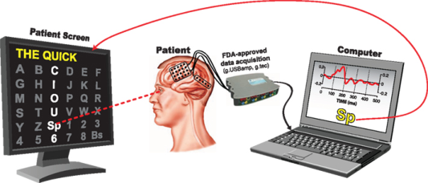
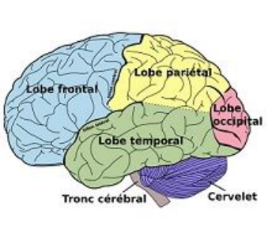
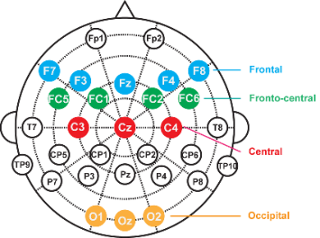

Premier chapitre du mémoire : l'activité cérébrale à l'origine de signaux exploitables par les machines.

## Introduction aux ICM

### Origine des ICM, chronologie

Les interfaces cerveau-machine (ICM) ne sont pas un concept récent. Dès les prémices de l'informatique, en 1945, les scénaristes et auteurs de science-fiction imaginent des machines capables de communiquer avec le cerveau humain. Parmi eux, Isaac Asimov s'illustre par l'invention d'un grand nombre d'objets fictifs agissant sur le cerveau, dont le "cérébroanalyseur" (*Les cavernes d'acier*, 1956), machine permettant l'interprétation des champs électromagnétiques générés par les neurones.

La créativité des auteurs est nourrie par les avancées en neurosciences. La première observation des signaux électriques générés par le cerveau, en 1875, ouvre la voie à de nombreuses perspectives d'études. Il faudra cependant attendre les découvertes majeures du 20ème siècle en chimie, biologie et physique pour mettre au point des outils et méthodes permettant d'étudier le fonctionnement du cerveau. Le développement de l'électroencéphalographie entre 1950 et 1960 permet la création des premières interfaces dès 1970 ; la fiction a finalement rejoint la réalité.

Parmi les premiers modèles d'ICM, on peut citer l'interface intracorticale mise au point par Philip Kennedy ou encore le modèle de Fetz, utilisant l'activité cérébrale de singes (1970). En 1999, Yang Dang et son équipe parviennent à créer un système capable de reconstruire la perception visuelle d'un chat. Cette dernière expérience ouvre la voie au développement de nombreuses ICM permettant le contrôle par l'activité cérébrale de bras mécaniques, de curseurs d'ordinateurs ou encore de claviers virtuels.

### Généralités

On peut définir simplement une ICM comme une interface de communication directe entre le cerveau et un dispositif externe (généralement un ordinateur). Pour que deux éléments (ici la machine et le cerveau) puissent entrer en communication, il est nécessaire qu'ils parlent le même langage. D'où l'intérêt d'exploiter les signaux électriques générés par le cerveau, car ceux-ci reflètent l'état mental de l'utilisateur. Ils peuvent donc être interprétés, compris par la machine.

Parmi les ICM, certaines sont invasives, c'est-à-dire qu'elles utilisent des électrodes implantées en profondeur dans le cerveau, afin de capter l'influx nerveux. Mais les ICM peuvent également être non invasives. En effet, la pose d'électrodes en surface du cuir chevelu permet de détecter des résidus de l'activité cérébrale, et ce sans intervention chirurgicale. L'inconvénient de ces méthodes non invasives est que les signaux considérés sont très faibles. Cependant, elles restent le meilleur compromis entre les risques de l'expérience (infection, atteinte à l'intégrité du cerveau) et la qualité du signal. Dans le cadre de ce projet, nous étudierons donc exclusivement des ICM non invasives.

On utilise généralement les ICM afin de pallier une inaptitude, dans l'objectif d'augmenter les capacités de l'utilisateur à effectuer une action en court-circuitant l'enchaînement conventionnel "cerveau-nerfs-muscles-action". Ainsi, les ICM trouvent des applications concrètes dans le domaine médical. Elles peuvent être utilisées afin de restaurer des facultés (ouïe, vue) ou encore servir le domaine clinique (mise au point de fauteuils roulants contrôlés par l'activité cérébrale par exemple).

### Un exemple d'ICM : le "P300 Matrix Speller"

Le P300 Matrix Speller est une interface très répandue. Introduit en 1988 par les chercheurs Farwell et Donchin, ce dispositif s'est imposé comme un cas d'école d'ICM. Il s'agit d'une interface permettant la communication écrite. Une analogie (un peu simpliste) avec une "machine à écrire mentale" semble pertinente, car le P300 Matrix Speller se sert uniquement de l'activité cérébrale de son utilisateur pour détecter la lettre qu'il souhaite écrire et l'inscrire à l'écran. Ainsi, l'utilisateur peut écrire des mots sur un écran, en se servant exclusivement de son activité cérébrale.

Plus précisément, le P300 Matrix Speller se base sur la détection d'une singularité dans l'activité cérébrale. Cette singularité prend la forme d'une onde d'amplitude caractéristique appelée potentiel P300. Son apparition est interprétée comme la conséquence d'états mentaux particuliers. Dans le cas du P300 Matrix Speller, on montre que l'onde P300 survient lorsque le caractère cible, c'est-à-dire la lettre ou le chiffre que l'on veut inscrire, est présenté à l'utilisateur.

Afin d'optimiser l'apparition de la P300 lors de l'utilisation du système, un paradigme de stimulation a été mis au point. Ce paradigme (Paradigme Ligne/Colonne) se présente sous la forme d'une matrice, affichée sur un écran et dans laquelle sont répertoriés les différents caractères (lettres et chiffres) nécessaires à l'écriture. Lorsque le P300 Speller fonctionne, les lignes et les colonnes de la matrice s'illuminent successivement, dans un clignotement très rapide. L'utilisateur est supposé fixer et focaliser son attention sur le caractère souhaité. L'illumination du caractère cible initie la réponse P300.

*Figure 1.1 : schéma de principe du P300 Matrix Speller. Si le lecteur souhaite avoir une représentation visuelle du processus d'illumination des lignes et des colonnes, nous le redirigeons vers [cette vidéo](https://www.youtube.com/watch?v=xvfxsNpaRGI).*

D'autres paradigmes de stimulation existent. Cependant, nous traiterons exclusivement du Paradigme Ligne/Colonne.

Le P300 Speller est constitué de plusieurs éléments. D'abord un casque EEG (électroencéphalogramme) permettant de détecter l'activité électrique en surface du cuir chevelu par l'intermédiaire d'électrodes. Ensuite, un boîtier permettant la réception et le traitement des signaux captés par les électrodes. Enfin, un écran d'ordinateur qui assure la stimulation de l'utilisateur et lui permet de visualiser le mot en cours d'écriture (figure 1.1).

## Anatomie et physiologie

Afin de comprendre le fonctionnement des ICM non invasives, il est essentiel de déterminer l'origine des signaux exploitables et d'expliciter leur lien avec l'activité cérébrale et l'état mental de l'utilisateur. Cette section propose au lecteur une introduction au système nerveux et à ses mécanismes ainsi qu'une description détaillée des techniques d'électroencéphalographie et de la notion de marqueur physiologique[^clerc].

[^clerc]: Clerc, M., Bougrain, L. et Lotte, F., *Les interfaces cerveau-ordinateur 1 : fondements et méthodes*, ISTE éditions, 2016.

### Description générale du système nerveux

Le neurone est à la base du système nerveux. Il s'agit d'une cellule dont le rôle est de transmettre des informations, véhiculées sous forme de signaux électriques appelés potentiels d'action. Par l'intermédiaire de prolongements appelés axones et dendrites, les neurones sont capables d'interagir, via la propagation de potentiels d'action créés par dépolarisation de la membrane axonale. Cette interaction a lieu au niveau des synapses, zone séparant l'axone d'un neurone de la dendrite d'un autre neurone.

Les neurones s'organisent en voies, faisceaux ou réseaux. La manière dont ils sont connectés entre eux détermine le rôle de ces structures. On distingue classiquement le système nerveux central (SNC) et le système nerveux périphérique (SNP). Nous nous focaliserons sur le SNC et plus particulièrement sur l'encéphale.

L'encéphale est constitué du tronc cérébral, du cervelet et de deux hémisphères. Les hémisphères comportent plusieurs lobes externes (frontal, pariétal, temporal et occipital).

Le lobe frontal intervient essentiellement dans la planification, le langage et le mouvement volontaire ; il est composé du gyrus précentral, des aires prémotrices et des aires préfrontales. Le lobe pariétal joue un rôle important dans l'intégration des informations issues des différentes modalités sensorielles. Cette région est impliquée dans la perception de l'espace et dans l'attention. Le lobe temporal est impliqué dans l'audition, le langage, la mémoire et la vision des formes complexes. Le lobe occipital est le centre visuel ; il permet la reconnaissance des orientations et des contours des images.

Le cortex se situe à la surface des hémisphères (figure 1.2). Les aires primaires du cortex regroupent le cortex moteur primaire et les aires qui réceptionnent les stimuli sensoriels. Elles se distinguent des aires secondaires, qui correspondent à des traitements élaborés des informations. On peut également évoquer les aires associatives, à l'origine des fonctions cognitives, qui régulent l'attention portée à la détection et à l'identification des stimuli. Enfin, le cervelet constitue également un élément fondamental du SNC. Il est le centre majeur de la coordination, de l'équilibre et du contrôle du tonus musculaire. Il permet la réalisation de tâches motrices complexes.

### Électrophysiologie : électroencéphalographie

Nous avons vu précédemment que l'unité fonctionnelle du système nerveux est le neurone, et que cette cellule communique par l'intermédiaire de signaux électrochimiques. L'activité cérébrale exploitée pour créer des interfaces cerveau-machine est donc de nature électrique. Il s'agit maintenant d'être capable de récupérer cette activité électrique et de lui donner un sens, c'est-à-dire de la relier à des processus cognitifs.

Les signaux générés en profondeur dans la boîte crânienne (ordre de 1000 mV) peuvent être détectés à la surface du cuir chevelu via une méthode d'acquisition de l'activité cérébrale appelée électroencéphalographie (abrégée EEG).

Lorsqu'un neurone reçoit un potentiel post-synaptique, c'est-à-dire un signal unitaire produit en aval d'une synapse, un mouvement d'ions est initié à travers la membrane cellulaire, résultant en un courant électrique qui se propage dans le volume de la tête. Cette propagation est indépendante de l'activité électrique qui participe au fonctionnement du cerveau. Le courant généré par un seul neurone est indétectable à la surface du cuir chevelu. Pour obtenir des signaux d'amplitude suffisante pour être mesurée, il faut qu'un grand nombre de neurones soient actifs en même temps.

Les champs produits par les neurones sont optimaux lorsque les dendrites sont parallèles entre elles et que les neurones à l'origine des signaux sont de forme pyramidale (on parle alors de neurones pyramidaux). Une grande partie de l'activité cérébrale enregistrée en EEG provient de champs électriques générés avec cette configuration.

D'un point de vue pratique, l'EEG mesure une différence de potentiels électriques entre des électrodes réparties sur l'ensemble du cuir chevelu et une électrode de référence pour déterminer le champ électrique associé. Les informations en provenance de chaque électrode sont d'abord analysées séparément, avant d'être recoupées pour une analyse plus globale.

Lors de la réalisation d'une tâche cognitive, il est nécessaire de multiplier les stimulations car les réponses unitaires sont faibles. De plus, il faut arriver à extraire les signaux d'intérêt du "bruit" environnant, consécutif à l'activité "normale" du cerveau en éveil.

Une étape précédant l'analyse à proprement parler des signaux (voir le chapitre [Traitement du signal et apprentissage](./traitement-du-signal.md)) consiste en la localisation des sources. Il s'agit d'estimer où la réponse cognitive a été construite dans le cortex avant sa détection à la surface du cuir chevelu. Cette étape n'est pas toujours évidente car l'EEG ne capte en surface que des résidus d'activité cérébrale : au cours de leur propagation dans la boîte crânienne, les signaux se sont atténués et une partie de l'information est perdue.

L'estimation des sources se base sur le calcul des champs électriques produits par les neurones, considérés comme des dipôles. Ce calcul nécessite de modéliser la boîte crânienne et de prendre en compte la conductivité des tissus. L'approche linéaire est souvent privilégiée ; elle consiste en la superposition de l'activité d'un grand nombre de sources dipolaires, distribuées uniformément.

Ainsi, l'EEG permet de détecter des signaux à la surface du cuir chevelu et de localiser les sources de ces signaux en profondeur dans la boîte crânienne. Le principal avantage de l'EEG est son excellente résolution temporelle. D'autres techniques de mesure, comme l'Imagerie par Résonance Magnétique fonctionnelle (IRMf), permettent également d'appréhender l'activité cérébrale, avec leurs avantages et inconvénients respectifs. Dans le cas de l'IRMf, la résolution temporelle est mauvaise et le dispositif est encombrant. Cependant, cette technique offre une très bonne résolution spatiale. Le choix de la technique à utiliser dépend donc des caractéristiques du phénomène que l'on veut observer.

### Marqueurs physiologiques pour le contrôle d'ICM réactives

Les interfaces cerveau-machine exploitent les signaux récupérés par EEG en cherchant à établir des corrélations entre les caractéristiques des signaux et la tâche mentale en cours.

Pour ce faire, le système recherche des formes de signaux particulières, se distinguant du bruit de fond par leur amplitude, leur fréquence ou leur temps de latence. Ces signaux d'intérêt sont appelés "marqueurs physiologiques". Nous nous focaliserons ici sur les marqueurs physiologiques des ICM réactives, c'est-à-dire des interfaces proposant une stimulation à l'utilisateur afin de produire une modification de son état mental. Pour pouvoir être utilisés en tant que tels, les marqueurs physiologiques doivent être localisables dans l'espace et/ou le temps. Ils ne sont pas propres à une tâche mentale en particulier mais plutôt à un type de réponse cognitive. Ainsi, un même marqueur physiologique peut être utilisé par plusieurs ICM.

La détection d'un marqueur physiologique reflète l'apparition d'un événement remarquable dans l'activité cérébrale, par exemple une variation importante de l'activité électrique due à une succession particulière d'activations et de désactivations dans une assemblée de neurones. L'enjeu est alors de caractériser la stimulation ou l'état mental à l'origine de cette variation.

Lorsque l'on dispose d'une bonne résolution spatiale, il est possible de localiser avec précision la région cérébrale concernée par le changement dans l'activité nerveuse, et donc de relier l'apparition du marqueur avec les fonctionnalités connues de cette région. Lorsque l'on dispose d'une bonne résolution temporelle, on peut directement associer l'apparition du marqueur à l'état mental de l'utilisateur, et en déduire la signification du marqueur.

En EEG, les marqueurs physiologiques sont communément appelés potentiels évoqués (abrégé PE). Il s'agit de modifications du potentiel électrique généré par le système nerveux en réponse à une stimulation externe (présentation d'une image, d'un son...) ou interne (modification de l'attention, préparation motrice...). Lorsqu'un PE ne peut être généré que par l'intermédiaire d'une stimulation externe, on le dit exogène. Par opposition, un PE pouvant éventuellement être généré par stimulation interne est dit endogène.

En conclusion, il est important de comprendre que l'ICM ne prend pas en compte l'intégralité de l'activité cérébrale de manière continue. Elle se focalise plutôt sur des informations remarquables, obtenues sous forme de signaux particuliers : les marqueurs physiologiques (appelés parfois PE). Ces marqueurs doivent être reliés spatialement ou temporellement à des événements (état mental particulier, stimulus) afin que leur apparition prenne un sens et qu'ils puissent être utilisés par l'interface.

## Exploitation d'un signal particulier : le P300

La détection des marqueurs physiologiques constitue le premier maillon de la chaîne de communication qu'établit une interface cerveau-machine. Un marqueur particulier est à la base de l'interface utilisée dans le cadre de notre projet. Il s'agit du potentiel P300.

Le potentiel P300 est pour la première fois observé en 1964 par les chercheurs Chapman et Bragdon. En 1965, Sutton en propose une caractérisation : il s'agit d'une onde d'amplitude positive sujette à une importante déformation, atteignant un pic au bout de 300 ms après le stimulus. Cette définition du P300 justifie son nom. La lettre "P" indique que l'onde présente une amplitude positive, "300" donne son temps de latence (en ms). Il s'agit d'un PE endogène ; l'onde peut donc être générée en l'absence de stimulation.

Depuis les années 1970, la P300 est utilisée pour la compréhension de divers processus cognitifs ainsi que pour la détection de certains troubles mentaux. Les signaux détectés sur le cuir chevelu d'individus malades présentent une modification d'amplitude et de temps de latence. Cette particularité peut donc servir d'outil de prévention ou de référence. Cependant, malgré les centaines d'études menées depuis sa découverte, l'utilité de la P300 en médecine reste limitée, car il est difficile de définir avec précision les rôles des différentes structures supposées responsables de son apparition.

Nous allons donc nous efforcer de décrire, de manière concise et crédible, les possibles acteurs et stimulations à l'origine de la réponse P300. Nous garderons cependant un certain recul par rapport à ces informations, qui sont de l'ordre de l'hypothèse.

### Événements déclencheurs

L'observation de réponses comportant l'onde P300 à la suite de différents types de stimulations permet d'en distinguer deux sous-composantes, respectivement appelées P3a et P3b.

La P3a (appelée en anglais *novelty P3*) est associée à un engagement important de l'attention lors de changements brusques dans l'environnement expérimental ainsi qu'à la réaction du sujet face à la nouveauté. C'est donc une réponse à un effet de surprise qui est attendue.

Dans le cas particulier où le sujet réalise une "tâche de discrimination", c'est-à-dire qu'il se concentre sur un événement "cible" disséminé parmi des événements non attendus et plus fréquents, l'onde P3a est suivie par l'onde P3b.

Plus l'événement cible est rare, plus la réponse P3b sera importante. Cette composante est en lien avec la mémoire et la prise de décision.

Bien qu'hypothétique, cette séparation de la P300 en deux sous-composantes s'est avérée judicieuse d'un point de vue pratique, en médecine notamment. De plus, elle permet de faire la distinction entre deux groupes d'acteurs (aires cérébrales, neurotransmetteurs) participant à l'un ou l'autre des aspects du signal. D'autres découpes encore plus précises de l'onde P300 ont été proposées avec, en plus des composantes P3a et P3b, l'ajout d'une onde lente (*Slow Wave*) et d'ondes apparaissant spécifiquement lorsque l'individu doit faire un choix simple (*Simple Reaction*) ou complexe (*Choice Reaction*).

Nous laisserons de côté ces composantes mineures pour nous concentrer principalement sur la P3a et la P3b. Il est cependant à retenir que l'onde P300 est constituée de plusieurs sous-composantes qui témoignent, en surface du cuir chevelu, d'étapes distinctes du traitement interne de l'information par le cerveau.

### Construction de la réponse, acteurs sollicités

Selon une approche purement électrophysiologique, le potentiel P300 est initié par les potentiels postsynaptiques générés par les neurones pyramidaux. Toutefois, il est largement admis que les acteurs à l'origine de la P300 sont multiples. Les données actuelles permettent les affirmations suivantes :

- La composante P3a dépend principalement de l'intégrité du lobe frontal et de la production du neurotransmetteur dopamine.
- La composante P3b dépend principalement de l'intégrité du carrefour temporo-pariétal et de la production de noradrénaline.

D'autres acteurs anatomiques, même s'ils ne contribuent pas directement à la génération du signal, sont à prendre en compte, comme la formation hippocampique.

Le signal, après génération, progresse à travers les neurones pyramidaux. Le champ induit se propage dans la boîte crânienne jusqu'en surface du cuir chevelu, où l'on peut le détecter.

### Construction d'ICM basées sur le P300 : exemple du P300 Matrix Speller

L'onde P300 se singularise par son amplitude et son temps de latence. On peut donc l'utiliser en tant que marqueur physiologique pour fabriquer des ICM. Le P300 Matrix Speller est un exemple type d'interface basée sur la détection de la P300.

Afin de déclencher l'apparition de la P300, le speller doit stimuler l'activité cérébrale de l'utilisateur. Comme expliqué plus haut (P300 Matrix Speller), la stimulation est effectuée par l'intermédiaire du Paradigme Ligne/Colonne : lorsque la lettre cible s'éclaire, une réponse P300 est supposée se produire chez l'utilisateur. Plus précisément, on s'attend à observer la composante P3b de la P300, car il s'agit ici d'une tâche de discrimination (voir Événements déclencheurs).

D'autres exemples de paradigmes existent, comportant leurs propres spécificités, avantages et limites. On peut citer le "Single character paradigm", dans lequel les caractères s'illuminent ponctuellement les uns après les autres, ou encore le "checkerboard paradigm", qui est un damier en noir et blanc sur lequel sont inscrites les lettres de l'alphabet.

L'ICM fait ensuite le lien entre l'apparition de la P300 et la lettre cible. Nous verrons ultérieurement que ce lien n'est pas évident et nécessite en amont un gros travail de traitement des signaux.

La détection de l'activité cérébrale en surface du cuir chevelu, dans l'exemple du P300 Speller, peut être effectuée par l'intermédiaire de 32 électrodes actives. Cela comprend une électrode servant de référence et une électrode permettant de mesurer l'activité cérébrale de fond, appelée "ground". Le contact entre les électrodes et le cuir chevelu est généralement assuré par un gel. La disposition des électrodes n'est pas laissée au hasard car, selon l'endroit où elles sont posées (figure 1.3), les informations transmises n'ont pas le même sens et l'importance accordée à chaque électrode diffère.

Une détection efficace de l'activité cérébrale permet d'établir un électroencéphalogramme fiable, dont l'exploitation permet de faire la distinction entre l'onde P300 et les autres signaux. Cette étape n'est donc pas à négliger, l'électroencéphalogramme constituant la base de données du système.

Cependant, même en soignant l'aspect matériel du dispositif (qualité et disposition des électrodes, qualité de la stimulation), l'obtention d'un électroencéphalogramme fiable n'est pas garantie, car de nombreux facteurs peuvent perturber la réponse P300. Ces facteurs (physiologiques ou liés aux caractéristiques du stimulus) seront détaillés dans le chapitre [Expérimentation : implémentation du P300 Matrix Speller](./implementation-p300-speller.md).

## Conclusion

Les ICM basent leur fonctionnement sur la détection de singularités dans l'activité cérébrale, par l'intermédiaire de techniques d'enregistrement telles que l'électroencéphalographie. Dans le cas des ICM non invasives, la principale difficulté réside dans le fait que les signaux considérés sont faibles et soumis à une grande variabilité inter- et intra-individus.

Le choix de la singularité à considérer (i.e. le choix du marqueur physiologique) est déterminant : celle-ci doit être facilement repérable et reliée à un état mental particulier.

Les caractéristiques techniques de la P300 en font une onde privilégiée pour la fabrication d'ICM comme le P300 Matrix Speller. Cependant, son apparition et ses propriétés sont corrélées à de nombreux facteurs biologiques ainsi qu'aux modalités de l'expérience et de la stimulation utilisée. Ce marqueur physiologique est donc sujet à une importante variabilité.

Il devient alors nécessaire de trier l'information afin de différencier les signaux intéressants et fiables, tout en prenant en compte les particularités de la tâche et du profil de l'utilisateur. Cela implique un gros travail d'analyse des données ainsi que l'adaptation du système aux paramètres de l'expérience.
