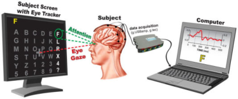
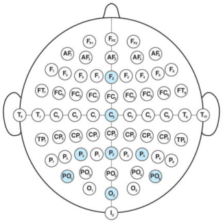
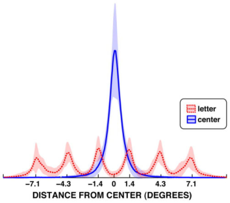
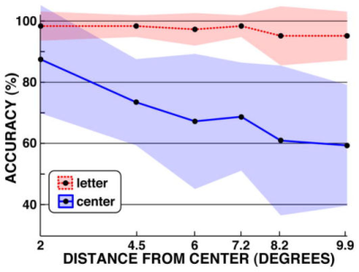
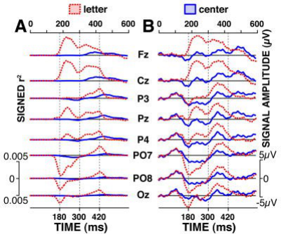
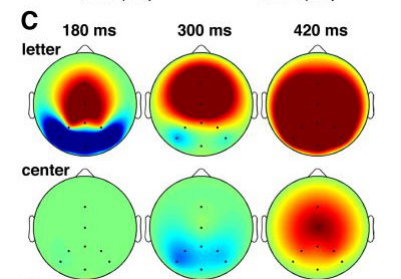

**Influence des mouvements oculaires sur la performance du "P300 Matrix Speller".** Article rédigé par Sébastien Delpeuch, Valentin Escobosa et Natacha Javerzat, Cycle Préparatoire de Bordeaux, Université de Bordeaux, 11 avril 2019.

**Résumé.** De nombreux troubles neuromusculaires engendrent une inaptitude partielle ou totale de la personne atteinte à la communication. Les interfaces cerveau-machine (ICM) offrent une alternative à ces personnes en reliant directement leur activité cérébrale à l'action à effectuer, sans intervention des muscles. Par l'intermédiaire de ces interfaces, il est donc possible de recréer une forme de communication, généralement écrite. Le "P300 Matrix Speller" a été pensé en ce sens. Il s'agit d'une ICM permettant à l'utilisateur de communiquer en inscrivant des lettres sur un écran, et ce en utilisant exclusivement son activité cérébrale. Il a été communément admis que la performance de ce système ne dépend pas de la capacité de l'utilisateur à voir et à fixer la lettre qu'il souhaite écrire. Plus précisément, il a été supposé que les composantes visuelles présentes dans l'activité cérébrale utilisée par la machine n'affectent pas sa fiabilité de manière significative. Cette hypothèse est cependant sujette à débat, ce qui soulève de nombreuses interrogations quant aux possibles applications cliniques. L'objectif de notre étude était d'estimer l'influence des mouvements oculaires sur les performances du P300 Speller.

Nous avons mené une expérience sur une cohorte de 15 sujets sains. Notre protocole consistait à comparer les performances du P300 Speller lors de deux scénarios distincts. Dans un premier temps, les sujets utilisaient le P300 Speller de manière conventionnelle (le regard était porté sur la lettre cible). Dans un second temps, les sujets devaient fixer leur regard sur un élément tiers tout en se concentrant mentalement sur la lettre qu'ils souhaitaient écrire.

Nos résultats ont montré que le taux de performance est bien plus élevé lorsque le caractère cible est fixé par l'utilisateur. Notre expérience suggère que la fiabilité du P300 Matrix Speller dépend significativement de l'emplacement du regard, ce qui va à l'encontre des hypothèses énoncées précédemment. Les relations entre nos résultats et les taux de performance qu'obtiendrait le P300 Speller auprès d'une personne atteinte de troubles oculomoteurs restent indéterminées. Même si nous pouvons raisonnablement affirmer que la fiabilité serait affectée, des études supplémentaires sont nécessaires pour pouvoir estimer dans quelle mesure et pourquoi.

**Mots clés.** ICM, P300, Potentiel Évoqué Visuel, P300 Matrix Speller

## Introduction

De nombreux troubles neuromusculaires engendrent l'inaptitude totale ou partielle de la personne atteinte à la communication. Ces troubles sont dus à des accidents vasculaires, des atteintes à la moelle épinière ou encore à des maladies comme la Sclérose Latérale Amyotrophique (SLA). Ils se traduisent par des paralysies plus ou moins importantes sur l'ensemble du corps. Aux stades les plus avancés de la SLA, la paralysie des muscles entourant les yeux (muscles oculomoteurs) empêche l'utilisation des moyens de communication basés sur la commande oculaire. Divers problèmes cliniques en résultent. On peut, entre autres, soulever la question du consentement et la difficulté à estimer la douleur chez la personne. La fabrication d'un système permettant d'écrire sans aucune intervention des muscles constituerait une alternative pour ces patients. Or, ces "machines à écrire mentales", sollicitant uniquement l'activité cérébrale pour fonctionner, existent déjà. Il s'agit d'interfaces cerveau-machine, généralement visuelles. La plus connue et la plus utilisée de ces interfaces à ce jour est le "P300 Matrix Speller".

Originellement introduit par L. Farwell et E. Donchin en 1988, le P300 Matrix Speller base son fonctionnement sur la détection d'une singularité dans l'activité cérébrale. Cette singularité prend la forme d'une onde d'amplitude caractéristique appelée potentiel P300. Son apparition est interprétée comme la conséquence d'états mentaux particuliers. Dans le cas du P300 Matrix Speller, on montre que la P300 survient lorsque le caractère cible, c'est-à-dire la lettre ou le chiffre que l'on veut inscrire, est présenté à l'utilisateur.

Afin d'optimiser l'apparition de la P300 lors de l'utilisation du système, un paradigme de stimulation a été mis au point. Ce paradigme (Row-Column Paradigm) se présente sous la forme d'une matrice, affichée sur un écran et dans laquelle sont répertoriés les différents caractères (lettres et chiffres) nécessaires à l'écriture. Lorsque le P300 Speller fonctionne, les lignes et les colonnes de la matrice s'illuminent successivement, dans un clignotement très rapide. L'utilisateur est supposé fixer le caractère souhaité. L'illumination du caractère cible initie la réponse P300.

Lors des premières expériences de P300 Matrix Speller, il a été admis que l'onde P300 est le principal marqueur visible par électroencéphalographie, au point de négliger les autres composantes du signal. Ainsi, les composantes visuelles, traditionnellement considérées comme mineures, ne sont pas supposées influencer la performance du système. Cette affirmation est aujourd'hui remise en cause, notamment par les cliniciens. De nombreux enjeux médicaux en découlent.

L'objectif de notre expérience était d'estimer l'influence des mouvements oculaires sur les performances du P300 Speller afin de valider, ou d'invalider, l'hypothèse de L. Farwell et E. Donchin.

## Méthode

### Description de l'expérience, hypothèses

Nous avons évalué les performances du P300 Matrix Speller dans le cadre de deux scénarios distincts.

- Scénario n° 1 : le speller fonctionne de manière conventionnelle, c'est-à-dire que l'utilisateur fixe son regard sur le caractère cible.
- Scénario n° 2 : l'utilisateur a pour consigne de fixer son regard sur une croix affichée au centre de l'écran et de ne pas le déplacer pendant toute la durée de l'expérience. Il se concentre donc sur le caractère cible de manière exclusivement mentale.

Excepté la présence de la croix dans le scénario 2, la matrice utilisée pour la stimulation n'a pas été modifiée. Nous avons considéré les deux hypothèses suivantes :

- Lorsque la lettre cible est fixée normalement par l'utilisateur, les deux composantes (visuelle et P300) sont initiées (scénario 1). Lorsque l'utilisateur regarde dans une autre direction, fixe et inchangée, seule la composante P300 est initiée (scénario 2).
- Le montage optimisé pour le P300 Speller en fonctionnement normal est sous-optimal lorsque les yeux ne fixent pas la cible. Une meilleure performance est donc attendue dans le scénario 1.

### Choix de la cohorte

Notre cohorte était composée de 15 sujets différents, 5 femmes et 10 hommes. Ils sont âgés de 20 à 62 ans, ont une vision normale ou normale corrigée et sont tous droitiers. Ils ont été informés du protocole et sont familiarisés avec le fonctionnement conventionnel du P300 Speller.

### Paradigme

Les sujets ont été placés à une distance de 60 cm de l'écran où était affichée la matrice. Celle-ci présentait 6 lignes et 6 colonnes et comprenait 36 caractères au total (lettres et chiffres). Considérant la distance à l'écran, il a été admis que la matrice occupait un angle de $\pm 7{,}1°$ de l'ensemble du champ visuel.

La direction du regard des utilisateurs a été mesurée par un système de suivi oculaire (eye-tracker) intégré à l'écran, à une fréquence de 60 estimations par seconde. Les coordonnées obtenues ont été intégrées dans l'acquisition des données et également utilisées lors de l'analyse post-expérimentale.

La durée totale de l'expérience était de deux heures par individu. Chaque sujet a testé les deux scénarios successivement. Dans le scénario 2, la croix était colorée et son intensité lumineuse était similaire à celle des autres éléments de la matrice. Si le sujet déplaçait son regard de plus de $2{,}8°$ par rapport à la croix, et ce pendant plus de 300 ms, celle-ci effectuait un mouvement rotatif à 45°. L'utilisateur était donc informé lorsqu'il devait recentrer son regard.

Les sujets ont effectué au total 24 sessions (12 par scénario). Chaque session comportait 4 essais, c'est-à-dire que 4 éléments cibles ont été successivement proposés à l'utilisateur. Lors de chaque essai, les lignes et les colonnes de la matrice ont été illuminées 15 fois respectivement. Chaque illumination durait 125 ms et était suivie par un intervalle de 125 ms également. Une pause de 8 secondes entre les essais a été instaurée, afin que le sujet puisse se concentrer sur la nouvelle cible.

### Acquisition et traitement des données

L'acquisition et le traitement des données ont été effectués par l'intermédiaire du logiciel BCI2000 [1] [2].

**A. Acquisition des données : méthode d'électroencéphalographie.** L'activité cérébrale de l'utilisateur a été enregistrée par l'intermédiaire de 8 électrodes (Fz, Cz, P3, Pz, P4, PO7, Oz, PO8), disposées à la surface du cuir chevelu. Deux électrodes, placées au niveau des apophyses mastoïdes, servaient respectivement d'électrode de masse et d'électrode de référence.

Dans le même temps, les différences de potentiel entre électrodes ont été mesurées. Ces données ont été utilisées pour construire des images de cartographie fonctionnelle cérébrale. Les données de l'eye-tracker ont également été acquises.

**B. Traitement des données.** Lors de l'extraction des données, nous avons effectué un filtrage spectral du signal entre 0,1 et 20 Hz, puis un sous-échantillonnage à 40 Hz. Considérant que la réponse s'étendait de 0 à 750 ms après présentation du stimulus cible, nous devions considérer 30 caractéristiques par électrode ($40 \times 0{,}75 = 30$), c'est-à-dire 240 caractéristiques pour l'ensemble du montage.

Avant de procéder à la classification, c'est-à-dire à la discrimination entre les stimulus cibles et non cibles, nous avons utilisé une méthode de régression séquentielle [3]. Cette méthode nous a permis de réduire le nombre de caractéristiques à considérer à un maximum de 60 caractéristiques pour l'ensemble du montage. La classification a ensuite été effectuée par l'intermédiaire d'un modèle linéaire [4]. Le classifieur a été entraîné et évalué avant chaque utilisation par un nouveau sujet.

### Vérification

Les deux scénarios ont été pensés pour estimer des différences de performances dues aux mouvements oculaires. Il était donc essentiel de vérifier que les sujets fixaient respectivement la cible dans le scénario 1 ou la croix dans le scénario 2.

Dans le scénario 2, les sujets étaient alertés si leur regard se déplaçait de manière significative. Toutefois, le cas échéant, leur essai n'était pas arrêté.

Une vérification post-expérimentale a été menée.

Les résultats obtenus ont permis de représenter la distribution des distances entre le point fixé à l'écran et le centre de l'écran enregistrées par l'eye-tracker. La courbe relative au scénario 2, en bleu, présente un unique pic centré en 0. On en déduit que le sujet s'est effectivement focalisé sur la croix. La courbe relative au scénario 1, en rouge, présente 6 petits pics réguliers. Chaque pic est centré sur une colonne. On en déduit que le sujet s'est concentré sur les 6 colonnes de manière uniforme. On peut donc conclure que le sujet a correctement effectué les deux scénarios et que les données sont exploitables.

## Résultats

### Comparaison des taux de performance

La performance de la classification (i.e. la fiabilité à différencier correctement un stimulus cible d'un stimulus non-cible) est plus élevée lorsque le speller est utilisé de manière conventionnelle.

La fiabilité de la classification après 15 répétitions du stimulus se situe entre 80 % et 100 % pour le scénario 1 et entre 2,8 % et 90 % pour le scénario 2. La fiabilité de la classification dans le scénario 2 est donc sujette à une importante variabilité.

Les analyses post-expérimentales ont montré que les cibles ont été correctement identifiées (100 % de fiabilité) pour 53 % des sujets dans le scénario 1. Dans le scénario 2, une fiabilité de 100 % n'a jamais été atteinte. Une fiabilité de 50 % a cependant été obtenue pour 47 % des sujets.

### Influence de la distance entre la position du caractère cible et le centre de l'écran

Les données enregistrées par l'eye-tracker permettent d'estimer l'influence, sur la classification, de la distance entre la position du caractère que l'utilisateur souhaite inscrire et le centre de l'écran. Les données de la figure 4 montrent que la courbe correspondant au scénario 1 (en rouge) est pratiquement constante. La fiabilité de la classification ne varie donc pas significativement selon la position du caractère souhaité. Au contraire, la courbe correspondant au scénario 2 (en bleu) témoigne d'une importante diminution de la fiabilité de la classification à mesure que l'on s'éloigne du centre de l'écran. La variation de la distance entre la position du caractère cible et le centre de l'écran influe donc sur la fiabilité de la classification dans le scénario 2, mais pas dans le scénario 1.

### Influence des mouvements oculaires sur l'apparition des marqueurs physiologiques

La fiabilité du P300 Matrix Speller est significativement meilleure dans le cas du premier scénario. Nous avons cherché à expliquer cet écart de performance d'un point de vue physiologique. Pour cela, nous avons comparé l'activité cérébrale enregistrée lors des deux scénarios.

Nous disposons des données d'électroencéphalographie relatives à chaque expérience. En moyennant les réponses obtenues dans un scénario à la suite d'un stimulus cible, l'allure d'une réponse "type" a pu être modélisée, et ce pour chaque électrode. Cette modélisation nous a permis de comparer l'allure de la réponse à un stimulus cible dans les scénarios 1 et 2.

Les premiers signaux visibles sur l'électroencéphalographe dans le cas du scénario 1 apparaissent dès 180 ms après le stimulus cible, et sont suivis par le potentiel P300. La réponse dans le cas du scénario 2 est plus tardive et l'amplitude du potentiel P300 moins importante. Les signaux précoces observés sur l'électroencéphalographe du scénario 1 sont absents des données relatives au scénario 2.

Dans le cas du scénario 1, les données de cartographie fonctionnelle cérébrale montrent une excitation des zones visuelles et occipitales de l'encéphale, puis des zones centro-pariétales. Ces images illustrent l'apparition d'un PEV (Potentiel Évoqué Visuel) précédant l'apparition de l'onde P300. Le PEV est absent des données de cartographie cérébrale du scénario 2.

Il s'agit ensuite d'estimer l'impact de la composante visuelle sur la fiabilité de la classification. Nous avons simulé une nouvelle classification, selon les mêmes critères d'analyse que précédemment, mais en excluant les données provenant des signaux les plus précoces (situés entre 0 et 250 ms après le stimulus). Les résultats montrent une réduction significative de la fiabilité de la classification dans le cas du scénario 1, mais pas de changement significatif dans le scénario 2.

## Discussion

Lorsque le caractère cible est regardé par l'utilisateur (scénario 1), le taux de fiabilité du speller est élevé et le système est optimal. Au contraire, lorsque le regard de l'utilisateur est porté sur un élément autre que le caractère cible et dont la position ne varie pas au cours du temps (scénario 2), la performance du speller devient mauvaise.

Cet écart de performance s'explique d'abord par le fait que, dans le scénario 2, la fiabilité décroît à mesure que la distance entre la position du caractère cible et le centre de l'écran augmente. De telles variations de fiabilité n'apparaissent pas dans le scénario 1.

Cependant, des analyses plus poussées montrent que les écarts de performance entre le scénario 1 et le scénario 2 sont essentiellement dus à des différences physiologiques. Nous avons en effet observé des signaux précoces sur l'électroencéphalographe du scénario 1 qui sont totalement absents de l'électroencéphalographe du scénario 2. Lorsque ces signaux sont virtuellement supprimés de l'électroencéphalographe du scénario 1, le taux de performance chute. En corrélant l'instant de leur apparition aux images de cartographie cérébrale, on montre que ces signaux sont des PEV (Potentiels Évoqués Visuels). Les PEV dépendent de l'intégrité du système visuel. On en déduit que le P300 Speller dépend en effet de l'apparition de l'onde P300 lors de la reconnaissance du stimulus cible, mais également d'une composante visuelle, initiée lorsque le caractère désiré est illuminé.

Il a été montré que le cortex visuel effectue des traitements complexes de divers facteurs spatio-temporels (mouvement, fréquence spatiale, vitesse...) [5]. D'après Martens et al. 2009, ces propriétés peuvent être exploitées pour augmenter l'amplitude de la réponse sur l'électroencéphalographe et donc, par extension, la fiabilité de la classification [6].

Deux aspects de la méthode utilisée lors de cette étude peuvent avoir exagéré la réelle différence de fiabilité entre les deux scénarios.

- Le scénario 2 est une tâche plus complexe, demandant plus d'attention et d'énergie de la part de l'utilisateur. De plus, les sujets n'étaient pas familiarisés avec ce scénario, contrairement au scénario 1. Avec un certain entraînement, on peut supposer que leurs performances sur le scénario 2 auraient été meilleures.
- Dans le scénario 2, certains caractères étaient "désavantagés" en tant que cible, car plus éloignés de la croix centrale que d'autres. Un nombre important d'erreurs était donc attendu. On peut supposer qu'avec une disposition des caractères en cercle autour de la croix centrale, la différence de fiabilité entre les deux scénarios aurait été moins marquée.

Enfin, il est à noter que, lorsque nous avons effectué les contrôles sur les mouvements oculaires, nous n'avons pas contrôlé les mouvements très brefs. Ces mouvements (micro-saccades) contribuent à la stimulation des neurones dans les aires visuelles primaires. Même s'il est connu que la SLA peut rendre impossibles les mouvements oculaires, son effet sur les micro-saccades n'a pas encore été étudié. Les résultats annoncés ici et les résultats attendus pour les patients souffrant de SLA ne peuvent donc pas être directement reliés.

## Conclusion

L'étude montre que la fiabilité du P300 Matrix Speller est affectée par les mouvements oculaires. En effet, nos résultats ont montré que la performance de l'interface dépend significativement de l'intégrité du système visuel. Plus précisément, la performance est affectée lorsque la composante visuelle de la réponse au stimulus (PEV) ne peut être initiée.

Ceci suggère que les performances d'un speller basé uniquement sur l'apparition de la P300 seront significativement altérées si l'utilisateur n'est pas en mesure de fixer le caractère cible. L'hypothèse de L. Farwell et E. Donchin est donc invalidée.

Nos résultats sont cohérents avec le fait que la performance du P300 Speller chute lors de l'utilisation par des patients atteints de SLA. Des recherches plus poussées doivent cependant être menées auprès de ces populations afin d'en établir les causes précises. La connaissance de ces mécanismes pourrait permettre, à terme, d'optimiser un montage en vue d'un usage clinique.

## Références

1. Schalk, Gerwin, McFarland, Dennis J., Hinterberger, Thilo, Birbaumer, Niels et Wolpaw, Jonathan R. *BCI2000 : A general-purpose brain-computer interface (BCI) system*. IEEE Transactions on Biomedical Engineering, vol. 51, no 6, page 10, juin 2004.
2. Schalk, Gerwin et Mellinger, Jürgen. *A practical guide to brain-computer interfacing with BCI2000*. Springer, 2010.
3. Jennrich, R.I., Wiley, John and Sons. *New York*. p. 58-75, 1977.
4. Krusienski D.J., Sellers E.W., Cabestaing F., Bayoudh S., McFarland D.J., Vaughan T.M. et Wolpaw J.R. *A comparison of classification techniques for the P300 speller*. Journal of Neural Engineering, vol. 3, no 4, octobre 2006.
5. Hubel D.H. et Wiesel T.N. *Receptive fields, binocular interaction and functional architecture in the cat's visual cortex*. Journal of Physiology, vol. 10, no 1, janvier 1962.
6. Martens S.M., Hill N.J., Farquhar J. et Schölkopf B. *Overlap and refractory effects in a brain-computer interface speller based on the visual P300 event-related potential*. Journal of Neural Engineering, vol. 6, no 2, mars 2009.
