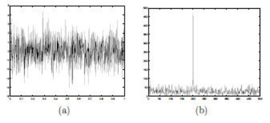
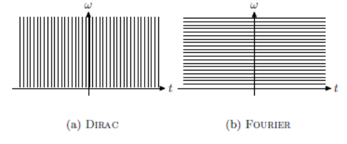
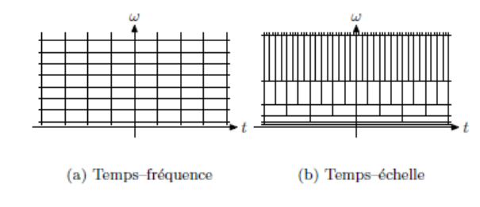
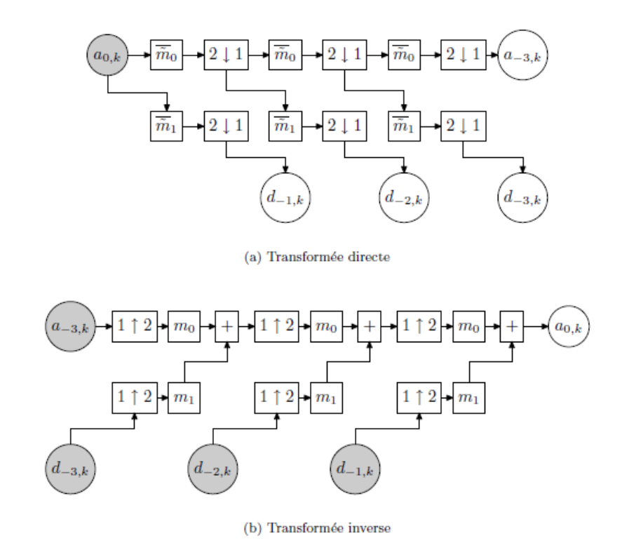

Annexe B du mémoire : explications mathématiques inhérentes aux traitements explicités au [chapitre 2](./traitement-du-signal.md).

Le but de cette annexe est d'offrir au lecteur intéressé les détails mathématiques concernant la transformée de Fourier, les représentations temps-fréquence et les transformées à ondelettes que nous avons utilisées dans la partie [Prétraitement de données d'électroencéphalographie](./traitement-du-signal.md#prétraitement-de-données-délectroencéphalographie). Les références suivantes seront utilisées[^fischer] [^montaine] [^lecomte] [^mallat].

[^fischer]: Fischer, P., Weynas, L. et Dossal, C., *Approximation numérique*, 2017.

[^montaine]: Montaine, B., *Méthodologie d'analyse des synchronisations neuronales dans les signaux EEG à l'aide de graphes d'informations temps-fréquence*, thèse de doctorat, Université de Poitiers, Faculté des Sciences Fondamentales et Appliquées, 2006.

[^lecomte]: Lecomte, M., *Transformation de Fourier*, École des Mines de Douai, juillet 2001.

[^mallat]: Mallat, S., *Une exploration des signaux en ondelettes*, Les éditions de l'École Polytechnique, 2000.

## Rappels sur la transformée de Fourier

### Rappel de quelques propriétés

Que ce soit en mathématiques ou en physique, la transformée de Fourier a été pendant longtemps un des outils les plus utilisés pour le traitement du signal. Cette représentation, basée sur la notion physique de fréquence, est bien adaptée pour traiter des signaux **stationnaires**, c'est-à-dire des signaux qui possèdent certaines propriétés invariantes dans le temps.

Nous travaillons uniquement avec des fonctions unidimensionnelles. L'espace $L^1(\mathbb{R})$ est l'ensemble des fonctions qui sont intégrables, c'est-à-dire telles que $\int_{\mathbb{R}} |f(t)| \, dt < +\infty$. De même, $L^2(\mathbb{R})$ est l'ensemble des fonctions de carré intégrable ($\int_{\mathbb{R}} |f(t)|^2 \, dt < +\infty$). Nous rappelons que $L^2(\mathbb{R})$ est un espace de Hilbert.

**Rappel.** Un espace de Hilbert est un espace préhilbertien complet, c'est-à-dire un espace de Banach dont la norme $\|\cdot\|$ découle d'un produit scalaire ou hermitien $\langle \cdot, \cdot \rangle$ par la formule

$$
\|x\| = \sqrt{\langle x, x \rangle}
$$

pour le produit scalaire

$$
\int_{-\infty}^{+\infty} f(t) \overline{g(t)} \, dt
$$

pour $f, g \in L^2(\mathbb{R})$, et où $\overline{g(t)}$ dénote le conjugué de $g(t)$. La norme d'une fonction $f \in L^2(\mathbb{R})$ sera notée $\|f\| = \sqrt{\int_{-\infty}^{+\infty} |f(t)|^2 \, dt}$.

En 1807, Joseph Fourier présente un mémoire à l'Institut de France qui propose de représenter toute fonction périodique comme une somme de sinusoïdes à différentes fréquences. C'est le début de l'analyse de Fourier, qui va avoir une importance déterminante en analyse mathématique, en physique et dans les sciences de l'ingénieur. Il existe plusieurs définitions de la transformée de Fourier, utilisant des normalisations différentes. Dans le cadre de ce travail, nous utiliserons la définition suivante.

**Définition.** La transformée de Fourier d'une fonction $f \in L^1(\mathbb{R})$ est définie par

$$
\hat{f}(\omega) = \int_{-\infty}^{+\infty} f(t) e^{-i\omega t} \, dt
$$

Elle mesure le contenu oscillatoire de la fonction $f$ à la fréquence $\omega \in \mathbb{R}$. Cette transformation peut être vue comme la projection de $f$ sur des fonctions analysantes qui sont des ondes pures (dont la fréquence ne dépend pas du temps). Celle-ci permet donc d'analyser le contenu fréquentiel d'un signal. Le théorème de Riemann-Lebesgue assure que :

- $f \mapsto \hat{f}$ est une application linéaire, continue de $L^1(\mathbb{R})$ dans $L^\infty(\mathbb{R})$ ;
- si $f \in L^1(\mathbb{R})$, alors $\hat{f}$ est continue sur $\mathbb{R}$ et $\displaystyle\lim_{\omega \to +\infty} \hat{f}(\omega) = 0$.

Parmi les principales propriétés de la transformée de Fourier qui sont souvent utilisées dans les calculs, on peut citer :

| Propriété | Fonction | Transformée de Fourier |
| --- | --- | --- |
| Translation | $f(t - t_0)$ | $e^{-i\omega t_0} \hat{f}(\omega)$ |
| Modulation | $e^{i\omega_0 t} f(t)$ | $\hat{f}(\omega - \omega_0)$ |
| Dilatation / Contraction | $f(t/a)$ | $\lvert a \rvert \hat{f}(a\omega)$ |
| Dérivation | $f^{(p)}(t)$ | $(i\omega)^p \hat{f}(\omega)$ |
| Symétrie hermitienne | $f(t) \in \mathbb{R}$ | $\hat{f}(-\omega) = \overline{\hat{f}(\omega)}$ |

Si $f \in L^1(\mathbb{R}), f' \in L^1(\mathbb{R}), \dots, f^{(p)} \in L^1(\mathbb{R})$, alors $\hat{f}(\omega) = o\left(\dfrac{1}{\omega^p}\right)$. De plus, si

$$
\int_{-\infty}^{+\infty} |\hat{f}(\omega)| (1 + |\omega|)^p \, d\omega < +\infty
$$

alors $f$ est $p$ fois continûment différentiable et bornée. La décroissance de $\hat{f}$ à l'infini est donc caractéristique de la régularité de $f$.

### Transformée de Fourier inverse

Il n'est pas évident de définir la transformée de Fourier inverse, car l'espace $L^1(\mathbb{R})$ n'est pas invariant par cette transformation. L'espace qui est bien adapté pour définir et inverser la transformée de Fourier est l'espace $L^2(\mathbb{R})$. Toutefois, il n'est pas possible de définir "directement" la transformée d'une fonction de $L^2(\mathbb{R})$. Il est nécessaire de se restreindre tout d'abord à $L^2(\mathbb{R}) \cap L^1(\mathbb{R})$, dense dans $L^2(\mathbb{R})$, pour étendre cette transformation et son inverse à $L^2(\mathbb{R})$. Le théorème fondamental de la transformée de Fourier dans $L^2(\mathbb{R})$ est le suivant.

**Théorème.** Soit $f \in L^2(\mathbb{R})$ ; on définit alors formellement la transformée de Fourier et son inverse par :

$$
\hat{f}(\omega) = \int_{-\infty}^{+\infty} f(t) e^{-i\omega t} \, dt
$$

$$
f(t) = \frac{1}{2\pi} \int_{-\infty}^{+\infty} \hat{f}(\omega) e^{i\omega t} \, d\omega
$$

Soit $f, g \in L^2(\mathbb{R})$ ; on obtient alors la formule de Parseval

$$
\int_{-\infty}^{+\infty} f(t) \overline{g(t)} \, dt = \frac{1}{2\pi} \int_{-\infty}^{+\infty} \hat{f}(\omega) \overline{\hat{g}(\omega)} \, d\omega
$$

et la formule de Plancherel

$$
\int_{-\infty}^{+\infty} |f(t)|^2 \, dt = \frac{1}{2\pi} \int_{-\infty}^{+\infty} |\hat{f}(\omega)|^2 \, d\omega
$$

### Produit de convolution

**Définition.** Pour $f \in L^1(\mathbb{R})$ et $h \in L^1(\mathbb{R})$, le produit de convolution de $f$ et $h$, noté $f \star h(t)$, est défini par

$$
f \star h(t) = \int_{-\infty}^{+\infty} f(t - u) h(u) \, du
$$

Alors $f \star h \in L^1(\mathbb{R})$ est défini presque partout et tel que :

- commutativité : $f \star h = h \star f$ ;
- dérivabilité : $\dfrac{d}{dt}(f \star h)(t) = \dfrac{df}{dt} \star h(t) = f \star \dfrac{dh}{dt}(t)$ ;
- convolution avec une masse de Dirac en $t_0$ : $f \star \delta_{t_0}(t) = f(t - t_0)$.

De plus, si l'on note $g = f \star h$, alors :

$$
\hat{g}(\omega) = \hat{f}(\omega) \hat{h}(\omega)
$$

Cette propriété est à la base du filtrage linéaire en traitement du signal. En effet, tout processus de filtrage du type $Lf = f \star h$, où $h$ est la réponse impulsionnelle du filtre $L$, peut s'écrire sous la forme d'un filtrage fréquentiel à partir de la transformée de Fourier inverse

$$
Lf(t) = \frac{1}{2\pi} \int_{-\infty}^{+\infty} \hat{h}(\omega) \hat{f}(\omega) e^{i\omega t} \, d\omega
$$

Chaque composante fréquentielle $e^{i\omega t}$ d'amplitude $\hat{f}(\omega)$ est en effet modulée par le filtre $\hat{h}(\omega)$. Ainsi, décomposer une fonction comme une intégrale de fonctions sinusoïdales complexes $e^{i\omega t}$ permet de calculer directement la réponse d'un filtre $Lf$ à partir de la donnée des coefficients $\hat{h}(\omega)$.

### Exemple de transformée de Fourier

Comme expliqué précédemment, la transformée de Fourier d'un signal permet d'obtenir des informations sur son contenu fréquentiel. La figure suivante représente une fonction sinusoïde de fréquence 200 Hz observée avec un bruit aléatoire, qui correspond au défaut des instruments de mesure et à la présence de parasites. La transformée de Fourier de ce signal permet de retrouver la fréquence de la sinusoïde malgré la présence de ce bruit.

## Fréquence locale

Les ondelettes ont été introduites il y a presque 50 ans pour combler une lacune entre deux modes de représentation du signal : la représentation d'une fonction par son graphe classique de $\mathbb{R}$ dans $\mathbb{R}$, ce qui correspond à une décomposition sur la base continue des distributions de Dirac

$$
f(t) = \int_{\mathbb{R}} f(u) \delta(t - u) \, du
$$

et la représentation dans la base de Fourier dont nous venons de rappeler les principes généraux

$$
f(t) = \frac{1}{2\pi} \int_{\mathbb{R}} \hat{f}(\omega) e^{i\omega t} \, d\omega.
$$

La première représentation donne une information précise en temps : la valeur $f(t)$ indique l'intensité du signal au temps $t$. En revanche, l'information fréquentielle est nulle. La valeur en un point de $f$ ne donne aucune information sur le contenu fréquentiel du signal $f$. À l'inverse, la représentation de Fourier donne une information très précise en fréquence, mais ne donne aucune information temporelle. Naturellement, chacune de ces représentations contient les informations de l'autre, puisque la transformation de Fourier permet de passer de l'une à l'autre. Néanmoins, à chaque fois, seul un type d'information est explicité.

La question qui vient naturellement est la suivante : existe-t-il une représentation dans laquelle on puisse lire une information mixte ? Morlet et Gabor ont cherché à concevoir des fonctions de base qui se situent à mi-chemin entre ces extrêmes, c'est-à-dire qui ont à la fois une bonne localisation fréquentielle et une bonne localisation spatiale.

Une limite théorique dans cette perspective est bien connue : c'est l'inégalité de Heisenberg. Soit une fonction de base $f$, qu'on suppose de norme $L^2$ égale à 1 :

$$
\int |f(t)|^2 \, dt = 1
$$

On définit le centre $c(f)$ et la largeur $\Delta(f)$ d'une telle fonction par

$$
c(f) = \int t |f(t)|^2 \, dt
$$

$$
\Delta(f) = \sqrt{\int (t - c(f))^2 |f(t)|^2 \, dt}
$$

L'inégalité de Heisenberg est une inégalité fondamentale qui s'écrit, pour toute fonction $f$ de norme 1,

$$
\Delta(f) \Delta(\hat{f}) \geq \frac{1}{2}
$$

Si on appelle largeur fréquentielle d'une fonction $f$ la largeur de sa transformée de Fourier $\hat{f}$, cette inégalité interdit donc d'avoir une fonction avec des largeurs temporelle et fréquentielle toutes deux aussi petites que l'on veut.

On connaît également les fonctions qui réalisent le minimum de cette limite théorique : ce sont les fonctions gaussiennes translatées et modulées

$$
A e^{-(t - t_0)^2 / 2\Delta^2} e^{i\omega_0 t}
$$

où $A$ est un coefficient de normalisation tel que la fonction ait une norme $L^2$ égale à 1, qui dépend de $\Delta t$. Pour de telles fonctions, et seulement pour ces fonctions-là, l'inégalité devient une égalité. Ces fonctions ont été appelées ondelettes de Gabor.

## Représentations temps-fréquence et temps-échelle

À une telle fonction, on associe un pavé temps-fréquence, c'est-à-dire un rectangle dans le plan $(t, \omega)$ centré en $(c(f), c(\hat{f}))$ et de dimensions $\Delta(f) \times \Delta(\hat{f})$. Ce pavé est une représentation intuitive de la couverture en temps et en fréquence d'une fonction. On associe également à une base un pavage du plan temps-fréquence, qui est un recouvrement du plan $(t, \omega)$ par des rectangles de couverture des fonctions de base. Si le centre des boîtes de Heisenberg est fixé comme le point des centres spatiaux et fréquentiels de la fonction, leurs dimensions sont en général choisies de telle manière que les boîtes forment une partition du plan temps-fréquence. Cette représentation a un aspect arbitraire, d'autant qu'aucun résultat ne lie le fait qu'une famille soit une base au fait que les pavés temps-fréquence de la famille recouvrent le plan.

Les pavages temps-fréquence correspondant par exemple aux bases de fonctions de Dirac et de fonctions de Fourier sont des pavages par des rectangles infiniment fins et allongés, qui sont représentés schématiquement dans la figure suivante.

Pour représenter un signal comme combinaison de telles fonctions, il est très redondant de laisser varier indépendamment les trois paramètres $t_0$, $\omega_0$ et $\Delta t$. Deux approches différentes ont prévalu :

- La première approche est l'approche temps-fréquence, dans laquelle la largeur spatiale $\Delta t$ des fonctions $g$ est indépendante de la fréquence. Les fonctions s'écrivent sous la forme

  $$
  g_{t_0, \omega_0}(t) = e^{i\omega_0 t} g_0(t - t_0)
  $$

  où $g_0(t) = A_0 e^{-t^2 / 2\Delta t^2}$. Ce mode d'approximation est également appelé analyse de Fourier à fenêtre.
- La deuxième approche est l'approche temps-échelle, utilisée dans la transformée en ondelettes et dans laquelle la largeur spatiale des fonctions $g$ est inversement proportionnelle à la fréquence (le produit $\omega_0 \Delta t$ est constant et égal à $c$). On obtient alors, à un facteur de module 1 près, une forme relativement simple pour les différentes ondelettes

  $$
  g_{t_0, \Delta t}(t) = \frac{1}{\sqrt{\Delta t}} g_0\left(\frac{t - t_0}{\Delta t}\right)
  $$

  où $g_0$ est appelée ondelette mère et peut être choisie en fonction de différentes caractéristiques. Avec

  $$
  g_0(t) = A_0 e^{-t^2 / 2\Delta t^2} e^{ict}
  $$

Les pavages du plan temps-fréquence donnent une idée de la différence des deux approches. Dans le cas de l'analyse temps-fréquence, le pavage obtenu est un pavage par des domaines rectangulaires qui se déduisent les uns des autres par translation dans le plan temps-fréquence. Dans le cas de l'analyse temps-échelle, les domaines sont également de surface constante, mais ont une résolution relative $\Delta\omega / \omega_0$ constante.

Les ondelettes que nous allons utiliser dans la suite correspondent à l'analyse temps-échelle. Les avantages de ce mode de décomposition sont multiples. On dispose de moyens efficaces pour construire des bases discrètes pour lesquelles les calculs de transformation sont très rapides. L'analyse multi-échelles repose sur une forme de fonction unique. Enfin, dans l'analyse temps-échelle, les fonctions de base ont une taille de support proportionnelle à la résolution spatiale liée à leur fréquence par l'inégalité de Heisenberg.

## Transformée à ondelettes continue

On choisit une fonction de base $\psi$ appelée ondelette mère, qui vérifie la condition d'admissibilité

$$
C_\psi = \int_{\mathbb{R}} \frac{|\hat{\psi}(\omega)|^2}{|\omega|} \, d\omega < +\infty \tag{B.1}
$$

On définit la transformée en ondelettes continue $\mathcal{W}f$ de la fonction $f$ par la formule suivante

$$
\mathcal{W}f(t, s) = \int_{\mathbb{R}} f(\tau) \frac{1}{\sqrt{s}} \overline{\psi\left(\frac{\tau - t}{s}\right)} \, d\tau \tag{B.2}
$$

La transformée inverse s'écrit

$$
f(t) = \frac{1}{C_\psi} \iint_{\mathbb{R}^2} \mathcal{W}f(\tau, s) \frac{1}{\sqrt{s}} \psi\left(\frac{t - \tau}{s}\right) d\tau \frac{ds}{s^2} \tag{B.3}
$$

En revanche, la représentation d'une fonction $f$ par sa transformée en ondelettes n'est pas biunivoque mais redondante, car une transformée en ondelettes vérifie une équation aux noyaux reproduisants

$$
\mathcal{W}f(t, s) = \frac{1}{C_\psi} \iint_{\mathbb{R}^2} \mathcal{W}f(\tau, \sigma) K(\tau, t, \sigma, s) \, d\tau \frac{d\sigma}{\sigma^2}
$$

avec un noyau $K$ défini par

$$
K(\tau, t, \sigma, s) = \int_{\mathbb{R}} \frac{1}{\sqrt{\sigma s}} \psi\left(\frac{t' - t}{s}\right) \overline{\psi\left(\frac{t' - \tau}{\sigma}\right)} \, dt'
$$

## La transformée à ondelettes discrète

Morlet a proposé de construire des bases ou des *frames* de fonctions construites sur le modèle suivant

$$
g_{t_0, \Delta t}(t) = \frac{1}{\sqrt{\Delta t}} g\left(\frac{t - t_0}{\Delta t}\right)
$$

où les valeurs possibles de $\Delta t$ sont prises sur une échelle géométrique et les paramètres de translation sont proportionnels à $\Delta t$ :

$$
\Delta t = b^j \qquad t_0 = k \Delta t
$$

Une gamme d'échelles $\Delta t$ couramment utilisée est la gamme des échelles dyadiques $2^j$, et on obtient des familles constituées de fonctions de la forme $g_0(2^j(t - 2^{-j}k)) = g(2^j t - k)$, où $j$ et $k$ sont des entiers relatifs. La normalisation la plus couramment utilisée étant une normalisation en norme $L^2$, on obtient des familles de fonctions $(\psi_{jk})_{j,k \in \mathbb{Z}}$ où $\psi_{jk}(t) = 2^{j/2} \psi(2^j t - k)$.

Dans un article écrit en 1987, Stéphane Mallat[^mallat-donnees] a mis en avant une certaine catégorie de décompositions en ondelettes qui peut être réalisée numériquement en un temps très court par une "transformée en ondelettes rapide", pour laquelle l'ondelette de base doit être écrite comme convolution infinie de filtres discrets. Plus exactement, soit un couple de filtres discrets $(m_0, m_1)$

[^mallat-donnees]: Mallat, S., *Science des données*, Collège de France, Fayard, 26 septembre 2018.

$$
k \mapsto m_0[k] \qquad k \in \mathbb{Z} \tag{B.4}
$$

$$
k \mapsto m_1[k] \qquad k \in \mathbb{Z} \tag{B.5}
$$

dont les transformées de Fourier $\omega \mapsto m_0(\omega)$ et $\omega \mapsto m_1(\omega)$ sont des fonctions $2\pi$-périodiques. On suppose qu'il existe une fonction d'échelle $\phi$ et une ondelette $\psi$ de $L^2(\mathbb{R})$ telles que

$$
\hat{\phi}(\omega) = \prod_{k=1}^{+\infty} m_0\left(\frac{\omega}{2^k}\right) \tag{B.6}
$$

$$
\hat{\psi}(\omega) = m_1\left(\frac{\omega}{2}\right) \hat{\phi}\left(\frac{\omega}{2}\right) \tag{B.7}
$$

Sous certaines conditions sur $m_0$ et $m_1$, la famille $(\psi_{jk})$ est une base orthogonale, et la décomposition en ondelettes d'une fonction échantillonnée peut être effectuée par un algorithme rapide constitué d'une cascade de filtrages et de sous-échantillonnages. Cette approche réduit considérablement la complexité de la construction d'une ondelette. Au lieu de choisir une fonction, on choisit l'ensemble discret (et fini) des coefficients des deux filtres.

## Analyses multi-résolutions

Le cadre d'analyse de ces ondelettes qui s'expriment à l'aide de filtres discrets s'est considérablement développé ces dernières années, et nous disposons de tout un jeu de théorèmes reliant les propriétés des ondelettes et celles des filtres discrets. Par ailleurs, il existe plusieurs familles classiques d'ondelettes, qui portent en général soit le nom de leur créateur, soit celui d'une propriété.

### Cadre théorique

Le cadre théorique posé par Stéphane Mallat est basé sur la notion d'analyse multi-résolutions. Une analyse multi-résolutions est une famille de sous-espaces de $L^2(\mathbb{R})$ notée $(V_j)_{j \in \mathbb{Z}}$ qui ont les propriétés suivantes.

$$
V_j = \left\{ \sum_{k \in \mathbb{Z}} a_k \phi_{jk} : a_k \in \mathbb{R} \right\} \quad \text{Espace de Riesz} \tag{B.8}
$$

$$
V_j \subset V_{j+1} \tag{B.9}
$$

$$
\bigcap_{j \in \mathbb{Z}} V_j = \{0\} \tag{B.10}
$$

$$
\overline{\bigcup_{j \in \mathbb{Z}} V_j} = L^2(\mathbb{R}) \tag{B.11}
$$

Les ondelettes apparaissent naturellement comme un moyen d'écrire la différence entre deux espaces $V_j$ et $V_{j+1}$ consécutifs. On construit pour cela un espace de Riesz $W_0$ tel que

$$
V_0 \oplus W_0 = V_1 \tag{B.12}
$$

L'espace $W_0$ est engendré par une fonction $\psi$

$$
W_0 = \left\{ t \mapsto \sum_{k \in \mathbb{Z}} d_k \psi(t - k) : d_k \in \mathbb{R} \right\}
$$

Ceci impose que la fonction $\psi$ soit dans l'espace $V_1$, et s'écrive comme combinaison linéaire des fonctions $(t \mapsto \phi(2t - k))_{k \in \mathbb{Z}}$

$$
\psi(t) = \sum_{k \in \mathbb{Z}} m_1[k] \phi(2t - k) \tag{B.13}
$$

Ainsi paraît le deuxième filtre discret $m_1$.

On montre que les fonctions $\phi$ et $\psi$ sont alors définies par les seules données des filtres discrets $m_0$ et $m_1$. Les formules sont

$$
\hat{\phi}(\omega) = \prod_{k=1}^{+\infty} m_0\left(\frac{\omega}{2^k}\right) \tag{B.14}
$$

$$
\hat{\psi}(\omega) = m_1\left(\frac{\omega}{2}\right) \hat{\phi}\left(\frac{\omega}{2}\right) \tag{B.15}
$$

### Les bases d'ondelettes

La relation (B.12) se transpose à toutes les échelles $j$

$$
V_j \oplus W_j = V_{j+1} \tag{B.16}
$$

On obtient par itérations de cette relation

$$
V_j \oplus W_j \oplus \dots \oplus W_{j'-1} = V_{j'} \quad \text{si } j < j' \tag{B.17}
$$

En faisant tendre $j'$ vers $+\infty$, on obtient deux relations

$$
L^2(\mathbb{R}) = V_j \oplus \overline{\bigoplus_{j'=j}^{+\infty} W_{j'}} \quad \forall j \in \mathbb{Z} \tag{B.18}
$$

$$
L^2(\mathbb{R}) = \overline{\bigoplus_{j'=-\infty}^{+\infty} W_{j'}} \tag{B.19}
$$

La réunion des bases de Riesz de chacun des espaces de ces sommes directes fournit aussi plusieurs bases d'ondelettes

$$
\mathcal{B}_j = \{\phi_{jk} : k \in \mathbb{Z}\} \cup \{\psi_{j'k} : j' \geq j, k \in \mathbb{Z}\} \tag{B.20}
$$

### Transformée à ondelettes

La transformée à ondelettes s'applique à des signaux échantillonnés sur une grille discrète, et en général cet échantillonnage consiste à approcher une fonction de $L^2(\mathbb{R})$ par

$$
f = \sum_{k \in \mathbb{Z}} 2^{j/2} f[k/2^j] \phi_{jk}
$$

où l'échantillon $f[k/2^j]$ peut lui aussi être estimé par

$$
f[k/2^j] \sim f(k/2^j)
$$

Le signal original est donc représenté sur une base de Riesz de $V_j$. Appliquer à ce signal une transformation en ondelettes jusqu'à l'échelle $L \in \mathbb{Z}$ revient à représenter ce signal sur une base adaptée à la somme directe

$$
V_L \oplus W_L \oplus W_{L+1} \oplus \dots \oplus W_{j-1}
$$

L'algorithme de transformation est itératif et consiste à remplacer la représentation d'une composante sur $V_{j'}$ par une représentation sur $V_{j'-1} \oplus W_{j'-1}$. On passe ainsi successivement par des décompositions adaptées aux différentes sommes directes suivantes

$$
\begin{aligned}
&V_{j-1} \oplus W_{j-1} \\
&V_{j-2} \oplus W_{j-2} \oplus W_{j-1} \\
&\qquad \vdots \\
&V_L \oplus W_L \oplus W_{L+1} \oplus \dots \oplus W_{j-1}
\end{aligned}
$$

### Filtres duaux, ondelettes duales

L'itération de base de transformations en ondelettes est donc un changement de base entre les deux décompositions suivantes

$$
V_{j+1} \to V_j \oplus W_j
$$

Elle s'écrit comme une correspondance

$$
\begin{aligned}
l_2(\mathbb{Z}) &\to l_2(\mathbb{Z}) \times l_2(\mathbb{Z}) \\
(a_{j+1,k})_{k \in \mathbb{Z}} &\mapsto [(a_{jk})_{k \in \mathbb{Z}}, (d_{jk})_{k \in \mathbb{Z}}]
\end{aligned}
$$

Si on note $A_j$ et $D_j$ les fonctions $2\pi$-périodiques dont les coefficients sont les suites discrètes $k \mapsto a_{jk}$ et $k \mapsto d_{jk}$

$$
A_j(\omega) = \sum_{k \in \mathbb{Z}} a_{jk} e^{-ik\omega}
$$

$$
D_j(\omega) = \sum_{k \in \mathbb{Z}} d_{jk} e^{-ik\omega}
$$

l'itération de base s'écrit comme l'application d'une matrice de transfert :

$$
\begin{bmatrix} A_j(2\omega) \\ D_j(2\omega) \end{bmatrix} = \begin{bmatrix} m_0(\omega) & m_0(\omega + \pi) \\ m_1(\omega) & m_1(\omega + \pi) \end{bmatrix} \begin{bmatrix} A_{j+1}(\omega) \\ A_{j+1}(\omega + \pi) \end{bmatrix}
$$

Une condition nécessaire pour que cette transformation soit inversible est donc que la matrice de transfert

$$
T(\omega) = \begin{pmatrix} m_0(\omega) & m_0(\omega + \pi) \\ m_1(\omega) & m_1(\omega + \pi) \end{pmatrix}
$$

soit bornée d'inverse bornée sur $[0, 2\pi]$. Dans ce cas, on appelle matrice de transfert duale la matrice $\tilde{T}(\omega) = T(\omega)^{-T}$. Il existe deux autres fonctions $2\pi$-périodiques $\tilde{m}_0$ et $\tilde{m}_1$ telles que $\tilde{T}(\omega)$ s'écrive

$$
\tilde{T}(\omega) = \begin{pmatrix} \tilde{m}_0(\omega) & \tilde{m}_0(\omega + \pi) \\ \tilde{m}_1(\omega) & \tilde{m}_1(\omega + \pi) \end{pmatrix}
$$

Ces filtres définissent les ondelettes duales $\tilde{\phi}$ et $\tilde{\psi}$ par des relations identiques à (B.14) et (B.15)

$$
\hat{\tilde{\phi}}(\omega) = \prod_{k=1}^{+\infty} \tilde{m}_0\left(\frac{\omega}{2^k}\right) \tag{B.21}
$$

$$
\hat{\tilde{\psi}}(\omega) = \tilde{m}_1\left(\frac{\omega}{2}\right) \hat{\tilde{\phi}}\left(\frac{\omega}{2}\right) \tag{B.22}
$$

Les fonctions $\tilde{\phi}$ et $\tilde{\psi}$ sont donc des ondelettes duales, dans le sens où, pour tout $j$, on a les formules de décomposition sur $L^2(\mathbb{R})$

$$
f = \sum_{k \in \mathbb{Z}} \langle f, \tilde{\phi}_{jk} \rangle \phi_{jk} + \sum_{j' \geq j, k \in \mathbb{Z}} \langle f, \tilde{\psi}_{j'k} \rangle \psi_{j'k} \tag{B.23}
$$

pour tous $j \in \mathbb{Z}$ et $f \in L^2(\mathbb{R})$, et, en faisant tendre $j$ vers $-\infty$, la formule de décomposition homogène

$$
f = \sum_{j, k \in \mathbb{Z}} \langle f, \tilde{\psi}_{jk} \rangle \psi_{jk} \tag{B.24}
$$

### Algorithme de la transformée à ondelettes rapide

Les coefficients des filtres $m_0$, $m_1$ et des filtres duaux $\tilde{m}_0$ et $\tilde{m}_1$ interviennent dans le calcul des changements de base

$$
\{\phi_{jk} : k \in \mathbb{Z}\} \cup \{\psi_{jk} : k \in \mathbb{Z}\} \leftrightarrow \{\phi_{j+1,k} : k \in \mathbb{Z}\}
$$

avec les formules suivantes :

- dans le sens de transformation dit "direct" (*forward wavelet transform*, FWT), on a

  $$
  a_{jk} = 2 \sum_{l \in \mathbb{Z}} \tilde{m}_0[k] a_{j+1, 2l-k}
  $$

  $$
  d_{jk} = 2 \sum_{l \in \mathbb{Z}} \tilde{m}_1[k] a_{j+1, 2l-k}
  $$

- et dans le sens de transformation inverse (*inverse wavelet transform*, IFWT), on obtient

  $$
  a_{j+1,k} = \frac{1}{2} \sum_{l \in \mathbb{Z}} m_0[2l - k] a_{jl} + m_1[2l - k] d_{jl}
  $$

Des schémas de transformation directe et de transformation inverse sont représentés sur la figure suivante entre les échelles $j = 0$ et $j = -3$.

Pour un nombre fini $N$ d'échantillons, une transformation en ondelettes (jusqu'à n'importe quelle profondeur autorisée par la taille de l'échantillon) prend moins de $A \times N$ opérations, où la constante $A$ dépend naturellement de la taille des filtres.

