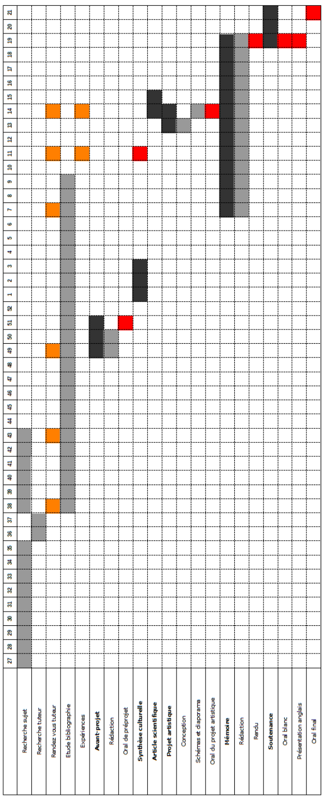

Annexe E du mémoire.

Tout au long de ce projet, nous avons dû gérer une organisation en trinôme. Afin de faciliter nos échanges, nous avons eu recours à une plateforme de partage de documents (Google Drive). Ce service nous a permis de communiquer rapidement sur le travail à faire, en cours et celui déjà fait. Par ailleurs, nous avons choisi de réaliser tous les livrables liés à ce projet avec le langage LaTeX. L'un des membres du groupe étant déjà expérimenté quant à l'utilisation de ce langage, il a pu initier les autres afin de garantir une meilleure cohésion et harmonisation de nos rendus. D'autre part, la rédaction via LaTeX étant devenue la norme dans de nombreux domaines scientifiques, cet apprentissage nous sera utile dans le futur.

Grâce à ces deux outils, nous avons pu nous répartir le travail selon les envies et compétences de chacun. Nous pouvions aisément consulter les avancées de nos travaux, les corriger ainsi qu'effectuer des ajouts. Toutes nos expériences ont été réalisées en trinôme, avec l'aide de notre tutrice. Les différentes tâches que nous avons été amenés à effectuer au cours de ce projet sont répertoriées dans la figure suivante. Les rencontres avec notre tutrice ou un autre intervenant extérieur au projet sont symbolisées par un carré orange. Les carrés rouges représentent les évaluations.

## Table des figures

Sources des figures du mémoire, telles qu'indiquées dans la table des figures (certaines adresses sont tronquées dans le document d'origine).

| Figure | Source |
| --- | --- |
| 1.1 | `https://www.semanticscholar.org/paper/Rapid-Communication-with-a--Matrix-Speller-Brunner` |
| 1.2 | `https://fr.wikipedia.org/wiki/Lobe_(cerveau)` |
| 1.3 | `https://www.researchgate.net/figure/Recorded-scalp-electrode-positions` |
| 2.1 | `http://www.f-legrand.fr/scidoc/docimg/numerique/tfd/echantillonnage/echantillonnage.html` |
| 2.2 | `http://villemin.gerard.free.fr/Wwwgvmm/Analyse/Fourier.htm` |
| 2.3 | `https://perso.crans.org/dandrimont/rapports/Montage-05-FiltresActifs.pdf` |
| 2.4, 2.5, 2.6 | `http://www.tsi.enst.fr/pages/enseignement/ressources/mti/donoho/Decomposition/Decomposition.htm` |
| 2.7 | `https://www.semanticscholar.org/paper/Filtrage-spatial-robuste` |
| 2.8, 2.9 | Image personnelle |
| 2.10 | `http://www.loria.fr/fr/sortie-du-livre-les-interfaces-cerveau-ordinateur` |
| 2.11 à 2.14 | Image personnelle |
| 3.1 à 3.3 | Image personnelle |
| 3.4 | Serveur d'acquisition de la plateforme OpenViBE |
| 3.5 à 3.16 | Image personnelle |
| 3.17 | `https://www.researchgate.net/figure/Components-of-a-BCI-system-signals-from-the-users-brain-are-` (fig1_267792090) |
| 3.18 | `https://www.frontiersin.org/articles/10.3389/fnins.2018.00517/full` |
| A.1 | Trois filtres laplaciens appliqués à l'électrode Cz |
| B.1 | Signal : sinus à 200 Hz et bruit, et sa transformée de Fourier |
| B.2 | Pavages temps-fréquence associés aux représentations de Dirac et de Fourier |
| B.3 | Pavages du plan temps-fréquence pour les représentations temps-fréquence et temps-échelle |
| B.4 | Transformées en ondelettes rapides |
| E.1 | Diagramme de Gantt de notre organisation |
