Dans les chapitres [1](./activite-cerebrale.md) et [2](./traitement-du-signal.md), nous avons expliqué comment enregistrer et traiter l'activité cérébrale afin que celle-ci puisse être exploitée par une ICM. Dans ce chapitre, nous allons voir comment implémenter en pratique l'enregistrement, le traitement et l'utilisation des signaux par le P300 Matrix Speller.

## Cahier des charges

### Matériel

Nous cherchons à mettre en place une ICM permettant la communication écrite. Nous avons choisi de paramétrer l'implémentation du P300 Matrix Speller, en utilisant le Paradigme Ligne/Colonne (voir [Un exemple d'ICM : le P300 Matrix Speller](./activite-cerebrale.md#un-exemple-dicm--le-p300-matrix-speller)).

Nous avons utilisé du matériel et une salle d'expérience prêtés par Inria. Pour l'enregistrement de nos signaux, nous disposons d'un casque EEG comportant 32 électrodes. Nous n'en utilisons en pratique que trois : les électrodes Cz, Oz et O2, car elles permettent de détecter les réponses P300 à la suite de stimuli visuels. Le contact entre les capteurs et le cuir chevelu est assuré par un gel. La stimulation (c'est-à-dire la matrice 6x6 comprenant les lettres et les chiffres) est affichée sur un écran d'ordinateur, placé devant l'utilisateur. Pour implémenter le Speller, nous utilisons le logiciel OpenViBE. Nous allons détailler son fonctionnement.

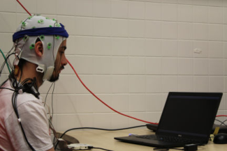

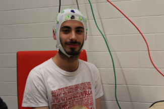

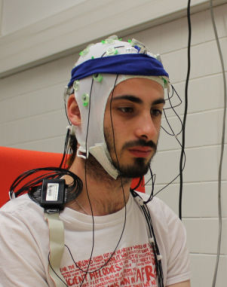

### Présentation d'OpenViBE

OpenViBE est une plateforme logicielle développée par Inria et basée sur le langage C++. Elle a été conçue pour le traitement en temps réel de données électrophysiologiques. La particularité d'OpenViBE est son langage graphique, qui facilite la conception de chaînes de traitement de signaux. OpenViBE permet le fonctionnement de plusieurs applications. La première est l'Acquisition Server, qui sert d'interface avec le dispositif d'enregistrement des signaux. Il délivre un flux de signaux qui sont ensuite transmis aux chaînes de traitement des signaux composées par l'opérateur via l'application Designer d'OpenViBE. Le traitement des signaux peut ainsi s'effectuer exclusivement par l'intermédiaire d'OpenViBE, ce qui nous assure d'éviter les problèmes de compatibilité et simplifie la création d'une ICM.

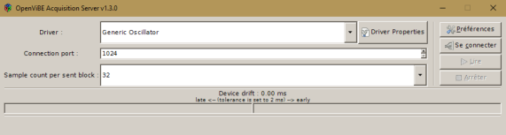

*Figure 3.4 : serveur d'acquisition de la plateforme OpenViBE. Le dispositif matériel EEG utilisé peut être sélectionné à partir d'un menu déroulant et ses propriétés peuvent être configurées. Lorsqu'on clique sur le bouton Play, le serveur d'acquisition commence à envoyer des données à des applications clientes telles que le Designer d'OpenViBE.*

L'application Designer est essentielle. Il s'agit d'un éditeur graphique qui permet de construire et d'exécuter les chaînes de traitement des signaux. Son utilisation est assez simple ; elle permet d'implémenter de nouvelles expériences d'ICM très rapidement, sans programmation.

Pour cela, le Designer met à la disposition de l'utilisateur un ensemble de "boîtes", c'est-à-dire des composants préprogrammés utilisés usuellement dans l'implémentation des chaînes de traitement. En manipulant ces boîtes, on peut ainsi créer facilement une chaîne de traitement comprenant filtres, techniques de visualisation, algorithmes de classification... Cependant, OpenViBE ne fournit pas tous les composants préprogrammés imaginables : pour certaines expériences, il est nécessaire de modifier et/ou programmer des composants. Cette programmation requiert l'utilisation de Lua, un langage rapide et intuitif.

Nous utiliserons OpenViBE dans le cadre de notre expérience ; nos algorithmes sont tirés des exemples d'algorithmes disponibles dans OpenViBE concernant les P300 Spellers.

### Implémentation du P300 Matrix Speller : 3 étapes

Nous avons vu au [chapitre 2](./traitement-du-signal.md) que concevoir une ICM exploitant l'apprentissage automatique nécessite une phase de calibrage durant laquelle des signaux d'apprentissage sont acquis. Ces signaux sont utilisés pour paramétrer l'extraction des caractéristiques et entraîner le classifieur (LDA), qui nous permet ici de différencier deux classes de signaux : P300 (cible) et non-P300 (non-cible). On peut ensuite procéder à la phase d'utilisation des modèles (extraction et classification) en situation "réelle", c'est-à-dire lorsque le speller fonctionne. Le système est alors entraîné à reconnaître les modifications (P300) qui apparaissent dans l'activité cérébrale de l'utilisateur. Celui-ci focalise son attention sur la lettre qu'il souhaite écrire et que l'on cherche à déterminer.

Ce procédé peut être découpé en trois étapes distinctes dans OpenViBE sous forme de "scénarios", c'est-à-dire d'assemblages de boîtes préprogrammées. Le premier scénario consiste en l'acquisition des données EEG de l'utilisateur après présentation de stimuli. Le second scénario, "entraînement du classifieur", nous permet de paramétrer le classifieur LDA (voir [Un classifieur particulier : la LDA](./traitement-du-signal.md#un-classifieur-particulier--la-lda)) pour la différenciation en deux classes. Ce scénario se base sur les données EEG enregistrées lors du scénario précédent. Comme les stimuli sont localisables temporellement, l'ordinateur peut relier l'instant de l'envoi des stimuli à la réponse EEG et ainsi déterminer la forme d'un signal cible (P300). Le dernier scénario, "utilisation", permet de faire fonctionner le speller. Il utilise les modèles qui ont été paramétrés lors des deux précédents scénarios afin que l'utilisateur puisse écrire un mot en s'appuyant exclusivement sur son activité cérébrale.

Il est à noter que, dans le jargon d'OpenViBE, stimuli et stimulation sont des termes distincts, qu'il convient de ne pas confondre. Les "stimuli" sont considérés comme des impulsions répétées pour provoquer une réaction du corps. Les signaux associés sont symbolisés par un triangle rose dans le logiciel. Ici, la réaction attendue est la génération d'un potentiel P300 et les stimuli sont les clignotements de la matrice de lettres. Le terme "stimulation" est réservé à l'interaction entre les boîtes. Il peut s'agir de messages ordonnant l'activation ou l'arrêt d'une partie ou de la totalité du programme, ou encore de messages indiquant l'instant d'envoi d'un stimulus (symbolisé par un triangle violet). L'échange d'informations sous forme matricielle se symbolise par un triangle vert. Les différents triangles représentent en fait l'information qu'une boîte prend en entrée et celle qu'elle donne en sortie.

## Détails des algorithmes

Cette section a pour objectif de décrire avec précision les trois scénarios constituant l'implémentation du P300 Matrix Speller. Nos explications sont illustrées avec des données réelles acquises lors de notre expérimentation. Comme nous l'avons expliqué, ces scénarios sont construits à partir de boîtes préprogrammées. Nous explicitons ici le rôle de ces boîtes, leur impact sur le signal et la manière dont nos données sont transformées. Un descriptif technique du fonctionnement de chaque boîte est disponible en annexe D ([Description des boîtes](./boites-openvibe.md)).

### Scénario 1 : acquisition

Au cours de ce premier scénario, l'utilisateur ne choisit pas la lettre qu'il souhaite écrire. En effet, l'objectif de l'acquisition est de constituer un ensemble de signaux d'apprentissage (voir le [chapitre 2](./traitement-du-signal.md)). Ces signaux permettent au système d'apprendre à reconnaître les modifications qui se produisent dans l'activité cérébrale de l'utilisateur lorsqu'il focalise son attention sur une lettre cible. Le programme impose donc à l'utilisateur une lettre cible puis lance la stimulation, c'est-à-dire l'illumination des lignes et colonnes de la matrice.

À la fin de la stimulation, un premier signal d'entraînement est acquis, permettant au programme de mettre en parallèle les apparitions de la P300 et les illuminations de la lettre cible imposée. Une nouvelle lettre cible est ensuite désignée et l'opération recommence, jusqu'à l'acquisition de 10 signaux d'entraînement. Ce scénario se divise logiquement en deux chaînes de boîtes. L'une permet d'enregistrer les données et l'autre permet d'envoyer des stimuli censés initier une réponse P300. Cette chaîne régit aussi le déroulement du scénario (début, fin).

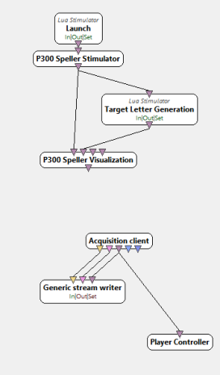

Commençons par expliquer l'envoi des stimuli P300 à l'utilisateur. Le scénario est déclenché par l'expérimentateur via le bouton d'activation Play. La boîte Launch envoie alors une stimulation ordonnant la mise en action du P300 Speller Stimulator. Cette boîte permet d'indiquer les caractéristiques de la session d'entraînement. Nous choisissons une session comprenant 10 essais, avec 12 répétitions (12 clignotements de chaque ligne et colonne, donc 24 clignotements pour chaque lettre de la grille).

Elle permet également de paramétrer la matrice utilisée pour épeler des mots. Nous utilisons ici une matrice 6x6. Il est à noter que la boîte P300 Speller Visualisation nous permet de visualiser et de définir la couleur, la luminosité et la taille de la matrice. Ces réglages sont cruciaux, car la qualité des signaux EEG est influencée par les réglages de cette matrice.

Les événements permettant d'initier la réponse P300 sont déclenchés grâce au clignotement de chaque ligne et colonne de la matrice.

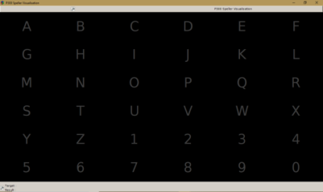

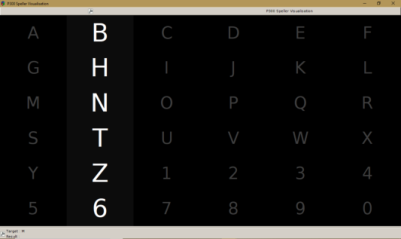

Pour acquérir des signaux d'apprentissage, le programme demande à plusieurs reprises à l'utilisateur de focaliser son attention sur une lettre par l'intermédiaire de la boîte Target Letter Generation. Une lettre par essai, imposée par le programme, est considérée comme cible. On aura donc au total 10 lettres cibles pour entraîner le classifieur. Pour demander à l'utilisateur de se concentrer sur une lettre en particulier, le programme colore momentanément la lettre en bleu (figure 3.8).

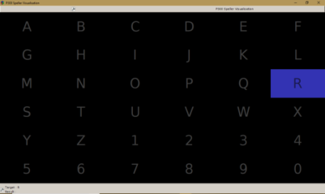

Considérons l'exemple suivant. Le scénario est activé, le P300 Speller Stimulator demande au Target Letter Generation la première lettre cible ; celui-ci renvoie "R". Pendant toute la durée de l'essai, qui comprend 12 clignotements pour les lignes et 12 clignotements pour les colonnes, Target Letter Generation va noter, selon les informations reçues par P300 Speller Stimulator, si la lettre R a été flashée. Cette information sera ensuite corrélée avec l'activité cérébrale et utilisée dans l'entraînement du classifieur. On appelle cette information la stimulation d'entraînement. Le même procédé se déroule pour 9 autres lettres. Lorsque les 10 essais prévus par P300 Speller Stimulator sont terminés, Target Letter Generation envoie le signal d'arrêt du scénario. L'ensemble des stimulations d'entraînement constitue l'ensemble d'entraînement.

La seconde chaîne de traitement permet d'enregistrer les données cérébrales. Elle est construite à l'aide des boîtes Acquisition Client et Generic Stream Writer. Acquisition Client collecte les données enregistrées par le casque EEG. Generic Stream Writer inscrit ensuite ces données dans un fichier.

En résumé, le scénario "acquisition" est composé de deux chaînes de traitement qui travaillent en parallèle. La première se charge de présenter des stimuli à l'utilisateur (via la matrice clignotante) tout en conservant les données concernant ces stimuli (c'est-à-dire si le stimulus est cible ou non-cible). La seconde se charge d'enregistrer l'activité cérébrale qui fait réponse à ces stimuli.

### Scénario 2 : entraînement du classifieur

Lorsque l'acquisition est terminée, nous pouvons passer à la phase où l'on utilise ce panel de "données-exemples" pour entraîner notre classifieur à différencier un potentiel P300 des autres signaux présents sur l'électroencéphalogramme. Les deux classes de signaux que notre classifieur (la LDA) doit discriminer sont "cible", lorsqu'il s'agit du potentiel P300, et "non-cible", pour les autres signaux. Ce scénario ne requiert pas d'action de la part de l'utilisateur.

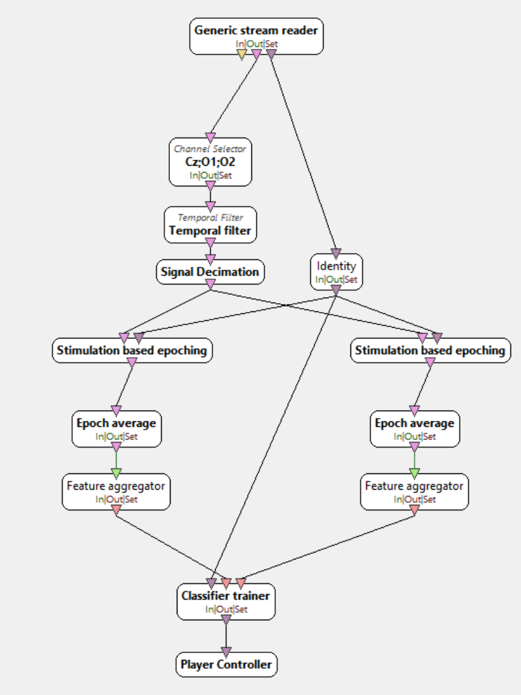

Dans le précédent scénario, nous avons établi une "stimulation d'entraînement". L'idée générale du scénario d'entraînement du classifieur est de comparer la stimulation d'entraînement avec l'activité cérébrale qui a été enregistrée. Reprenons l'exemple du précédent scénario avec la lettre R. Grâce à la stimulation d'entraînement, nous pouvons savoir quand la lettre R a été illuminée. Le classifieur peut donc déterminer que, à tel instant, il doit reconnaître un P300. Ainsi, de corrélation en corrélation, le classifieur s'entraîne à détecter les P300 sur l'électroencéphalogramme.

Cependant (voir [Prétraitement de données d'électroencéphalographie](./traitement-du-signal.md#prétraitement-de-données-délectroencéphalographie)), nous ne pouvons pas donner en entrée le signal EEG brut. Nous devons au préalable traiter le signal. Le prétraitement se base sur les données du scénario précédent, qui sont récupérées via la boîte Generic Stream Reader.

Ces données sont ensuite transmises à la chaîne de prétraitement, constituée des boîtes Channel Rename, Channel Selector, Temporal Filter et Signal Decimation. Channel Rename nous permet de renommer les électrodes en fonction de leur emplacement (par commodité). Channel Selector nous permet de sélectionner les électrodes d'intérêt (voir [Représentation spatiale](./traitement-du-signal.md#représentation-spatiale)), c'est-à-dire celles qui sont susceptibles de détecter une réponse P300. Il s'agit des électrodes Cz, Oz et O2.

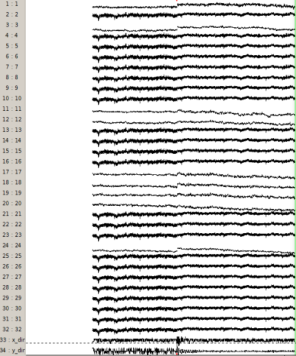

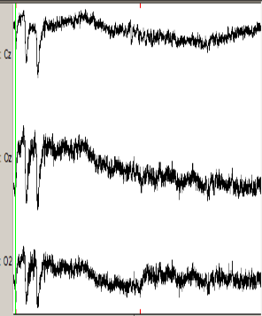

Temporal Filter permet de procéder à l'essentiel du prétraitement. Cette boîte applique un filtre de Butterworth, de type passe-bande (voir [Représentation fréquentielle et filtrage](./traitement-du-signal.md#représentation-fréquentielle-et-filtrage)). Ce filtre utilise différentes techniques expliquées au chapitre 2, comme la transformée à ondelettes, qui permet ici de passer dans le domaine fréquentiel.

Le prétraitement se termine via Signal Decimation, qui permet de réduire facilement la fréquence d'échantillonnage du signal. Cette boîte nous permet de transmettre le signal sans perte d'information. Cela n'est possible que si la fréquence du signal est inférieure à la moitié de la fréquence d'échantillonnage (théorème de Nyquist-Shannon[^mallat]).

[^mallat]: Mallat, S., *Une exploration des signaux en ondelettes*, Les éditions de l'École Polytechnique, 2000.

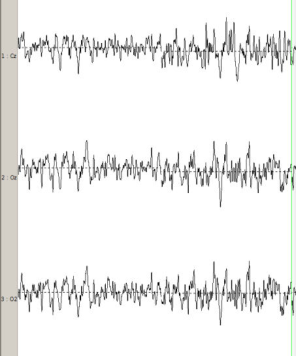

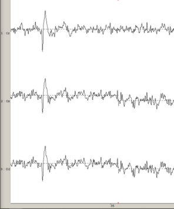

Il faut à présent procéder à l'extraction des caractéristiques. La chaîne de traitement dédiée à cette étape est constituée des boîtes Stimulation Based Epoching, Epoch Average et Feature Aggregator. Elle est présente en double dans le scénario, car nous voulons discriminer deux classes avec le classifieur. Ainsi, la chaîne de gauche se charge d'extraire les caractéristiques pour la classe cible (P300), tandis que la chaîne de droite se charge des caractéristiques de la classe non-cible (non-P300).

Les deux chaînes de traitement utilisent les données de l'ensemble des stimulations d'entraînement. Cet ensemble nous permet de déterminer si, lors d'un clignotement de ligne ou de colonne, la lettre cible a été illuminée. La boîte Stimulation Based Epoching peut ainsi sélectionner le signal à proximité d'un stimulus. Lorsque la stimulation d'entraînement est une stimulation cible, elle est traitée par la partie gauche du scénario. Quand il s'agit d'une stimulation non-cible, elle est traitée par la partie droite. Dans notre exemple, cela revient à sélectionner et à distinguer d'une part les signaux pour lesquels la lettre R a été illuminée, d'autre part les signaux pour lesquels la lettre n'a pas été illuminée.

Ces deux ensembles de signaux passent ensuite au travers de la boîte Epoch Average de leur chaîne de traitement respective. Epoch Average permet d'extraire un ensemble de valeurs (amplitude maximale et minimale, instant où l'amplitude a telle valeur...) caractéristiques de la classe. Ces informations sont ensuite rassemblées dans un vecteur de caractéristiques via la boîte Feature Aggregator.

En résumé, à ce stade du scénario, nous avons récupéré le signal et l'avons comparé à l'ensemble d'entraînement. Ceci nous a permis de sélectionner des parties du signal que nous avons séparées en deux classes : cible et non-cible. Pour chaque partie du signal, nous avons procédé à l'extraction des caractéristiques, consignées dans un vecteur de caractéristiques. La figure suivante illustre le traitement expliqué précédemment.

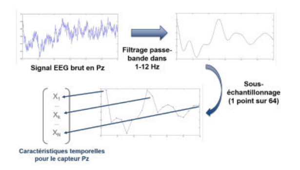

Nous avons à présent tous les outils nécessaires à l'entraînement du classifieur LDA (voir [Un classifieur particulier : la LDA](./traitement-du-signal.md#un-classifieur-particulier--la-lda) pour les détails du fonctionnement du classifieur). L'entraînement est assuré par la boîte Classifier Trainer. Cette boîte prend en entrée les vecteurs de caractéristiques issus de la chaîne d'extraction des caractéristiques. Classifier Trainer classe systématiquement chaque vecteur qu'il reçoit dans les classes cible ou non-cible en s'appuyant sur les données universelles caractérisant la P300. Il procède ensuite à une vérification de son classement, en comparant par exemple son résultat avec le tri qui avait été effectué en amont, au début de la chaîne d'extraction des caractéristiques. Une autre méthode de vérification, que nous utilisons, est la partition des vecteurs de caractéristiques. L'idée est de diviser l'ensemble des vecteurs en un certain nombre de partitions afin que le classifieur s'entraîne sur certaines partitions et soit testé sur les autres. Cette méthode est appelée méthode de validation croisée ; elle permet de réaliser un entraînement efficace du classifieur avec une quantité réduite de données d'entraînement.

Par l'intermédiaire de méthodes d'apprentissage machine, le classifieur peut réajuster ses paramètres de classification en fonction des erreurs qu'il commet. Il propose ainsi une classification unique, en adéquation avec le profil cognitif de l'utilisateur. Lorsque l'entraînement est terminé, Classifier Trainer calcule le taux de réussite (ou taux de bonne classification, voir [Classification](./traitement-du-signal.md#classification)). Si la performance du classifieur est assez haute (réussite supérieure à 80 %), nous pouvons utiliser la classification ainsi paramétrée pour l'utilisation en situation réelle. Dans le cas contraire, il est recommandé de recommencer l'entraînement du classifieur.

### Scénario 3 : utilisation

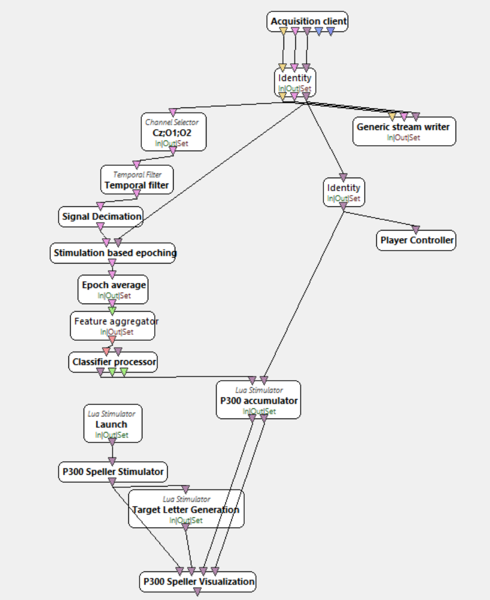

Lorsque l'entraînement du classifieur est terminé et que le taux de réussite est satisfaisant, nous pouvons procéder à l'utilisation du P300 Matrix Speller. Dans ce dernier scénario, "Utilisation", l'utilisateur tente d'épeler un mot via l'interface, en utilisant exclusivement son activité cérébrale. Pour ce faire, l'utilisateur commence par choisir et focaliser son attention sur la lettre qu'il souhaite écrire. La stimulation est ensuite lancée, c'est-à-dire que les lignes et les colonnes de la matrice se mettent à clignoter. À chaque illumination de la ligne ou de la colonne comportant la lettre cible de l'utilisateur, un potentiel P300 est supposé être généré. Lors de l'arrêt de la stimulation, le programme indique à l'utilisateur quelle lettre a été considérée comme cible, en la surlignant momentanément en vert puis en l'inscrivant en bas de l'écran afin de commencer un mot. Le processus peut ensuite reprendre avec une nouvelle lettre cible choisie par l'utilisateur.

La première étape du scénario consiste à récupérer les données EEG enregistrées en direct par l'intermédiaire de la boîte Acquisition Client. Les signaux passent ensuite dans la même chaîne de prétraitement que dans le scénario précédent (Channel Selector + Temporal Filter + Signal Decimation) avant l'extraction des caractéristiques (Stimulation Based Epoching + Epoch Average + Feature Aggregator). Le traitement des signaux est donc similaire au scénario précédent, à la différence que la chaîne de traitement est ici unique. En effet, on ne peut pas diviser le traitement en deux chaînes chargées de traiter le signal cible ou non-cible, car on ne connaît pas la classe du signal au préalable. C'est justement ce que l'on va chercher à déterminer dans ce qui suit.

Les signaux traités sont transmis à la boîte Classifier Processor, qui permet de les discriminer en deux classes (P300 ou non-P300) selon les informations portées par leurs vecteurs de caractéristiques. Ce procédé est rendu possible par la calibration (l'entraînement) du classifieur, réalisée au scénario précédent.

Le résultat de la classification est ensuite transmis à la boîte P300 Accumulator. Cette boîte considère un à un les vecteurs de caractéristiques des signaux classés P300 et les relie à la ligne (ou la colonne) qui a été illuminée lors de leur génération. Un "vote" est alors apposé à cette ligne (ou colonne). En réalisant le même processus sur les différentes répétitions d'un même essai, on obtient une matrice présentant un certain nombre de votes sur ses lignes et sur ses colonnes. L'intersection de la ligne et de la colonne qui présentent le plus grand nombre de votes est considérée comme la lettre cible de l'utilisateur.

Un ensemble de boîtes permet d'afficher et de régler les paramètres de la matrice, comme dans le scénario 1. Cependant, deux entrées en provenance de P300 Accumulator sont ajoutées à la boîte P300 Speller Visualisation. Cet ajout permet aux deux boîtes d'échanger des informations. En particulier, cela permet de colorer en vert la lettre déterminée comme cible par le programme ainsi que de visualiser le mot que l'utilisateur est en train d'écrire.

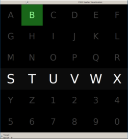

En résumé, l'implémentation du P300 Matrix Speller sous OpenViBE résulte du travail de trois scénarios et son utilisation nécessite au préalable une phase de calibration. On peut noter que la traduction en commande de l'état mental reconnu ne représente qu'une partie réduite des scénarios, contrairement au traitement du signal (prétraitement, extraction des caractéristiques, classification), qui occupe une place centrale. OpenViBE facilite la tâche du programmeur en proposant une interface intuitive qui ne nécessite pas la compréhension de tous les concepts mathématiques (voir le [chapitre 2](./traitement-du-signal.md)) sur lesquels repose la théorie du traitement du signal. L'essentiel est de "suivre" le signal à travers les différentes boîtes et de comprendre son évolution (voir figure 3.17).

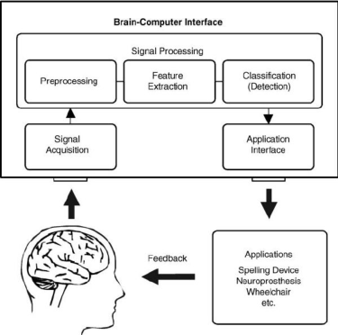

*Figure 3.17 : principe de l'utilisation de l'interface cerveau-ordinateur. Le signal est acquis via l'EEG, puis traité via les prétraitements, l'extraction des caractéristiques et le classifieur que nous avons calibré lors des deux premiers scénarios. L'application renvoie finalement un retour visuel via la matrice à l'utilisateur. Ce retour visuel provoque une réponse cérébrale qui est récupérée par EEG, etc.*

Les performances du P300 Matrix Speller implémenté avec le Paradigme Ligne/Colonne sont relativement élevées. Environ 73 % des sujets atteignent une fiabilité de classification de 100 % avec seulement 5 min d'entraînement[^fazel-frontiers]. Cependant, elles restent dépendantes d'un grand nombre de facteurs, liés à l'utilisateur ou aux paramètres de l'expérience.

[^fazel-frontiers]: Fazel-Rezai, Reza et al., *P300 brain computer interface : current challenges and emerging trends*, Frontiers in Neuroengineering, 5, juillet 2012.

## Limites et perspectives

### Limites utilisateur

La détection et la traduction en commande du signal par le P300 Matrix Speller sont entièrement dépendantes d'un état mental donné. Le fonctionnement du système est donc indissociable de l'utilisateur, ce qui impose certaines limites.

La fatigue, le niveau d'attention, la lassitude et l'état mental général de l'utilisateur impactent la fiabilité de la classification de manière significative. Le profil cognitif de l'utilisateur est également source de biais. De plus, certaines pathologies provoquent l'incapacité à produire une réponse P300 suffisante pour être détectée. Le P300 Matrix Speller ne peut donc pas être utilisé de façon optimale par toutes les populations.

Une bonne utilisation du speller requiert un entraînement préalable de l'utilisateur. La familiarisation avec le système ainsi que la réalisation de la tâche mentale à proprement parler sont demandeuses en énergie et répétitives. L'utilisateur doit donc fournir un effort conséquent pour maintenir son attention.

Enfin, il est à noter que certains événements peuvent perturber la réponse de l'utilisateur à la stimulation[^fazel-jne] :

- Lorsque l'intervalle entre deux cibles différentes est inférieur à 500 ms (i.e. l'utilisateur voit sa cible s'illuminer puis change de cible, et cette nouvelle cible s'illumine moins de 500 ms après cette décision). On parle alors d'"Attentional blink" : l'utilisateur n'a pas le temps de recentrer son attention et la réponse est perturbée.
- Lorsque l'intervalle entre deux cibles identiques (i.e. la cible est illuminée une fois puis une seconde fois) est compris entre 100 ms et 500 ms. Il s'agit ici du phénomène de "Repetition Blindness" : une réponse P300 va généralement être initiée par la première illumination mais pas par la seconde, qui passe inaperçue.

[^fazel-jne]: Fazel-Rezai, R. et al., *P300 brain computer interface : current challenges and emerging trends*, Journal of Neural Engineering, vol. 5, no 14, juillet 2012.

### Limites matérielles

Aux limites de l'utilisateur viennent s'ajouter des limites matérielles, inhérentes au montage et aux appareils utilisés, mais également à la nature des signaux.

En effet, il ne faut pas perdre de vue que les signaux enregistrés correspondent à des résidus d'activité cérébrale ; l'information est donc bien moins précise que celle que donnerait un dispositif invasif. Le traitement de ces signaux est fastidieux ; en conséquence, le temps requis pour l'écriture d'un seul caractère est important et la fiabilité variable.

Il nous faut également souligner les inconvénients dus aux dimensions du montage, qui est très encombrant, peu esthétique et qui nécessite une longue phase de préparation (pose des électrodes, gel). Les retours de personnes handicapées suggèrent une amélioration du confort et de la compacité du système afin que celui-ci soit transportable[^fazel-jne2].

[^fazel-jne2]: Fazel-Rezai, R. et al., *P300 brain computer interface : current challenges and emerging trends*, Journal of Neural Engineering, vol. 5, no 14, juillet 2012.

### Perspectives d'amélioration

Le P300 Matrix Speller que nous avons utilisé pour notre expérience est un modèle basique, dont le fonctionnement est assez fiable. Des améliorations peuvent cependant être apportées, et ce à plusieurs échelles.

On peut, par exemple, proposer une modification du paradigme ligne/colonne en augmentant la fréquence d'apparition des lettres usuelles. On peut de même envisager la création d'un correcteur automatique.

Cependant, de récentes études ont montré que stimuler l'utilisateur par l'apparition du visage d'une célébrité est plus efficace que d'illuminer la matrice par ligne et par colonne[^kaufmann].

[^kaufmann]: Kaufmann, T. et al., *Flashing characters with famous faces improves ERP-based brain computer interface performance*, Journal of Neural Engineering, vol. 8, no 5, septembre 2011.

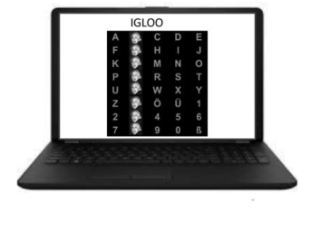

On peut donc envisager une amélioration du système en modifiant le paradigme.

Enfin, il est possible d'améliorer le P300 Speller en associant l'ICM P300 avec une ICM visuelle (SSVEP) ou une ICM basée sur l'imagination motrice (MI). On parle alors d'ICM hybride[^pfurtscheller] [^allison]. Une hybridation P300/SSVEP permet d'implémenter une fonction "on/off" pour le système : en considérant que l'absence d'activité en provenance du cortex visuel équivaut à un désintérêt de l'utilisateur, on provoque la "mise en veille" de l'interface matricielle. Une hybridation P300/MI permet de la même façon de créer des fonctionnalités supplémentaires (curseurs par exemple), contrôlées par imagination de mouvements simples.

[^pfurtscheller]: Pfurtscheller, G. et al., *The hybrid BCI*, Journal of Neural Engineering, vol. 4, no 42, 2010.

[^allison]: Allison, B.Z. et al., *Toward a hybrid brain-computer interface based on imagined movement and visual attention*, Journal of Neural Engineering, vol. 7, 2010.

## Conclusion du chapitre

L'implémentation du P300 Matrix Speller sous OpenViBE est relativement simple et intuitive. Elle suit la logique du fonctionnement général d'une ICM quelconque (voir figure 3.17) en proposant d'abord une phase de calibrage, au cours de laquelle des signaux d'entraînement sont acquis (scénario 1) puis utilisés afin de paramétrer la classification (scénario 2). Lorsque le taux de performance du classifieur est satisfaisant, on peut procéder à la phase d'utilisation (scénario 3) afin d'épeler le mot de notre choix. L'interface proposée par OpenViBE permet de suivre les transformations du signal lors de chaque scénario. Les étapes de traitement détaillées au [chapitre 2](./traitement-du-signal.md) (prétraitement, extraction des caractéristiques, classification) y sont visibles.

Malgré un taux de réussite élevé dans un environnement expérimental, les performances du P300 Speller restent sujettes à une grande variabilité. Le profil cognitif de l'utilisateur, le matériel utilisé ainsi que les paramètres globaux de l'expérience sont autant de paramètres influant sur la fiabilité de la classification. Des perspectives d'amélioration sont envisageables à plusieurs échelles. On peut éventuellement modifier le paradigme Ligne/Colonne, utiliser un paradigme alternatif ou encore associer le speller à une autre ICM (ICM hybride).

## Conclusion générale du mémoire

Ce projet offre une vue d'ensemble du fonctionnement d'une ICM non invasive, basée sur l'enregistrement de signaux en surface du cuir chevelu.

Dans le [chapitre 1](./activite-cerebrale.md), nous avons étudié l'origine des signaux exploitables et décrit la méthode d'électroencéphalographie qui permet leur détection en surface du cuir chevelu. Nous avons également explicité le lien entre les signaux d'intérêt, c'est-à-dire les marqueurs physiologiques, et l'état mental de l'utilisateur.

Dans le [chapitre 2](./traitement-du-signal.md), exclusivement dédié au traitement du signal, nous avons d'abord détaillé le prétraitement des données d'électroencéphalographie. Cette étape nous a permis d'obtenir des signaux exploitables, c'est-à-dire porteurs de l'information d'intérêt et sans artefact. Nous avons ensuite procédé à l'extraction des caractéristiques, étape consistant à dégager un ensemble de valeurs descriptives du signal, rassemblées dans des vecteurs de caractéristiques. Ces vecteurs ont été utilisés lors de la classification, dans l'objectif de différencier deux classes de signaux : cibles et non-cibles.

Enfin, nous avons expliqué dans le chapitre 3 l'implémentation pratique d'une ICM particulière, le P300 Matrix Speller, avec le logiciel OpenViBE. Ce chapitre nous a permis d'illustrer les concepts théoriques énoncés précédemment ainsi que de mettre en évidence la traduction en commande de l'état mental reconnu par l'ICM.

Ainsi, l'enchaînement des chapitres permet d'appréhender la propagation et les différentes transformations des signaux utilisés par l'ICM, depuis leur génération dans la boîte crânienne jusqu'à la traduction en commandes par la machine.

La principale difficulté quant à la réalisation et la compréhension de ce mémoire est la diversité des connaissances sollicitées, car le sujet est au croisement de nombreux domaines tels que la biologie, la cognitique, l'informatique et les mathématiques. Cependant, aborder des concepts inédits comme la théorie du traitement du signal et l'apprentissage automatique s'est révélé être une grande source de motivation.

Nous ne pensons pas que la démocratisation d'ICM comme le P300 Matrix Speller soit envisageable actuellement, ces dispositifs étant étudiés majoritairement en laboratoire, dans un environnement expérimental. De plus, les dimensions, la variabilité des performances et l'inconfort des appareils utilisés sont un frein à leur commercialisation. Cependant, nous sommes intimement convaincus que le concept en lui-même en vaut la peine. Sujet à une forte évolution ces dernières décennies, il se révèle porteur d'espoir pour de nombreuses personnes atteintes de troubles neurologiques ou musculaires.

## Bibliographie

- Clerc, M., Bougrain, L. et Lotte, F. : *Les interfaces cerveau-ordinateur 1 : fondements et méthodes*. ISTE éditions, 2016.
- Mallat, S. : *Une exploration des signaux en ondelettes*. Les éditions de l'École Polytechnique, 2000.
- Lecomte, M. : *Transformation de Fourier*. École des Mines de Douai, juillet 2001, 20.
- Flandrin, P. : *Temps-Fréquence*. Hermès, Paris, 1993.
- Montaine, B. : *Méthodologie d'analyse des synchronisations neuronales dans les signaux EEG à l'aide de graphes d'informations temps-fréquence*. Thèse de doctorat, Université de Poitiers, Faculté des Sciences Fondamentales et Appliquées, 2006.
- Lotte, F. et Congedo, M. : *Extraction de caractéristiques du signal EEG*. Les interfaces cerveau-ordinateur 1 : fondements et méthodes, 2016, 17.
- Starmer, J. et StatQuest : *Un peu de Machine Learning avec les SVM*. Avril 2017, [zestedesavoir.com](https://zestedesavoir.com/tutoriels/1760/un-peu-de-machine-learning-avec-les-svm/).
- Fazel-Rezai, Reza et al. : *P300 brain computer interface : current challenges and emerging trends*. Frontiers in Neuroengineering, 5, juillet 2012, 14.
- Fazel-Rezai, R. et al. : *P300 brain computer interface : current challenges and emerging trends*. Journal of Neural Engineering, vol. 5, no 14, juillet 2012.
- Kaufmann, T. et al. : *Flashing characters with famous faces improves ERP-based brain computer interface performance*. Journal of Neural Engineering, vol. 8, no 5, septembre 2011.
- Pfurtscheller, G. et al. : *The hybrid BCI*. Journal of Neural Engineering, vol. 4, no 42, 2010.
- Allison, B.Z. et al. : *Toward a hybrid brain-computer interface based on imagined movement and visual attention*. Journal of Neural Engineering, vol. 7, 2010.
- Fischer, P., Weynas, L. et Dossal, C. : *Approximation numérique*. 2017, 70.
- Mallat, S. : *Science des données*. Collège de France, Fayard, 26 septembre 2018.
- Tharwat, A. et al. : *Linear discriminant analysis : a detailed tutorial*. ResearchGate, 2017.

**Autres références utilisées dans nos recherches**

- Kaplan, A., Shishkin, S., Ganin, I., Basyul, I. et Zhigalov, A. : *Adapting the P300-Based Brain Computer Interface for Gaming : A Review*. IEEE Transactions on Computational Intelligence and AI in Games, vol. 5, no 2, juin 2013.
- Rezeika, A., Benda, M., Stawicki, P., Gembler, F., Saboor, A. et Volosyak, I. : *Brain-Computer Interface Spellers : A Review*. Faculty of Technology and Bionics, University of Applied Sciences, Allemagne, 30 mars 2018.
- Renard, Y., Lotte, F., Gibert, G., Congedo, M., Maby, E. et al. : *OpenViBE : An Open-Source Software Platform to Design, Test and Use Brain-Computer Interfaces in Real and Virtual Environments*. Presence : Teleoperators and Virtual Environments, MIT Press, 2010, 19 (1), p. 35-53.
