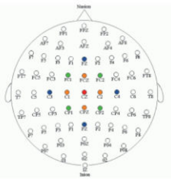

Annexe A du mémoire : outils mathématiques pour le filtrage spatial.

Lors des prétraitements, notre mémoire s'attarde beaucoup sur la partie temporelle et ne présente que très peu les différents filtrages spatiaux. Cette annexe a pour but de présenter au lecteur intéressé un filtrage spatial : le laplacien de surface[^clerc].

[^clerc]: Clerc, M., Bougrain, L. et Lotte, F., *Les interfaces cerveau-ordinateur 1 : fondements et méthodes*, ISTE éditions, 2016.

Le potentiel électrique mesuré par EEG résulte de la superposition de nombreuses sources d'activité cérébrale, qui créent par conduction volumique des différences de potentiel électrique à la surface du cuir chevelu. Il est intéressant de séparer ces différentes sources afin d'obtenir des signaux qui soient fidèles à l'activité cérébrale sous-jacente. Le filtrage spatial offre cette possibilité de "déconvoluer" le signal sur les capteurs, à la manière d'une paire de lunettes qui corrige la myopie.

Avant de présenter la stratégie du laplacien de surface, rappelons que le mélange des sources est linéaire et instantané (par les équations de Maxwell en approximation quasistatique) : si on considère $J$ sources cérébrales d'amplitude $s_j$, pour chaque échantillon temporel $n$, le potentiel mesuré sur chaque capteur $k$ est de la forme

$$
f_k[n] = \sum_{j=1}^{J} g_{kj} s_j[n]
$$

La relation précédente est une relation linéaire qui peut s'écrire sous forme de produit matrice-vecteur $f = Gs$, où la matrice $G = (g_{kj})$ est appelée matrice de gain. L'élément $g_{kj}$ de la matrice de gain représente le potentiel sur le capteur d'indice $k$ résultant de la présence d'une source unitaire (d'amplitude 1) à la position de la source $j$.

Le potentiel électrique, noté $V$, vérifie dans le volume conducteur de conductivité $\sigma$

$$
\nabla \cdot (\sigma \nabla V) = \nabla \cdot J^p
$$

où $J^p$ sont les sources primaires. Dans les régions où ces sources primaires sont absentes (par exemple le crâne et le cuir chevelu), $\nabla \cdot (\sigma \nabla V) = 0$. Donc le potentiel vérifie l'équation de Laplace $\Delta V = 0$ dans ces régions.

Sur une surface $S$ de vecteur normal $n$, le laplacien de surface $\Delta_S V$ est relié au laplacien volumique par $\Delta V = \Delta_S V + \dfrac{\partial^2 V}{\partial n^2}$. Sur le scalp, le laplacien de surface est un filtre spatial intéressant car $\Delta_S V$ est proche du courant normal sur le crâne. En effet, comme le laplacien volumique s'annule dans le scalp, on a $\Delta_S V = -\dfrac{\partial^2 V}{\partial n^2}$. Mais puisque l'air est non conducteur, par conservation du courant normal, sur le scalp $\dfrac{\partial V}{\partial n} = 0$ et $-\dfrac{\partial^2 V}{\partial n^2}$ est proportionnel à la dérivée normale du potentiel sur le crâne.

Pour calculer le laplacien de surface, il faut connaître $V$ sur le scalp, et la forme de la surface du scalp. On peut approcher ce calcul par éléments finis frontières, par splines sphériques ou surfaciques. Une approximation grossière du "laplacien de surface" couramment utilisée en BCI consiste à soustraire à chaque électrode la moyenne de ses voisines. La figure suivante montre plusieurs gabarits possibles pour les électrodes servant à faire la soustraction, les filtres laplaciens larges (respectivement étroits) étant sensibles à des sources corticales profondes (respectivement superficielles).

*Figure A.1 : trois filtres laplaciens appliqués à l'électrode Cz (rouge). La moyenne des signaux mesurés en C3, C4, Fz et Pz (bleu) est retirée au canal Cz (rouge) pour le filtre laplacien large. Les électrodes utilisées pour un filtre laplacien moyen et étroit sont représentées en vert et orange respectivement.*
