Le traitement du signal constitue le cœur du fonctionnement d'une ICM. L'enjeu est multiple ; il s'agit dans un premier temps de rendre exploitables les données enregistrées par EEG, puis de relier le signal obtenu à un état mental précis. Le traitement se déroule en trois phases. On applique d'abord un prétraitement, qui permet de rendre lisible l'information intéressante portée par le signal et de limiter l'impact du bruit. On procède ensuite à l'extraction des caractéristiques, qui réduit la dimension des données à considérer et permet d'acquérir l'information essentielle à l'étape de classification. Enfin, on effectue la classification des données, qui permet de discriminer les données entre elles et de déterminer l'état mental reconnu.

## Prétraitement de données d'électroencéphalographie

L'électroencéphalographie fournit des mesures du potentiel électrique sous la forme d'un signal temporel par électrode. Même si elles ne reflètent qu'une partie des phénomènes électrophysiologiques cérébraux, ces mesures contiennent beaucoup d'informations pouvant servir au diagnostic clinique, aux sciences cognitives ainsi qu'à l'implémentation d'ICM. L'information brute obtenue par EEG est très riche et ne peut être exploitée telle quelle par la machine. Cependant, il est possible d'en discerner plusieurs aspects : il peut s'agir de variations d'amplitude à certains instants, à certaines fréquences, ou bien de la répartition spatiale du potentiel. Afin de pouvoir effectuer cette distinction, il est nécessaire de procéder à une analyse pertinente, en adéquation avec ce que l'on veut observer. Dans cette logique, les analyses temporelle, spectrale et spatiale ont été mises au point, offrant différentes possibilités de représentation des données, pour différents usages. Il n'y a donc pas "un" prétraitement mais plusieurs prétraitements possibles, dont l'objectif général est le filtrage des données ainsi que le débruitage du signal. Nous diviserons cette partie en plusieurs sous-parties. Tout d'abord, nous procéderons à un rappel sur l'acquisition des mesures EEG. Ensuite, nous exposerons les analyses en temps, en fréquence puis en temps-fréquence combinés. Enfin, nous détaillerons différentes représentations spatiales et traitements statistiques des données. Les détails mathématiques de cette partie sont tous disponibles en annexe B ([Fourier et ondelettes](./fourier-et-ondelettes.md)).

### Principe d'acquisition de l'EEG

L'EEG est effectuée par l'intermédiaire d'électrodes disposées sur le cuir chevelu (voir [Électrophysiologie : électroencéphalographie](./activite-cerebrale.md#électrophysiologie--électroencéphalographie)). Les données obtenues sont des signaux temporels. Chaque signal correspond à un canal d'acquisition, c'est-à-dire à une différence de potentiel électrique entre deux électrodes. Celle-ci peut être mesurée via divers montages, dont les plus répandus sont le montage monopolaire et le montage bipolaire. Dans le cas du montage monopolaire, une électrode est désignée comme référence et le potentiel qu'elle mesure est systématiquement soustrait aux potentiels mesurés par les autres électrodes. Dans le cas du montage bipolaire, on mesure les différences de potentiels entre électrodes voisines.

Lorsqu'on utilise un amplificateur numérique, l'électroencéphalogramme n'est pas enregistré de manière continue, mais discrète. Plus précisément, les données sont échantillonnées, c'est-à-dire mesurées à des instants espacés par un pas d'échantillonnage. Le pas (ou la fréquence) d'échantillonnage conditionne la résolution des phénomènes observables, ainsi que l'étendue du spectre fréquentiel analysable. La théorie de l'échantillonnage de Shannon impose une fréquence d'échantillonnage au moins deux fois supérieure à la fréquence maximale d'intérêt[^mallat] (c'est-à-dire la plus haute fréquence que l'on voudra observer).

[^mallat]: Mallat, S., *Une exploration des signaux en ondelettes*, Les éditions de l'École Polytechnique, 2000.

Le principe de l'échantillonnage est illustré avec l'exemple suivant. Considérons une fonction sinusoïdale. On effectue un échantillonnage de cette fonction, représenté par les points en bleu (a). Si on relie naïvement les points, on obtient une mauvaise représentation de la sinusoïde (b). Pour reconstruire le signal, nous allons nous placer dans l'espace des fréquences en calculant la transformée de Fourier (c). Ce spectre compte deux maxima ; nous pouvons augmenter la fréquence d'échantillonnage en ajoutant des 0 entre ces deux parties (d). Grâce à une transformée de Fourier inverse, on obtient une meilleure approximation (e).

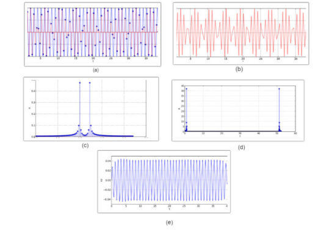

L'échantillonnage est essentiel car il nous permet d'enregistrer le signal et de le reconstruire avec une quantité réduite d'information. Traditionnellement, l'échantillonnage est réalisé d'après une analyse temporelle des signaux. Le but de cette sous-partie est de comprendre pourquoi nous ne pouvons pas utiliser l'échantillonnage "classique" pour l'implémentation du P300 Matrix Speller et de déterminer une stratégie d'échantillonnage alternative. Dans cet objectif, nous allons étudier les différentes "représentations" possibles du signal, c'est-à-dire les différentes manières d'appréhender le signal afin de procéder à l'échantillonnage.

### Représentation temporelle

La représentation la plus immédiate des données EEG, directement fournie par l'amplificateur, est la représentation temporelle. L'observation directe de ces signaux permet de s'assurer a priori de leur bonne qualité lors de leur acquisition.

L'utilisation "d'événements" permet de définir par fenêtrage des segments d'intérêt pour l'analyse des données. Dans l'exemple du P300 Matrix Speller, les événements sont les stimulations que l'interface propose à l'utilisateur. Ces stimulations sont localisables avec précision dans le temps et impliquent une réponse particulière (l'onde P300) sur l'électroencéphalogramme. Nous savons que la réponse P300 est visible sur l'électroencéphalogramme environ 300 ms après stimulation. Nous pouvons donc utiliser cette indication temporelle afin de ne garder que les parties du signal qui sont susceptibles de contenir des informations intéressantes. De plus, certaines portions du signal sont systématiquement éliminées par la simple observation d'anomalies sur les signaux temporels (par exemple les signaux provenant d'électrodes décollées ne mesurant que du bruit).

Ce découpage temporel s'appelle la segmentation des données. Cette méthode est également appliquée en représentation fréquentielle.

La représentation temporelle est assez directe et instinctive. Elle permet notamment de s'assurer de la bonne qualité d'enregistrement des signaux. Cependant, le signal obtenu avec cette représentation est très complexe et ne permet pas la détection de l'onde P300. Pour rendre possible l'observation de la P300 et rendre "lisible" le signal, nous allons donc devoir utiliser d'autres représentations.

### Représentation fréquentielle et filtrage

Dès les premiers tracés d'EEG enregistrés chez l'Homme par Hans Berger, le caractère oscillatoire de l'activité cérébrale a été mis en évidence. Le signal réel est une combinaison de l'information recherchée et de bruit. Le bruit ne contient pas d'information intéressante et dégrade le signal ; on cherche donc à le minimiser.

Une approche fréquentielle du signal peut être adoptée dans cet objectif. En effet, cette représentation est généralement plus simple à interpréter que la représentation temporelle.

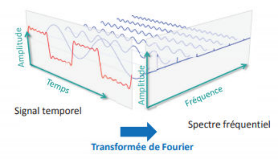

En 1807, Joseph Fourier énonce : "Tout signal périodique continu peut être représenté par une somme d'ondes sinusoïdales". Chaque élément de la décomposition proposée par Fourier est caractérisé par sa fréquence et son amplitude. Ce processus permet de passer de la représentation temporelle à la représentation fréquentielle, par l'intermédiaire de la formule suivante[^lecomte] :

[^lecomte]: Lecomte, M., *Transformation de Fourier*, École des Mines de Douai, juillet 2001.

$$
X[k] = \sum_{n=0}^{N-1} x[n] e^{-i 2\pi k n / N}
$$

où les $X[k]$ sont les données de l'espace fréquentiel $k$, c'est-à-dire la fréquence du $k$-ième élément issu de la décomposition, et les $x[n]$ sont les données dans l'espace temporel correspondant.

Il peut être judicieux, afin de simplifier l'analyse, de supprimer certains artefacts. Les artefacts sont des perturbations non permanentes du signal, plus importantes que le bruit moyen dû à l'activité physiologique du sujet. Ils surviennent dans des bandes de fréquence particulières ; on peut donc les éliminer avec un filtrage adéquat. Un filtre passe-haut élimine les basses fréquences parfois observées, notamment avec des électrodes sèches. Un filtre passe-bas élimine les hautes fréquences, ce qui écarte certaines sources de bruit, comme l'activité électrique musculaire. L'utilisation du courant alternatif est également source d'artefacts sur les canaux EEG. Ceux-ci peuvent être éliminés par un filtre coupe-bande.

Afin d'illustrer notre explication, nous pouvons prendre l'exemple du filtre de Butterworth. Ce filtre permet d'atténuer les hautes et basses fréquences sur les fragments du signal qui sont à négliger. L'avantage du Butterworth est qu'il possède un gain qui est le plus constant possible dans la bande passante et qui tend rapidement vers 0 dans la bande de coupure. Ce phénomène est schématisé ci-dessous.

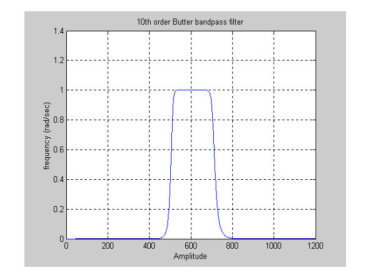

L'analyse fréquentielle du signal permet de filtrer efficacement les signaux dans la bande de fréquence correspondant à l'activité recherchée. Cependant, cette méthode d'analyse ne convient que pour des signaux stationnaires, ce qui n'est pas le cas du signal utilisé par le P300 Matrix Speller, qui est non stationnaire. L'usage d'un filtrage fréquentiel pour ce type de signal introduirait des artefacts, ce qui dégraderait significativement la qualité.

Pour notre expérimentation, il est donc nécessaire de s'orienter vers une autre méthode, qui appréhende le signal à la fois en temps et en fréquence.

### Représentation temps-fréquence

La transformée de Fourier est un outil puissant pour décomposer un signal EEG en composantes oscillatoires, et ainsi analyser les fréquences des rythmes cérébraux. Cependant, il est rare que ces oscillations soient établies de façon stationnaire pendant toute la durée de l'enregistrement. Nous observons dans notre signal des événements transitoires, c'est-à-dire des "bouffées" d'oscillations.

Pour pouvoir appliquer l'analyse en fréquence (valable seulement pour les signaux stationnaires), on découpe le signal non stationnaire en petits morceaux, supposés stationnaires. L'analyse en fréquence est ainsi effectuée dans une fenêtre temporelle centrée autour d'un instant choisi et autorisée à glisser le long d'un axe temporel (fenêtre glissante). Cette méthode nous permet d'obtenir à la fois les informations temporelles et les informations fréquentielles. Elle conduit à la représentation la plus efficace pour la détection de l'onde P300 : la représentation temps-fréquence[^flandrin].

[^flandrin]: Flandrin, P., *Temps-Fréquence*, Hermès, Paris, 1993.

Cette représentation repose sur deux variables : l'instant temporel où la fenêtre est centrée, noté $u$, et la fréquence de chaque composante de Fourier (i.e. les fréquences des sinusoïdes qui approximent le signal sur cette fenêtre), notée $\xi$.

Pour représenter un signal en temps-fréquence, nous devons l'analyser autour d'un couple temps-fréquence $(u, \xi)$. Pour ce faire, nous devons établir un plan temps-fréquence basé sur un découpage en briques élémentaires appelées "atomes temps-fréquence". Le détail de la construction mathématique du plan temps-fréquence est disponible en annexe B ([Fourier et ondelettes](./fourier-et-ondelettes.md)).

Les atomes temps-fréquence permettent de localiser l'analyse en temps et en fréquence en définissant les étalements temporel et fréquentiel. La figure suivante propose une représentation du pavage temps-fréquence.

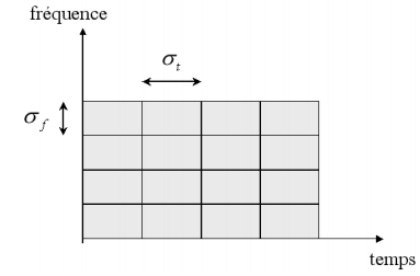

Il est à noter que la concentration temps-fréquence conjointe est limitée, c'est-à-dire que plus une fonction est concentrée en temps, moins elle est concentrée en fréquence. Ce principe s'écrit $\sigma_t \sigma_\omega \geq \dfrac{1}{2}$. Concrètement, cela signifie que si l'on veut diminuer la largeur (respectivement la longueur) d'un "pixel" de notre pavage, nous devons aussi augmenter sa longueur (respectivement sa largeur).

L'outil mathématique permettant la partition d'un signal non stationnaire en fractions supposées stationnaires est la transformée de Fourier à fenêtre (ou à court terme). Pour chaque fraction temporelle, une transformée de Fourier est appliquée. Le signal est découpé au moyen d'une fenêtre qui peut être une fonction créneau (on parle alors de fenêtre porte ou rectangulaire). La transformée de Fourier à fenêtre utilise des atomes temps-fréquence qui sont localisés autour de $(u, \xi)$ par translation et modulation (c'est-à-dire déplacer l'atome du point $(u, \xi)$ en $(u + v, \xi + \nu)$) d'une fonction réelle et symétrique $g$. La transformée s'obtient en faisant le produit scalaire de notre signal, décrit par la fonction $f$, et de l'atome $g_{u,\xi}$ :

$$
\langle f, g_{u,\xi} \rangle = \int_{-\infty}^{+\infty} f(t) g(t - u) e^{-i \xi t} \, dt
$$

La résolution de la transformée de Fourier à fenêtre autour d'un instant $u$ et d'une fréquence $\xi$ est uniforme dans le plan temps-fréquence. Elle dépend de la concentration de $g$ en temps et en fréquence ; le choix de $g$ est donc crucial pour obtenir des informations pertinentes.

Toutefois, le signal utilisé par le P300 Matrix Speller présente des variations non uniformes selon le temps ou la fréquence ; il est préférable de les analyser avec une résolution qui dépend de la fréquence. Dans cette logique, on introduit une deuxième transformée : la transformée à ondelettes. Le pavage temps-fréquence correspondant à ce type de transformée est représenté ci-dessous.

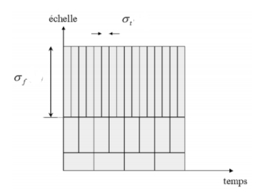

La transformée à ondelettes est réalisée au moyen d'une fonction d'analyse spécifique $\Psi$ appelée ondelette de base. Durant l'analyse, cette ondelette est positionnée dans le domaine temporel pour sélectionner la partie du signal à traiter. Elle est ensuite dilatée ou contractée par utilisation d'un facteur d'échelle $s$ permettant de focaliser l'analyse sur une gamme donnée d'oscillations. Lorsque l'ondelette est dilatée, l'analyse traite les composantes du signal qui oscillent lentement. Lorsqu'elle est contractée, ce sont les oscillations rapides (comme par exemple les oscillations à l'origine d'une discontinuité du signal) qui sont traitées.

Concrètement, une ondelette est un atome temps-fréquence $\Psi$ normalisé, de moyenne nulle, ainsi que de position moyenne nulle. On construit une famille d'atomes temps-fréquence en translatant $\Psi$ à la position $u$ et en lui appliquant notre facteur d'échelle $s > 0$ :

$$
\Psi_{u,s}(t) = \frac{1}{\sqrt{s}} \Psi\left(\frac{t - u}{s}\right)
$$

Ainsi, la transformée à ondelettes de $f$ à l'instant $u$ et à l'échelle $s$ est définie par le produit scalaire

$$
\langle f, \Psi_{u,s} \rangle = \int_{-\infty}^{+\infty} f(t) \frac{1}{\sqrt{s}} \Psi^*\left(\frac{t - u}{s}\right) dt
$$

Considérons maintenant un exemple concret. La transformée à ondelettes du signal (a) compare une ondelette (b) aux divers morceaux du signal. La figure (c) représente le signal de base avec l'ondelette (b) superposée à la partie gauche du signal. La figure (e) représente le signal de base avec l'ondelette (b) superposée à la partie droite. Le produit d'un morceau du signal et de l'ondelette donne une courbe (respectivement (d) et (f)). L'aire située sous cette courbe est égale au coefficient d'ondelette (en grisé). Le morceau gauche du signal, qui ressemble à l'ondelette, donne un coefficient important car le produit de l'ondelette et du signal est positif (d). Un morceau qui varie plus lentement donne un coefficient plus faible, car les valeurs négatives de l'intégrale compensent presque les valeurs positives (f). Ainsi, en évaluant les coefficients d'ondelette, on peut déterminer si une fonction choisie approxime avec précision le signal original. Par extension, les ondelettes font ressortir les variations du signal ; c'est précisément ce que nous recherchons dans ce type de traitement[^montaine].

[^montaine]: Montaine, B., *Méthodologie d'analyse des synchronisations neuronales dans les signaux EEG à l'aide de graphes d'informations temps-fréquence*, thèse de doctorat, Université de Poitiers, Faculté des Sciences Fondamentales et Appliquées, 2006.

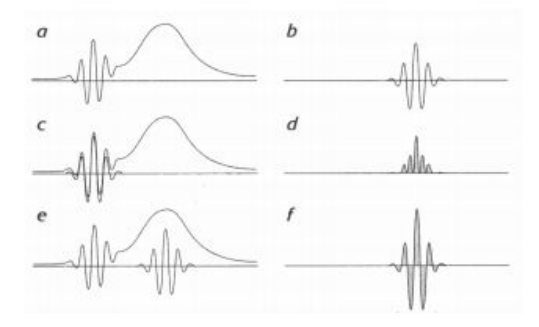

La phase finale de la transformée à ondelettes est l'utilisation de la transformée à ondelettes inverse. De manière analogue à la transformée de Fourier inverse, la transformée à ondelettes inverse permet de reconstruire le signal.

Dans la pratique, on dispose de signaux discrets de la forme $\{f[n], n = 1 \dots N\}$. Les transformées temps-fréquence de ces signaux discrets dépendent de la discrétisation du plan temps-fréquence. Nous utiliserons les transformées redondantes, où le plan temps-fréquence est discrétisé de manière dense. Cela conduit à davantage de valeurs pour la transformée que les $N$ échantillons de $f$.

Ainsi, l'analyse temps-fréquence, et plus particulièrement la transformée à ondelettes, permet de pratiquer le même type d'analyse que l'analyse fréquentielle. Cependant, cette méthode est valable pour les signaux non stationnaires, ce qui nous permettra par la suite de repérer aisément les pics d'amplitude P300.

En pratique, nous utiliserons l'algorithme "Fast Wavelet Transform", disponible en annexe B ([algorithme de la transformée à ondelettes rapide](./fourier-et-ondelettes.md#algorithme-de-la-transformée-à-ondelettes-rapide)). Cette représentation constitue notre prétraitement le plus important. Elle remplace toutes les transformées de Fourier classiques lors du filtrage et de l'échantillonnage.

### Représentation spatiale

Le prétraitement en représentation spatiale permet de réduire la quantité de données à collecter. Cette représentation relie l'activité électrique enregistrée par EEG aux régions cérébrales correspondantes. La localisation des électrodes donne une première indication pour la représentation spatiale. Par exemple, les phénomènes visuels primaires sont détectables au niveau des électrodes occipitales, tandis que les phénomènes moteurs sont enregistrés par les électrodes centrales.

Cette information, appelée représentation topographique, permet de se limiter à un nombre réduit d'électrodes selon le phénomène que l'on veut observer.

Pour analyser de manière plus fine la provenance de l'activité électrique, on utilise un filtrage spatial dont l'objectif est la localisation des sources.

En montage monopolaire, la répartition des électrodes sur le scalp fournit une carte du potentiel électrique, comme le fait une carte des températures sur le globe. Cette représentation est construite à partir des données collectées par chaque électrode, par l'intermédiaire de fonctions définies par morceaux sur un maillage épousant la forme du scalp.

Il est intéressant de distinguer ces différentes sources afin d'obtenir des signaux qui soient représentatifs de l'activité cérébrale sous-jacente. Le filtrage spatial offre cette possibilité de déconvoluer le signal sur les capteurs, à la manière d'une paire de lunettes qui corrige la myopie. On utilise dans cet objectif des outils mathématiques tels que le laplacien de surface, disponible en annexe A ([Laplacien de surface](./laplacien-de-surface.md)).

Finalement, l'analyse spatiale permet de cartographier l'activité cérébrale.

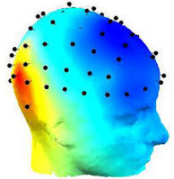

Cette stratégie nous permet d'isoler les zones sur lesquelles devront se focaliser les étapes suivantes de la chaîne de traitement (extraction des caractéristiques et classification des données).

Dans le cas particulier de l'implémentation du P300 Matrix Speller, la représentation spatiale se limite à la sélection des électrodes d'intérêt (électrodes occipitales).

Le prétraitement, dans le cas de l'implémentation d'ICM, peut être effectué hors ligne (les données sont alors déjà enregistrées) ou en ligne (directement lors de l'interaction avec l'utilisateur). Le prétraitement hors ligne est généralement utilisé afin de s'assurer au préalable que les signaux contiennent l'information nécessaire à l'implémentation de l'ICM. Les approches du prétraitement en temps-fréquence et selon les caractéristiques spatiales du signal opèrent avec des principes complémentaires, et sont souvent combinées. L'analyse en temps-fréquence, effectuée par l'intermédiaire de la transformée à ondelettes, permet d'observer facilement les pics d'amplitude P300. L'analyse spatiale permet d'isoler les canaux d'acquisition intéressants et de relier l'activité électrique enregistrée par EEG aux régions cérébrales correspondantes. Cette opération permet de réduire la quantité de données à considérer. Afin d'illustrer nos propos, nous proposons au lecteur d'observer la différence entre le signal brut et le signal après prétraitement, enregistré lors de nos expérimentations via l'électrode Cz. Le filtrage est effectué par l'intermédiaire d'un filtre temps-fréquence et d'un diviseur de la fréquence d'échantillonnage, ce qui nous permet d'identifier clairement l'onde P300, encadrée en rouge. L'implémentation du prétraitement sera détaillée au [chapitre 3](./implementation-p300-speller.md).

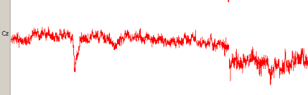

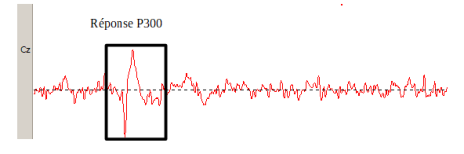

## Extraction de caractéristiques

L'extraction des caractéristiques[^lotte] fait suite au prétraitement. Cette étape permet de préparer la phase de classification, qui nécessite d'avoir à disposition une "carte d'identité" des données, c'est-à-dire un ensemble essentiel (idéalement petit) de valeurs qui décrivent l'information pertinente contenue dans l'électroencéphalogramme. Dans cette partie, nous cherchons à déterminer quelle information extraire des signaux EEG et la méthode à adopter.

[^lotte]: Lotte, F. et Congedo, M., *Extraction de caractéristiques du signal EEG*, dans *Les interfaces cerveau-ordinateur 1 : fondements et méthodes*, 2016.

### Principe général

Une ICM peut être utilisée par un grand nombre d'utilisateurs. Le panel de profils cognitifs à considérer est donc très large. Par extension, l'ensemble des caractéristiques intéressantes à extraire diffère d'un utilisateur à l'autre et est sujet à une grande variabilité. Anticiper et calibrer l'utilisation de l'ICM pour chaque profil cognitif existant est impossible. Ainsi, dans la conception d'ICM, l'extraction des caractéristiques (ainsi que la classification, voir [Classification](#classification)) s'appuie généralement sur des techniques d'apprentissage automatique. Cela signifie que les caractéristiques sont ajustées et optimisées lors d'une phase de calibration, et ce indépendamment pour chaque utilisateur. Cette phase de calibration utilise des exemples de signaux EEG de l'utilisateur appelés "ensemble d'apprentissage". Ils sont étiquetés avec leur classe d'appartenance, c'est-à-dire l'état mental du sujet correspondant au moment de leur enregistrement.

À la suite de la calibration, les paramètres de l'extraction des caractéristiques sont ajustés et on peut procéder à la phase d'utilisation, c'est-à-dire au fonctionnement de l'ICM avec des signaux inédits qui n'appartiennent pas à l'ensemble d'apprentissage. Les caractéristiques extraites sont "rangées" dans un "vecteur de caractéristiques", dont la dimension dépend du nombre de caractéristiques à considérer.

L'information obtenue lors de l'extraction des caractéristiques doit être la plus compacte possible. Nous verrons plus en détail dans la partie [Classification](#classification) que le problème de la dimension des données est au cœur de la classification, car la quantité d'exemples nécessaires pour décrire correctement les classes d'appartenance augmente exponentiellement avec les dimensions du vecteur de caractéristiques. Par exemple, l'utilisation d'un dispositif EEG à 32 électrodes avec un échantillonnage à 250 Hz et un enregistrement d'une durée d'une seconde d'un seul signal "exemple" nécessite un vecteur de caractéristiques de dimension $32 \times 250 \times 1 = 8000$, ce qui implique l'acquisition de $8000 \times 5 = 40\,000$ exemples d'apprentissage par classe. L'utilisateur ne peut, bien sûr, effectuer chaque tâche mentale 40 000 fois dans le but de calibrer l'ICM avant utilisation. D'où l'intérêt d'adopter une représentation compacte lors de l'extraction des caractéristiques.

Trois sources d'information peuvent être utilisées lors de l'extraction des caractéristiques.

- L'information spatiale, qui indique la provenance du signal pertinent. Elle permet en pratique la sélection et/ou l'amplification de certains canaux d'acquisition. Ce procédé permet d'utiliser les signaux générés dans une ou plusieurs régions cérébrales spécifiques.
- L'information spectrale, qui indique les variations de la puissance du signal dans certaines bandes de fréquences. Elle permet en pratique d'acquérir des puissances de signaux particulières, utilisées en tant que caractéristiques.
- L'information temporelle, qui décrit les variations des signaux au cours du temps. Elle permet en pratique la sélection des signaux visibles dans certaines fenêtres temporelles pour différents pas de temps.

### Extraction des caractéristiques pour les ICM exploitant les potentiels évoqués

Les Potentiels Évoqués (PE) sont caractérisés par des variations temporelles spécifiques. Ils dépendent de l'instant d'apparition du stimulus qui les déclenche. Les ICM dont le fonctionnement repose sur les PE (comme le P300 Matrix Speller) utilisent donc principalement l'information temporelle et assez rarement l'information spectrale. Par conséquent, les caractéristiques extraites reflètent généralement l'information temporelle des signaux, c'est-à-dire leur variation d'amplitude en fonction du temps.

L'extraction des caractéristiques repose sur l'information portée par les signaux prétraités. Les données sont recueillies en différents points du signal, constituant ainsi le vecteur de caractéristiques. On extrait généralement des caractéristiques d'un PE en effectuant deux prétraitements. On applique d'abord un filtre passe-bande aux signaux, permettant d'éliminer certaines parties non porteuses d'information, de manière analogue à la segmentation des données (voir [Représentation temporelle](#représentation-temporelle)). On procède ensuite au sous-échantillonnage du signal filtré, ce qui permet de déterminer un nombre de points caractérisant le signal (voir [Prétraitement de données d'électroencéphalographie](#prétraitement-de-données-délectroencéphalographie)). Ces opérations visent à réduire le nombre de points du signal à considérer, et donc, par extension, à réduire la dimension du problème. Nous pouvons ensuite extraire une quantité d'information sur la courbe rendue lisible, comme l'amplitude minimale, le moment de l'amplitude minimale, l'amplitude maximale, la durée totale... Finalement, ces valeurs sont rassemblées en un unique vecteur de caractéristiques par signal, qui sera exploité lors de la classification.

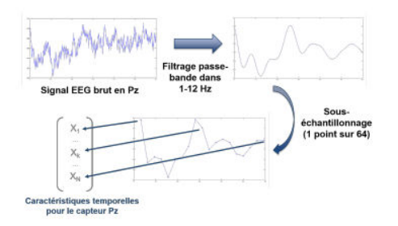

Trois sources d'information sont utilisées lors de l'extraction des caractéristiques. Il s'agit de l'information spatiale, spectrale et temporelle. Pour le cas particulier des ICM exploitant les potentiels évoqués, l'information temporelle prédomine, c'est-à-dire que la principale caractéristique à considérer est la variation de l'amplitude des signaux en fonction du temps. L'extraction des caractéristiques est essentielle car elle permet de réduire significativement la dimension des données en discrétisant l'information en un ensemble fini de valeurs décrivant le signal. Ces valeurs, regroupées dans un "vecteur de caractéristiques", sont ensuite utilisées lors de la classification.

## Classification

### Principe général de la classification

La phase de classification[^clerc-classif] succède au prétraitement et à l'extraction des caractéristiques. Elle est suivie par la traduction en commande de l'état mental reconnu. On désigne par "classifieur" une famille d'algorithmes de classement statistique. Le rôle d'un classifieur est de classer dans des groupes (des classes) des données qui ont des propriétés similaires, évaluées lors de l'extraction des caractéristiques. On parle aussi d'analyse discriminante. Les techniques de classification statistique sont essentielles pour l'apprentissage automatique (*Machine Learning*), c'est-à-dire l'amélioration des performances de l'ordinateur à résoudre des tâches sans qu'il soit explicitement programmé pour chacune d'entre elles. On parle d'apprentissage car l'algorithme créé construit une représentation interne du problème à résoudre, et ce de manière autonome. La machine "apprend" donc d'elle-même. Afin de s'autoparamétrer, de s'adapter au problème posé, l'algorithme doit disposer d'un panel de données. Mais les données en question ne peuvent être fournies brutes à l'ordinateur, car celui-ci ne peut appréhender toutes les dimensions nécessaires à leur représentation. C'est là qu'interviennent des techniques d'analyse de données telles que la classification, l'objectif étant de réduire la dimension du panel de données, en ayant recours à différentes méthodes et outils mathématiques.

[^clerc-classif]: Clerc, M., Bougrain, L. et Lotte, F., *Les interfaces cerveau-ordinateur 1 : fondements et méthodes*, ISTE éditions, 2016.

Nous nous intéressons dans cette partie aux méthodes de classification (ou classifieurs) dites "linéaires", qui utilisent des combinaisons linéaires de données pour la différenciation en classes. Le principe général de ces techniques y est décrit de manière qualitative et le détail des outils mathématiques nécessaires est disponible en annexe C ([Outils mathématiques pour la classification](./analyse-discriminante-lineaire.md)).

Chaque type de classifieur fonctionne selon sa propre stratégie, basée sur des outils mathématiques. Cependant, tous les classifieurs sont soumis à une certaine flexibilité ; ils doivent être en capacité de s'adapter aux données qu'ils reçoivent. Avant de débuter une expérience sollicitant des classifieurs, on doit donc effectuer une phase de "calibrage", appelée apprentissage ou entraînement, durant laquelle le système prend en compte les paramètres du modèle expérimental. Cet entraînement nécessite d'avoir à disposition des données dont on connaît la signification ainsi que les caractéristiques, afin de pouvoir relier l'état mental de l'utilisateur aux propriétés des données correspondantes.

Une fois l'apprentissage terminé, il est nécessaire de pouvoir juger de la fiabilité du classifieur sur le traitement de nouvelles données. On procède donc à une phase d'évaluation du classifieur, qui déterminera si le système peut être utilisé ou non dans le cadre de l'expérience. On utilise pour cela des indicateurs de performances. Il s'agit d'outils mathématiques visant à estimer l'efficacité de la classification. L'indicateur de performance peut être un simple ratio succès/échecs (taux de bonne classification), ou faire appel à des outils plus complexes (matrice de confusion, courbe ROC[^clerc-roc]), notamment lorsque la quantité de données disponible pour l'évaluation est faible. Cette opération nécessite un panel de données dont on ne connaît pas la nature profonde mais dont on connaît la classe. On peut ainsi vérifier la performance du classifieur à chaque tentative de classification.

[^clerc-roc]: Clerc, M., Bougrain, L. et Lotte, F., *Les interfaces cerveau-ordinateur 1 : fondements et méthodes*, ISTE éditions, 2016.

Il est à noter que, dans certains modèles expérimentaux, la classification ne se résume pas au travail d'un unique classifieur. Elle peut en effet résulter d'une association de classifieurs travaillant en parallèle. Le bénéfice du parallélisme est principalement le gain de temps de traitement.

La plupart des classifieurs sont paramétrés pour la différenciation de deux classes au plus. Ces classifieurs permettent de couvrir un grand nombre de modèles expérimentaux dont l'issue est binaire (par exemple déterminer si un signal donné est intéressant ou non). Cependant, pour la différenciation en un nombre plus important de classes, ces algorithmes ne fonctionnent plus et on doit avoir recours à des stratégies de discrimination. Ces stratégies peuvent consister en la décomposition d'un problème multiclasse en un problème binaire : c'est le cas des stratégies 1-vs-all et 1-vs-1. Dans la stratégie 1-vs-all, chaque classifieur est entraîné à distinguer (respectivement) une classe en particulier parmi toutes les autres. En considérant l'ensemble des classifieurs ainsi paramétrés, on se ramène à l'étude d'une combinaison de classifications binaires. L'issue finale est déterminée en tenant compte d'un indice de confiance délivré par chaque classifieur. La stratégie 1-vs-1 est similaire à la stratégie 1-vs-all ; cependant, chaque classifieur est entraîné à distinguer deux classes particulières. De la même manière, la prise en compte des réponses de chaque classifieur permet de décider de l'issue finale.

### Un classifieur particulier : la LDA

Maintenant que nous nous sommes familiarisés avec la notion de classification, nous allons nous focaliser sur un classifieur en particulier : la LDA (*Linear Discriminant Analysis*)[^starmer]. Cet exemple nous permettra d'illustrer les différentes idées abordées et de préparer le lecteur au [chapitre 3](./implementation-p300-speller.md) (le classifieur LDA étant celui utilisé dans le cadre de notre expérimentation).

[^starmer]: Starmer, J. et StatQuest, *Un peu de Machine Learning avec les SVM*, avril 2017.

**Fonctionnement général, stratégies de discrimination.** La LDA est une technique d'analyse discriminante prédictive dont l'objectif est de différencier un panel de données en classes distinctes, selon les caractéristiques communes des échantillons. Idéalement, on souhaite obtenir une ségrégation nette des données en évitant les chevauchements (*overlaps*). Pour ce faire, le classifieur LDA se base sur une méthode consistant à créer des axes sur lesquels sont projetées les données non classées. La projection des données sur ces nouveaux axes permet de réduire la dimension du problème, car le nombre d'axes créés est bien inférieur au nombre d'axes de départ. La projection est paramétrée selon deux critères à optimiser : la maximisation des distances entre les moyennes des différentes classes et la minimisation de la dispersion à l'intérieur de chacune des classes.

**Illustration : un exemple trivial en 2D.** Afin de fixer les idées, et de dégager l'essentiel du fonctionnement du classifieur LDA, nous avons choisi de décrire un exemple trivial en 2D. L'objectif est ici de réduire un graphe 2D en un graphe 1D. Imaginons que nous avons à disposition un panel de données (voir figure 2.11), que nous voulons partager en deux catégories (classes) distinctes : rouge et bleue. Ces données sont obtenues à partir d'informations provenant de deux sources différentes (mesure de la fréquence et mesure de l'amplitude par exemple). Nous avons donc deux caractéristiques pour faire travailler notre classifieur ; nommons-les simplement "caractéristique 1" et "caractéristique 2".

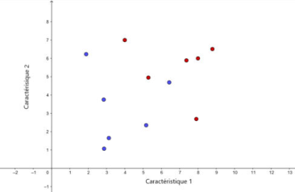

On cherche à obtenir une bonne séparation des points bleus et des points rouges. On procède selon la méthode LDA. Comme nous avons ici un problème à deux dimensions (nous avons à disposition deux caractéristiques, placées respectivement en abscisse et en ordonnée), un seul axe suffit à effectuer la séparation en deux groupes. On place cet axe sur notre graphique de façon à maximiser la distance entre les moyennes de chaque catégorie et à minimiser la dispersion à l'intérieur de chaque catégorie, comme on peut le voir en figure 2.12.

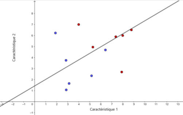

Les données sont ensuite projetées sur le nouvel axe.

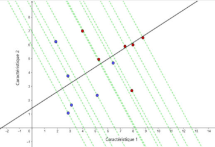

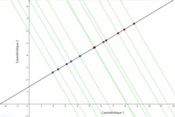

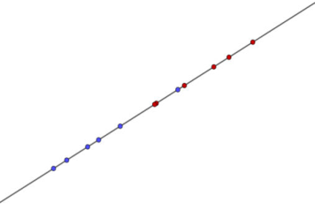

Le respect des deux critères (maximisation de la distance entre les moyennes et minimisation de la dispersion) lors de la création du nouvel axe revient en fait à optimiser (maximiser) l'expression suivante :

$$
\frac{(\mu_1 - \mu_2)^2}{(s_1)^2 + (s_2)^2}
$$

où $\mu_1$ et $\mu_2$ représentent respectivement les moyennes de la 1ère et de la 2ème catégorie, et $s_1$ et $s_2$ représentent respectivement les dispersions dans la 1ère et dans la 2ème catégorie (élever au carré permet de s'assurer d'avoir un nombre positif). Le détail des calculs des variances inter-classes (c'est-à-dire de la distance entre les moyennes des classes) et intra-classes (c'est-à-dire de la dispersion à l'intérieur des classes) est disponible en annexe C ([Outils mathématiques pour la classification](./analyse-discriminante-lineaire.md)).

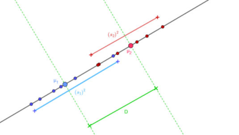

Nous avons ainsi réduit le problème 2D à un problème 1D, où la séparation des deux catégories est clairement visible.

L'ajout d'une caractéristique supplémentaire (et donc d'une dimension au problème) ne change pas la procédure : on se ramène à l'étude d'un problème 1D, avec la création d'un nouvel axe sur lequel sont projetées les données. Cependant, l'ajout d'une catégorie (classe) supplémentaire implique de modifier légèrement la méthode. En effet, on ne considère plus la distance entre les moyennes des classes mais la somme des distances entre les moyennes de chaque classe et un point placé au centre du nuage de points. La minimisation de la dispersion des données à l'intérieur de chaque classe reste en vigueur. La plus grande différence réside dans le fait qu'il nous faut maintenant deux axes pour séparer les données (on ne peut séparer 3 catégories avec seulement une ligne).

La méthode LDA nous a permis de réduire un graphe 2D en un graphe 1D, avec un protocole simple. Que penser de la réduction d'un graphe comprenant 100, 1000, 10 000 dimensions ? Nous avons vu précédemment que de nombreux problèmes sont binaires (nécessité de différencier seulement deux classes) et que les problèmes multiclasses peuvent généralement être réduits à une combinaison de classifications binaires. Nous avons également remarqué que l'ajout de caractéristiques à considérer, contrairement à l'ajout de classes à différencier, ne complexifie pas drastiquement le travail du classifieur. On comprend alors que la discrimination en seulement deux classes de données provenant de l'extraction de centaines, voire de milliers de caractéristiques (en pratique, il est tout de même préférable d'avoir un nombre limité de caractéristiques, voir [Extraction de caractéristiques](#extraction-de-caractéristiques)) n'est laborieuse qu'en apparence, car avec la méthode LDA, on réduit la dimension originale (100, 10 000) à seulement deux dimensions.

## Conclusion

Le traitement du signal est l'étape fondamentale de la conception d'une ICM. La qualité du signal traité, et donc par extension la qualité du traitement, conditionne les performances de l'ICM, c'est-à-dire la capacité du système à différencier correctement différents états mentaux. L'enjeu est double ; il s'agit d'une part de rendre les signaux EEG exploitables, lisibles par la machine, d'autre part de réduire la dimension des données acquises.

Dans cet objectif, le traitement se divise logiquement en trois étapes. On procède d'abord au prétraitement des données, qui permet, via une analyse adéquate, de mettre en évidence l'information utile et de limiter l'influence du bruit environnant. Dans le cadre de l'implémentation du P300 Matrix Speller, il est nécessaire d'utiliser une analyse temps-fréquence, car le signal est non stationnaire. Le prétraitement est suivi par l'extraction des caractéristiques. Cette étape consiste en l'évaluation des propriétés des signaux afin de dégager un ensemble essentiel de valeurs illustrant l'information pertinente qu'ils contiennent. Ces valeurs sont répertoriées dans des "vecteurs de caractéristiques". L'extraction des caractéristiques précède et prépare la classification. Cette dernière étape utilise les vecteurs de caractéristiques des signaux afin de déterminer la nature d'un signal en particulier et de le classer. Dans le cadre de l'implémentation du P300 Matrix Speller, deux classes sont à différencier : cible, pour un signal généré lorsque la lettre que l'utilisateur veut écrire est illuminée, et non-cible, pour les autres signaux.

Il est important de comprendre que le traitement du signal se doit d'être flexible, car les signaux acquis dépendent du profil cognitif de l'utilisateur. Par exemple, l'amplitude et le temps de latence de la P300 peuvent légèrement différer d'un individu à l'autre. En conséquence, les étapes d'extraction des caractéristiques et de classification nécessitent une phase de calibrage permettant l'ajustement et l'optimisation de leurs paramètres grâce à des techniques d'apprentissage automatique.
